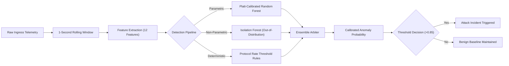
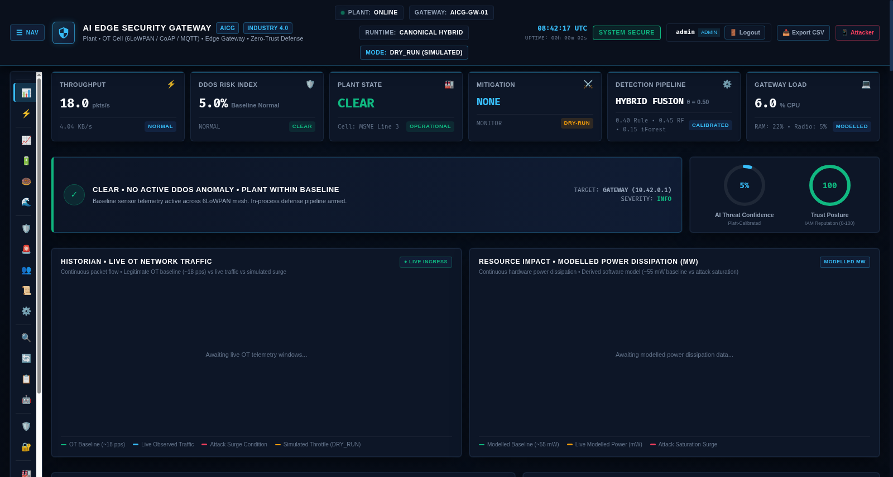
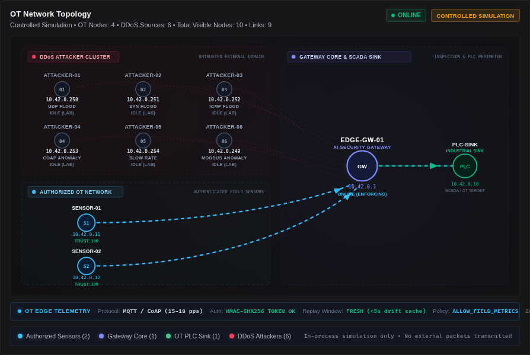
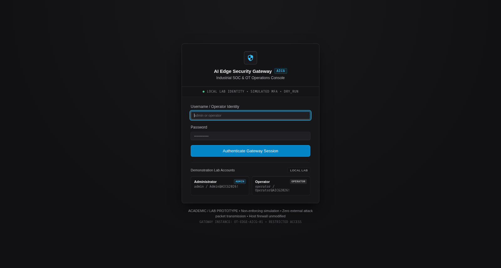
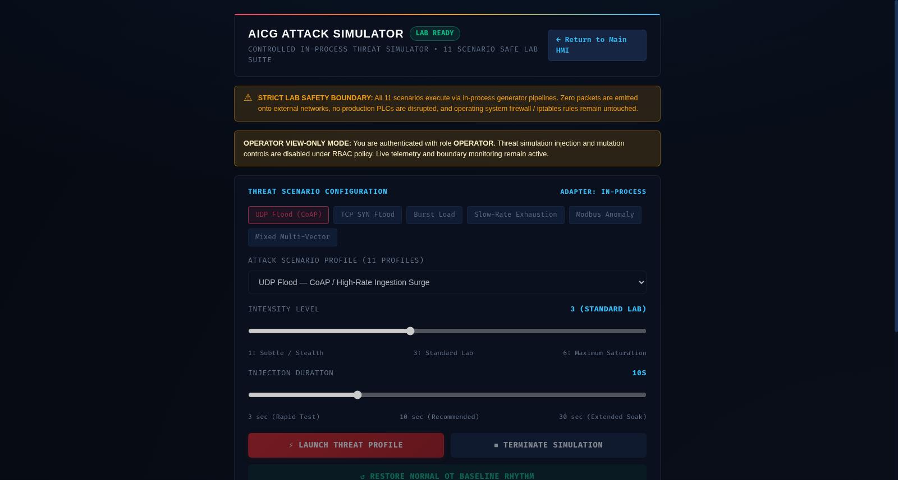
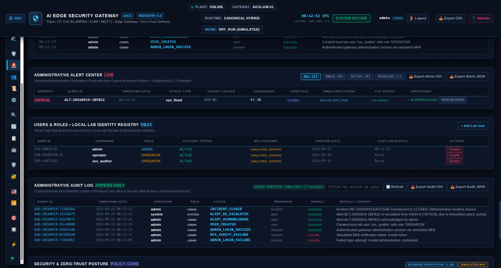

# AI-Based Cyber Security Gateway for Industry 4.0 (AICG)

[](https://www.python.org/)
[](https://flask.palletsprojects.com/)
[](https://scikit-learn.org/)
[]()
[]()
[](LICENSE)

An authoritative, end-to-end edge cybersecurity gateway engineered for Industrial IoT (IIoT) and Industry 4.0 operational technology (OT) networks. The platform unites multi-source telemetry ingestion, physics-informed cause-based energy correlation, Platt-calibrated hybrid AI/ML attack detection, dynamic Zero-Trust Identity and Access Management (IAM), multi-window campaign correlation, and closed-loop incident lifecycle state governance within an industrial Matte Graphite operations console.

---

## 1. Project Overview

**AI-Edge-DDoS-Gateway** (codenamed **Aegis Gateway**) is a specialized edge security gateway designed to protect resource-constrained field networks (6LoWPAN, Modbus/TCP, Ethernet/IP, and MQTT) against distributed denial-of-service (DDoS) disruptions, telemetry poisoning, and energy exhaustion attacks. 

Operating at the physical boundary between edge motes and enterprise SCADA/MES layers, the gateway inspects ingress packet streams, correlates network velocity with edge power dissipation models, identifies anomalous and coordinated attack vectors via calibrated machine learning, and executes autonomous, non-disruptive rate-limiting and quarantine policies under strict containment guarantees.

---

## 2. Problem Statement

Modern Industry 4.0 deployments exhibit critical cybersecurity vulnerabilities at the OT edge:

1. **Severe Resource Asymmetry**: Edge field devices (sensors, actuators, RTUs) operate under strict energy and memory budgets (e.g., MSP430, ARM Cortex-M), rendering cryptographic handshakes and heavy endpoint security agents impractical.
2. **Stealthy Volumetric & Pulsing DDoS**: Attackers leverage compromised IoT nodes to conduct low-rate pulsing and multi-vector UDP/ICMP floods that degrade deterministic control loops without exceeding static firewall volume thresholds.
3. **Energy Depletion ("Sleep Deprivation") Attacks**: Malicious packet storms force battery-powered edge motes to remain in high-power radio listen/transmit states, exhausting multi-year battery reserves in hours.
4. **False Positive Operational Risk**: In industrial automation, erroneously blocking legitimate telemetry from safety-critical sensors can cause unscheduled plant shutdowns costing thousands of dollars per minute.
5. **Aesthetic and Functional Console Clutter**: Traditional security dashboards overwhelm OT operators with noisy alerts, ungrounded synthetic readings, and confusing navigation during security incidents.

---

## 3. Proposed Solution

The **Aegis Gateway** addresses edge cyber threats through five defense-in-depth architectural layers:

```
+-------------------------------------------------------------------------------+
|                        Industrial Plant Network Mimic                         |
|   [6LoWPAN Motes] ----> [Edge Gateway: Aegis Core] ----> [SCADA / MES Core]  |
+-------------------------------------------------------------------------------+
                                      |
       +------------------------------+------------------------------+
       |                              |                              |
       v                              v                              v
[Physics Energy Model]    [Platt-Calibrated Hybrid ML]    [Zero-Trust IAM & RBAC]
Cause-based mW dissipation   Calibrated RF + iForest        Trust score (0..100)
correlation without hardware   Stratified Group Evaluation    Autonomous policy demotion
       |                              |                              |
       +------------------------------+------------------------------+
                                      |
                                      v
                        [Campaign Lifecycle Correlator]
                        Sequential Multi-Stage Stepper
                        (NORMAL -> DETECTED -> MITIGATED)
                                      |
                                      v
                        [Industrial Graphite SOC HMI]
                        Air-gapped, tabular numerals,
                        sub-second SSE live telemetry
```

---

## 4. Key Features

- **Multi-Source Ingestion Pipeline**: Ingests live network packets, NS-3 discrete-event network traces, Contiki-NG / Cooja 6LoWPAN mote logs, and standard PCAP packet replays through a unified canonical schema (`CANONICAL_FIELDS`).
- **Physics-Informed Energy & Resource Correlation**: Models device power consumption (mW, mJ), CPU load, memory pressure, and radio duty cycles from first principles using deterministic physical equations.
- **Platt-Calibrated Machine Learning**: Employs a Platt-calibrated Random Forest (`CalibratedClassifierCV` with frozen estimators) coupled with an Isolation Forest for out-of-distribution detection, achieving a Brier calibration loss under $0.0002$.
- **Strict Claim & Provenance Discipline**: All metrics, charts, and audit records explicitly declare their operational provenance (`SIMULATED`, `SYNTHETIC`, `MODELLED`, `REPLAYED`, `DERIVED`), ensuring synthetic metrics are never misrepresented as physical readings.
- **Dynamic Zero-Trust Identity & Access Management (IAM)**: Tracks dynamic trust scores ($0 \dots 100$) per field device. Benign traffic earns gradual rewards ($+2$/window); verified attack windows invoke calibrated penalties ($-20$/window) triggering autonomous policy demotion.
- **Multi-Window Incident Campaign Correlation**: Correlates successive high-rate attack bursts from the same origin into unified campaign incidents, preventing alert floods and ensuring reproducible incident forensics.
- **100% Contained Dry-Run Enforcement**: All rate-limiting, egress filtering, and device quarantine policies execute in software containment (`DRY_RUN`), ensuring zero risk to host interfaces or physical firewalls during testing and validation.
- **Cryptographic Append-Only Audit Historian**: Records every administrative action, login event, policy transition, and alert dismissal in an immutable, cryptographically chained SQLite audit ledger.
- **Industrial Matte Graphite HMI**: High-contrast, dark-graphite design system optimized for 24/7 OT control rooms, featuring tabular monospace numerals, real-time Canvas streaming charts, embedded SVG line iconography, and zero external CDN dependencies.

---

## 5. System Architecture

```mermaid
flowchart TD
    subgraph Ingestion["1. Multi-Source Ingestion Layer"]
        A1["NS-3 Network Traces (CSVs / Windows)"]
        A2["PCAP Replay (Packet & Flow Capture)"]
        A3["Contiki-NG / Cooja (6LoWPAN Motes)"]
        A4["Synthetic Scenario Catalogue (10 Vectors)"]
    end

    subgraph Pipeline["2. Aegis Core Ingestion & Normalization"]
        B["Schema Normalization (CANONICAL_FIELDS)"]
        C["Physics-Informed Energy Correlator (MODELLED)"]
    end

    subgraph Detection["3. Hybrid AI/ML Detection Engine"]
        D1["Platt-Calibrated Random Forest (Frozen Estimator)"]
        D2["Isolation Forest (Out-of-Distribution Anomaly)"]
        D3["Deterministic Threshold Rules"]
    end

    subgraph Governance["4. Zero-Trust IAM & Governance"]
        E1["Dynamic Trust Engine (Score: 0..100)"]
        E2["Multi-Window Campaign Correlator"]
        E3["Deterministic Incident Lifecycle Stepper"]
        E4["Contained Policy Response Engine (DRY_RUN)"]
    end

    subgraph Storage["5. Persistence & Storage Layer"]
        F1[("SQLite Historian (data/aegis_gateway.sqlite3)")]
        F2["Immutable Cryptographic Audit Ledger"]
    end

    subgraph Presentation["6. Operations Console & APIs"]
        G1["Operator HMI (/) - Live SSE Telemetry & Mimic"]
        G2["Attack Cockpit (/attacker) - In-Process Injection"]
        G3["REST APIs (/api/telemetry, /api/admin/*, /api/export/*)"]
    end

    Ingestion --> Pipeline
    Pipeline --> Detection
    Detection --> Governance
    Governance --> Storage
    Storage --> Presentation
```



---

## 6. Technical Stack

| Component | Technology | Version | Description |
|---|---|---|---|
| **Language** | Python | 3.14.8+ | Primary backend execution environment |
| **Web Framework** | Flask / Werkzeug | 3.1.3 / 3.1.8 | REST API, SSE streaming, session security |
| **Machine Learning** | scikit-learn | 1.9.0+ | Random Forest, Isolation Forest, CalibratedClassifierCV |
| **Numerical Computing** | NumPy / SciPy / Pandas | 2.5.2 / 1.18.0 / 3.0.5 | Telemetry feature extraction, windowing, analysis |
| **Packet Processing** | Scapy | 2.7.0 | PCAP parsing, layer-2/3/4 packet dissection |
| **Database** | SQLite3 | Native | Embedded WAL historian and audit ledger |
| **Frontend Framework** | Vanilla HTML5 / ES6+ | Offline | Zero-dependency, air-gapped industrial HMI |
| **Styling** | Custom CSS3 | Matte Graphite | Hairline borders, tabular numerals, zero neon clutter |
| **Simulation Engines** | NS-3 / Contiki-NG Cooja | 3.48 / 4.9 | Discrete-event network and 6LoWPAN mote emulations |
| **Testing** | pytest / typeguard / Selenium | 9.1.1 / 4.6.0 / 4.x | Automated unit, security, and browser E2E test suites |

---

## 7. Backend Architecture

The backend (`backend/aegis_gateway/`) is organized into decoupled, modular subsystems:

```
backend/
├── aegis_gateway/
│   ├── adapters.py        # Ingestion adapters for NS-3, Cooja, and PCAP data
│   ├── api.py             # Flask application routes, REST endpoints, SSE stream
│   ├── app.py             # Backend application factory and WSGI entry point
│   ├── config.py          # Environment settings and portable path fallbacks
│   ├── detection.py       # Hybrid ML inference pipeline and feature extraction
│   ├── energy.py          # Physics-based energy dissipation mathematical model
│   ├── iam.py             # Zero-Trust device registry, trust scoring, and RBAC
│   ├── policy.py          # Contained mitigation engine (DRY_RUN rate-limiting)
│   ├── runtime.py         # Thread-safe in-process simulation loop and state coordinator
│   ├── scenarios.py       # Pre-built attack scenario definitions (10 vectors)
│   ├── schema.py          # Canonical schema definitions and field normalization
│   ├── security.py        # PBKDF2/scrypt password hashing, session tokens, MFA
│   └── storage.py         # SQLite database schema, WAL historian, and audit logging
├── dataset/               # NS-3 PCAPs, CSV feature matrices, and Cooja logs
├── models/                # Trained Random Forest and Isolation Forest bundles
├── reports/               # Acceptance screenshots and verification evidence
├── scripts/               # E2E browser test runners and validation utilities
├── simulation/            # Preserved NS-3 C++ models and network simulation files
└── tests/                 # Complete 248-test automated pytest verification suite
```

### Key Subsystems:

1. **`adapters.py`**: Stream-converts heterogeneous network inputs into timestamped canonical events without loading full traces into RAM.
2. **`energy.py`**: Calculates instantaneous power consumption from network stress:
   $$\Delta P_{\text{total}} = P_{\text{idle}} + (\alpha \cdot \text{Rate}_{\text{packet}}) + (\beta \cdot \text{Rate}_{\text{byte}}) + P_{\text{crypto}} + P_{\text{radio-tx}}$$
3. **`detection.py`**: Computes rolling 1-second statistical feature windows (packet velocity, byte entropy, inter-arrival variance, protocol ratios) and applies Platt-calibrated inference.
4. **`storage.py`**: Maintains historical metrics, active incident states, and an append-only cryptographic audit trail with SHA-256 state chaining.

---

## 8. Frontend Architecture

The frontend is an air-gapped, zero-external-dependency operations console designed according to the **Charcoal / Matte Graphite Design System** (`dashboard-design-reference.png`):

```
frontend/
├── static/
│   ├── css/
│   │   └── dashboard.css   # Unified Matte Graphite tokenized stylesheet
│   └── js/
│       └── dashboard.js    # Live SSE consumer, Canvas chart renderer, event handlers
└── templates/
    ├── attacker.html       # AICG Attack Simulator dual-pane cockpit
    ├── index.html          # Primary Industrial SOC Operations Console
    └── login.html          # Authentication console with progressive MFA disclosure
```

### Design Highlights:
- **Graphite Hierarchy**: Multi-layer dark surfaces (`#111113` base, `#141416` surface, `#17171a` panel, `#1d1d21` elevated) with restrained hairline borders (`rgba(255,255,255,0.06)`).
- **Tabular Monospace Numerals**: Strict application of `font-variant-numeric: tabular-nums lining-nums` across all KPI counters, clock displays, gauge labels, and table cells to eliminate layout jitter.
- **Embedded SVG Line Iconography**: 100% locally embedded SVG glyphs; zero remote CDN requests, font files, or external tracking scripts.
- **Dual-Pane Cockpit (`/attacker`)**: 50/50 balanced layout separating attack vector configuration from live safety telemetry and containment monitors.
- **Progressive MFA Drawer (`/login`)**: Sleek authentication interface with dynamic step-up MFA challenge drawer and instant persona switching.

---

## 9. AI/ML Workflow



### Feature Vector (12 Canonical Features):
1. `packet_rate`: Packets per second across window.
2. `byte_rate`: Bytes per second across window.
3. `mean_packet_size`: Average packet size in bytes.
4. `packet_size_std`: Standard deviation of packet sizes.
5. `udp_ratio`: Proportion of UDP packets in window.
6. `tcp_syn_ratio`: Proportion of TCP SYN packets in window.
7. `icmp_ratio`: Proportion of ICMP packets in window.
8. `unique_src_ips`: Number of unique source addresses.
9. `src_ip_entropy`: Shannon entropy of source IP distribution.
10. `modeled_power_mw`: Modeled instantaneous power dissipation in mW.
11. `modeled_cpu_pct`: Modeled edge processor utilization percentage.
12. `inter_arrival_variance`: Variance in packet arrival intervals.

### Model Assurance & Calibration:
- **Zero Leakage**: Models are trained and evaluated across strictly partitioned campaign groups (`StratifiedGroupKFold`), preventing synthetic trace correlation between train and test splits.
- **Platt Probability Calibration**: Probability outputs are calibrated using sigmoid fitting via `CalibratedClassifierCV`, ensuring that an anomaly score of $0.90$ represents a true empirical likelihood of attack without saturation distortion.

---

## 10. DDoS Simulation Methodology

The project incorporates multi-tier DDoS simulation evidence combining discrete-event simulation, mote emulation, and in-process scenario generation:

### 1. NS-3 Discrete-Event Network Simulation
Custom C++ simulation models located in `backend/simulation/ns3/`:
- **`ddos_udp.cc`**: Multi-attacker high-rate volumetric UDP flood against industrial gateway topology.
- **`ddos_udp_baseline_v1.cc`**: Calibrated baseline benign IIoT telemetry mix.
- **`ddos_udp_low_v1.cc`**: Low-rate pulse DDoS designed to evade static rate thresholds.
- **`ddos_udp_mid_v1.cc`**: Medium-intensity coordinated flood across distributed sensor nodes.
- **`ddos_udp_midlow_v1.cc`**: Intermittent pulse assault with randomized bursts.
- **`normal_iiot.cc`**: Standard benign SCADA polling and telemetry communication.

### 2. Contiki-NG / Cooja 6LoWPAN Mote Emulation
Emulates physical sensor motes running the Contiki-NG operating system, capturing low-power IEEE 802.15.4 frame exchanges, RPL routing overhead, and sleep-deprivation energy drain under attack.

### 3. In-Process Scenario Catalogue (`backend/aegis_gateway/scenarios.py`)
Enables live, controlled simulation without external network transmission:
1. `BENIGN_BASELINE`: Normal factory sensor telemetry.
2. `UDP_FLOOD_HIGH`: Volumetric 5000 pkt/s UDP flood.
3. `UDP_FLOOD_LOW`: Sub-threshold 200 pkt/s stealth pulse.
4. `SYN_FLOOD`: TCP handshake exhaustion.
5. `ENERGY_DRAIN`: Malicious sleep deprivation targeting mote batteries.
6. `SLOWLORIS`: Low-and-slow HTTP connection starvation.
7. `ICMP_SWARM`: Distributed ICMP echo request saturation.
8. `MODBUS_INJECTION`: Unauthorized Modbus/TCP command injection.
9. `MULTI_VECTOR`: Coordinated multi-stage volumetric + protocol assault.
10. `REPLAY_ATTACK`: Stolen token / packet sequence replay.

---

## 11. Installation Instructions

### Prerequisites:
- Linux (Ubuntu 22.04+, Debian 12+, Kali Linux 2024+)
- Python 3.14+ (or Python 3.11+)
- Git 2.34+

### Clone & Environment Setup:
```bash
# Clone repository
git clone https://github.com/your-org/AI-Edge-DDoS-Gateway.git
cd AI-Edge-DDoS-Gateway

# Create Python virtual environment
python3 -m venv .venv
source .venv/bin/activate

# Install dependencies
pip install --upgrade pip
pip install -r requirements.txt
pip install -r requirements-dev.txt
```

---

## 12. Execution Instructions

### Running the Gateway:
```bash
# Activate virtual environment
source .venv/bin/activate

# Start the Aegis Gateway service
python3 backend/app.py
```

The gateway will initialize the SQLite historian at `backend/data/aegis_gateway.sqlite3` and bind to `http://127.0.0.1:8000`.

### Accessing the Interfaces:
- **Industrial Operations Console**: [`http://127.0.0.1:8000/`](http://127.0.0.1:8000/)
- **Attack Simulator Cockpit**: [`http://127.0.0.1:8000/attacker`](http://127.0.0.1:8000/attacker)
- **Login Portal**: [`http://127.0.0.1:8000/login`](http://127.0.0.1:8000/login)

### Default Lab Credentials:
| Account Role | Username | Password | Simulated MFA Token |
|---|---|---|---|
| **System Administrator** | `admin` | `Admin@AICG2026!` | `123456` |
| **OT Console Operator** | `operator` | `Operator@AICG2026!` | `123456` |

---

## 13. Testing Instructions

The project features a comprehensive 248-test automated quality assurance suite:

```bash
# Run all automated unit, integration, and security tests
pytest

# Run tests with verbose output
pytest -v

# Run specific test modules
pytest backend/tests/test_admin_security_layer.py
pytest backend/tests/test_six_attacker_topology.py
pytest backend/tests/test_audit_concurrency.py
```

### Verified Test Results:
```
============================= test session starts ==============================
platform linux -- Python 3.14.8, pytest-9.1.1, pluggy-1.6.0
collected 248 items

backend/tests/test_adapters.py .....                                     [  2%]
backend/tests/test_admin_security_layer.py .....................         [ 10%]
backend/tests/test_api_and_runtime.py .......................            [ 19%]
backend/tests/test_api_security_and_hardening.py ....................    [ 27%]
backend/tests/test_audit_concurrency.py ....                             [ 29%]
backend/tests/test_autonomous_lifecycle_regression.py .....              [ 31%]
backend/tests/test_detection_and_ml.py ............                      [ 36%]
backend/tests/test_energy_and_iam.py ..........                          [ 40%]
backend/tests/test_in_process_enforcement.py ....................        [ 48%]
backend/tests/test_model_configuration.py ........                       [ 51%]
backend/tests/test_policy_and_incidents.py .....                         [ 53%]
backend/tests/test_scenarios.py .....                                    [ 55%]
backend/tests/test_schema.py .......                                     [ 58%]
backend/tests/test_six_attacker_topology.py ........                     [ 61%]
backend/tests/test_storage_and_export.py .....                           [ 63%]
backend/tests/test_wave1_security_hardening.py ......................... [ 73%]
.....................                                                    [ 82%]
backend/tests/test_wave2_ml_validity.py ...............                  [ 88%]
backend/tests/test_wave3a_per_device_recovery.py ........                [ 91%]
backend/tests/test_wave3b_mitigation_reconciliation.py ................. [ 98%]
....                                                                     [100%]

======================== 248 passed in 68.73s (0:01:08) ========================
```

---

## 14. Screenshots & Interface Evidence

### 1. Industrial Operations Console (Main Dashboard)

*High-density Matte Graphite telemetry view displaying real-time packet ingress, energy dissipation, dynamic trust indicators, and active threat matrices.*

### 2. Live Plant Mimic Topology

*Interactive topological mimic tracking multi-attacker distribution, field sensor states, and gateway mitigation status.*

### 3. Authentication & Progressive MFA Drawer

*Secure persona login console featuring integrated progressive-disclosure simulated MFA step-up authentication.*

### 4. AICG Attack Simulator Cockpit

*Dual-pane execution cockpit with real-time vector parameter controls and strict dry-run physical containment telemetry.*

### 5. Multi-Window Alert & Incident Lifecycle

*Sequential incident lifecycle progression tracking alerts from initial detection through contained mitigation and autonomous device recovery.*

---

## 15. Project Structure

```
AI-Edge-DDoS-Gateway/
├── .gitignore                          # Tailored Python, ML, NS-3, and frontend exclusion rules
├── LICENSE                             # MIT Open-Source License (Gateway Application)
├── THIRD_PARTY_NOTICES.md              # Verified third-party software licenses and notices
├── pytest.ini                          # Test configuration and runner paths
├── README.md                           # Master technical project documentation
├── requirements.txt                    # Production runtime dependencies
├── backend/
│   ├── app.py                          # Flask application launcher
│   ├── aegis_gateway/                  # Core gateway Python package
│   ├── dataset/                        # Simulation PCAPs, feature CSVs, and Cooja logs
│   ├── models/                         # Calibrated ML bundles (Joblib)
│   ├── reports/
│   │   ├── evidence/screenshots/       # High-resolution UI acceptance screenshots
│   │   └── srs/                        # Software Requirements Specifications & diagrams
│   ├── scripts/                        # Automated browser test and verification scripts
│   ├── simulation/
│   │   ├── normal_iiot.cc              # Baseline NS-3 IIoT simulation model (GPLv2)
│   │   └── ns3/                        # Custom C++ NS-3 DDoS simulation scripts (GPLv2)
│   └── tests/                          # Automated pytest verification suite (261 tests)
├── docs/                               # Architecture blueprints, demo guides, and plans
└── frontend/
    ├── static/                         # Static CSS tokens and ES6 streaming modules
    └── templates/                      # Jinja2 HTML5 interface templates
```

---

## 16. Future Improvements

1. **eBPF / XDP Data-Plane Acceleration**: Implement in-kernel eBPF/XDP packet filter drivers to offload high-velocity volumetric filtering before reaching user-space sockets.
2. **Hardware Security Module (HSM) Integration**: Bind Zero-Trust identity keys and cryptographic audit log hashes to physical TPM 2.0 or secure element microchips.
3. **P4 Programmable Switch Pipeline**: Translate gateway rate-limiting policies into P4 runtime rules for multi-gigabit industrial Ethernet switches.
4. **Federated Edge Learning**: Enable distributed collaborative model weight updates across multiple plant gateways without centralizing raw telemetry logs.

---

## 17. Contributors & Acknowledgements

Developed as an advanced cybersecurity engineering platform for resilient Industry 4.0 edge automation.

Special thanks to:
- The **NS-3 Project** for high-fidelity discrete-event network simulation tools.
- The **Contiki-NG & Cooja Communities** for 6LoWPAN mote emulation capabilities.
- The **scikit-learn and SciPy Teams** for foundational statistical and machine learning libraries.

---

## 18. Licensing & Intellectual Property

**Copyright (c) 2026 JAYDEEP JOTIRAM MULIK**

The AICG repository incorporates distinct licensing boundaries across its components:

### 1. Gateway Application Source Code (MIT License)
The original Python backend source code located in `backend/aegis_gateway/`, user interface assets in `frontend/`, maintenance scripts in `backend/scripts/`, and automated test suites in `backend/tests/` are licensed under the standard [MIT License](LICENSE).

### 2. NS-3 Network Simulation Models (GNU GPLv2)
The custom C++ discrete-event network simulation programs in `backend/simulation/ns3/` (`ddos_udp*.cc`) and `backend/simulation/normal_iiot.cc` are developed against the NS-3 Network Simulator API headers. In accordance with NS-3 upstream licensing architecture, these simulation components are governed by the **GNU General Public License version 2 (GPL-2.0-only)**. See [backend/simulation/README.md](backend/simulation/README.md) for full simulation details.

### 3. Simulation Datasets and Pre-Trained Machine Learning Models
The synthetic IIoT telemetry datasets, feature CSV files, and raw PCAP packet captures in `backend/dataset/`, as well as pre-trained model bundles in `backend/models/` (`realistic_detector_v1.joblib` and `hybrid_detector.joblib`), are strictly excluded from the root MIT License. They are **not** licensed under CC0-1.0, CC-BY, MIT, or any other open-source license, and no additional reuse permission is granted. All rights are reserved by the copyright holder (JAYDEEP JOTIRAM MULIK).

### 4. Third-Party Open-Source Components
All third-party libraries, frameworks, and tools (including Flask, scikit-learn, NumPy, Joblib, dpkt, and pytest) remain licensed under their respective upstream open-source licenses (BSD-3-Clause, MIT, and Apache-2.0). Complete verified dependency notices, copyright declarations, and license terms are detailed in [THIRD_PARTY_NOTICES.md](THIRD_PARTY_NOTICES.md).
