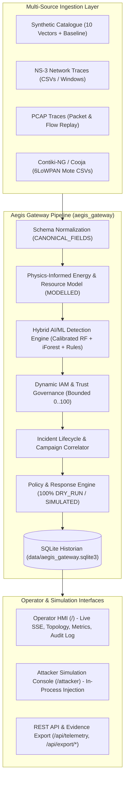

# AI-Based Cyber Security Gateway for Industry 4.0 (Aegis Gateway)

[](https://www.python.org/)
[](https://flask.palletsprojects.com/)
[](https://scikit-learn.org/)
[]()
[]()

A technically defensible, end-to-end edge cybersecurity gateway engineered for Industrial IoT (IIoT) and Industry 4.0 automation networks. The platform combines real-time multi-source telemetry ingestion, physics-informed cause-based energy correlation, Platt-calibrated hybrid AI/ML attack detection, dynamic Zero-Trust Identity and Access Management (IAM), multi-window campaign correlation, and closed-loop incident lifecycle state governance.

---

## 1. System Architecture & Data Flow



---

## 2. Core Pillars & Innovations

### A. Strict Claim & Provenance Discipline
Every telemetry point, decision, and audit record carries an explicit provenance tag:
- **`SIMULATED`**: Network simulation traces (NS-3, Cooja 6LoWPAN) and in-process scenario executions.
- **`SYNTHETIC`**: Algorithmically generated operational windows and held-out evaluation datasets.
- **`MODELLED`**: Energy dissipation (mW, mJ), CPU, memory, and radio state calculated via mathematical cause-based models. *No physical power meter is connected or claimed.*
- **`REPLAYED`**: Network capture (PCAP) traces re-ingested through timestamp normalization.
- **`DERIVED`**: Internal pipeline deductions including trust delta calculations and correlated incident evidence.

### B. Hybrid Calibrated AI/ML Detection
- **Stratified Group-Shuffle Evaluation**: Evaluated across isolated campaign groups with **zero data leakage**. 
- **Model Architecture**: Platt-calibrated Random Forest ensemble (`CalibratedClassifierCV` via `FrozenEstimator` for scikit-learn 1.9+ compatibility) paired with an Isolation Forest for out-of-distribution anomaly scoring and deterministic protocol threshold rules.
- **Assurance**: Platt calibration reduces probability distortion (Brier score < 0.0002) for reliable decision thresholds across high-rate floods and stealthy slow-rate attacks.
- **Zero-Day / Generalization Check**: Completely held out `mixed_vector` scenario achieves 100% recall.

### C. Cause-Based Energy & Resource Correlation
- Correlates incoming network stress directly to edge device power consumption without hardware meters:
  $$\Delta P_{\text{total}} = P_{\text{idle}} + (\alpha \cdot \text{Rate}_{\text{packet}}) + (\beta \cdot \text{Rate}_{\text{byte}}) + P_{\text{crypto}} + P_{\text{radio-tx}}$$
- Exposes energy anomalies when packet rates or cryptographic handshakes elevate energy beyond baseline tolerances.

### D. Dynamic Zero-Trust IAM & Trust Governance
- Trust scores are strictly bounded in $[0, 100]$.
- Every identity (sensor node, operator, gateway daemon) is tracked with explainable, audit-logged trust penalties upon detection (e.g., $-20$ per flood window) and bounded recovery rewards ($+2$ per sustained benign window).
- Autonomous policy demotion: Devices below trust threshold ($<50$) are restricted to unprivileged roles or simulated quarantine.

### E. Multi-Window Campaign Incident Lifecycle
- Prevents duplicate incident creation during multi-second attack waves. Consecutive attack windows from the same device/vector correlate into an active incident entity.
- Deterministic lifecycle states:
  $$\text{DETECTED} \longrightarrow \text{TRIAGED} \longrightarrow \text{RESPONDING} \longrightarrow \text{CONTAINED} \longrightarrow \text{RECOVERING} \longrightarrow \text{RESOLVED} \longrightarrow \text{CLOSED}$$
- **Verified Recovery Verification**: Incidents transition to `RECOVERING` only after 3 consecutive benign windows, and to `RESOLVED` (with `recovery_state="VERIFIED"`) only after 5 consecutive benign windows.

### F. Complete Scenario Catalogue (10 Attack Vectors + Benign Baseline = 11 Profiles)
Includes 10 attack profiles + 1 benign operational baseline:
0. `normal`: Benign IIoT sensor telemetry baseline (14–18 pps).
1. `udp_flood`: High-volume stateless UDP datagram flood.
2. `syn_flood`: Half-open TCP connection exhaustion attack.
3. `icmp_flood`: Edge control ping and ICMP echo storm.
4. `burst_exhaustion`: Intermittent pulsating micro-bursts degrading edge buffers.
5. `slow_rate`: Low-frequency asymmetric connection holding (stealth).
6. `coap_anomaly`: IIoT constrained CoAP confirmable request flood (port 5683).
7. `mqtt_anomaly`: MQTT/MQTT-SN publish-like anomaly profile (port 1883).
8. `rpl_anomaly`: 6LoWPAN routing DODAG inconsistency & rank spoofing (ICMPv6).
9. `modbus_anomaly`: Industrial OT Modbus TCP function code & register scan (port 502).
10. `mixed_vector`: Multi-protocol hybrid barrage (held out for zero-day generalization validation).

---

## 3. Quick Start & Execution

### Environment Setup
Activate the pre-configured Python virtual environment:
```bash
source .venv/bin/activate
```

### Running the Test Suite
Run the 236-test automated verification suite:
```bash
.venv/bin/pytest
```
*Expected Output: `236 passed in ~55s`.*

### End-to-End Headless Browser Verification
Run the comprehensive headless browser E2E suite (MFA, RBAC, alert lifecycle, and viewports):
```bash
.venv/bin/python backend/scripts/run_browser_e2e_admin.py
```

### Starting the Gateway & HMI
Launch the gateway runtime and operator dashboard:
```bash
.venv/bin/python backend/app.py
```
- **Operator HMI**: [http://127.0.0.1:8000/](http://127.0.0.1:8000/)
- **Attacker Console**: [http://127.0.0.1:8000/attacker](http://127.0.0.1:8000/attacker)

---

## 4. Repository Structure

```
AI-Edge-DDoS-Gateway/
├── backend/                         # Server-side runtime, ML, API, and tests
│   ├── aegis_gateway/               # Core Gateway Engine (adapters, api, config, detection, energy, iam, ml, policy, runtime, scenarios, schema, security, storage)
│   ├── app.py                       # Unified backend launcher
│   ├── data/                        # SQLite historian & canonical datasets
│   ├── dataset/                     # Raw NS-3 and PCAP simulation traces
│   ├── legacy_prototypes/           # Historical prototype scripts and models
│   ├── models/                      # Trained ML bundles (hybrid_detector, realistic_detector)
│   ├── reports/                     # Validation metrics, screenshots, and academic SRS drafts
│   ├── scripts/                     # E2E acceptance & browser automation scripts
│   ├── simulation/                  # NS-3 C++ topology simulation (normal_iiot.cc)
│   └── tests/                       # 17-file automated test suite (236 passing tests)
├── frontend/                        # Human-Machine Interface (HMI) & static assets
│   ├── archive/                     # Historical UI revisions (.bak*)
│   ├── static/                      # CSS styling & vanilla JavaScript SSE client
│   └── templates/                   # Jinja2 templates (index.html, login.html, attacker.html)
├── ns-allinone-3.48/                # Network Simulator 3 (NS-3.48) workspace
├── dashboard/                       # Backward-compatibility shim
├── data -> backend/data             # Root compatibility symlink
├── dataset -> backend/dataset       # Root compatibility symlink
├── models -> backend/models         # Root compatibility symlink
└── simulation -> backend/simulation # Root compatibility symlink
```

---

## 5. Security & Safety Boundary

> [!CAUTION]
> **Safety Guarantee**: This platform operates strictly inside a contained user-space sandbox. It **NEVER** modifies host routing tables, network interfaces, `iptables`, `nftables`, or external firewalls. All mitigation actions (`BLOCK`, `RATE_LIMIT`, `ISOLATE`, `QUARANTINE`) are recorded as dry-run simulation events within the SQLite historian and published to the HMI for demonstration fidelity without operational risk.
