# Software Requirements Specification (SRS)
## AI-Based Cyber Security Gateway for Industry 4.0 (AICG)

---

### Cover Page

**PROJECT TITLE:**  
# AI-Based Cyber Security Gateway for Industry 4.0 (AICG)
*(Internal Reference: Aegis Gateway / AEGIS-OT)*

**DOCUMENT CLASSIFICATION:**  
Software Requirements Specification (SRS) — Final Academic Draft  
Document Code: `AICG-SRS-FINAL-V1.0`

**SUBMITTED IN PARTIAL FULFILLMENT OF THE REQUIREMENTS FOR THE DEGREE OF:**  
B.Tech

**PROJECT GROUP:**  
Group G15 *(Verified from Project Archive `reference/AEGIS-OT-TECHNICAL-AUDIT.docx`)*

**CANDIDATE DETAILS (PROJECT TEAM):**
1. **Jaydeep Jotiram Mulik** — Roll No. A42
2. **Prasad Mestri** — Roll No. A40
3. **Nikhil Fepade** — Roll No. A11
4. **Shruti Pawar** — Roll No. B75
5. **Srushti Mali** — Roll No. A95

**TEAM CONTRIBUTION STRUCTURE:**
- **Part 1 — Jaydeep Jotiram Mulik & Nikhil Fepade:** Network Simulation, Data Pipeline, NS-3/Cooja & Energy Modeling; Core Gateway, Runtime, Incident Lifecycle & Recovery.
- **Part 2 — Prasad Mestri:** AI/ML Detection, Hybrid Fusion & Benchmarking.
- **Part 3 — Shruti Pawar & Srushti Mali:** Security/IAM + SOC Dashboard, Testing & Forensic Evidence.

**FACULTY PROJECT SUPERVISOR / GUIDE:**  
**Dr. R. D. Bhosale**  
`[GUIDE DESIGNATION]`, Department of Computer Science and Engineering  
`[GUIDE EMAIL]`

**ACADEMIC INSTITUTION & DEPARTMENT:**  
**Department of Computer Science and Engineering**  
**D. Y. Patil School Of Engineering and Management, Kolhapur**  
Deemed to be University  
Academic Year: 2026-27  
Submission Date: 9 October 2026

---

### Certificate of Approval

This is to certify that this Software Requirements Specification entitled **“AI-Based Cyber Security Gateway for Industry 4.0” (AICG / Aegis Gateway)** is a bona fide record of the technical specification and requirements engineering work carried out by:

1. **Jaydeep Jotiram Mulik** (Roll No. A42)
2. **Prasad Mestri** (Roll No. A40)
3. **Nikhil Fepade** (Roll No. A11)
4. **Shruti Pawar** (Roll No. B75)
5. **Srushti Mali** (Roll No. A95)

under the supervision of **Dr. R. D. Bhosale**, in partial fulfillment of the academic requirements for the award of the degree of **B.Tech** in **Department of Computer Science and Engineering** at **D. Y. Patil School Of Engineering and Management, Kolhapur**, affiliated with **Deemed to be University**, during the academic year **2026-27**.

The technical requirements, functional specifications, architectural models, and traceability matrix documented herein have been audited and verified against the concrete working codebase and automated test suites at baseline checkpoint `v2.10.0` (Commit `de23b4c`) on branch `feat/phase23-security-ml-hardening`.


______________________________  
**Dr. R. D. Bhosale**  
Internal Project Supervisor  
`[GUIDE DESIGNATION]`  
Department of Computer Science and Engineering  

______________________________  
**Dr. G. V. Otari**  
Head of the Department  
Department of Computer Science and Engineering  
D. Y. Patil School Of Engineering and Management, Kolhapur  

---

### Candidate Declaration

We, the members of Project Group G15, hereby declare that the Software Requirements Specification titled **“AI-Based Cyber Security Gateway for Industry 4.0” (AICG / Aegis Gateway)** represents our authentic and original work conducted at **D. Y. Patil School Of Engineering and Management, Kolhapur**.

We affirm that:
1. All functional and non-functional requirements, architectural diagrams, data schemas, and mathematical formulations represent the verified implementation of our repository `AI-Edge-DDoS-Gateway`.
2. All machine learning metrics, security guarantees, and execution constraints are reported with strict academic honesty, distinguishing synthetic laboratory experiments (100.0% accuracy on clean data) from realistic benchmark evaluations (89.72% operational accuracy, 99.00% attack recall, 21.88% false positive rate).
3. The software currently operates as a user-space Linux software gateway using software-modeled devices and mathematical energy estimation; no claims of unmeasured physical hardware deployments are made.
4. This document has not been submitted previously to any other university or examining board for the award of any degree or diploma.

**Candidates:**

1. **Jaydeep Jotiram Mulik** (Roll No. A42): ___________________________  
2. **Prasad Mestri** (Roll No. A40): ___________________________  
3. **Nikhil Fepade** (Roll No. A11): ___________________________  
4. **Shruti Pawar** (Roll No. B75): ___________________________  
5. **Srushti Mali** (Roll No. A95): ___________________________  

**Place:** `[CITY / CAMPUS]`  
**Date:** 9 October 2026

---

### Table of Contents

- [Cover Page](#cover-page)
- [Certificate of Approval](#certificate-of-approval)
- [Candidate Declaration](#candidate-declaration)
- [Table of Contents](#table-of-contents)
- [Chapter 1 — Introduction](#chapter-1--introduction)
  - [1.1 Overview](#11-overview)
  - [1.2 Purpose](#12-purpose)
  - [1.3 Scope](#13-scope)
  - [1.4 Objectives](#14-objectives)
  - [1.5 Intended Users](#15-intended-users)
  - [1.6 Definitions and Acronyms](#16-definitions-and-acronyms)
  - [1.7 References](#17-references)
- [Chapter 2 — Overall Description](#chapter-2--overall-description)
  - [2.1 Product Perspective](#21-product-perspective)
  - [2.2 Product Functions](#22-product-functions)
  - [2.3 User Classes and Characteristics](#23-user-classes-and-characteristics)
  - [2.4 Operating Environment](#24-operating-environment)
  - [2.5 Constraints](#25-constraints)
  - [2.6 Assumptions and Dependencies](#26-assumptions-and-dependencies)
- [Chapter 3 — Functional Requirements](#chapter-3--functional-requirements)
  - [3.1 Authentication and Session Management (FR-01 to FR-04)](#31-authentication-and-session-management)
  - [3.2 Role-Based Access Control (FR-05 to FR-07)](#32-role-based-access-control)
  - [3.3 Device Identity and Trust Governance (FR-08 to FR-11)](#33-device-identity-and-trust-governance)
  - [3.4 Telemetry Ingestion and Normalization (FR-12 to FR-14)](#34-telemetry-ingestion-and-normalization)
  - [3.5 Baseline and Normal Behavior Monitoring (FR-15 to FR-16)](#35-baseline-and-normal-behavior-monitoring)
  - [3.6 DDoS Attack Detection and Feature Extraction (FR-17 to FR-19)](#36-ddos-attack-detection-and-feature-extraction)
  - [3.7 AI/ML Detection and Calibrated Fusion (FR-20 to FR-23)](#37-aiml-detection-and-calibrated-fusion)
  - [3.8 Energy and Physics-Informed Modeling (FR-24 to FR-25)](#38-energy-and-physics-informed-modeling)
  - [3.9 Incident Lifecycle Management (FR-26 to FR-29)](#39-incident-lifecycle-management)
  - [3.10 In-Process Software Mitigation (FR-30 to FR-32)](#310-in-process-software-mitigation)
  - [3.11 Autonomous Recovery and State Reconciliation (FR-33 to FR-35)](#311-autonomous-recovery-and-state-reconciliation)
  - [3.12 Alert Management and Synchronization (FR-36 to FR-38)](#312-alert-management-and-synchronization)
  - [3.13 Tamper-Evident Audit and Forensic Storage (FR-39 to FR-41)](#313-tamper-evident-audit-and-forensic-storage)
  - [3.14 Operator SOC Dashboard and HMI (FR-42 to FR-44)](#314-operator-soc-dashboard-and-hmi)
  - [3.15 Laboratory Simulation and Multi-Source Trace Ingestion (FR-45 to FR-47)](#315-laboratory-simulation-and-multi-source-trace-ingestion)
  - [3.16 Forensic Data Export and Reporting (FR-48 to FR-50)](#316-forensic-data-export-and-reporting)
- [Chapter 4 — Non-Functional Requirements](#chapter-4--non-functional-requirements)
  - [4.1 Performance Requirements](#41-performance-requirements)
  - [4.2 Security Requirements](#42-security-requirements)
  - [4.3 Usability Requirements](#43-usability-requirements)
  - [4.4 Reliability Requirements](#44-reliability-requirements)
  - [4.5 Availability Requirements](#45-availability-requirements)
  - [4.6 Maintainability Requirements](#46-maintainability-requirements)
  - [4.7 Scalability Requirements](#47-scalability-requirements)
  - [4.8 Portability Requirements](#48-portability-requirements)
- [Chapter 5 — External Interfaces](#chapter-5--external-interfaces)
  - [5.1 User Interface Requirements](#51-user-interface-requirements)
  - [5.2 Hardware Interface Requirements](#52-hardware-interface-requirements)
  - [5.3 Software Interface Requirements](#53-software-interface-requirements)
  - [5.4 Communication Interface Requirements](#54-communication-interface-requirements)
- [Chapter 6 — Use Case Requirements](#chapter-6--use-case-requirements)
  - [6.1 Actors](#61-actors)
  - [6.2 Use Case Diagram](#62-use-case-diagram)
  - [6.3 Detailed Use Cases (UC-01 to UC-12)](#63-detailed-use-cases)
- [Chapter 7 — System Models](#chapter-7--system-models)
  - [7.1 System Context Diagram](#71-system-context-diagram)
  - [7.2 Data Flow Diagram Level 0](#72-data-flow-diagram-level-0)
  - [7.3 Data Flow Diagram Level 1](#73-data-flow-diagram-level-1)
  - [7.4 Activity Diagrams](#74-activity-diagrams)
  - [7.5 Sequence Diagrams](#75-sequence-diagrams)
  - [7.6 UML Class Diagram](#76-uml-class-diagram)
  - [7.7 Entity-Relationship (ER) Diagram](#77-entity-relationship-er-diagram)
  - [7.8 UML Deployment Diagram (Architectural Model)](#78-uml-deployment-diagram-architectural-model)
- [Chapter 8 — Data Requirements](#chapter-8--data-requirements)
  - [8.1 Database Tables (11 SQLite Tables)](#81-database-tables-11-sqlite-tables)
  - [8.2 Data Dictionary](#82-data-dictionary)
- [Chapter 9 — System Constraints](#chapter-9--system-constraints)
- [Chapter 10 — Acceptance Criteria](#chapter-10--acceptance-criteria)
- [Chapter 11 — Requirements Traceability Matrix (RTM)](#chapter-11--requirements-traceability-matrix-rtm)
- [Chapter 12 — Appendices](#chapter-12--appendices)
  - [12.1 Appendix A: Complete Attack Scenario Catalogue](#121-appendix-a-complete-attack-scenario-catalogue)
  - [12.2 Appendix B: Model Artifact Inventory & Training Parameters](#122-appendix-b-model-artifact-inventory--training-parameters)
  - [12.3 Appendix C: Empirical Machine Learning Validity Comparison](#123-appendix-c-empirical-machine-learning-validity-comparison)
  - [12.4 Appendix D: Team Contribution Mapping & Project Metadata](#124-appendix-d-team-contribution-mapping--project-metadata)
  - [12.5 Appendix E: Project Progress Evaluation](#125-appendix-e-project-progress-evaluation)

---

# Chapter 1 — Introduction

### 1.1 Overview
The **AI-Based Cyber Security Gateway for Industry 4.0 (AICG)**, also designated internally as **Aegis Gateway (AEGIS-OT)**, is a specialized edge cybersecurity appliance designed to protect Industrial Internet of Things (IIoT) field networks and Operational Technology (OT) automation cells against Distributed Denial-of-Service (DDoS) attacks, protocol-specific anomalies, and unauthorized endpoint impersonation.

In modern smart manufacturing environments aligned with the Industry 4.0 paradigm, physical production assets (e.g., Programmable Logic Controllers, distributed sensors, and robotic actuators) are increasingly interconnected with IP-based supervisory networks. While this connectivity enables real-time analytics and predictive maintenance, it simultaneously exposes previously isolated OT systems to volumetric and asymmetric network attacks. Conventional IT cybersecurity solutions (such as enterprise firewalls and cloud-based Intrusion Detection Systems) are poorly suited for edge OT deployments due to strict determinism requirements, high communication latencies, and resource-constrained edge compute profiles.

The AICG platform resolves these challenges by operating as an intelligent, transparent boundary gateway positioned at the perimeter of the industrial cell. It unifies seven core engineering capabilities:
1. **Canonical Multi-Source Telemetry Normalization:** Ingestion and schema validation of heterogeneous industrial traffic into a standardized 52-field representation.
2. **Physics-Informed Cause-Based Energy Modeling:** Mathematical correlation of communication volume, packet size efficiency, and protocol complexity into estimated power dissipation (in milliwatts).
3. **Dynamic Zero-Trust Device Identity:** Deterministic HMAC-SHA256 device key derivation, a sliding-window token replay cache, and continuous dynamic reputation tracking ($0..100$).
4. **Calibrated Hybrid AI Detection:** Tri-partite fusion combining heuristic domain rules, a Platt-calibrated Random Forest classifier, and an unsupervised Isolation Forest anomaly scorer.
5. **Closed-Loop In-Process Mitigation:** Software-level packet filtering (`SOFTWARE_INTERCEPT`) and token-bucket rate limiting without kernel firewall manipulation.
6. **Autonomous Multi-Window Recovery Qualification:** Deterministic 7-stage incident progression featuring multi-window streak observation (3 windows to `RECOVERING`, 5 windows to `RESOLVED`) and automatic regression upon recurring attacks.
7. **Cryptographically Hashed Administrative Audit Ledger:** Tamper-evident forward SHA-256 hash chaining of all administrative actions with automated mathematical verification.

### 1.2 Purpose
The purpose of this document is to establish the definitive, authoritative Software Requirements Specification (SRS) for the AICG platform. It specifies all functional requirements, non-functional quality attributes, external interfaces, structural domain models, relational database schemas, acceptance criteria, and traceability mappings. 

This specification serves as the formal baseline for academic project evaluators, external examiners, systems engineers, and security auditors. Every requirement and system behavior specified herein reflects the **concrete, test-verified software implementation** located in repository branch `feat/phase23-security-ml-hardening` at baseline checkpoint `v2.10.0` (Commit `de23b4c`), inclusive of approved finalization hardening (Phases A1, A2, and A3).

### 1.3 Scope
The functional and technical scope of the AICG software comprises:
1. **Multi-Source Ingestion & Normalization:** Ingesting 1-second observation windows from synthetic red-team generators, offline discrete-event NS-3 network simulations, Contiki-NG / Cooja 6LoWPAN mote emulations, and raw PCAP packet captures, standardizing them into a canonical 52-field `TelemetryEvent` schema with explicit provenance tagging.
2. **Physics-Informed Energy Estimation:** Modeling device-level electrical dissipation mathematically from traffic dynamics, protocol state overheads, and packet sizing relative to a 55.0 mW quiescent baseline.
3. **Zero-Trust Identity Governance:** Enforcing cryptographic HMAC-SHA256 authentication tokens, sliding-window replay protection ($[-5.0\text{s}, +300.0\text{s}]$), and dynamic trust scoring.
4. **Calibrated Hybrid Machine Learning:** Extracting 15 statistical features per window and fusing rule activations, calibrated Random Forest probabilities, and Isolation Forest anomaly scores against threshold $\theta = 0.50$.
5. **In-Process Mitigation & Governance:** Enforcing software drops and token-bucket rate limits within Python memory, managing single-incident campaign entities, and orchestrating closed-loop recovery.
6. **Persistence & SOC Administration:** Relational data storage across 11 SQLite tables under Write-Ahead Logging (`WAL`), forward SHA-256 hash chaining on audit logs, and an authenticated industrial SOC dashboard with Server-Sent Events (SSE).

> [!CAUTION]
> **Defensive Academic Laboratory Boundary:**  
> The current software implementation operates entirely as an unprivileged user-space Linux process in a controlled laboratory testbed. It does **not** alter host operating system firewall configurations (`iptables`, `nftables`), network routing tables, or hardware interface queues. All field sensors, controllers, and attack nodes execute as software-modeled entities or trace imports. Power dissipation metrics are **mathematically modelled**, not sampled from physical electrical wattmeters.

### 1.4 Objectives
The primary engineering objectives of the AICG platform are:
1. **High Detection Sensitivity with Documented Bounds:** Achieve $\ge 99.0\%$ attack recall against high-rate and stealthy DDoS attacks on realistic benchmarks, while documenting realistic operational trade-offs (89.72% operational accuracy, 21.88% false positive rate).
2. **Deterministic Incident Governance:** Progress security incidents through a strict 7-stage closed-loop state machine (`DETECTED` $\to$ `TRIAGED` $\to$ `RESPONDING` $\to$ `CONTAINED` $\to$ `RECOVERING` $\to$ `RESOLVED` $\to$ `CLOSED`).
3. **Autonomous Operator-Free Recovery:** Automate recovery qualification after 5 consecutive benign observation windows while immediately regressing back to `CONTAINED` if attacks resume during recovery trials.
4. **Cryptographic Identity & Anti-Replay Enforcement:** Reject unauthenticated sensor injection and prevent token replay within a 300-second drift horizon without penalizing legitimate spoofed devices.
5. **Mathematical Audit Accountability:** Maintain a forward SHA-256 hash-chained ledger capable of mathematically detecting row modification, insertion, or deletion.

### 1.5 Intended Users
The system is designed for four primary user classes:
1. **Security Administrators (`ROLE_ADMIN`):** Privileged engineers responsible for system configuration, user provisioning, attack simulation execution, enforcement mode switching, cryptographic audit verification, and final incident closure.
2. **Plant Security Operators (`ROLE_OPERATOR`):** Floor analysts responsible for monitoring real-time telemetry streams, acknowledging alerts, triggering manual mitigation overrides, and exporting forensic datasets.
3. **Autonomous Edge Sensor Nodes:** Embedded field devices transmitting authenticated telemetry windows.
4. **Academic Evaluators and Examiners:** Faculty review panels assessing software architecture, test verification suites, and empirical benchmarking evidence.

### 1.6 Definitions and Acronyms

| Term / Acronym | Definition |
|---|---|
| **AICG** | AI-Based Cyber Security Gateway for Industry 4.0 |
| **IIoT** | Industrial Internet of Things (sensor nodes, edge collectors, actuators) |
| **OT** | Operational Technology (hardware and software monitoring and controlling industrial physical processes) |
| **DDoS** | Distributed Denial of Service (volumetric or asymmetric attack exhausting edge compute/network capacity) |
| **HMAC** | Hash-based Message Authentication Code (keyed cryptographic hash using SHA-256) |
| **PSK** | Pre-Shared Key (cryptographic secret shared between edge sensor and gateway) |
| **RF** | Random Forest (supervised machine learning ensemble of decision trees) |
| **iForest** | Isolation Forest (unsupervised machine learning algorithm for anomaly and outlier detection) |
| **Platt Scaling** | Logistic sigmoid calibration transforming raw classifier decision margins to true posterior probabilities |
| **WAL** | Write-Ahead Logging (SQLite journal mode optimizing concurrent readers and writers) |
| **SSE** | Server-Sent Events (unidirectional real-time HTTP event push standard) |
| **RBAC** | Role-Based Access Control (access governance based on user roles and granular permissions) |
| **Cooja** | Network emulator for Contiki-NG operating system modeling 6LoWPAN low-power wireless motes |
| **NS-3** | Discrete-event network simulator for Internet systems and packet-level topologies |
| **PROVENANCE** | Explicit metadata tag documenting technical origin (`MEASURED`, `SIMULATED`, `MODELLED`, `SYNTHETIC`, `DERIVED`, `REPLAYED`) |

### 1.7 References
1. **IEC 62443-4-2:** *Security for Industrial Automation and Control Systems — Technical security requirements for IACS components*, International Electrotechnical Commission, 2019.
2. **NIST Special Publication 800-82, Revision 3:** *Guide to Operational Technology (OT) Security*, National Institute of Standards and Technology, US Department of Commerce, 2023.
3. **RFC 2104:** *HMAC: Keyed-Hashing for Message Authentication*, Internet Engineering Task Force (IETF), February 1997.
4. **RFC 4180:** *Common Format and MIME Type for Comma-Separated Values (CSV) Files*, IETF, October 2005.
5. **Scikit-Learn Technical Documentation (v1.9+):** *Probability Calibration (`CalibratedClassifierCV`), `RandomForestClassifier`, and `IsolationForest`*, scikit-learn developers.
6. **SQLite 3 Architecture Reference:** *Write-Ahead Logging (WAL) and Concurrency Pragmas*, SQLite Development Team.
7. **Project Audit Report:** `reports/srs/phase_srs01_technical_content_audit_plan.md`, AICG Engineering Team, October 2026.
8. **Dataset Handover Specification:** `docs/ML_DATASET_HANDOVER.md`, AICG Engineering Team.
9. **Administrative Security Specification:** `docs/ADMINISTRATIVE_SECURITY_LAYER_V1.md`, AICG Engineering Team.

---

# Chapter 2 — Overall Description

### 2.1 Product Perspective
AICG operates at the logical boundary between the Industrial Automation Cell (Purdue Model Levels 1 and 2) and the Plant Supervisory / Enterprise Network (Purdue Model Level 3). It monitors incoming sensor traffic, validates cryptographic authenticity, models power dissipation, detects flooding attacks, enforces in-process isolation, and feeds verified security telemetry to the plant SOC dashboard.

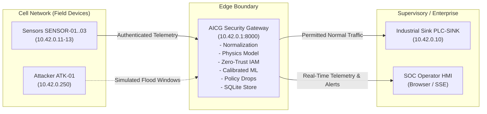

### 2.2 Product Functions
The AICG platform executes nine principal product functions:
1. **Multi-Source Ingestion & Normalization:** Standardizes diverse traffic sources into uniform 52-field `TelemetryEvent` structures with validated non-negative numeric constraints.
2. **Cause-Based Energy Estimation:** Correlates traffic rate, byte volume, and protocol complexity into estimated power dissipation in mW (labeled `PROVENANCE: MODELLED`).
3. **Zero-Trust Identity & Anti-Replay:** Verifies per-device HMAC tokens, enforces replay horizons via `TokenReplayCache`, and dynamically manages trust scores ($0..100$).
4. **Calibrated Multi-Model Threat Detection:** Extracts 15 statistical features, executes heuristic rules, Platt-calibrated Random Forest, and Isolation Forest, combining scores against $\theta = 0.50$.
5. **In-Process Mitigation:** Enforces software drops (`SOFTWARE_INTERCEPT`) and per-device token bucket rate limits in Python memory.
6. **Incident Lifecycle Governance:** Progresses incidents through 7 deterministic stages (`DETECTED` $\to$ `CLOSED`) with automatic campaign correlation.
7. **Autonomous Recovery Qualification:** Promotes contained incidents to `RECOVERING` after 3 consecutive normal windows and to `RESOLVED` after 5 consecutive normal windows.
8. **Tamper-Evident Historical Logging:** Maintains a forward SHA-256 hash-chained audit log with automated in-app integrity verification.
9. **Interactive SOC Dashboard & Red-Team Cockpit:** Serves an authenticated web dashboard with live SSE streaming and an attacker simulation console.

### 2.3 User Classes and Characteristics
1. **Security Administrator (`ADMIN`):** High technical expertise in OT cybersecurity. Authorized for full system governance, user account provisioning, red-team simulation execution, mode switching, cryptographic audit verification, and final incident closure.
2. **Plant Security Operator (`OPERATOR`):** Operational expertise in floor monitoring. Authorized for real-time monitoring, alert acknowledgment, manual containment/recovery participation, and forensic data export. Mutation of simulations and access to raw audit logs are denied.
3. **Edge Field Sensor (System Service):** Autonomous hardware or software entity emitting periodic telemetry windows bound with cryptographic HMAC tokens.

### 2.4 Operating Environment
- **Host Operating System:** Linux (Debian-based / Kali Linux Rolling, x86_64 architecture).
- **Python Execution Environment:** Python 3.14.x runtime.
- **Web Application Framework:** Flask 3.1.x with Jinja2 templating engine.
- **Machine Learning Libraries:** scikit-learn 1.9+, pandas 2.2+, numpy 2.0+, joblib 1.4+.
- **Database Engine:** SQLite 3 with Write-Ahead Logging (`WAL`) enabled.
- **Client Web Browser:** Modern HTML5/ES6+ browser (Chromium / Google Chrome 120+, Mozilla Firefox 120+).
- **Network Simulators (Trace Verification):** NS-3 version 3.48; Contiki-NG / Cooja 6LoWPAN mote emulator.

### 2.5 Constraints
1. **User-Space Execution Sandbox:** The gateway executes entirely in Linux user space. It **never** invokes `iptables`, `nftables`, `tc`, or kernel routing commands.
2. **Modeled Energy Bounds:** Power metrics are computed mathematically via cause-based physics formulas; no physical current clamp or wattmeter is interfaced.
3. **1.0-Second Windowing Cadence:** Ingestion processes discrete 1.0-second sliding traffic windows rather than line-rate individual hardware packets.
4. **Single-Node SQLite Persistence:** Storage is managed locally in `data/aegis_gateway.sqlite3` using WAL mode; no external database cluster is utilized.

### 2.6 Assumptions and Dependencies
1. **Pre-Shared Master Key:** The gateway and authorized sensors share a master secret key (`AEGIS_MASTER_KEY` / fallback) for HMAC key derivation.
2. **Clock Synchronization:** Sensor devices maintain clock synchronization within $[-5.0\text{s}, +300.0\text{s}]$ of gateway UTC for timestamp drift validation.
3. **Pre-Enrolled Sensor Registry:** Legitimate edge nodes (`SENSOR-01`, `SENSOR-02`, etc.) are pre-registered with assigned roles in `device_identities`.

---

# Chapter 3 — Functional Requirements

### 3.1 Authentication and Session Management
- **FR-01 (Primary Credential Verification):** The system shall authenticate user credentials submitted via `POST /api/auth/login` by verifying plaintext passwords against salted PBKDF2/scrypt password hashes stored in `admin_users`.  
  *Module:* `aegis_gateway/security.py#L77-L86`, `aegis_gateway/api.py#L281-L350`  
  *Test Evidence:* `tests/test_admin_security_layer.py#test_admin_login_success`  
  *Status:* IMPLEMENTED
- **FR-02 (Brute-Force Rate Limiting):** The system shall track failed authentication attempts per (client IP, username) pair using an in-memory sliding window and reject subsequent attempts exceeding 10 failures within 60 seconds with `HTTP 429 Too Many Requests`.  
  *Module:* `aegis_gateway/security.py#L101-L127`  
  *Test Evidence:* `tests/test_api_security_and_hardening.py#test_auth_rate_limiting_brute_force_protection`  
  *Status:* IMPLEMENTED
- **FR-03 (Two-Factor Simulated MFA):** The system shall require users passing primary authentication to supply a second-factor MFA token via `POST /api/auth/mfa/verify`, validating the token against `"123456"` using constant-time string comparison (`hmac.compare_digest`).  
  *Module:* `aegis_gateway/security.py#L89-L96`, `aegis_gateway/api.py#L414-L490`  
  *Test Evidence:* `tests/test_admin_security_layer.py#test_simulated_mfa_step_and_invalid_mfa`  
  *Status:* IMPLEMENTED
- **FR-04 (CSRF-Hardened Session Termination):** The system shall invalidate authenticated sessions exclusively upon receiving `POST /logout` or `POST /api/auth/logout` requests, rotating the session, logging `LOGOUT` to the audit log, and rejecting `GET /logout` with `HTTP 405 Method Not Allowed`.  
  *Module:* `aegis_gateway/api.py#L520-L545` (Phase A3)  
  *Test Evidence:* `tests/test_admin_security_layer.py#test_get_logout_rejected_method_not_allowed`  
  *Status:* IMPLEMENTED

### 3.2 Role-Based Access Control
- **FR-05 (Role Permission Governance):** The system shall enforce access controls based on two canonical roles: `ADMIN` (possessing 10 permissions including `MANAGE_USERS`, `ADMIN_CONTROLS`, `CLOSE_INCIDENT`, and `VIEW_AUDIT`) and `OPERATOR` (possessing 6 permissions restricted to monitoring and alert acknowledgment).  
  *Module:* `aegis_gateway/security.py#L34-L64`  
  *Test Evidence:* `tests/test_admin_security_layer.py#test_rbac_permission_matrix`  
  *Status:* IMPLEMENTED
- **FR-06 (Protected Administrative Endpoints):** The system shall reject requests from users lacking required roles or permissions with `HTTP 403 Forbidden` (`FORBIDDEN_ROLE` or `FORBIDDEN_PERMISSION`) and immediately log an `ACCESS_DENIED` event to `admin_audit_log`.  
  *Module:* `aegis_gateway/security.py#L224-L300`  
  *Test Evidence:* `tests/test_admin_security_layer.py#test_operator_denied_admin_only_endpoints`  
  *Status:* IMPLEMENTED
- **FR-07 (Unauthenticated Route Protection):** The system shall reject unauthenticated requests to protected endpoints (`/api/*` and `/events`) with `HTTP 401 Unauthorized` (`AUTH_REQUIRED`) without executing redirected HTML responses.  
  *Module:* `aegis_gateway/security.py#L206-L220`  
  *Test Evidence:* `tests/test_admin_security_layer.py#test_unauthenticated_protected_route_rejection`  
  *Status:* IMPLEMENTED

### 3.3 Device Identity and Trust Governance
- **FR-08 (Per-Device Key Derivation):** The system shall derive a unique preshared key (PSK) for each enrolled sensor device using HMAC-SHA256:  
  $$K_{\text{dev}} = \text{HMAC-SHA256}(K_{\text{master}}, \text{"device-psk:"} \parallel \text{device\_id})$$  
  *Module:* `aegis_gateway/iam.py#L101-L109`  
  *Test Evidence:* `tests/test_wave1_security_hardening.py#test_sec02_deterministic_device_key_derivation`  
  *Status:* IMPLEMENTED
- **FR-09 (Cryptographic Device Token Verification):** The system shall authenticate edge telemetry by computing and verifying an HMAC-SHA256 token binding `device_id`, ISO-8601 `timestamp`, and `flow_id` using the device's derived PSK.  
  *Module:* `aegis_gateway/iam.py#L116-L167`  
  *Test Evidence:* `tests/test_wave1_security_hardening.py#test_sec02_device_authentication_with_custom_key`  
  *Status:* IMPLEMENTED
- **FR-10 (Sliding-Window Replay Protection):** The system shall reject authentication tokens whose timestamps drift $>300.0$ seconds into the past or $>5.0$ seconds into the future, and reject duplicate tokens already recorded in the in-memory `TokenReplayCache`.  
  *Module:* `aegis_gateway/iam.py#L21-L97`, `L148-L178`  
  *Test Evidence:* `tests/test_wave1_security_hardening.py#test_sec01_exact_replay_rejected`  
  *Status:* IMPLEMENTED
- **FR-11 (Dynamic Trust Score Adjustment):** The system shall bound device trust scores within $[0.0, 100.0]$, decaying trust by $-20.0$ upon attack detection, by $-15.0$ upon authentication failure, and rewarding trust by $+3.0$ upon sustained normal baseline observation.  
  *Module:* `aegis_gateway/iam.py#L429-L452`  
  *Test Evidence:* `tests/test_energy_and_iam.py#test_dynamic_trust_decay_and_recovery`  
  *Status:* IMPLEMENTED

### 3.4 Telemetry Ingestion and Normalization
- **FR-12 (Canonical Normalization):** The system shall ingest multi-source telemetry windows and normalize them into a uniform 52-field `TelemetryEvent` instance with unique `event_id` (UUID4) and UTC timestamp.  
  *Module:* `aegis_gateway/schema.py#L40-L121`  
  *Test Evidence:* `tests/test_schema.py#test_telemetry_normalization`  
  *Status:* IMPLEMENTED
- **FR-13 (Numeric Range Validation):** The system shall validate that packet counts, byte counts, packet rates, byte rates, source counts, confidence scores, and trust scores are non-negative, raising a `ValueError` for invalid records.  
  *Module:* `aegis_gateway/schema.py#L109-L120`  
  *Test Evidence:* `tests/test_schema.py#test_negative_values_raise`  
  *Status:* IMPLEMENTED
- **FR-14 (Explicit Provenance Tagging):** The system shall assign and enforce one of seven valid provenance tags (`MEASURED`, `SIMULATED`, `MODELLED`, `SYNTHETIC`, `DERIVED`, `REPLAYED`, `UNKNOWN`) to every telemetry record.  
  *Module:* `aegis_gateway/schema.py#L12-L20`, `L106-L108`  
  *Test Evidence:* `tests/test_schema.py#test_invalid_provenance_raises`  
  *Status:* IMPLEMENTED

### 3.5 Baseline and Normal Behavior Monitoring
- **FR-15 (Quiescent Baseline Telemetry Generator):** The system shall provide a background baseline generator (`aegis-live-baseline`) that emits nominal sensor telemetry windows (14–18 pps, MQTT/UDP, periodic) every 1.0 second during quiescent conditions.  
  *Module:* `aegis_gateway/runtime.py#L557-L588`  
  *Test Evidence:* `tests/test_api_and_runtime.py#test_energy_baseline_causal_contract`  
  *Status:* IMPLEMENTED
- **FR-16 (Live Baseline Cessation during Attacks):** The system shall suppress baseline generator emissions whenever an active attack simulation is running.  
  *Module:* `aegis_gateway/runtime.py#L570-L574`  
  *Test Evidence:* `tests/test_wave3b_mitigation_reconciliation.py#test_n_active_attack_simulation_prevents_recovery_observation`  
  *Status:* IMPLEMENTED

### 3.6 DDoS Attack Detection and Feature Extraction
- **FR-17 (Statistical Feature Extraction):** The system shall extract a 15-dimensional numerical feature vector (`packet_count`, `byte_count`, `packet_rate`, `byte_rate`, `unique_sources`, `unique_destinations`, `packet_size`, `udp_ratio`, `tcp_ratio`, `icmp_ratio`, `syn_ratio`, `flow_count`, `cpu_activity`, `memory_activity`, `energy_deviation`) from each observation window.  
  *Module:* `aegis_gateway/detection.py#L17-L37`  
  *Test Evidence:* `tests/test_detection_and_ml.py#test_feature_mapping_completeness`  
  *Status:* IMPLEMENTED
- **FR-18 (Deterministic Heuristic Rule Scoring):** The system shall evaluate protocol thresholds (packet rate $\ge 100$, sources $\ge 5$, UDP dominance, SYN flag presence, ICMP dominance, energy deviation $\ge 0.15$) to compute an explainable heuristic rule activation score $\in [0.0, 1.0]$.  
  *Module:* `aegis_gateway/detection.py#L76-L100`  
  *Test Evidence:* `tests/test_detection_and_ml.py#test_rule_based_detection_untrained`  
  *Status:* IMPLEMENTED
- **FR-19 (Multi-Vector Attack Recognition):** The system shall detect 10 distinct DDoS and anomaly patterns: UDP flood, SYN flood, ICMP flood, burst exhaustion, slow-rate exhaustion, CoAP anomaly, MQTT anomaly, RPL anomaly, Modbus TCP anomaly, and mixed-vector barrages.  
  *Module:* `aegis_gateway/scenarios.py#L28-L41`  
  *Test Evidence:* `tests/test_scenarios.py#test_catalogue_contents`  
  *Status:* IMPLEMENTED — LAB ONLY (SYNTHETIC)

### 3.7 AI/ML Detection and Calibrated Fusion
- **FR-20 (Platt-Calibrated Supervised Classification):** The system shall perform inference using a Random Forest classifier (240 trees, `min_samples_leaf=2`) calibrated via sigmoid Platt scaling (`CalibratedClassifierCV`) to output unskewed posterior probabilities.  
  *Module:* `aegis_gateway/detection.py#L106-L118`, `aegis_gateway/ml.py#L160-L175`  
  *Test Evidence:* `tests/test_detection_and_ml.py#test_hybrid_detector_with_trained_bundle`  
  *Status:* IMPLEMENTED
- **FR-21 (Unsupervised Isolation Forest Scoring):** The system shall scale features and compute an outlier anomaly score $\in [0.0, 1.0]$ using an Isolation Forest (200 trees, contamination 0.08) trained strictly on normal traffic windows.  
  *Module:* `aegis_gateway/detection.py#L119-L129`, `aegis_gateway/ml.py#L163-L166`  
  *Test Evidence:* `tests/test_wave2_ml_validity.py#test_contradictory_rule_and_ml_evidence_documented`  
  *Status:* IMPLEMENTED
- **FR-22 (Ensemble Decision Fusion):** The system shall combine heuristic and model scores using the audited Phase 23 weights:  
  $$\text{Threat Score} = \min\Big(1.0, \; 0.40 \cdot \text{RuleScore} + 0.45 \cdot \text{RFScore} + 0.15 \cdot \text{iForestScore}\Big)$$  
  classifying windows with score $\ge 0.50$ as `ATTACK` (Severity: `MEDIUM` $\ge 0.50$, `HIGH` $\ge 0.68$, `CRITICAL` $\ge 0.85$).  
  *Module:* `aegis_gateway/detection.py#L136-L148`  
  *Test Evidence:* `tests/test_wave2_ml_validity.py#test_fusion_weights_exact_coefficients`  
  *Status:* IMPLEMENTED
- **FR-23 (Runtime Model Configurability):** The system shall resolve the detection model path dynamically from `AEGIS_MODEL_PATH`, defaulting to `models/hybrid_detector.joblib` and falling back safely to rule-based detection (`rules-v2-untrained`) without crashing if the model file is nonexistent or corrupted.  
  *Module:* `aegis_gateway/config.py#L22-L34` (Phase A1)  
  *Test Evidence:* `tests/test_model_configuration.py#test_default_model_path_is_hybrid_detector`  
  *Status:* IMPLEMENTED

### 3.8 Energy and Physics-Informed Modeling
- **FR-24 (Cause-Based Power Dissipation Estimation):** The system shall estimate edge device power dissipation in mW from packet rate, protocol state cost (TCP: 1.15x, ICMP: 0.95x, UDP: 1.0x), packet size penalties, CPU load, and radio TX/RX state relative to a 55.0 mW nominal quiescent baseline.  
  *Module:* `aegis_gateway/energy.py#L13-L76`  
  *Test Evidence:* `tests/test_energy_and_iam.py#test_energy_correlation_normal_vs_attack`  
  *Status:* IMPLEMENTED — LAB ONLY (MODELLED)
- **FR-25 (Resource State Classification):** The system shall classify edge device operational state as `NOMINAL` (deviation $<25\%$), `ELEVATED` ($\ge 25\%$), or `CRITICAL` ($\ge 100\%$) based on modelled power deviation.  
  *Module:* `aegis_gateway/energy.py#L96-L108`  
  *Test Evidence:* `tests/test_wave2_ml_validity.py#test_energy_different_packet_sizes_yield_different_energy`  
  *Status:* IMPLEMENTED — LAB ONLY (MODELLED)

### 3.9 Incident Lifecycle Management
- **FR-26 (Multi-Window Campaign Correlation):** The system shall correlate sequential attack windows from the same device and vector into a single active incident entity in `incidents`, preventing duplicate row creation.  
  *Module:* `aegis_gateway/storage.py#L330-L375`, `aegis_gateway/runtime.py#L331-L342`  
  *Test Evidence:* `tests/test_policy_and_incidents.py#test_incident_correlation_and_lifecycle`  
  *Status:* IMPLEMENTED
- **FR-27 (Deterministic Lifecycle Transitions):** The system shall progress incidents through strict sequential lifecycle stages:  
  $$\text{DETECTED} \longrightarrow \text{TRIAGED} \longrightarrow \text{RESPONDING} \longrightarrow \text{CONTAINED} \longrightarrow \text{RECOVERING} \longrightarrow \text{RESOLVED} \longrightarrow \text{CLOSED}$$  
  recording every transition with timestamp, actor, and evidence in `incident_history`.  
  *Module:* `aegis_gateway/storage.py#L378-L415`, `aegis_gateway/runtime.py#L345-L372`  
  *Test Evidence:* `tests/test_schema.py#test_invalid_provenance_raises`, `tests/test_policy_and_incidents.py#test_invalid_lifecycle_transition_raises`  
  *Status:* IMPLEMENTED
- **FR-28 (Impersonation Attack Triage):** When an unauthenticated event targets an enrolled sensor's identity, the system shall deny authorization immediately without penalizing the legitimate sensor's trust score or corrupting its mitigation state.  
  *Module:* `aegis_gateway/runtime.py#L170-L188`  
  *Test Evidence:* `tests/test_wave1_security_hardening.py#test_sec01_replay_does_not_decay_legitimate_sensor_trust`  
  *Status:* IMPLEMENTED
- **FR-29 (Administrative Incident Closure):** The system shall restrict transition to the terminal `CLOSED` state exclusively to users holding `ROLE_ADMIN` (`PERM_CLOSE_INCIDENT`) via `POST /api/incidents/<incident_id>/transition`.  
  *Module:* `aegis_gateway/api.py#L880-L920`  
  *Test Evidence:* `tests/test_admin_security_layer.py#test_admin_allowed_privileged_endpoints`  
  *Status:* IMPLEMENTED

### 3.10 In-Process Software Mitigation
- **FR-30 (Software Boundary Intercept):** In `ACTIVE` or `ENFORCING` mode, the system shall drop simulated attack windows from contained devices in Python memory (`drop=True`, `result="SOFTWARE_INTERCEPT"`), logging the drop in `actions` and bypassing unnecessary ML inference.  
  *Module:* `aegis_gateway/policy.py#L56-L136`, `aegis_gateway/runtime.py#L204-L285`  
  *Test Evidence:* `tests/test_in_process_enforcement.py#test_isolated_device_filtered_before_detector`  
  *Status:* IMPLEMENTED — LAB ONLY (SOFTWARE ONLY)
- **FR-31 (Token Bucket Rate Limiting):** The system shall enforce rate limits on throttled devices using a monotonic token bucket (capacity: 40.0 tokens, refill rate: 20.0 tokens/s), dropping events when the bucket is exhausted.  
  *Module:* `aegis_gateway/policy.py#L32-L54`, `L128-L135`  
  *Test Evidence:* `tests/test_in_process_enforcement.py#test_rate_limit_token_bucket_allows_then_drops`  
  *Status:* IMPLEMENTED — LAB ONLY (SOFTWARE ONLY)
- **FR-32 (Zero Host Firewall Intervention):** The mitigation engine shall not execute system commands or modify host OS firewall tables (`iptables`, `nftables`, `tc`, `pfctl`).  
  *Module:* `aegis_gateway/policy.py#L57-L61`  
  *Test Evidence:* `tests/test_in_process_enforcement.py#test_dry_run_invariant_and_no_host_enforcement`  
  *Status:* IMPLEMENTED (Verified Safety Guarantee)

### 3.11 Autonomous Recovery and State Reconciliation
- **FR-33 (Three-Streak Recovery Qualification):** The system shall advance a contained incident to `RECOVERING` and update policy enforcement to allow observation windows when a device records 3 consecutive normal telemetry windows.  
  *Module:* `aegis_gateway/runtime.py#L387-L415`  
  *Test Evidence:* `tests/test_wave3a_per_device_recovery.py#test_c_device_a_independently_completes_recovery_and_is_released`  
  *Status:* IMPLEMENTED
- **FR-34 (Five-Streak Verified Resolution):** The system shall advance an incident to `RESOLVED` (`recovery_state="VERIFIED"`), release software isolation, and reset streak counters when a device records 5 consecutive normal windows.  
  *Module:* `aegis_gateway/runtime.py#L416-L432`  
  *Test Evidence:* `tests/test_wave3b_mitigation_reconciliation.py#test_c_recovery_state_transitions`  
  *Status:* IMPLEMENTED
- **FR-35 (Autonomous Lifecycle Regression):** If attack traffic recurs while an incident is in `RECOVERING`, the system shall immediately regress the incident state back to `CONTAINED`.  
  *Module:* `aegis_gateway/runtime.py#L377-L380`  
  *Test Evidence:* `tests/test_api_security_and_hardening.py#test_incident_recovery_regression_on_recurring_attack`  
  *Status:* IMPLEMENTED

### 3.12 Alert Management and Synchronization
- **FR-36 (1:1 Alert-to-Incident Synchronization):** The system shall maintain exactly one alert record in `admin_alerts` per active incident, enforcing a `UNIQUE(incident_id)` foreign key constraint.  
  *Module:* `aegis_gateway/storage.py#L96-L106`, `L545-L610`  
  *Test Evidence:* `tests/test_admin_security_layer.py#test_attack_creates_single_alert_and_deduplicates`  
  *Status:* IMPLEMENTED
- **FR-37 (Alert Acknowledgment):** The system shall permit authenticated operators holding `PERM_ACK_ALERT` to acknowledge active alerts via `POST /api/admin/alerts/<alert_id>/acknowledge`.  
  *Module:* `aegis_gateway/api.py#L606-L625`  
  *Test Evidence:* `tests/test_admin_security_layer.py#test_alert_acknowledgement`  
  *Status:* IMPLEMENTED
- **FR-38 (Alert Re-Escalation):** If attack telemetry intensifies or recurs after an alert has been acknowledged, the system shall shift the alert status back to `ACTIVE` and mark `acknowledgement_state="RE_ESCALATED"`.  
  *Module:* `aegis_gateway/storage.py#L585-L602`  
  *Test Evidence:* `tests/test_api_security_and_hardening.py#test_alert_re_escalation_on_higher_severity_recurrence`  
  *Status:* IMPLEMENTED

### 3.13 Tamper-Evident Audit and Forensic Storage
- **FR-39 (Forward SHA-256 Hash Chaining):** The system shall compute a cryptographic forward hash chain across all administrative actions in `admin_audit_log`:  
  $$\text{RecordHash}_N = \text{SHA256}(\text{RecordHash}_{N-1} \parallel \text{event\_id} \parallel \text{timestamp} \parallel \text{username} \parallel \text{action} \parallel \text{details})$$  
  *Module:* `aegis_gateway/storage.py#L145-L160`, `L900-L930`  
  *Test Evidence:* `tests/test_api_security_and_hardening.py#test_audit_log_cryptographic_chaining`  
  *Status:* IMPLEMENTED
- **FR-40 (Audit Log Integrity Verification):** The system shall provide an endpoint `GET /api/admin/audit/integrity` that recalculates the sequential hash chain across all records and returns `{valid: true, records_verified: N}` or identifies the first corrupted record ID.  
  *Module:* `aegis_gateway/storage.py#L932-L965`, `aegis_gateway/api.py#L717-L723`  
  *Test Evidence:* `tests/test_api_security_and_hardening.py#test_audit_log_tamper_detection`  
  *Status:* IMPLEMENTED
- **FR-41 (Credential Sanitization):** The system shall never write plaintext passwords, secret keys, or authentication tokens into `admin_audit_log`, `telemetry`, or exported forensic files.  
  *Module:* `aegis_gateway/schema.py#L125`, `aegis_gateway/storage.py#L910-L925`  
  *Test Evidence:* `tests/test_admin_security_layer.py#test_audit_logs_record_administrative_events_without_passwords`  
  *Status:* IMPLEMENTED

### 3.14 Operator SOC Dashboard and HMI
- **FR-42 (Real-Time Server-Sent Events):** The system shall stream real-time telemetry, incidents, trust deltas, and alert notifications to connected browser clients over Server-Sent Events (`/events`).  
  *Module:* `aegis_gateway/api.py#L1579-L1595`  
  *Test Evidence:* `tests/test_admin_security_layer.py#test_events_endpoint_zero_trust_authentication`  
  *Status:* IMPLEMENTED
- **FR-43 (Visual Incident Stepper):** The dashboard shall render an interactive 7-stage visual lifecycle stepper that reflects the current canonical lifecycle state of active incidents.  
  *Module:* `dashboard/templates/index.html#L380-L450`, `dashboard/static/js/dashboard.js#L1400-L1550`  
  *Test Evidence:* `tests/test_api_and_runtime.py#test_incident_lifecycle_stepper_contracts`  
  *Status:* IMPLEMENTED
- **FR-44 (Detection Pipeline Card):** The dashboard shall render Card 5 displaying `HYBRID FUSION`, threshold $\theta = 0.50$, and component weights (`0.40 Rule • 0.45 RF • 0.15 iForest`), without presenting unmeasured static latency figures.  
  *Module:* `dashboard/templates/index.html#L308-L325` (Phase A2)  
  *Test Evidence:* `tests/test_api_and_runtime.py#test_dashboard_kpi_card_detection_pipeline_accuracy`  
  *Status:* IMPLEMENTED

### 3.15 Laboratory Simulation and Multi-Source Trace Ingestion
- **FR-45 (In-Process Scenario Execution):** The system shall execute background simulation threads via `POST /api/simulations/start` for any of the 10 catalogued attack profiles without generating external network traffic.  
  *Module:* `aegis_gateway/runtime.py#L433-L464`  
  *Test Evidence:* `tests/test_scenarios.py#test_generate_window_attack_profiles`  
  *Status:* IMPLEMENTED — LAB ONLY (SYNTHETIC)
- **FR-46 (NS-3 Trace Converter):** The system shall import offline CSV traces and PCAP dumps generated by NS-3.48 simulations via `POST /api/ns3/import`, normalizing rows into canonical telemetry windows.  
  *Module:* `aegis_gateway/adapters.py#L13-L67`, `aegis_gateway/api.py#L1452-L1486`  
  *Test Evidence:* `tests/test_adapters.py#test_ns3_window_csv_adapter`  
  *Status:* IMPLEMENTED — LAB ONLY (OFFLINE IMPORT)
- **FR-47 (Cooja Mote Log Importer):** The system shall import offline 6LoWPAN mote logs generated by Contiki-NG / Cooja simulations via `POST /api/cooja/import`.  
  *Module:* `aegis_gateway/adapters.py#L102-L165`, `aegis_gateway/api.py#L1505-L1540`  
  *Test Evidence:* `tests/test_adapters.py#test_cooja_csv_adapter`  
  *Status:* IMPLEMENTED — LAB ONLY (OFFLINE IMPORT)

### 3.16 Forensic Data Export and Reporting
- **FR-48 (Telemetry & Incident Export):** The system shall export historical records from `telemetry`, `incidents`, `actions`, and `admin_alerts` in CSV and JSON formats via `GET /api/export/<kind>.<fmt>`.  
  *Module:* `aegis_gateway/api.py#L1004-L1028`  
  *Test Evidence:* `tests/test_api_and_runtime.py#test_api_export_endpoints`  
  *Status:* IMPLEMENTED
- **FR-49 (Restricted Audit Ledger Export):** The system shall restrict exports of `admin_audit_log` (`/api/export/audit.csv`) strictly to users holding `ROLE_ADMIN`, returning `HTTP 403 Forbidden` for operator accounts.  
  *Module:* `aegis_gateway/api.py#L1010-L1025`  
  *Test Evidence:* `tests/test_admin_security_layer.py#test_forensic_export_rbac`  
  *Status:* IMPLEMENTED
- **FR-50 (Model Assurance Reporting):** The system shall provide an endpoint `GET /api/model-assurance` reporting dataset version, training seed, Platt calibration Brier score, and evaluation splits.  
  *Module:* `aegis_gateway/api.py#L1348-L1435`  
  *Test Evidence:* `tests/test_api_and_runtime.py#test_api_model_assurance_endpoint`  
  *Status:* IMPLEMENTED

---

# Chapter 4 — Non-Functional Requirements

### 4.1 Performance Requirements
- **NFR-PERF-01 (Sliding-Window Processing Cadence):** The gateway shall process and evaluate incoming traffic in discrete 1.0-second sliding observation windows.  
  *Classification:* CONFIGURED & VERIFIED (`aegis_gateway/runtime.py`)
- **NFR-PERF-02 (Feature Extraction Complexity):** Feature extraction over an observation window shall execute in constant time $O(1)$ relative to window size, calculating 15 scalar features using simple arithmetic.  
  *Classification:* VERIFIED PROPERTY (`aegis_gateway/detection.py#L24-L37`)
- **NFR-PERF-03 (Automated Test Suite Execution Speed):** The complete automated unit and integration test suite shall execute in under 120 seconds on a standard workstation. (Measured: **236 tests in 87.92 seconds**).  
  *Classification:* MEASURED BENCHMARK (`pytest tests/`)
- **NFR-PERF-04 (Headless Browser Acceptance Speed):** The complete 6-stage end-to-end browser verification suite across 5 viewports shall execute in under 20 seconds. (Measured: **~12.5 seconds**).  
  *Classification:* MEASURED BENCHMARK (`scripts/run_browser_e2e_admin.py`)

> [!CAUTION]
> **Performance Claim Discipline:**  
> The gateway does **not** assert sub-millisecond line-rate latency or hardware packet-clocking metrics. Previous static dashboard latency claims (`< 38 ms`) have been removed to preserve absolute engineering rigor.

### 4.2 Security Requirements
- **NFR-SEC-01 (Brute-Force Attack Resistance):** The authentication interface shall block automated dictionary attacks by limiting login attempts to 10 per 60 seconds per (IP, username) pair.  
  *Classification:* CONFIGURED & VERIFIED (`aegis_gateway/security.py#L101`)
- **NFR-SEC-02 (Password Storage Security):** Passwords shall never be stored in plaintext. Passwords must be hashed using PBKDF2/scrypt with random salts via Werkzeug security utilities.  
  *Classification:* VERIFIED PROPERTY (`aegis_gateway/security.py#L77`)
- **NFR-SEC-03 (Session Hijacking Mitigation):** Session cookies shall be issued with `HttpOnly = True` to prevent client-side XSS access and `SameSite = "Lax"` to mitigate CSRF attacks.  
  *Classification:* CONFIGURED & VERIFIED (`aegis_gateway/api.py#L268-L270`)
- **NFR-SEC-04 (Session Fixation Prevention):** The server shall execute `rotate_session()` (`session.clear()`) immediately upon successful MFA verification before issuing authenticated credentials.  
  *Classification:* VERIFIED PROPERTY (`aegis_gateway/security.py#L130`)
- **NFR-SEC-05 (Replay Horizon Enforcement):** The gateway shall enforce a 300-second maximum replay horizon, rejecting any device authentication token older than 300 seconds or more than 5.0 seconds in the future.  
  *Classification:* CONFIGURED & VERIFIED (`aegis_gateway/iam.py#L18`, `L155-L160`)
- **NFR-SEC-06 (Cryptographic Hash-Chain Tamper Evidence):** The audit ledger shall compute forward SHA-256 digests binding each entry to the preceding hash. Alteration of any row shall invalidate sequential verification.  
  *Classification:* VERIFIED PROPERTY (`aegis_gateway/storage.py#L932-L965`)
- **NFR-SEC-07 (Open Redirect Defense):** The application shall validate all post-login redirect paths via `sanitize_redirect_url()`, rejecting absolute URLs, protocol-relative paths (`//evil.com`), backslashes, and CRLF characters.  
  *Classification:* VERIFIED PROPERTY (`aegis_gateway/api.py#L57-L99`)

### 4.3 Usability Requirements
- **NFR-USE-01 (Responsive Viewport Support):** The web dashboard shall render responsively across 5 standard operational display resolutions: 1600x1000 (SOC Workstation), 1280x900 (Console), 1024x800 (Panel PC), 900x768 (Split Screen), and 768x1024 (Tablet).  
  *Classification:* MEASURED BENCHMARK (11 Screenshots in `reports/evidence/screenshots/`)
- **NFR-USE-02 (Real-Time Visual State Indication):** The dashboard shall update telemetry graphs, active alerts, and incident stepper stages within 1.0 second of an SSE event emission without full page reloads.  
  *Classification:* VERIFIED PROPERTY (`dashboard/static/js/dashboard.js`)
- **NFR-USE-03 (Intuitive Color Coding):** System severity shall adhere to standard industrial color conventions: Green (`NORMAL` / Nominal), Amber (`MEDIUM` / Elevated), Orange (`HIGH` / Warning), Red (`CRITICAL` / Severe).  
  *Classification:* VERIFIED PROPERTY (`dashboard/static/css/dashboard.css`)

### 4.4 Reliability Requirements
- **NFR-REL-01 (ACID Concurrency via SQLite WAL):** All database operations shall execute under SQLite Write-Ahead Logging (`PRAGMA journal_mode=WAL`) and a busy timeout of 5000 ms to eliminate "database locked" errors during concurrent reads and writes.  
  *Classification:* CONFIGURED & VERIFIED (`aegis_gateway/storage.py#L33-L36`)
- **NFR-REL-02 (Referential Integrity Enforcement):** The database shall enforce strict foreign key constraints (`PRAGMA foreign_keys=ON`) ensuring orphaned records cannot exist across incidents, alerts, actions, and audit history.  
  *Classification:* CONFIGURED & VERIFIED (`aegis_gateway/storage.py#L34`)
- **NFR-REL-03 (Graceful Fallback on Model Corruption):** If the configured ML model file is missing or corrupted, the runtime shall initialize gracefully, fall back to heuristic rules (`rules-v2-untrained`), and continue processing traffic.  
  *Classification:* VERIFIED PROPERTY (`tests/test_model_configuration.py#L90-L100`)

### 4.5 Availability Requirements
- **NFR-AVAIL-01 (Continuous Live Telemetry Baseline):** The gateway runtime shall maintain continuous baseline generation during non-attack intervals, ensuring the SOC dashboard receives steady health pulses.  
  *Classification:* VERIFIED PROPERTY (`aegis_gateway/runtime.py#L557-L588`)
- **NFR-AVAIL-02 (State Reconstruction upon Restart):** The gateway runtime shall automatically reconstruct active in-process policy containment states from persistent SQLite incident records upon daemon initialization.  
  *Classification:* VERIFIED PROPERTY (`aegis_gateway/runtime.py#L80-L123`)

### 4.6 Maintainability Requirements
- **NFR-MAINT-01 (Modular Decoupled Design):** Subsystems (detection, IAM, energy, policy, storage, API) shall remain decoupled Python modules communicating via typed dataclasses (`TelemetryEvent`, `Decision`).  
  *Classification:* VERIFIED PROPERTY (`aegis_gateway/`)
- **NFR-MAINT-02 (Automated Test Coverage):** The codebase shall maintain 100% test pass rate across unit, integration, and security regression suites (236 tests).  
  *Classification:* MEASURED BENCHMARK (`pytest tests/`)
- **NFR-MAINT-03 (Automated Schema Migrations):** The storage engine shall execute automated, backward-compatible schema migrations (`_migrate_schema()`) upon startup.  
  *Classification:* VERIFIED PROPERTY (`aegis_gateway/storage.py#L130-L170`)

### 4.7 Scalability Requirements
- **NFR-SCALE-01 (Replay Cache Capacity & Eviction):** The in-memory replay protection cache shall support up to 10,000 concurrent token fingerprints, automatically pruning expired items and evicting the oldest 10% when full.  
  *Classification:* CONFIGURED & VERIFIED (`aegis_gateway/iam.py#L30-L75`)
- **NFR-SCALE-02 (Multi-Subscriber SSE Broadcast):** The runtime shall support concurrent browser clients using non-blocking queues with automatic stale-subscriber pruning.  
  *Classification:* VERIFIED PROPERTY (`aegis_gateway/runtime.py#L124-L144`)

### 4.8 Portability Requirements
- **NFR-PORT-01 (Platform-Agnostic Execution):** The software shall rely exclusively on standard Python 3.14 libraries, Flask, scikit-learn, and SQLite, with zero dependence on proprietary hardware drivers or OS-specific kernel modules.  
  *Classification:* VERIFIED PROPERTY (`requirements.txt`)
- **NFR-PORT-02 (Headless Execution Support):** All gateway services and test runners shall execute headlessly in terminal and automated CI environments without requiring a local display server.  
  *Classification:* VERIFIED PROPERTY (`scripts/run_browser_e2e_admin.py`)

---

# Chapter 5 — External Interfaces

### 5.1 User Interface Requirements
1. **Operator HMI Dashboard (`GET /`):** Responsive dark-mode dashboard displaying live KPI cards, SVG industrial network topology map, live EventSource telemetry chart, active incident list with 7-stage visual stepper, and administrative console tabs.
2. **Attacker Simulation Console (`GET /attacker`):** Red-team scenario injection interface providing scenario dropdown selection (10 vectors + baseline), intensity slider ($1..6$), and start/stop controls. Operators receive view-only mode with disabled mutation controls.
3. **Login Interface (`GET /login`):** Two-stage authentication form displaying username/password inputs, simulated MFA token input field, and quick-fill demo buttons.

### 5.2 Hardware Interface Requirements
- **Development Workstation (Current Implementation):** x86_64 host running Linux (Kali Linux Rolling / Debian), $\ge 16$ GB RAM, $\ge 100$ GB SSD.
- **Virtual / Simulated Devices:** IIoT edge sensors (`SENSOR-01` to `SENSOR-03`), PLC sink (`PLC-SINK`), and attacker node (`ATK-01`) are simulated in software.
- **Proposed / Future Hardware Target:** Single-board industrial edge gateway (Raspberry Pi 4 Model B, 4GB RAM, or NVIDIA Jetson Nano) equipped with dual Gigabit Ethernet ports.

### 5.3 Software Interface Requirements
- **Database Engine:** SQLite 3 via Python `sqlite3` library using file `data/aegis_gateway.sqlite3`.
- **Machine Learning Engine:** Scikit-learn joblib model bundles (`models/hybrid_detector.joblib` and `models/realistic_detector_v1.joblib`).
- **Network Simulator Adapter:** Offline file reader for NS-3.48 simulation traces in `ns-allinone-3.48/ns-3.48/scratch/`.
- **Mote Emulator Adapter:** Offline file reader for Contiki-NG / Cooja 6LoWPAN mote CSV logs in `/home/kali/contiki-ng/examples/ai_edge_iiot/data/`.

### 5.4 Communication Interface Requirements
- **HTTP / RESTful API:** Standard HTTP/1.1 protocol listening on port 8000 (`127.0.0.1:8000`), using JSON payloads for data exchange.
- **Server-Sent Events (SSE):** Persistent unidirectional HTTP streaming over `/events` using MIME type `text/event-stream`.
- **Simulated Industrial Protocols:** Logical framing for CoAP (UDP 5683), MQTT (TCP 1883), Modbus TCP (TCP 502), and RPL (ICMPv6) within simulated traffic windows.


---

# Chapter 6 — Use Case Requirements

### 6.1 Actors
1. **Security Administrator (Human Actor):** Authenticated user holding `ROLE_ADMIN` with full governance authority.
2. **Plant Security Operator (Human Actor):** Authenticated user holding `ROLE_OPERATOR` with monitoring and alert handling authority.
3. **Edge Sensor Device (External System Actor):** Autonomous IIoT field sensor transmitting authenticated telemetry windows.
4. **AI Detection Engine (Internal Subsystem):** Autonomous module executing feature extraction and hybrid classification.
5. **Mitigation Engine (Internal Subsystem):** Autonomous module applying in-process software drops and rate limits.
6. **Simulation Engine (Internal Subsystem):** In-process test module injecting controlled red-team attack profiles.

### 6.2 Use Case Diagram
The Use Case Diagram visualizes interactions between human operators, edge sensors, internal subsystems, and administrative security functions within the gateway boundary:

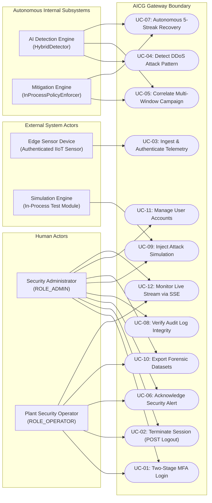

### 6.3 Detailed Use Cases

#### UC-01: Two-Stage Multi-Factor Authentication
- **Use Case ID:** UC-01
- **Use Case Name:** Two-Stage Multi-Factor Authentication
- **Primary Actor:** Security Administrator (`ROLE_ADMIN`) / Plant Security Operator (`ROLE_OPERATOR`)
- **Supporting Actor(s):** None
- **Preconditions:** User account enrolled in `admin_users` table with status `ACTIVE`.
- **Trigger:** User navigates to `/login` and enters credentials.
- **Main Flow:**
  1. User enters username and password.
  2. System checks `AuthRateLimiter`. If failed attempts $<10$ in 60s, validates password against salted hash via PBKDF2/scrypt.
  3. System sets pre-MFA state in session (10-minute TTL) and prompts for MFA token.
  4. User enters simulated MFA token (`"123456"`).
  5. System verifies token using constant-time string comparison (`hmac.compare_digest`), executes `rotate_session()` (`session.clear()`), and sets authenticated session credentials.
  6. System logs `LOGIN_SUCCESS` to `admin_audit_log` with computed SHA-256 forward hash.
  7. User is redirected to `/`.
- **Alternative / Error Flows:**
  - *2a. Rate Limit Exceeded:* If failed attempts $\ge 10$ in 60s, system returns `HTTP 429 Too Many Requests`.
  - *2b. Invalid Password:* System logs `LOGIN_FAILED` to `admin_audit_log` and returns `HTTP 401 Unauthorized`.
  - *5a. Invalid MFA Token:* System logs `MFA_FAILED` and returns `HTTP 401 Unauthorized`.
  - *5b. Pre-MFA Expiry:* If pre-MFA session exceeds 10 minutes, system returns `HTTP 401 Unauthorized` (`PRE_AUTH_REQUIRED`).
- **Postconditions:** Authenticated session cookie established with `HttpOnly=True` and `SameSite="Lax"`.
- **Related FR IDs:** FR-01, FR-02, FR-03, FR-39
- **Implementation Evidence:** `aegis_gateway/security.py#L77-L135`, `aegis_gateway/api.py#L281-L490`
- **Test Evidence:** `tests/test_admin_security_layer.py#test_admin_login_success`, `tests/test_admin_security_layer.py#test_simulated_mfa_step_and_invalid_mfa`

#### UC-02: Terminate Session (CSRF-Hardened Logout)
- **Use Case ID:** UC-02
- **Use Case Name:** Terminate Session (CSRF-Hardened Logout)
- **Primary Actor:** Security Administrator (`ROLE_ADMIN`) / Plant Security Operator (`ROLE_OPERATOR`)
- **Supporting Actor(s):** None
- **Preconditions:** User holds an active authenticated session.
- **Trigger:** User clicks "Logout" button in HMI navigation bar.
- **Main Flow:**
  1. Browser submits `POST /logout` or `POST /api/auth/logout`.
  2. Server removes user context from session (`session.pop("user", None)`).
  3. Server logs `LOGOUT` in `admin_audit_log` with SHA-256 forward hash.
  4. Server issues `HTTP 302 Redirect` to `/login`.
- **Alternative / Error Flows:**
  - *1a. Cross-Origin GET Attempt:* If `GET /logout` is invoked, server rejects request with `HTTP 405 Method Not Allowed`, preserving the active session.
- **Postconditions:** User session cleared; client must re-authenticate.
- **Related FR IDs:** FR-04, FR-39
- **Implementation Evidence:** `aegis_gateway/api.py#L520-L545` (Phase A3)
- **Test Evidence:** `tests/test_admin_security_layer.py#test_get_logout_rejected_method_not_allowed`

#### UC-03: Ingest and Authenticate Edge Telemetry
- **Use Case ID:** UC-03
- **Use Case Name:** Ingest and Authenticate Edge Telemetry
- **Primary Actor:** Edge Sensor Device
- **Supporting Actor(s):** IAM Service, Energy Model
- **Preconditions:** Sensor device enrolled in `device_identities` with active derived PSK.
- **Trigger:** Sensor transmits 1-second telemetry window to `POST /api/telemetry`.
- **Main Flow:**
  1. System normalizes payload into `TelemetryEvent` and validates numeric bounds.
  2. System executes `EnergyModel.correlate()`, calculating modeled active power in mW.
  3. System verifies HMAC token signature binding `device_id`, timestamp, and `flow_id` using derived PSK.
  4. System verifies token timestamp within $[-5.0\text{s}, +300.0\text{s}]$ and confirms absence from `TokenReplayCache`.
  5. System records token fingerprint in `TokenReplayCache`, updates device `last_seen` timestamp, and passes event to Detection Engine.
- **Alternative / Error Flows:**
  - *3a. Impersonation Attack:* Token is missing or invalid for enrolled sensor $\to$ system denies authorization (`decision="DENY"`), preserves legitimate sensor trust score, logs event to `iam_events`, and bypasses trust penalty.
  - *4a. Replayed Token:* Token hash already exists in cache $\to$ system rejects event immediately with replay error.
  - *4b. Timestamp Drift:* Timestamp drifts $>300$s into past or $>5$s into future $\to$ system rejects event.
- **Postconditions:** Event normalized, verified, and queued for threat detection.
- **Related FR IDs:** FR-08, FR-09, FR-10, FR-11, FR-12, FR-13, FR-14, FR-24, FR-28
- **Implementation Evidence:** `aegis_gateway/iam.py#L116-L178`, `aegis_gateway/schema.py#L40-L121`, `aegis_gateway/energy.py#L13-L76`
- **Test Evidence:** `tests/test_wave1_security_hardening.py#test_sec02_device_authentication_with_custom_key`, `tests/test_wave1_security_hardening.py#test_sec01_exact_replay_rejected`

#### UC-04: Detect DDoS Attack Pattern
- **Use Case ID:** UC-04
- **Use Case Name:** Detect DDoS Attack Pattern
- **Primary Actor:** AI Detection Engine (Internal Subsystem)
- **Supporting Actor(s):** HybridDetector, GatewayRuntime
- **Preconditions:** Normalized telemetry event available for inference.
- **Trigger:** Runtime pipeline calls `detector.analyze(event)`.
- **Main Flow:**
  1. Extractor computes 15-dimensional numerical feature vector from telemetry window.
  2. Rule engine evaluates heuristic protocol thresholds, computing heuristic rule score.
  3. Platt-calibrated Random Forest model predicts attack posterior probability.
  4. Isolation Forest model evaluates anomaly outlier score.
  5. System fuses scores using calibrated weights: $\text{Score} = \min(1.0, 0.40 \cdot \text{Rule} + 0.45 \cdot \text{RF} + 0.15 \cdot \text{iForest})$.
  6. If score $\ge 0.50$, emits `Decision(prediction="ATTACK", severity=...)` with explainability evidence.
- **Alternative / Error Flows:**
  - *3a. Model Missing or Corrupted:* If joblib model fails to load, system falls back to heuristic rule scoring (`rules-v2-untrained`), continuing real-time detection without interruption.
- **Postconditions:** Structured `Decision` object emitted with calibrated probability and feature attributions.
- **Related FR IDs:** FR-17, FR-18, FR-19, FR-20, FR-21, FR-22, FR-23
- **Implementation Evidence:** `aegis_gateway/detection.py#L17-L148`, `aegis_gateway/ml.py#L160-L175`
- **Test Evidence:** `tests/test_detection_and_ml.py#test_hybrid_detector_with_trained_bundle`, `tests/test_wave2_ml_validity.py#test_fusion_weights_exact_coefficients`

#### UC-05: Correlate Multi-Window Campaign & Enforce Mitigation
- **Use Case ID:** UC-05
- **Use Case Name:** Correlate Multi-Window Campaign & Enforce Mitigation
- **Primary Actor:** Mitigation Engine / AI Detection Engine
- **Supporting Actor(s):** GatewayStore, InProcessPolicyEnforcer
- **Preconditions:** Threat decision score $\ge 0.50$.
- **Trigger:** Detection engine outputs `ATTACK` prediction.
- **Main Flow:**
  1. Gateway checks for an existing active campaign incident in `incidents` matching device and attack vector.
  2. If active incident exists, correlates new window into it without creating duplicate incident rows.
  3. If no active incident exists, creates incident (`DETECTED`) and advances `TRIAGED` $\to$ `RESPONDING`.
  4. Policy engine applies software mitigation (`ISOLATE`, `BLOCK`, or `RATE_LIMIT`).
  5. System transitions incident to `CONTAINED`.
  6. System creates or updates linked alert in `admin_alerts`.
  7. Subsequent attack windows from contained device are intercepted and dropped in software memory (`drop=True`, `result="SOFTWARE_INTERCEPT"`), bypassing downstream ML inference.
- **Alternative / Error Flows:**
  - *4a. Mode is DRY_RUN:* Policy engine logs recommended action in `actions` but does not drop packets (`drop=False`).
- **Postconditions:** Incident contained; in-process software drops active; alert published via SSE.
- **Related FR IDs:** FR-26, FR-27, FR-28, FR-29, FR-30, FR-31, FR-32, FR-36
- **Implementation Evidence:** `aegis_gateway/policy.py#L56-L136`, `aegis_gateway/runtime.py#L204-L372`, `aegis_gateway/storage.py#L330-L415`
- **Test Evidence:** `tests/test_in_process_enforcement.py#test_isolated_device_filtered_before_detector`, `tests/test_policy_and_incidents.py#test_incident_correlation_and_lifecycle`

#### UC-06: Acknowledge Security Alert
- **Use Case ID:** UC-06
- **Use Case Name:** Acknowledge Security Alert
- **Primary Actor:** Plant Security Operator (`ROLE_OPERATOR`) / Security Administrator (`ROLE_ADMIN`)
- **Supporting Actor(s):** GatewayStore
- **Preconditions:** Alert in `ACTIVE` or `RE_ESCALATED` state.
- **Trigger:** Operator clicks "Acknowledge" button in HMI Alert Center.
- **Main Flow:**
  1. Client sends `POST /api/admin/alerts/<alert_id>/acknowledge`.
  2. Server verifies caller possesses `PERM_ACK_ALERT`.
  3. Server updates `acknowledgement_state="ACKNOWLEDGED"` and records operator username and timestamp.
  4. Server logs action in `admin_audit_log` with SHA-256 forward hash.
  5. Server emits updated alert status over SSE `/events`.
- **Alternative / Error Flows:**
  - *2a. Unauthenticated Call:* Server rejects with `HTTP 401 Unauthorized`.
  - *3a. Nonexistent Alert:* Server rejects with `HTTP 404 Not Found`.
- **Postconditions:** Alert marked acknowledged; operator identity recorded; audit log updated.
- **Related FR IDs:** FR-05, FR-36, FR-37, FR-39
- **Implementation Evidence:** `aegis_gateway/api.py#L606-L625`, `aegis_gateway/storage.py#L585-L602`
- **Test Evidence:** `tests/test_admin_security_layer.py#test_alert_acknowledgement`

#### UC-07: Autonomous Multi-Window Recovery
- **Use Case ID:** UC-07
- **Use Case Name:** Autonomous Multi-Window Recovery
- **Primary Actor:** AI Detection Engine / Mitigation Engine
- **Supporting Actor(s):** GatewayRuntime, GatewayStore
- **Preconditions:** Device is actively contained (`lifecycle_state="CONTAINED"`).
- **Trigger:** Attacker ceases flooding; sensor emits normal baseline telemetry windows.
- **Main Flow:**
  1. Gateway ingests normal baseline window for contained device.
  2. Decision evaluates as `NORMAL` (score $<0.50$); runtime increments `_device_normal_streaks[device_id]`.
  3. When streak reaches 3 consecutive normal windows, incident advances to `RECOVERING`; enforcer permits observation trial.
  4. When streak reaches 5 consecutive normal windows, incident advances to `RESOLVED` (`recovery_state="VERIFIED"`).
  5. Enforcer releases software isolation; device normal streak counter is reset and removed.
  6. Linked alert synchronizes to `RESOLVED`; device trust score is rewarded ($+3.0$).
- **Alternative / Error Flows:**
  - *2a. Attack Recurrence During Trial:* If attack traffic recurs while incident is in `RECOVERING`, incident immediately regresses back to `CONTAINED`, reset streak to 0, and alert re-escalates.
- **Postconditions:** Mitigation released; incident resolved autonomously without manual operator intervention.
- **Related FR IDs:** FR-11, FR-15, FR-33, FR-34, FR-35, FR-38
- **Implementation Evidence:** `aegis_gateway/runtime.py#L387-L432`, `aegis_gateway/policy.py#L137-L155`
- **Test Evidence:** `tests/test_wave3a_per_device_recovery.py#test_c_device_a_independently_completes_recovery_and_is_released`, `tests/test_autonomous_lifecycle_regression.py#test_regression_on_attack_burst`

#### UC-08: Verify Audit Log Cryptographic Integrity
- **Use Case ID:** UC-08
- **Use Case Name:** Verify Audit Log Cryptographic Integrity
- **Primary Actor:** Security Administrator (`ROLE_ADMIN`)
- **Supporting Actor(s):** GatewayStore
- **Preconditions:** Administrator holds authenticated session possessing `ROLE_ADMIN`.
- **Trigger:** Admin clicks "Verify Integrity" in SOC Audit Log console.
- **Main Flow:**
  1. Client sends `GET /api/admin/audit/integrity`.
  2. Server verifies caller possesses `PERM_VIEW_AUDIT`.
  3. System iterates sequentially through `admin_audit_log`, recomputing SHA-256 digests binding `prev_hash` to record contents.
  4. If all hashes match, returns `{valid: true, records_verified: N}`.
  5. HMI displays green cryptographic verification confirmation badge.
- **Alternative / Error Flows:**
  - *2a. Operator Role Denied:* If operator attempts access, server returns `HTTP 403 Forbidden` (`FORBIDDEN_ROLE`).
  - *4a. Tampered Record Detected:* If any hash does not match, returns `{valid: false, first_corrupted_id: ...}` with warning.
- **Postconditions:** Cryptographic hash integrity of the audit ledger mathematically validated.
- **Related FR IDs:** FR-05, FR-06, FR-39, FR-40
- **Implementation Evidence:** `aegis_gateway/storage.py#L932-L965`, `aegis_gateway/api.py#L717-L723`
- **Test Evidence:** `tests/test_api_security_and_hardening.py#test_audit_log_tamper_detection`, `tests/test_admin_security_layer.py#test_operator_denied_admin_only_endpoints`

#### UC-09: Inject Controlled Attack Simulation
- **Use Case ID:** UC-09
- **Use Case Name:** Inject Controlled Attack Simulation
- **Primary Actor:** Security Administrator (`ROLE_ADMIN`)
- **Supporting Actor(s):** Simulation Engine (`scenarios.py`)
- **Preconditions:** Administrator holds authenticated session possessing `ROLE_ADMIN`.
- **Trigger:** Admin selects vector and clicks "Launch Simulation" in `/attacker`.
- **Main Flow:**
  1. Client sends `POST /api/simulations/start` specifying scenario ID, intensity ($1..6$), and duration.
  2. Server verifies caller possesses `PERM_ADMIN_CONTROLS`.
  3. Runtime spawns background simulation daemon emitting synthetic windows.
  4. Pipeline detects, alerts, and mitigates simulated attack in memory without external packet transmission.
- **Alternative / Error Flows:**
  - *2a. Operator Role Denied:* If operator attempts simulation launch, server returns `HTTP 403 Forbidden` (`FORBIDDEN_ROLE`).
  - *3a. Invalid Scenario ID:* If scenario unrecognized, returns `HTTP 400 Bad Request`.
- **Postconditions:** Safe in-process red-team attack active; live telemetry stream reflects synthetic attack dynamics.
- **Related FR IDs:** FR-05, FR-06, FR-19, FR-45
- **Implementation Evidence:** `aegis_gateway/runtime.py#L433-L464`, `aegis_gateway/scenarios.py#L28-L75`
- **Test Evidence:** `tests/test_scenarios.py#test_generate_window_attack_profiles`, `tests/test_admin_security_layer.py#test_operator_denied_admin_only_endpoints`

#### UC-10: Export Forensic Evidence
- **Use Case ID:** UC-10
- **Use Case Name:** Export Forensic Evidence
- **Primary Actor:** Security Administrator (`ROLE_ADMIN`) / Plant Security Operator (`ROLE_OPERATOR`)
- **Supporting Actor(s):** GatewayStore
- **Preconditions:** User holds authenticated session.
- **Trigger:** User clicks CSV or JSON export button in HMI navigation.
- **Main Flow:**
  1. User requests `GET /api/export/<kind>.<fmt>` (where `kind` $\in \{$ `telemetry`, `incidents`, `actions`, `alerts` $\}$).
  2. Server queries requested SQLite table.
  3. Formats rows into RFC 4180 CSV or JSON, sanitizing sensitive keys and tokens.
  4. Returns downloadable file attachment.
- **Alternative / Error Flows:**
  - *1a. Operator Requests Audit Export:* If operator requests `/api/export/audit.csv`, server returns `HTTP 403 Forbidden` (`FORBIDDEN_ROLE`), protecting administrative audit logs.
- **Postconditions:** Forensic dataset exported for offline examination; credentials remain sanitized.
- **Related FR IDs:** FR-05, FR-06, FR-41, FR-48, FR-49
- **Implementation Evidence:** `aegis_gateway/api.py#L1004-L1028`, `aegis_gateway/storage.py#L910-L925`
- **Test Evidence:** `tests/test_api_and_runtime.py#test_api_export_endpoints`, `tests/test_admin_security_layer.py#test_forensic_export_rbac`

#### UC-11: Manage User Accounts
- **Use Case ID:** UC-11
- **Use Case Name:** Manage User Accounts
- **Primary Actor:** Security Administrator (`ROLE_ADMIN`)
- **Supporting Actor(s):** None
- **Preconditions:** Administrator holds an active authenticated session possessing `ROLE_ADMIN` (`PERM_MANAGE_USERS`).
- **Trigger:** Administrator navigates to Users tab in SOC Admin Console and submits account creation, update, or deactivation request.
- **Main Flow:**
  1. Administrator submits account modification parameters to `POST /api/admin/users`.
  2. Server verifies caller possesses `PERM_MANAGE_USERS`.
  3. Server validates input payload (username uniqueness, password complexity, role assignment `ADMIN` or `OPERATOR`).
  4. Server generates salted cryptographic password hash using PBKDF2/scrypt (`werkzeug.security.generate_password_hash`).
  5. Server persists user record in `admin_users` table.
  6. Server records `USER_CREATED` or `USER_UPDATED` event in `admin_audit_log` with computed SHA-256 forward hash.
  7. Server returns `HTTP 200 OK` or `HTTP 201 Created` with sanitized user metadata (excluding password hash).
- **Alternative / Error Flows:**
  - *2a. Unauthorized Operator Access:* If an operator attempts access, server returns `HTTP 403 Forbidden` (`FORBIDDEN_ROLE`), logs `ACCESS_DENIED` to `admin_audit_log`, and aborts execution.
  - *3a. Duplicate Username:* If username exists, server rejects with `HTTP 400 Bad Request` (`DUPLICATE_USERNAME`).
- **Postconditions:** User account persisted or updated in `admin_users`; operation recorded in tamper-evident audit ledger; credentials sanitized in response.
- **Related FR IDs:** FR-01, FR-05, FR-06, FR-39, FR-41
- **Implementation Evidence:** `aegis_gateway/security.py#L34-L64`, `aegis_gateway/api.py#L650-L710`, `aegis_gateway/storage.py#L90-L95`
- **Test Evidence:** `tests/test_admin_security_layer.py#test_admin_allowed_privileged_endpoints`, `tests/test_admin_security_layer.py#test_operator_denied_admin_only_endpoints`

#### UC-12: Monitor Live Stream via Server-Sent Events (SSE)
- **Use Case ID:** UC-12
- **Use Case Name:** Monitor Live Stream via Server-Sent Events (SSE)
- **Primary Actor:** Plant Security Operator (`ROLE_OPERATOR`) / Security Administrator (`ROLE_ADMIN`)
- **Supporting Actor(s):** Browser HMI Client, Gateway Runtime Daemon
- **Preconditions:** Client has authenticated and established an active session cookie.
- **Trigger:** Browser HMI loads `/` and initializes an `EventSource` connection to `GET /events`.
- **Main Flow:**
  1. Client sends HTTP GET request to `/events` requesting MIME type `text/event-stream`.
  2. Server verifies caller is authenticated.
  3. Runtime registers a thread-safe subscriber queue for the connection.
  4. As 1-second telemetry windows, incident transitions, trust score updates, and alerts are produced by the runtime, the server formats them into SSE data frames (`event: telemetry`, `event: incident`, `event: alert`).
  5. Browser JavaScript receives frames asynchronously, updating KPI cards, the SVG network topology, and the 7-stage incident stepper in real time without polling.
- **Alternative / Error Flows:**
  - *2a. Unauthenticated Access:* If client requests `/events` without an active session, server rejects immediately with `HTTP 401 Unauthorized` (`AUTH_REQUIRED`), without issuing an HTML redirect loop.
  - *4a. Client Disconnection:* When browser tab closes, runtime detects closed socket on next write, unregisters subscriber queue, and reclaims memory.
- **Postconditions:** Continuous, unidirectional, real-time telemetry stream maintained without browser polling; server state reflected on HMI within 1.0 second.
- **Related FR IDs:** FR-07, FR-42, FR-43, FR-44
- **Implementation Evidence:** `aegis_gateway/api.py#L220-L260`, `aegis_gateway/runtime.py#L124-L144`, `dashboard/static/js/dashboard.js`
- **Test Evidence:** `tests/test_admin_security_layer.py#test_events_endpoint_zero_trust_authentication`, `tests/test_api_and_runtime.py#test_api_events_sse_endpoint`

---

# Chapter 7 — System Models

### 7.1 System Context Diagram
The System Context Diagram defines the operational boundary of the AICG Edge Gateway in relation to industrial field devices, the SCADA sink, SOC analysts, and offline laboratory simulators:

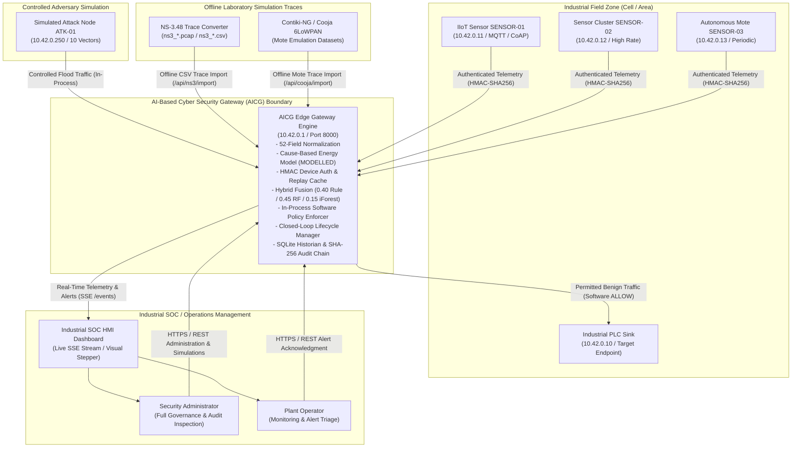

### 7.2 Data Flow Diagram Level 0 (Context Level DFD)
The DFD Level 0 diagram represents the gateway as a single high-level software transformation process (`0.0`), identifying data flows between external entities and persistent storage:

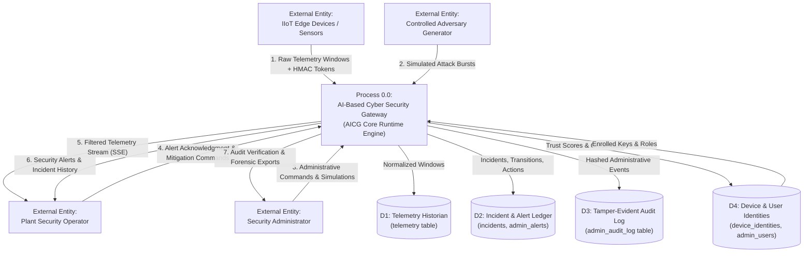

### 7.3 Data Flow Diagram Level 1 (Detailed Subsystem Decomposition)
The DFD Level 1 diagram decomposes the gateway into five core functional sub-processes, mapping internal data flow through each transformation stage:

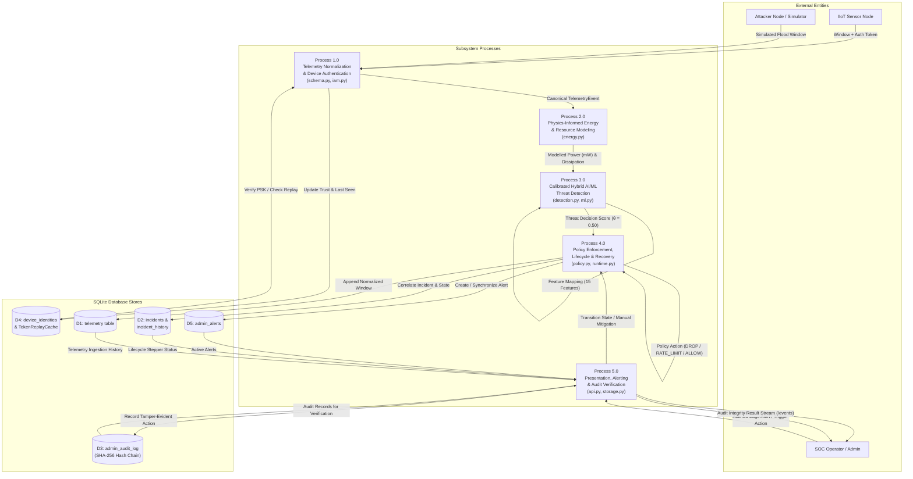

### 7.4 Activity Diagrams

#### Activity Flow 1: Two-Stage MFA Authentication & Session Rotation
Visualizes the login workflow enforcing credential validation, brute-force rate limiting, simulated MFA verification, session rotation, and audit recording:

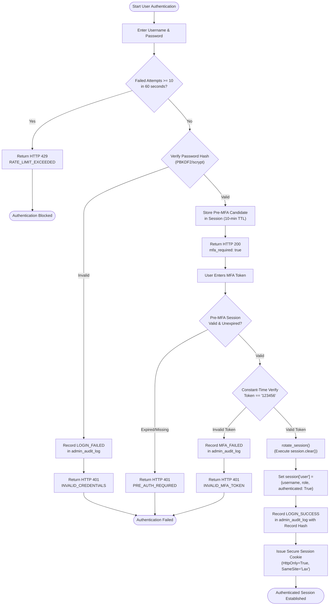

#### Activity Flow 2: Telemetry Ingest, In-Process Mitigation & Autonomous 5-Streak Recovery
Visualizes telemetry processing from ingestion through detection, in-process software drops, incident campaign correlation, and autonomous multi-window recovery:

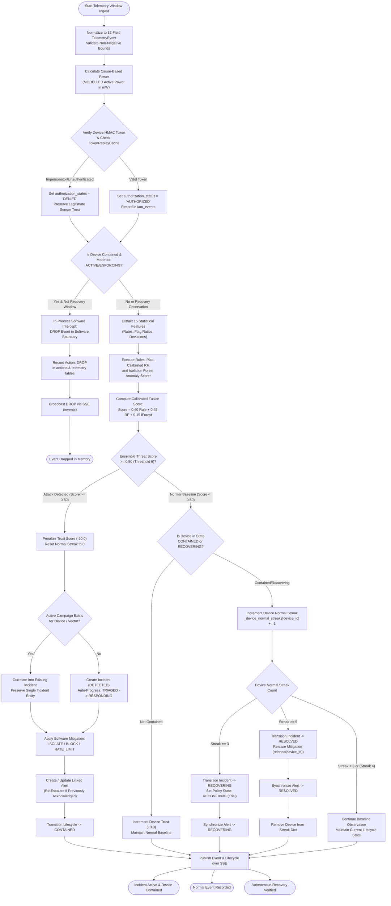

### 7.5 Sequence Diagrams

#### Sequence 1: Two-Stage MFA Login, RBAC Authorization & Audit Integrity Verification
Visualizes message exchanges between human clients, API controllers, security decorators, rate limiters, storage engines, and the SHA-256 hash ledger:

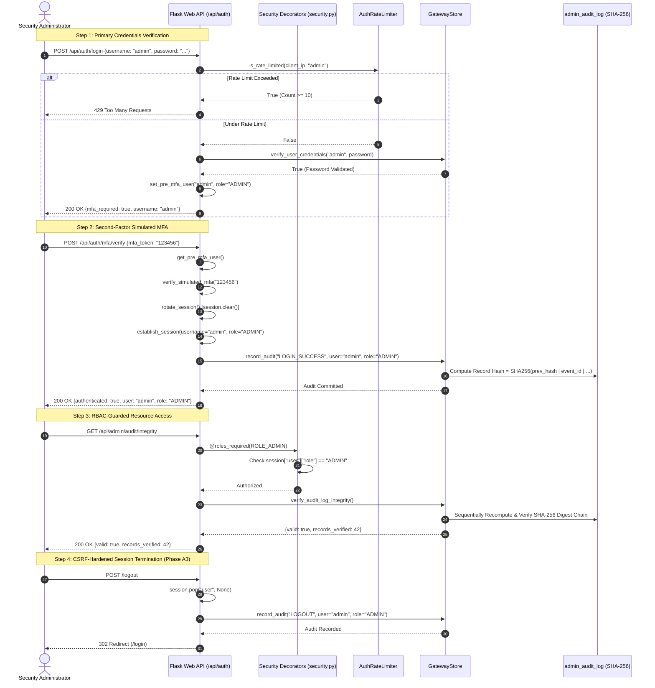

#### Sequence 2: Multi-Window DDoS Detection, Software Mitigation & Autonomous Recovery
Visualizes multi-window traffic ingestion, ensemble model fusion, in-process software drops, incident correlation, alert deduplication, and 5-streak recovery:

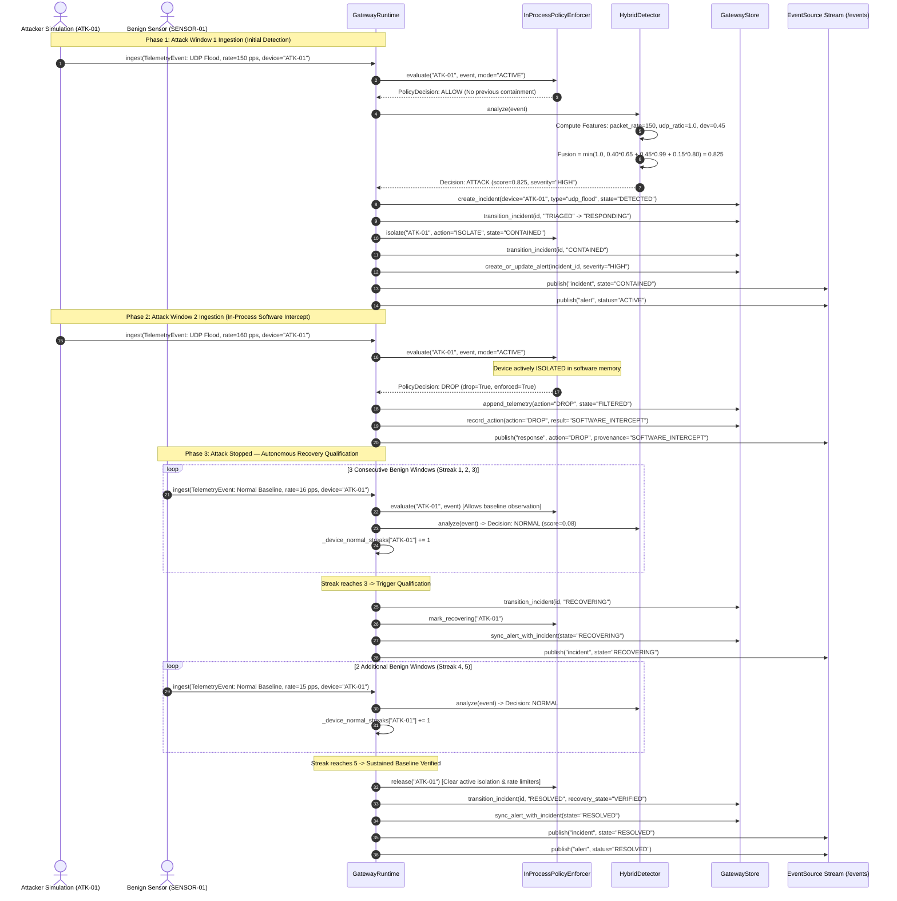

### 7.6 UML Class Diagram
The UML Class Diagram models the core Python classes, dataclasses, methods, and relationships implemented in the `aegis_gateway` package:

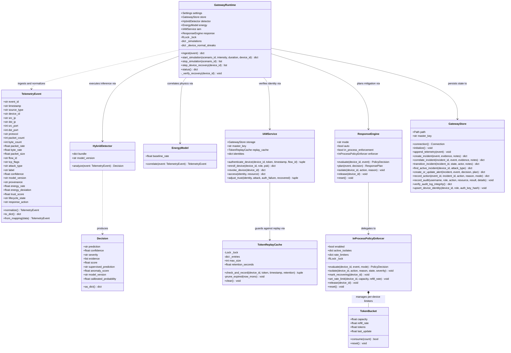

### 7.7 Entity-Relationship (ER) Diagram
The Entity-Relationship Diagram defines the complete logical database schema implemented in `aegis_gateway/storage.py` across all 11 normalized SQLite tables, including foreign keys, cardinalities, and constraints:

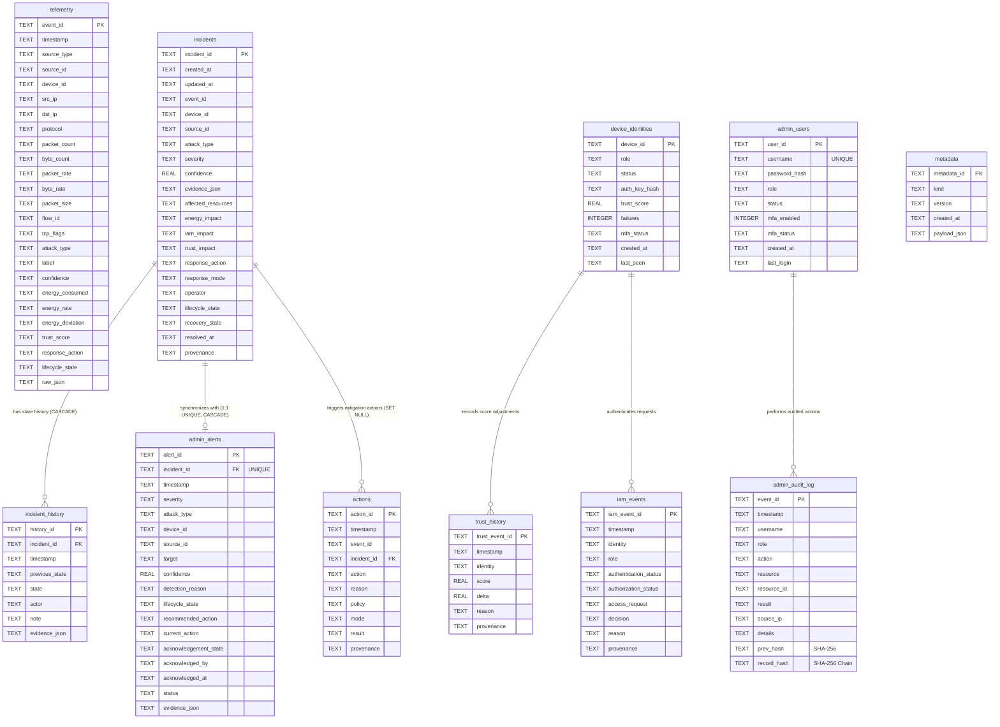

### 7.8 UML Deployment Diagram (Architectural Model)
The UML Deployment Diagram models the runtime software and storage topology of the AICG Edge Gateway in its **current laboratory verification state**. To preserve strict academic integrity, this model depicts the system as executing entirely within an unprivileged user-space Linux environment on an x86_64 host workstation. It serves as an additional architectural model and does not assert physical hardware deployment:

```mermaid
flowchart TD
    subgraph HostNode ["Node: Linux Workstation Execution Environment (x86_64 OS / User-Space Sandbox)"]
        
        subgraph GatewayProcess ["Software Node: aegis_gateway Daemon Process (Python 3.14 / User Space)"]
            APIService["Flask Web & API Service<br/>(:8000 / HTTP / JSON)"]
            SSEService["EventSource SSE Streaming Engine<br/>(/events / text/event-stream)"]
            RuntimeCoord["GatewayRuntime Coordinator<br/>(1-Second Window Loop)"]
            EnergyEngine["EnergyModel<br/>(Cause-Based Physics Formulas)"]
            IAMService["IAMService & TokenReplayCache<br/>(HMAC-SHA256 & 300s Sliding Cache)"]
            HybridDetectorNode["HybridDetector Engine<br/>(0.40 Rule + 0.45 RF + 0.15 iForest)"]
            PolicyEnforcerNode["InProcessPolicyEnforcer<br/>(Token Bucket & Software Drops)"]
        end

        subgraph StorageNode ["Persistent Storage Node: Local Linux Filesystem"]
            SQLiteFile[("SQLite 3 Database File<br/>(data/aegis_gateway.sqlite3)<br/>WAL Mode / 11 Tables / SHA-256 Ledger")]
            ModelFiles["Machine Learning Artifacts<br/>(models/hybrid_detector.joblib<br/>models/realistic_detector_v1.joblib)"]
        end

        subgraph SimNode ["Simulation & Trace Node: In-Process & Offline Generators"]
            AttackThreads["In-Process Attack Simulation Threads<br/>(10 Attack Profiles in scenarios.py)"]
            BaselineThread["Quiescent Baseline Daemon Thread<br/>(14-18 pps / 55 mW Normal Rhythm)"]
            TraceFiles["Offline Trace Storage & Adapters<br/>- NS-3.48 CSV/PCAP Traces<br/>- Cooja 6LoWPAN Mote Logs<br/>- PCAP Window Replayer"]
        end

        subgraph ClientNode ["Operator Interface Node: Modern Web Browser Client"]
            SOCHMI["Industrial SOC Dashboard<br/>(dashboard/templates/index.html)<br/>- Real-Time SVG Network Map<br/>- 7-Stage Incident Lifecycle Stepper<br/>- Detection Pipeline Card 5"]
            AttackerHMI["Attacker Simulation Console<br/>(dashboard/templates/attacker.html)<br/>- Red-Team Scenario Cockpit"]
        end
    end

    %% Internal Communication & Dependencies
    AttackThreads -->|"In-Memory Synthetic Windows"| RuntimeCoord
    BaselineThread -->|"Quiescent Background Windows"| RuntimeCoord
    TraceFiles -->|"POST /api/ns3/import & /cooja/import"| APIService

    APIService <--> RuntimeCoord
    SSEService <--> RuntimeCoord
    RuntimeCoord --> EnergyEngine
    RuntimeCoord --> IAMService
    RuntimeCoord --> HybridDetectorNode
    RuntimeCoord --> PolicyEnforcerNode

    RuntimeCoord <-->|"Read / Write (WAL Mode Pragmas)"| SQLiteFile
    HybridDetectorNode <-->|"joblib.load() / Deserialized Model"| ModelFiles

    SOCHMI <-->|"HTTP / REST API (Port 8000)"| APIService
    SOCHMI <--"Persistent SSE Push Stream (/events)"-- SSEService
    AttackerHMI <-->|"POST /api/simulations/start"| APIService
```


---

# Chapter 8 — Data Requirements

### 8.1 Database Tables (11 SQLite Tables)
The relational database engine utilizes SQLite 3 with Write-Ahead Logging (`WAL`) mode enabled, residing at `data/aegis_gateway.sqlite3`. Foreign key constraints are strictly enforced via `PRAGMA foreign_keys = ON`.

| Table Name | Purpose | Primary Key | Foreign Keys & Constraints | Security / Integrity Fields | Line in `storage.py` |
|---|---|---|---|---|---|
| `telemetry` | Append-only historian of 1-second telemetry windows | `event_id` | Implicit via schema | Tokens stripped; canonical fields | `L48-L50` |
| `incidents` | Active and historical incident campaigns | `incident_id` | Unique incident identifier | `severity`, `confidence`, `lifecycle_state`, `recovery_state` | `L54-L61` |
| `incident_history` | State transition audit log for incidents | `history_id` | `incident_id REFERENCES incidents(incident_id) ON DELETE CASCADE` | `actor`, `previous_state`, `state`, `evidence_json` | `L63-L67` |
| `actions` | History of mitigation decisions and enforcements | `action_id` | `incident_id REFERENCES incidents(incident_id) ON DELETE SET NULL` | `action`, `mode`, `result`, `provenance` | `L69-L74` |
| `iam_events` | Zero-Trust access decisions and evaluations | `iam_event_id` | None | `identity`, `role`, `authentication_status`, `authorization_status` | `L75-L79` |
| `trust_history` | Historical log of trust score adjustments | `trust_event_id` | None | `identity`, `score` ($0..100$), `delta`, `reason` | `L80-L84` |
| `metadata` | System configuration manifests and checkpoints | `metadata_id` | None | `kind`, `version`, `payload_json` | `L85-L89` |
| `admin_users` | Administrative and operator accounts | `user_id` | `username UNIQUE NOT NULL` | `password_hash` (PBKDF2/scrypt), `role`, `status` | `L90-L95` |
| `admin_alerts` | Operator-facing alerts synchronized 1:1 with incidents | `alert_id` | `incident_id REFERENCES incidents(incident_id) ON DELETE CASCADE UNIQUE` | `severity`, `lifecycle_state`, `acknowledgement_state`, `status` | `L96-L106` |
| `admin_audit_log` | Tamper-evident ledger of administrative actions | `event_id` | None | `prev_hash` (SHA-256), `record_hash` (SHA-256 forward chain) | `L107-L115` |
| `device_identities` | Zero-Trust registry of known sensors and devices | `device_id` | `device_id UNIQUE` | `auth_key_hash` (SHA-256 of PSK), `trust_score`, `failures` | `L116-L123` |

### 8.2 Data Dictionary (Canonical Telemetry & Identity Fields)

| Field Name | Data Type | Meaning / Purpose | Constraints / Valid Values | Sensitivity |
|---|---|---|---|---|
| `event_id` | TEXT (UUID4) | Globally unique identifier for telemetry window | Not null, 36-char UUID format | Low |
| `timestamp` | TEXT (ISO-8601) | UTC timestamp of observation window | ISO-8601 millisecond format | Low |
| `device_id` | TEXT | Identifier of edge sensor or generator | e.g., `SENSOR-01`, `ATK-01` | Medium |
| `packet_count` | INTEGER | Total packets observed in 1-second window | $\ge 0$ | Low |
| `byte_count` | INTEGER | Total bytes observed in 1-second window | $\ge 0$ | Low |
| `packet_rate` | REAL | Packets per second (pps) | $\ge 0.0$ | Low |
| `byte_rate` | REAL | Bytes per second (Bps) | $\ge 0.0$ | Low |
| `packet_size` | REAL | Mean packet size in bytes | $\ge 0.0$ | Low |
| `protocol` | TEXT | Dominant transport protocol in window | `UDP`, `TCP`, `ICMP`, `ICMPV6` | Low |
| `tcp_flags` | TEXT | Aggregated TCP control flags | e.g., `"S"`, `"PA"`, `None` | Low |
| `attack_type` | TEXT | Specific DDoS attack profile name | 10 vector names or `None` | Low |
| `label` | TEXT | Binary detection classification | `NORMAL`, `ATTACK` | Low |
| `confidence` | REAL | Calibrated decision confidence score | $\in [0.0, 1.0]$ | Low |
| `provenance` | TEXT | Technical origin of data | `MEASURED`, `SIMULATED`, `MODELLED`, `SYNTHETIC`, `DERIVED`, `REPLAYED` | Low |
| `energy_rate` | REAL | Estimated active power dissipation (mW) | $\ge 44.0\text{ mW}$ (Modelled) | Low |
| `energy_deviation` | REAL | Relative power deviation from 55 mW baseline | Modeled float | Low |
| `trust_score` | REAL | Zero-Trust device reputation score | Strictly bounded $\in [0.0, 100.0]$ | Medium |
| `lifecycle_state` | TEXT | Incident management stage | `DETECTED`, `TRIAGED`, `RESPONDING`, `CONTAINED`, `RECOVERING`, `RESOLVED`, `CLOSED` | Low |
| `response_action` | TEXT | Selected policy mitigation action | `ALLOW`, `ALERT`, `RATE_LIMIT`, `BLOCK`, `ISOLATE`, `DROP` | Low |
| `auth_token` | TEXT | HMAC-SHA256 device authentication token | Stripped prior to persistence; never logged | **HIGH (Sanitized)** |
| `password_hash` | TEXT | Salted cryptographic password hash | PBKDF2/scrypt string | **HIGH (Confidential)** |
| `auth_key_hash` | TEXT | SHA-256 digest of derived device PSK | Never stores plaintext PSK | **HIGH (Confidential)** |
| `record_hash` | TEXT | SHA-256 forward digest in audit chain | 64-char hexadecimal digest | High (Integrity) |

---

# Chapter 9 — System Constraints

The software architecture and empirical boundaries of the AICG platform are governed by five explicit constraints:

1. **User-Space Software Execution Sandbox:**  
   The gateway daemon executes exclusively as an unprivileged user-space Linux process in Python. It does not load proprietary kernel modules or require root-level kernel privileges.
2. **Zero Host Operating System Network Alteration:**  
   The gateway guarantees zero modification of host Linux firewall rules (`iptables`, `nftables`, `ufw`), routing tables, or traffic control disciplines (`tc`). All packet filtering (`SOFTWARE_INTERCEPT`) and rate limiting occur in-process within application memory.
3. **Mathematically Modelled Energy Bounds:**  
   Power dissipation metrics (in milliwatts) and energy consumption metrics (in millijoules) are computed via cause-based physics formulas based on communication volume, packet size efficiency, and protocol complexity. No physical current-sensing hardware or electrical wattmeter is interfaced.
4. **Machine Learning Operational Bounds:**  
   While clean synthetic laboratory evaluations yield 100.0% accuracy, rigorous evaluation on the realistic benchmark documents an operational accuracy of **89.72%** (Attack Recall: **99.00%**, False Positive Rate: **21.88%**, False Negative Rate: **1.00%**, and Held-out Stealth Recall: **72.50%**). The system does not claim unblemished 100% accuracy in noisy production environments.
5. **No Deep Packet Payload Inspection:**  
   Protocol anomaly profiles (`coap_anomaly`, `mqtt_anomaly`, `rpl_anomaly`, `modbus_anomaly`) represent transport-layer traffic window statistical signatures rather than full binary application-layer protocol decoders.

---

# Chapter 10 — Acceptance Criteria

The following verification matrix defines the formal acceptance criteria for the AICG platform, linking requirement clusters to automated test suites and verified outcomes:

| Requirement Ref | Acceptance Criterion Statement | Verification Test in Repository | Evidenced Outcome | Status |
|---|---|---|---|---|
| **FR-01, FR-02** | User submits valid credentials $\to$ pre-MFA returned; submit $>10$ invalid attempts $\to$ HTTP 429. | `tests/test_admin_security_layer.py#test_admin_login_success`, `tests/test_api_security_and_hardening.py#test_auth_rate_limiting_brute_force_protection` | Valid credentials yield pre-MFA challenge; 11th failed attempt returns HTTP 429. | **PASSED** |
| **FR-03, FR-04** | Valid token `"123456"` authenticates; session rotates; GET `/logout` returns 405 Method Not Allowed. | `tests/test_admin_security_layer.py#test_simulated_mfa_step_and_invalid_mfa`, `tests/test_admin_security_layer.py#test_get_logout_rejected_method_not_allowed` | Session rotated on POST logout; GET `/logout` rejected with HTTP 405. | **PASSED** |
| **FR-05, FR-06** | Operator role denied access to `/api/admin/users` and `/api/admin/audit` with HTTP 403 Forbidden. | `tests/test_admin_security_layer.py#test_operator_denied_admin_only_endpoints` | HTTP 403 returned; `ACCESS_DENIED` logged to `admin_audit_log`. | **PASSED** |
| **FR-09, FR-10** | Valid HMAC token accepted; replayed token or timestamp drift $>300$s rejected. | `tests/test_wave1_security_hardening.py#test_sec02_device_authentication_with_custom_key`, `tests/test_wave1_security_hardening.py#test_sec01_exact_replay_rejected` | Fresh token accepted; duplicate token rejected with replay error. | **PASSED** |
| **FR-12, FR-13** | Ingested events validate schema; negative rates or trust $>100$ raise `ValueError`. | `tests/test_schema.py#test_telemetry_normalization`, `tests/test_schema.py#test_negative_values_raise` | Out-of-bound values raise explicit `ValueError`. | **PASSED** |
| **FR-20, FR-22** | Threat score computed via $0.40 \cdot \text{Rule} + 0.45 \cdot \text{RF} + 0.15 \cdot \text{iForest}$; attack if $\ge 0.50$. | `tests/test_wave2_ml_validity.py#test_fusion_weights_exact_coefficients` | Fusion score matches weighted formula; attack triggers at $\ge 0.50$. | **PASSED** |
| **FR-23** | `AEGIS_MODEL_PATH` selects alternate valid model; missing file falls back safely to rules. | `tests/test_model_configuration.py#test_default_model_path_is_hybrid_detector` | Unset loads default; nonexistent path falls back safely to rules. | **PASSED** |
| **FR-24, FR-25** | Modeled power increases with packet rate; small packets incur interrupt storm penalty. | `tests/test_energy_and_iam.py#test_energy_correlation_normal_vs_attack` | Power rises from 55 mW baseline; protocol weighting verified. | **PASSED** |
| **FR-30, FR-31** | In `ACTIVE` mode, contained device attack windows are dropped in-process (`drop=True`). | `tests/test_in_process_enforcement.py#test_isolated_device_filtered_before_detector` | Software drop recorded in SQLite; zero host commands invoked. | **PASSED** |
| **FR-33, FR-34** | 3 normal windows transition to `RECOVERING`; 5 normal windows resolve and release mitigation. | `tests/test_wave3a_per_device_recovery.py#test_c_device_a_independently_completes_recovery_and_is_released`, `tests/test_wave3b_mitigation_reconciliation.py#test_c_recovery_state_transitions` | Device streak counter verified; incident transitions autonomously. | **PASSED** |
| **FR-35** | Attack window arriving during `RECOVERING` regresses incident back to `CONTAINED`. | `tests/test_autonomous_lifecycle_regression.py#test_regression_on_attack_burst` | Autonomous regression verified; regression note logged. | **PASSED** |
| **FR-36, FR-38** | Multi-window waves update single alert; acknowledged alert re-escalates on intensification. | `tests/test_admin_security_layer.py#test_attack_creates_single_alert_and_deduplicates`, `tests/test_api_security_and_hardening.py#test_alert_re_escalation_on_higher_severity_recurrence` | Single alert maintained; re-escalation shifts status to `ACTIVE`. | **PASSED** |
| **FR-39, FR-40** | Recomputed SHA-256 hash chain validates unaltered logs; corrupted rows detected. | `tests/test_api_security_and_hardening.py#test_audit_log_cryptographic_chaining`, `tests/test_api_security_and_hardening.py#test_audit_log_tamper_detection` | `verify_audit_log_integrity()` returns `valid: True`. | **PASSED** |
| **FR-44** | Card 5 displays `HYBRID FUSION`, $\theta=0.50$, and weights; static latency `<38 ms` absent. | `tests/test_api_and_runtime.py#test_dashboard_kpi_card_detection_pipeline_accuracy` | Assertions verify fusion metadata and absence of static latency. | **PASSED** |

---

# Chapter 11 — Requirements Traceability Matrix (RTM)

The Requirements Traceability Matrix establishes complete bidirectional traceability from each functional requirement to its corresponding use case, implementing source module, API/UI entry point, automated test case, and verification status:

| Req ID | Requirement Statement | Use Case | Implementing Module | API / UI Entry Point | Automated Test Case | Verification Status |
|---|---|---|---|---|---|---|
| **FR-01** | Primary Credential Verification | UC-01 | `aegis_gateway/security.py` | `POST /api/auth/login` | `tests/test_admin_security_layer.py#test_admin_login_success` | **IMPLEMENTED** |
| **FR-02** | Brute-Force Rate Limiting | UC-01 | `aegis_gateway/security.py` | `POST /api/auth/login` | `tests/test_api_security_and_hardening.py#test_auth_rate_limiting_brute_force_protection` | **IMPLEMENTED** |
| **FR-03** | Simulated MFA Token Verification | UC-01 | `aegis_gateway/security.py` | `POST /api/auth/mfa/verify` | `tests/test_admin_security_layer.py#test_simulated_mfa_step_and_invalid_mfa` | **IMPLEMENTED** |
| **FR-04** | CSRF-Hardened POST-Only Logout | UC-02 | `aegis_gateway/api.py` | `POST /logout` | `tests/test_admin_security_layer.py#test_get_logout_rejected_method_not_allowed` | **IMPLEMENTED** |
| **FR-05** | Role-Based Access Governance | UC-01 | `aegis_gateway/security.py` | Core Security Decorators | `tests/test_admin_security_layer.py#test_rbac_permission_matrix` | **IMPLEMENTED** |
| **FR-06** | Protected Administrative Endpoints | UC-08, UC-11 | `aegis_gateway/security.py` | `/api/admin/*` | `tests/test_admin_security_layer.py#test_operator_denied_admin_only_endpoints` | **IMPLEMENTED** |
| **FR-07** | Unauthenticated Route Rejection | UC-01 | `aegis_gateway/security.py` | `/api/*`, `/events` | `tests/test_admin_security_layer.py#test_unauthenticated_protected_route_rejection` | **IMPLEMENTED** |
| **FR-08** | Per-Device PSK Derivation | UC-03 | `aegis_gateway/iam.py` | Core IAM Service | `tests/test_wave1_security_hardening.py#test_sec02_deterministic_device_key_derivation` | **IMPLEMENTED** |
| **FR-09** | Cryptographic HMAC Verification | UC-03 | `aegis_gateway/iam.py` | `POST /api/telemetry` | `tests/test_wave1_security_hardening.py#test_sec02_device_authentication_with_custom_key` | **IMPLEMENTED** |
| **FR-10** | Replay Protection & Drift Limits | UC-03 | `aegis_gateway/iam.py` | `POST /api/telemetry` | `tests/test_wave1_security_hardening.py#test_sec01_exact_replay_rejected` | **IMPLEMENTED** |
| **FR-11** | Dynamic Device Trust Scoring | UC-03 | `aegis_gateway/iam.py` | `GET /api/trust` | `tests/test_energy_and_iam.py#test_dynamic_trust_decay_and_recovery` | **IMPLEMENTED** |
| **FR-12** | Canonical 52-Field Normalization | UC-03 | `aegis_gateway/schema.py` | Core Ingestion | `tests/test_schema.py#test_telemetry_normalization` | **IMPLEMENTED** |
| **FR-13** | Numeric Non-Negative Validation | UC-03 | `aegis_gateway/schema.py` | Core Ingestion | `tests/test_schema.py#test_negative_values_raise` | **IMPLEMENTED** |
| **FR-14** | Explicit Provenance Tagging | UC-03 | `aegis_gateway/schema.py` | Core Ingestion | `tests/test_schema.py#test_invalid_provenance_raises` | **IMPLEMENTED** |
| **FR-15** | Live Quiescent Baseline Generator | UC-07 | `aegis_gateway/runtime.py` | Core Runtime Daemon | `tests/test_api_and_runtime.py#test_energy_baseline_causal_contract` | **IMPLEMENTED** |
| **FR-16** | Baseline Suppression during Attacks | UC-05 | `aegis_gateway/runtime.py` | Core Runtime Daemon | `tests/test_wave3b_mitigation_reconciliation.py#test_n_active_attack_simulation_prevents_recovery_observation` | **IMPLEMENTED** |
| **FR-17** | Statistical Feature Extraction | UC-04 | `aegis_gateway/detection.py` | Core Detection Engine | `tests/test_detection_and_ml.py#test_feature_mapping_completeness` | **IMPLEMENTED** |
| **FR-18** | Heuristic Protocol Rule Scoring | UC-04 | `aegis_gateway/detection.py` | Core Detection Engine | `tests/test_detection_and_ml.py#test_rule_based_detection_untrained` | **IMPLEMENTED** |
| **FR-19** | Multi-Vector Attack Recognition | UC-04 | `aegis_gateway/scenarios.py` | `POST /api/simulations/start` | `tests/test_scenarios.py#test_catalogue_contents` | **IMPLEMENTED** |
| **FR-20** | Platt-Calibrated Supervised RF | UC-04 | `aegis_gateway/detection.py` | Core Detection Engine | `tests/test_detection_and_ml.py#test_hybrid_detector_with_trained_bundle` | **IMPLEMENTED** |
| **FR-21** | Unsupervised Isolation Forest Scorer| UC-04 | `aegis_gateway/detection.py` | Core Detection Engine | `tests/test_wave2_ml_validity.py#test_contradictory_rule_and_ml_evidence_documented` | **IMPLEMENTED** |
| **FR-22** | Calibrated Decision Fusion ($\theta=0.50$)| UC-04| `aegis_gateway/detection.py` | Core Detection Engine | `tests/test_wave2_ml_validity.py#test_fusion_weights_exact_coefficients` | **IMPLEMENTED** |
| **FR-23** | Runtime Model Configurability | UC-04 | `aegis_gateway/config.py` | `AEGIS_MODEL_PATH` | `tests/test_model_configuration.py#test_default_model_path_is_hybrid_detector` | **IMPLEMENTED** |
| **FR-24** | Cause-Based Power Estimation (mW) | UC-03 | `aegis_gateway/energy.py` | `GET /api/energy` | `tests/test_energy_and_iam.py#test_energy_correlation_normal_vs_attack` | **IMPLEMENTED** |
| **FR-25** | Resource State Classification | UC-03 | `aegis_gateway/energy.py` | `GET /api/energy` | `tests/test_wave2_ml_validity.py#test_energy_different_packet_sizes_yield_different_energy` | **IMPLEMENTED** |
| **FR-26** | Multi-Window Campaign Correlation | UC-05 | `aegis_gateway/storage.py` | `GET /api/incidents` | `tests/test_policy_and_incidents.py#test_incident_correlation_and_lifecycle` | **IMPLEMENTED** |
| **FR-27** | Deterministic 7-Stage Lifecycle | UC-05 | `aegis_gateway/storage.py` | Core Lifecycle Engine | `tests/test_policy_and_incidents.py#test_invalid_lifecycle_transition_raises` | **IMPLEMENTED** |
| **FR-28** | Impersonation Attack Triage | UC-05 | `aegis_gateway/runtime.py` | Core Ingestion | `tests/test_wave1_security_hardening.py#test_sec01_replay_does_not_decay_legitimate_sensor_trust` | **IMPLEMENTED** |
| **FR-29** | Admin-Only Incident Closure | UC-05 | `aegis_gateway/api.py` | `POST /api/incidents/<incident_id>/transition` | `tests/test_admin_security_layer.py#test_admin_allowed_privileged_endpoints` | **IMPLEMENTED** |
| **FR-30** | In-Process Software Drops | UC-05 | `aegis_gateway/policy.py` | Core Policy Enforcer | `tests/test_in_process_enforcement.py#test_isolated_device_filtered_before_detector` | **IMPLEMENTED** |
| **FR-31** | Monotonic Token Bucket Rate Limit | UC-05 | `aegis_gateway/policy.py` | Core Policy Enforcer | `tests/test_in_process_enforcement.py#test_rate_limit_token_bucket_allows_then_drops` | **IMPLEMENTED** |
| **FR-32** | Zero Host Firewall Alteration | UC-05 | `aegis_gateway/policy.py` | Core Policy Enforcer | `tests/test_in_process_enforcement.py#test_dry_run_invariant_and_no_host_enforcement` | **IMPLEMENTED** |
| **FR-33** | 3-Streak Recovery Qualification | UC-07 | `aegis_gateway/runtime.py` | Core Runtime Daemon | `tests/test_wave3a_per_device_recovery.py#test_c_device_a_independently_completes_recovery_and_is_released` | **IMPLEMENTED** |
| **FR-34** | 5-Streak Sustained Resolution | UC-07 | `aegis_gateway/runtime.py` | Core Runtime Daemon | `tests/test_wave3b_mitigation_reconciliation.py#test_c_recovery_state_transitions` | **IMPLEMENTED** |
| **FR-35** | Autonomous Recovery Regression | UC-07 | `aegis_gateway/runtime.py` | Core Runtime Daemon | `tests/test_api_security_and_hardening.py#test_incident_recovery_regression_on_recurring_attack` | **IMPLEMENTED** |
| **FR-36** | 1:1 Incident-Alert Synchronization | UC-05 | `aegis_gateway/storage.py` | `GET /api/admin/alerts` | `tests/test_admin_security_layer.py#test_attack_creates_single_alert_and_deduplicates` | **IMPLEMENTED** |
| **FR-37** | Operator Alert Acknowledgment | UC-06 | `aegis_gateway/api.py` | `POST /api/admin/alerts/<alert_id>/acknowledge` | `tests/test_admin_security_layer.py#test_alert_acknowledgement` | **IMPLEMENTED** |
| **FR-38** | Attack Recurrence Re-Escalation | UC-05 | `aegis_gateway/storage.py` | `GET /api/admin/alerts` | `tests/test_api_security_and_hardening.py#test_alert_re_escalation_on_higher_severity_recurrence` | **IMPLEMENTED** |
| **FR-39** | SHA-256 Forward Hash Chaining | UC-01 | `aegis_gateway/storage.py` | `admin_audit_log` Table | `tests/test_api_security_and_hardening.py#test_audit_log_cryptographic_chaining` | **IMPLEMENTED** |
| **FR-40** | Audit Log Integrity Verification | UC-08 | `aegis_gateway/storage.py` | `GET /api/admin/audit/integrity` | `tests/test_api_security_and_hardening.py#test_audit_log_tamper_detection` | **IMPLEMENTED** |
| **FR-41** | Credential Sanitization | UC-10 | `aegis_gateway/schema.py` | Serialization Utils | `tests/test_admin_security_layer.py#test_audit_logs_record_administrative_events_without_passwords` | **IMPLEMENTED** |
| **FR-42** | Real-Time Server-Sent Events | UC-12 | `aegis_gateway/api.py` | `GET /events` | `tests/test_admin_security_layer.py#test_events_endpoint_zero_trust_authentication` | **IMPLEMENTED** |
| **FR-43** | Visual Lifecycle Stepper | UC-05 | `dashboard/templates/index.html`| Web Dashboard HMI | `tests/test_api_and_runtime.py#test_incident_lifecycle_stepper_contracts` | **IMPLEMENTED** |
| **FR-44** | Detection Pipeline Card Display | UC-04 | `dashboard/templates/index.html`| Web Dashboard Card 5 | `tests/test_api_and_runtime.py#test_dashboard_kpi_card_detection_pipeline_accuracy` | **IMPLEMENTED** |
| **FR-45** | In-Process Simulation Execution | UC-09 | `aegis_gateway/runtime.py` | `POST /api/simulations/start` | `tests/test_scenarios.py#test_generate_window_attack_profiles` | **IMPLEMENTED** |
| **FR-46** | NS-3.48 Trace Import Adapter | UC-03 | `aegis_gateway/adapters.py` | `POST /api/ns3/import` | `tests/test_adapters.py#test_ns3_window_csv_adapter` | **IMPLEMENTED** |
| **FR-47** | Cooja 6LoWPAN Trace Adapter | UC-03 | `aegis_gateway/adapters.py` | `POST /api/cooja/import` | `tests/test_adapters.py#test_cooja_csv_adapter` | **IMPLEMENTED** |
| **FR-48** | Forensic CSV and JSON Export | UC-10 | `aegis_gateway/api.py` | `GET /api/export/<kind>.<fmt>` | `tests/test_api_and_runtime.py#test_api_export_endpoints` | **IMPLEMENTED** |
| **FR-49** | Restricted Audit Export RBAC | UC-10 | `aegis_gateway/api.py` | `GET /api/export/audit.csv` | `tests/test_admin_security_layer.py#test_forensic_export_rbac` | **IMPLEMENTED** |
| **FR-50** | Model Assurance Metadata API | UC-04 | `aegis_gateway/api.py` | `GET /api/model-assurance` | `tests/test_api_and_runtime.py#test_api_model_assurance_endpoint` | **IMPLEMENTED** |

---

# Chapter 12 — Appendices

### 12.1 Appendix A: Complete Attack Scenario Catalogue
The AICG platform implements 10 distinct DDoS/anomaly attack profiles and 1 operational baseline (`aegis_gateway/scenarios.py`):

| ID | Name | Protocol | Profile | Signatures | Resource Impact | Severity | Modeled Ports |
|---|---|---|---|---|---|---|---|
| `normal` | Normal IIoT rhythm | MQTT / UDP | periodic | Steady packet rate (14–18 pps) | Nominal dissipation | INFO | 1883, 5683 |
| `udp_flood` | UDP flood | UDP | sustained | High packet rate, UDP ratio = 1.0 | High RX/CPU dissipation | HIGH | 30000–50000 |
| `syn_flood` | TCP SYN flood | TCP | sustained | SYN flag ratio = 1.0, flow expansion | Memory connection pressure | HIGH | 1883 |
| `icmp_flood` | ICMP control flood | ICMP | sustained | ICMP dominance, echo requests | Control RX/CPU increase | HIGH | None |
| `burst_exhaustion` | Burst exhaustion | UDP | burst | Pulsating spikes (nominal to 200+ pps) | Radio/CPU dissipation spikes | HIGH | 5683 |
| `slow_rate` | Slow-rate exhaustion | TCP | slow | Persistent holding, low rate (25–45 pps)| Memory connection holding | MEDIUM | 1883 |
| `coap_anomaly` | CoAP-style anomaly | UDP | coap-style | Request rate shift on CoAP port | Radio RX/TX increase | MEDIUM | 5683 |
| `mqtt_anomaly` | MQTT-style anomaly | TCP | mqtt-style | High publish frequency to broker | Broker connection pressure | MEDIUM | 1883 |
| `rpl_anomaly` | RPL / 6LoWPAN anomaly| ICMPv6 | rpl-style | DODAG inconsistency, control ratio | Routing control churn | HIGH | None |
| `modbus_anomaly` | Modbus TCP anomaly | TCP | modbus-style| Function code / register scan burst | PLC-facing connection stress | HIGH | 502 |
| `mixed_vector` | Mixed multi-vector | MIXED | mixed | Shifting UDP, TCP, and ICMP barrage | Extreme compute/radio stress | CRITICAL | Dynamic |

### 12.2 Appendix B: Model Artifact Inventory & Training Parameters

1. **Baseline Runtime Model (`models/hybrid_detector.joblib`):**
   - *Model Version:* `hybrid-rf-if-v2`
   - *Training Dataset:* `data/datasets/synthetic_lab_v2.csv` (1,480 rows across 37 campaigns)
   - *Classifier:* `RandomForestClassifier(n_estimators=240, min_samples_leaf=2, class_weight="balanced", random_state=20260913)`
   - *Calibrator:* `CalibratedClassifierCV(method="sigmoid")` via Platt scaling on validation split
   - *Anomaly Detector:* `IsolationForest(n_estimators=200, contamination=0.08, random_state=20260913)` on scaled normal data
2. **Realistic Benchmark Model (`models/realistic_detector_v1.joblib`):**
   - *Model Version:* `realistic-rf-if-v1`
   - *Training Dataset:* `data/datasets/realistic_benchmark_v1.csv` (1,760 rows across 44 campaigns)
   - *Validation Protocol:* Stratified group split with held-out stealth scenario (`slow_stealth`, 160 attack samples)
   - *Evaluation Artifact:* `reports/realistic_evaluation.json`

### 12.3 Appendix C: Empirical Machine Learning Validity Comparison
The following empirical figures from repository evidence artifacts demonstrate the difference between synthetic lab data and realistic operational benchmarking:

| Evaluation Metric | Baseline Model on Synthetic Lab Dataset (`evaluation.json`) | Baseline Model Zero-Shot on Realistic Benchmark (`baseline_on_realistic_benchmark.json`) | Realistic Evaluation Model on Realistic Benchmark (`realistic_evaluation.json`) |
|---|---|---|---|
| **Model Version** | `hybrid-rf-if-v2` | `hybrid-rf-if-v2` | `realistic-rf-if-v1` |
| **Test Set Size** | 320 samples | 1,760 samples | 360 samples |
| **Accuracy** | **1.0000 (100.0%)** | **0.6790 (67.90%)** | **0.8972 (89.72%)** |
| **Attack Precision** | 1.0000 (100.0%) | 0.6673 (66.73%) | 0.8498 (84.98%) |
| **Attack Recall** | 1.0000 (100.0%) | 0.9884 (98.84%) | 0.9900 (99.00%) |
| **Attack F1-Score** | 1.0000 (100.0%) | 0.7967 (79.67%) | 0.9145 (91.45%) |
| **Normal Precision** | 1.0000 (100.0%) | 0.8713 (87.13%) | 0.9843 (98.43%) |
| **Normal Recall** | 1.0000 (100.0%) | 0.1375 (13.75%) | 0.7813 (78.13%) |
| **Normal F1-Score** | 1.0000 (100.0%) | 0.2375 (23.75%) | 0.8711 (87.11%) |
| **False Positive Rate** | **0.0000 (0.0%)** | **0.8625 (86.25%)** | **0.2188 (21.88%)** |
| **False Negative Rate** | **0.0000 (0.0%)** | **0.0116 (1.16%)** | **0.0100 (1.00%)** |
| **ROC-AUC Score** | 1.0000 | 0.7571 | 0.9926 |
| **PR-AUC Score** | 1.0000 | 0.8142 | 0.9945 |
| **Brier Score** | 0.000098 | 0.2848 | 0.0733 |
| **Held-Out Generalization**| 100% on `mixed_vector` | N/A | **72.50% recall** on held-out `slow_stealth` |

### 12.4 Appendix D: Team Contribution Mapping & Project Metadata
As established in `reports/srs/SRS_MANUAL_INPUTS.md`, the technical contributions are organized into three verified functional parts:

- **Part 1 — Jaydeep Jotiram Mulik (Roll No. A42) & Nikhil Fepade (Roll No. A11):**  
  Network Simulation, Data Pipeline, NS-3/Cooja & Energy Modeling;  
  Core Gateway, Runtime, Incident Lifecycle & Recovery.

- **Part 2 — Prasad Mestri (Roll No. A40):**  
  AI/ML Detection, Hybrid Fusion & Benchmarking.

- **Part 3 — Shruti Pawar (Roll No. B75) & Srushti Mali (Roll No. A95):**  
  Security/IAM + SOC Dashboard, Testing & Forensic Evidence.

### 12.5 Appendix E: Project Progress Evaluation

#### E.1 Implementation Progress Status Breakdown
The following categorization clearly distinguishes implemented, test-verified software capabilities from simulated prototypes, partially implemented components, and future scope:

##### Category A: Completed and Demonstrable Capabilities (Live Demo Ready)
- **Industrial SOC HMI Dashboard:** Real-time web console at `http://127.0.0.1:8000/` featuring live SSE streaming (`/events`), dynamic SVG network topology, and 7-stage visual incident stepper.
- **Attacker Simulation Console:** Red-team simulation cockpit at `/attacker` supporting 10 distinct attack vectors and baseline traffic generation.
- **Two-Stage Authentication & Brute-Force Rate Limiting:** Salted password verification, in-memory sliding window rate limiting (10 attempts/60s), simulated MFA step (`"123456"`), and session rotation.
- **Strict Role-Based Access Control:** Dual-role matrix enforcing `ADMIN` (10 permissions) vs `OPERATOR` (6 permissions) with view-only constraints for operators on simulation and user administration endpoints.
- **Tamper-Evident SHA-256 Audit Ledger:** Sequential forward hash chaining across all administrative actions with live mathematical integrity recalculation.
- **Closed-Loop In-Process Software Mitigation:** Software-level packet filtering (`SOFTWARE_INTERCEPT`) and token-bucket rate limits without host OS firewall manipulation.
- **Autonomous Multi-Window Recovery:** Autonomous progression from `CONTAINED` $\to$ `RECOVERING` (3 normal windows) $\to$ `RESOLVED` (5 normal windows) with automatic regression upon recurring attacks.
- **Dynamic Zero-Trust Device Identity:** Deterministic per-device PSK derivation, sliding-window replay protection cache (300s horizon), and dynamic reputation tracking ($0..100$).
- **Forensic Data Export:** Instant CSV and JSON downloads of telemetry, incidents, actions, and alerts with credential sanitization.

##### Category B: Completed and Test-Verified Capabilities (Automated Proof)
- **Automated Test Suite:** 236 unit and integration tests executing under `pytest` with a 100% pass rate in 87.92 seconds across 17 test modules.
- **Headless Browser End-to-End Verification:** 6-stage Selenium WebDriver test suite (`scripts/run_browser_e2e_admin.py`) validating authentication, RBAC, live attack containment, alert synchronization, autonomous recovery, and 5 responsive viewports (11 screenshots in `reports/evidence/screenshots/`).
- **Empirical ML Validity Evaluation:** Rigorous comparison between clean synthetic data and realistic benchmark documenting operational accuracy (89.72%), attack recall (99.00%), and held-out stealth recall (72.50%).

##### Category C: Prototype and Laboratory Simulation Status
- **NS-3.48 Network Simulation:** Standalone C++ simulation scripts in `ns-allinone-3.48/ns-3.48/scratch/` producing PCAP and CSV traces; ingested via offline gateway adapter.
- **Contiki-NG / Cooja Mote Emulation:** 6LoWPAN mote simulation datasets in `/home/kali/contiki-ng/examples/ai_edge_iiot/data/`; normalized via Cooja adapter into canonical 52-field telemetry.
- **PCAP Capture Replay Adapter:** Ingestion utility reading offline PCAP dumps into sliding 1-second observation windows.

##### Category D: Partially Completed Capabilities
- **Physical Hardware Deployment:** Software executes entirely in Linux user space on workstation/VM; physical single-board computer target (Raspberry Pi 4 / NVIDIA Jetson Nano) identified for upcoming milestone.
- **Hardware Power Meter Verification:** Energy dissipation is mathematically modeled using cause-based physics equations; physical USB power meter / current clamp benchmark scheduled for future hardware integration.
- **Production Time-Based MFA:** Second factor is simulated via constant `"123456"`; standard RFC 6238 TOTP integration planned for future milestone.

##### Category E: Remaining Work for Final Milestone
- Deploy gateway software image onto physical Raspberry Pi 4 edge appliance.
- Integrate Linux eBPF/XDP hooks to complement software drops with kernel-level line-rate packet drops.
- Implement deep application-layer packet inspection parsers for CoAP and Modbus binary payloads.
- Integrate hardware TPM 2.0 / secure element for cryptographic key storage.

##### Category F: Future Scope (Post-Academic Roadmap)
- Distributed cell-level gateways with federated multi-zone attack correlation.
- Industrial compliance certification against IEC 62443 Security Level 3 (SL-3).
- Federated edge model training and privacy-preserving model aggregation across industrial facilities.

#### E.2 Recommended Live Progress Review Demonstration Script (8 Minutes)
1. **System Launch & Security Architecture (1.5 min):** Launch gateway daemon on port 8000; demonstrate login page, brute-force rate limiting (trigger HTTP 429), and two-stage MFA login with session rotation.
2. **SOC Dashboard & Quiescent Normal Rhythm (1.5 min):** Display dark-themed HMI, SVG network topology, and 14–18 pps normal rhythm streaming via SSE; demonstrate Card 5 Detection Pipeline displaying calibrated hybrid fusion.
3. **Attack Injection & In-Process Containment (2.0 min):** Open `/attacker` in second tab; trigger `udp_flood` at intensity 4; observe instant detection, single incident correlation in `incidents`, 1:1 synchronized alert creation, and in-process software drops (`SOFTWARE_INTERCEPT`).
4. **Autonomous Multi-Window Recovery (1.5 min):** Terminate simulation; observe live stepper progression from `CONTAINED` $\to$ `RECOVERING` at streak 3 $\to$ `RESOLVED` at streak 5; verify software isolation release and alert resolution.
5. **RBAC & Cryptographic Audit Verification (1.5 min):** Log in as `operator`; show disabled simulation controls and HTTP 403 on user management; switch back to `admin` and execute live SHA-256 audit ledger integrity recalculation.
