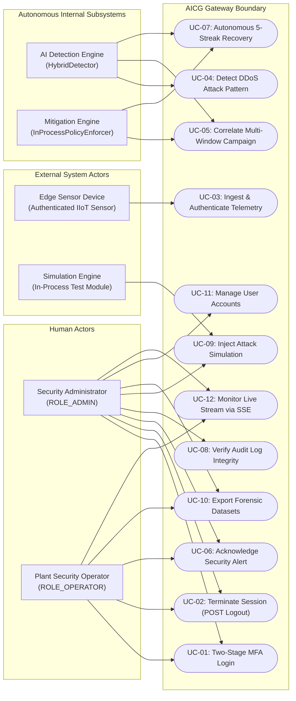
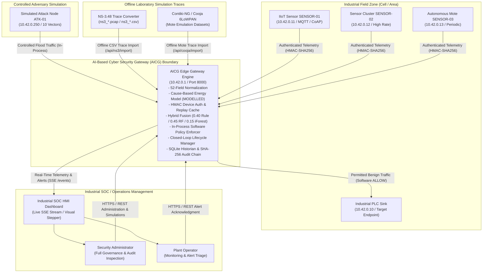
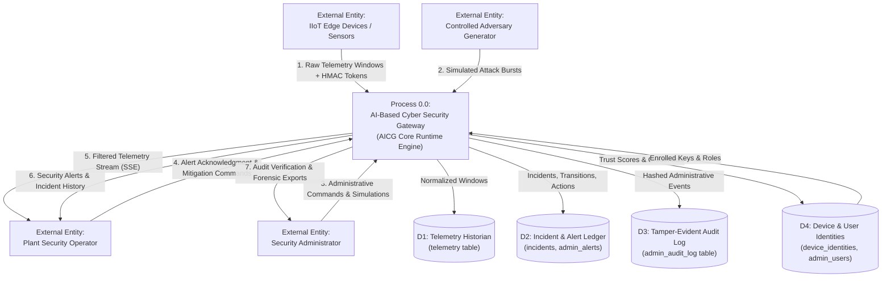
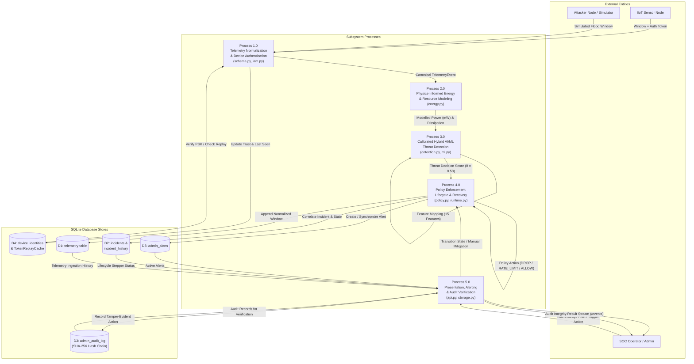
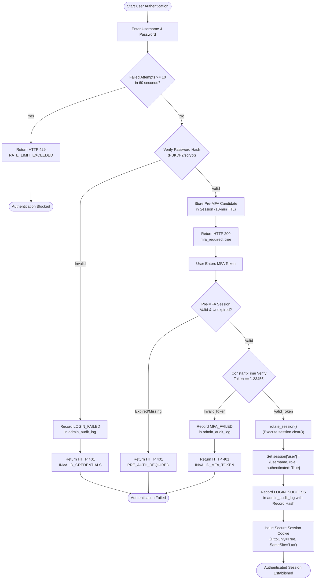
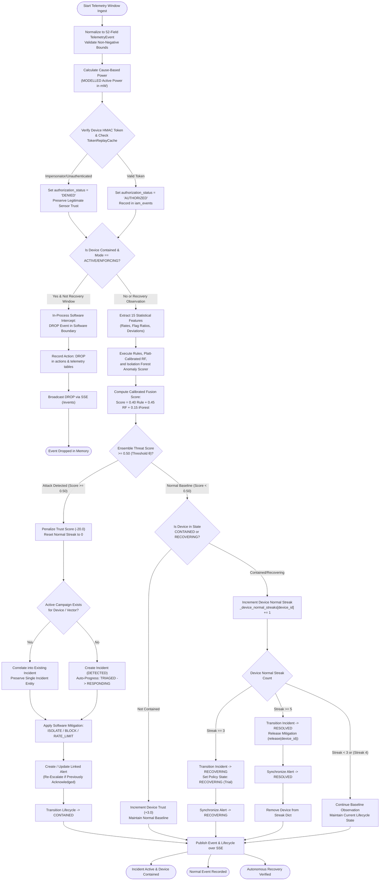
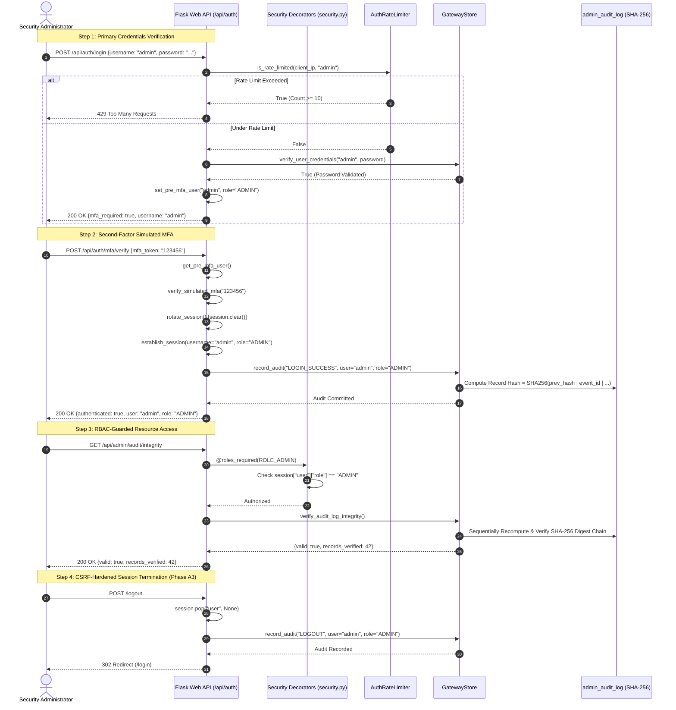
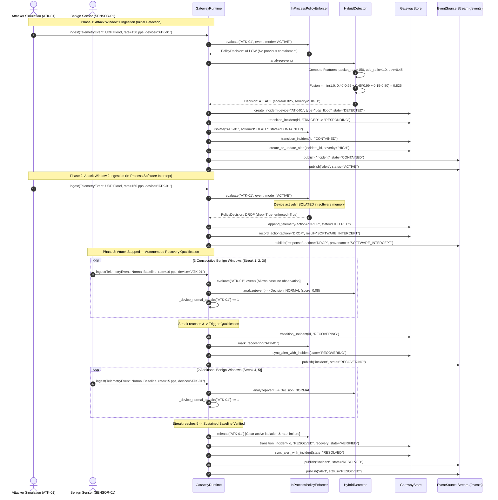
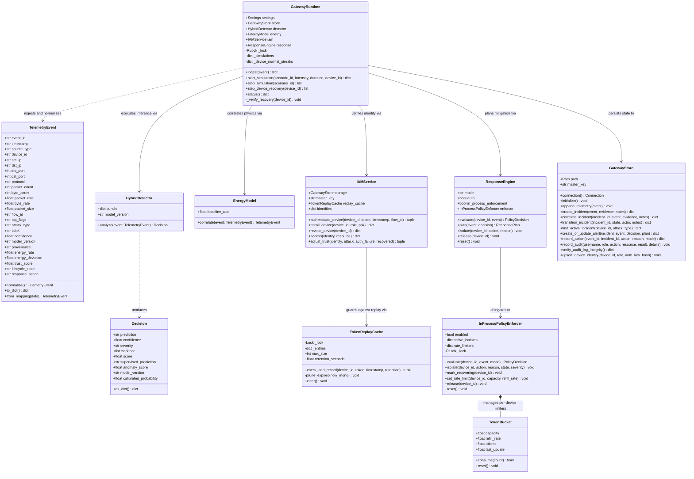
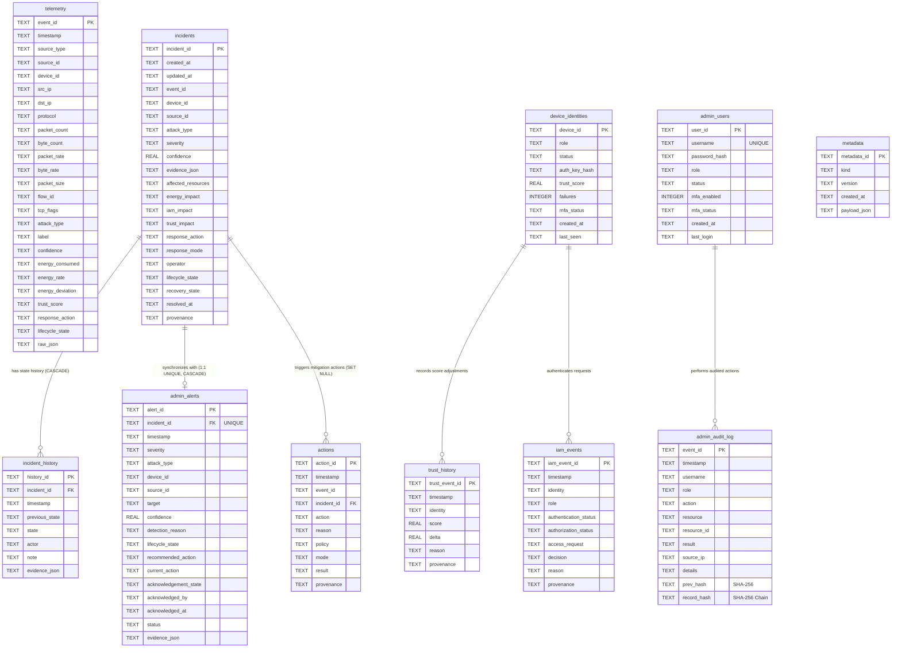

# AICG Software Requirements Specification (SRS)
## System Models & Diagram Source Definitions

**Project Title:** AI-Based Cyber Security Gateway for Industry 4.0  
**Project Identifier / Abbreviation:** AICG / Aegis Gateway  
**Document Code:** AICG-SRS-DIAGRAM-SOURCE-V1  
**Project Group:** Group G15  
**Repository Branch:** `feat/phase23-security-ml-hardening`  
**Current Baseline Tag:** `v2.10.0` (Commit `de23b4c`)  
**Audit Reference:** `reports/srs/phase_srs01_technical_content_audit_plan.md`  

---

### Overview & Visual Modeling Standards

This document provides the authoritative Mermaid diagram source specifications for Chapter 7 (*System Models*) and Chapter 6 (*Use Case Requirements*) of the AICG Software Requirements Specification. Every diagram models the **actual repository implementation** as audited in `phase_srs01_technical_content_audit_plan.md`.

All entities, actors, data stores, states, and process names maintain 100% terminological consistency across all diagrams:
- **Actors:** `Security Administrator`, `Plant Security Operator`, `Edge Sensor Node`, `Detection Engine`, `Mitigation Engine`, `Simulation Console`.
- **States:** `DETECTED`, `TRIAGED`, `RESPONDING`, `CONTAINED`, `RECOVERING`, `RESOLVED`, `CLOSED`.
- **Data Stores:** The 11 normalized SQLite tables (`telemetry`, `incidents`, `incident_history`, `actions`, `iam_events`, `trust_history`, `metadata`, `admin_users`, `admin_alerts`, `admin_audit_log`, `device_identities`).
- **Core Modules:** `aegis_gateway.runtime`, `aegis_gateway.detection`, `aegis_gateway.policy`, `aegis_gateway.iam`, `aegis_gateway.energy`, `aegis_gateway.storage`, `aegis_gateway.api`.

---

## 1. Use Case Diagram

The Use Case Diagram visualizes interactions between human operators, edge sensors, internal subsystems, and administrative security functions.



---

## 2. System Context Diagram

The System Context Diagram defines the operational boundary of the AICG Edge Gateway in relation to industrial field devices, the SCADA sink, SOC analysts, and offline laboratory simulators.



---

## 3. Data Flow Diagram Level 0 (Context Level DFD)

The DFD Level 0 diagram represents the gateway as a single high-level software transformation process (`0.0`), identifying data flows between external entities and persistent storage.



---

## 4. Data Flow Diagram Level 1 (Detailed Subsystem Decomposition)

The DFD Level 1 diagram decomposes the gateway into five core functional sub-processes, mapping the exact internal data flow through each transformation stage.



---

## 5. Activity Diagram

### Activity Flow 1: Two-Stage MFA Authentication & Session Rotation
Visualizes the login workflow enforcing credential validation, brute-force rate limiting, simulated MFA verification, session rotation, and audit recording.



---

### Activity Flow 2: Telemetry Ingest, In-Process Mitigation & Autonomous 5-Streak Recovery
Visualizes telemetry processing from ingestion through detection, in-process software drops, incident campaign correlation, and autonomous multi-window recovery.



---

## 6. Sequence Diagram

### Sequence 1: Two-Stage MFA Login, RBAC Authorization & Audit Integrity Verification
Visualizes message exchanges between human clients, API controllers, security decorators, rate limiters, storage engines, and the SHA-256 hash ledger.



---

### Sequence 2: Multi-Window DDoS Detection, Software Mitigation & Autonomous Recovery
Visualizes multi-window traffic ingestion, ensemble model fusion, in-process software drops, incident correlation, alert deduplication, and 5-streak recovery.



---

## 7. Class Diagram

The UML Class Diagram models the core Python classes, dataclasses, methods, and relationships implemented in the `aegis_gateway` package.



---

## 8. Entity-Relationship (ER) Diagram

The Entity-Relationship Diagram defines the complete logical database schema implemented in `aegis_gateway/storage.py` across all 11 normalized SQLite tables, including foreign keys, cardinalities, and constraints.



---

## 9. Deployment Diagram (Laboratory User-Space Sandbox)

### 9.1 Architecture and Node Classification Narrative
The Deployment Diagram models the physical and logical runtime environment of the AICG Edge Gateway in its **current laboratory verification state**. To maintain absolute academic honesty, this diagram explicitly models the system as executing entirely inside an unprivileged user-space Linux environment on an x86_64 host workstation. It does **not** depict or assert physical hardware deployments (e.g., DIN-rail PLCs, hardware current sensors, or physical edge routers), which remain designated for future scope.

The deployment topology categorizes nodes into four distinct operational classifications:
1. **Actual Software / Runtime Node (`GatewayProcess`):** The core `aegis_gateway` daemon running as an unprivileged user-space Linux process (Python 3.14.x). It hosts the Flask WSGI server (port 8000), REST API handlers, the Server-Sent Events (`/events`) streaming engine, the `EnergyModel` physics engine, `IAMService` with in-memory `TokenReplayCache`, the Platt-calibrated `HybridDetector`, and the `InProcessPolicyEnforcer`.
2. **Simulation / Test Node (`SimEnvironment`):** In-process synthetic generator threads executing within the same Python process (`aegis_gateway/scenarios.py`), generating background benign baseline traffic (14–18 pps) and 10 controlled DDoS/anomaly attack profiles. Additionally, offline trace ingestion adapters parse discrete-event simulation datasets from NS-3.48 (`ns-allinone-3.48/ns-3.48/scratch/`), Contiki-NG / Cooja 6LoWPAN mote logs (`/home/kali/contiki-ng/examples/ai_edge_iiot/data/`), and raw PCAP captures without transmitting live physical packets.
3. **Persistent Storage Node (`StorageArtifacts`):** Local filesystem storage hosting the single-file SQLite 3 relational database (`data/aegis_gateway.sqlite3`) running under Write-Ahead Logging (`WAL`) mode with 11 normalized tables and the SHA-256 forward-chained ledger, alongside serialized Scikit-learn joblib model bundles (`models/hybrid_detector.joblib` and `models/realistic_detector_v1.joblib`).
4. **Operator Interface Node (`ClientNode`):** A modern HTML5/ES6+ web browser (Chromium / Firefox) executing on the local workstation or adjacent LAN client, rendering the responsive dark-mode industrial SOC HMI (`/`), real-time SVG network topology, 7-stage incident stepper, and the red-team Attacker Simulation Console (`/attacker`).

> [!CAUTION]
> **Defensive Academic Laboratory Boundary:**  
> All edge sensors (`SENSOR-01` to `SENSOR-03`), industrial sink targets (`PLC-SINK`), and adversary nodes (`ATK-01`) execute as software-modeled entities in memory. The gateway performs in-process software drops (`SOFTWARE_INTERCEPT`) and does not manipulate host Linux routing tables or kernel firewall filters (`iptables`, `nftables`).

### 9.2 Mermaid Deployment Diagram Specification

```mermaid
flowchart TD
    subgraph HostNode ["Node: Linux Workstation Execution Environment (x86_64 OS / User-Space Sandbox)"]
        
        subgraph GatewayProcess ["Software Node: aegis_gateway Daemon Process (Python 3.14 / User Space)"]
            APIService["Flask Web & API Service<br/>(:8000 / HTTP / JSON)"]
            SSEService["EventSource SSE Streaming Engine<br/>(/events / text/event-stream)"]
            RuntimeCoord["GatewayRuntime Coordinator<br/>(1-Second Window Loop)"]
            EnergyEngine["EnergyModel<br/>(Cause-Based Physics Formulas)"]
            IAMService["IAMService & TokenReplayCache<br/>(HMAC-SHA256 & 300s Sliding Cache)"]
            HybridDetectorNode["HybridDetector Engine<br/>(0.40 Rule + 0.45 RF + 0.15 iForest)"]
            PolicyEnforcerNode["InProcessPolicyEnforcer<br/>(Token Bucket & Software Drops)"]
        end

        subgraph StorageNode ["Persistent Storage Node: Local Linux Filesystem"]
            SQLiteFile[("SQLite 3 Database File<br/>(data/aegis_gateway.sqlite3)<br/>WAL Mode / 11 Tables / SHA-256 Ledger")]
            ModelFiles["Machine Learning Artifacts<br/>(models/hybrid_detector.joblib<br/>models/realistic_detector_v1.joblib)"]
        end

        subgraph SimNode ["Simulation & Trace Node: In-Process & Offline Generators"]
            AttackThreads["In-Process Attack Simulation Threads<br/>(10 Attack Profiles in scenarios.py)"]
            BaselineThread["Quiescent Baseline Daemon Thread<br/>(14-18 pps / 55 mW Normal Rhythm)"]
            TraceFiles["Offline Trace Storage & Adapters<br/>- NS-3.48 CSV/PCAP Traces<br/>- Cooja 6LoWPAN Mote Logs<br/>- PCAP Window Replayer"]
        end

        subgraph ClientNode ["Operator Interface Node: Modern Web Browser Client"]
            SOCHMI["Industrial SOC Dashboard<br/>(dashboard/templates/index.html)<br/>- Real-Time SVG Network Map<br/>- 7-Stage Incident Lifecycle Stepper<br/>- Detection Pipeline Card 5"]
            AttackerHMI["Attacker Simulation Console<br/>(dashboard/templates/attacker.html)<br/>- Red-Team Scenario Cockpit"]
        end
    end

    %% Internal Communication & Dependencies
    AttackThreads -->|"In-Memory Synthetic Windows"| RuntimeCoord
    BaselineThread -->|"Quiescent Background Windows"| RuntimeCoord
    TraceFiles -->|"POST /api/ns3/import & /cooja/import"| APIService

    APIService <--> RuntimeCoord
    SSEService <--> RuntimeCoord
    RuntimeCoord --> EnergyEngine
    RuntimeCoord --> IAMService
    RuntimeCoord --> HybridDetectorNode
    RuntimeCoord --> PolicyEnforcerNode

    RuntimeCoord <-->|"Read / Write (WAL Mode Pragmas)"| SQLiteFile
    HybridDetectorNode <-->|"joblib.load() / Deserialized Model"| ModelFiles

    SOCHMI <-->|"HTTP / REST API (Port 8000)"| APIService
    SOCHMI <--"Persistent SSE Push Stream (/events)"-- SSEService
    AttackerHMI <-->|"POST /api/simulations/start"| APIService
```

