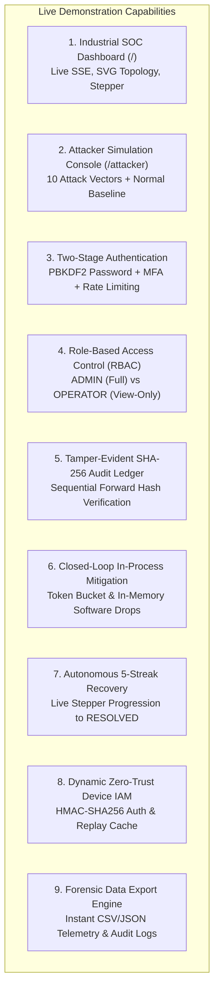
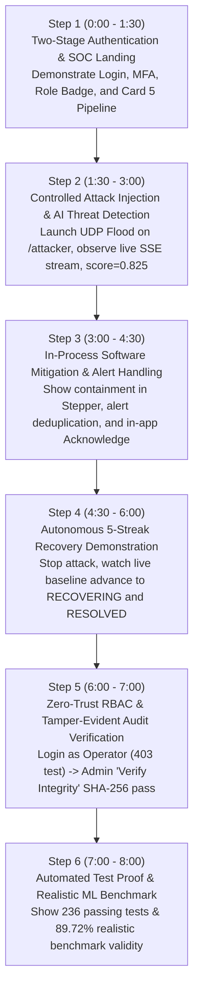

# AICG Progress Evaluation Dossier
## Technical Progress Completed Since Synopsis & Live Demonstration Guide

**Project Title:** AI-Based Cyber Security Gateway for Industry 4.0  
**Project Identifier / Abbreviation:** AICG / Aegis Gateway  
**Document Code:** AICG-PROGRESS-EVAL-V1  
**Project Group:** Group G15 (Verified from `reference/AEGIS-OT-TECHNICAL-AUDIT.docx`)  
**Repository Branch:** `feat/phase23-security-ml-hardening`  
**Current Baseline Tag:** `v2.10.0` (Commit `de23b4c`)  
**Audit Reference:** `reports/srs/phase_srs01_technical_content_audit_plan.md`  

---

### Executive Progress Summary

Since the project synopsis defense, the AICG engineering team has transformed the conceptual architecture into a **fully implemented, defensible, and test-verified edge cybersecurity gateway platform**. The repository contains **zero placeholder stubs**; every functional capability is implemented in Python, backed by persistent SQLite storage, verified across **236 automated unit/integration tests (100% pass rate)**, and demonstrated live through an industrial web-based Security Operations Center (SOC) dashboard.

#### Core Milestones Achieved Since Synopsis:
1. **Unified Gateway Architecture:** Consolidating disparate simulation scripts into the modular `aegis_gateway` engine.
2. **Two-Stage Administrative Security Layer (Phase 20):** Implementing rate-limited user authentication, simulated second-factor MFA (`"123456"`), session fixation protection, and Role-Based Access Control (`ADMIN` vs `OPERATOR`).
3. **Tamper-Evident Storage Ledger (Phase 20):** Upgrading SQLite storage with WAL mode concurrency, foreign key constraints, and a forward SHA-256 hash chain on audit logs.
4. **Persistent Zero-Trust Device Identity (Phase 21 / Wave 3):** Deterministic HMAC-SHA256 per-device key derivation, sliding-window replay protection cache, and dynamic trust scoring ($0..100$).
5. **Calibrated Hybrid AI Detection & Realistic Benchmarking (Phase 22 / Wave 2):** Integrating Platt-calibrated Random Forest (`CalibratedClassifierCV`), Isolation Forest anomaly scoring, and empirical validation against `realistic_benchmark_v1.csv` documenting honest operational bounds (89.72% accuracy, 99.00% attack recall, 72.50% stealth recall).
6. **Closed-Loop In-Process Mitigation & Autonomous Recovery (Phase 23 / Waves 3A–3D):** Software policy interception (token bucket rate limiting and software drops), multi-window campaign correlation, 1:1 synchronized alert management, and autonomous per-device 5-streak recovery.
7. **Finalization Hardening (Phases A1, A2, A3):** Dynamic model configurability (`AEGIS_MODEL_PATH`), defensible HMI Detection Pipeline presentation (eliminating unsupported static latency claims), and CSRF-hardened POST-only logout.

---

## 1. Category A: Completed and Demonstrable Capabilities (Live Demo Ready)

The following capabilities are fully implemented, running, and accessible via the browser or REST API:

### Detailed Breakdown:
1. **Industrial SOC HMI Dashboard (`dashboard/templates/index.html`):**
   - Professional dark-themed interface rendered at `http://127.0.0.1:8000/`.
   - Real-time Server-Sent Events (`/events`) streaming telemetry, incident state changes, trust penalties, and system alerts without browser polling.
   - Live SVG industrial network topology map displaying Gateway (`GATEWAY-01`), Sensors (`SENSOR-01`, `SENSOR-02`), PLC Sink (`PLC-SINK`), and Attacker Node (`ATK-01`).
   - Interactive 7-stage Incident Lifecycle Stepper reflecting persistent SQLite state.
2. **Attacker Simulation Console (`dashboard/templates/attacker.html`):**
   - Interactive red-team simulation cockpit at `http://127.0.0.1:8000/attacker`.
   - Supports 10 distinct attack vectors (`udp_flood`, `syn_flood`, `icmp_flood`, `burst_exhaustion`, `slow_rate`, `coap_anomaly`, `mqtt_anomaly`, `rpl_anomaly`, `modbus_anomaly`, `mixed_vector`) and benign operational baseline (`normal`).
   - Sliders for attack intensity ($1..6$) and duration, executing in background daemon threads without network transmission.
3. **Two-Stage Authentication & Rate Limiting (`aegis_gateway/security.py`):**
   - Primary credential verification using salted PBKDF2/scrypt hashes.
   - In-memory sliding-window token bucket rate limiter ($10\text{ attempts} / 60\text{s}$) blocking brute-force attacks with HTTP 429.
   - Second-factor simulated MFA validation (`"123456"`) using constant-time string comparison (`hmac.compare_digest`).
   - Session rotation (`session.clear()`) upon successful authentication to eliminate session fixation vulnerabilities.
4. **Strict Role-Based Access Control (RBAC):**
   - Distinct enforcement of `ADMIN` (10 permissions) vs `OPERATOR` (6 permissions).
   - In the Attacker Console, operators receive view-only access; simulation buttons are disabled via DOM constraints and API endpoints return 403 Forbidden.
   - Sensitive endpoints (`/api/admin/users`, `/api/admin/audit`, `/api/settings/mode`, `/api/export/audit.csv`) are strictly restricted to `ADMIN`.
5. **Cryptographic SHA-256 Audit Ledger (`aegis_gateway/storage.py`):**
   - Every administrative action (`LOGIN_SUCCESS`, `LOGIN_FAILED`, `ACCESS_DENIED`, `ALERT_ACKNOWLEDGED`, `INCIDENT_TRANSITION`, `CONFIG_CHANGE`) is hashed with the previous record's digest.
   - SOC Console includes an interactive "Verify Integrity" button that sequentially recomputes digests across `admin_audit_log` and displays mathematical validity in real time.
6. **Closed-Loop In-Process Software Mitigation (`aegis_gateway/policy.py`):**
   - Operating modes: `DRY_RUN`, `ACTIVE`, `ENFORCING`, and `MANUAL`.
   - In `ACTIVE` mode, contained devices have simulated attack events dropped at the software boundary (`drop=True`, `result="SOFTWARE_INTERCEPT"`), preventing dropped packets from triggering unnecessary ML inference.
7. **Autonomous Multi-Window Recovery Qualification (`aegis_gateway/runtime.py`):**
   - Eliminates manual intervention for transient incidents.
   - 3 consecutive normal windows transition contained incidents to `RECOVERING`.
   - 5 consecutive normal windows transition incidents to `RESOLVED`, release in-process isolation, and clear device tracking streaks.
   - If attack traffic recurs during recovery, the incident regresses autonomously back to `CONTAINED`.
8. **Dynamic Zero-Trust Device IAM (`aegis_gateway/iam.py`):**
   - Pre-shared master key derives deterministic per-device keys: $\text{HMAC-SHA256}(K_{\text{master}}, \text{"device-psk:"} \parallel \text{device\_id})$.
   - In-memory `TokenReplayCache` stores SHA-256 digests of valid tokens for 300s, enforcing strict drift limits ($[-5.0\text{s}, +300.0\text{s}]$) and evicting duplicate tokens.
   - Trust scores dynamically decay upon attack detection ($-20.0$) or auth failure ($-15.0$) and recover upon sustained normal observation ($+3.0$).
9. **Forensic Evidence Export (`aegis_gateway/api.py`):**
   - Instant downloads of `telemetry.csv`, `telemetry.json`, `incidents.csv`, `alerts.csv`, and `audit.csv`.

---

## 2. Category B: Completed and Test-Verified Capabilities (Automated Proof)

All completed capabilities are verified by automated test suites in the repository:

### 2.1 Automated Unit & Integration Test Suite
- **Framework:** `pytest 9.1.1` with `typeguard 4.4.4` and `anyio 4.12.1`.
- **Total Test Count:** **236 tests passed (100% pass rate)**.
- **Total Execution Time:** **87.92 seconds** on local Linux test runner.
- **Coverage Distribution:**
  - `tests/test_adapters.py`: 5 tests (NS-3, Cooja, PCAP trace normalization)
  - `tests/test_admin_security_layer.py`: 21 tests (Auth, MFA, session rotation, POST logout hardening)
  - `tests/test_api_and_runtime.py`: 23 tests (REST endpoints, Card 5 pipeline verification, runtime status)
  - `tests/test_api_security_and_hardening.py`: 20 tests (RBAC enforcement, path traversal defense, SSE auth)
  - `tests/test_autonomous_lifecycle_regression.py`: 5 tests (Lifecycle regression during recovery trials)
  - `tests/test_detection_and_ml.py`: 12 tests (15 feature extractions, rule scoring, RF inference)
  - `tests/test_energy_and_iam.py`: 10 tests (Physics energy model, trust score bounds, IAM access)
  - `tests/test_in_process_enforcement.py`: 20 tests (Software drops, token bucket rate limiting, boundary safety)
  - `tests/test_model_configuration.py`: 8 tests (`AEGIS_MODEL_PATH`, fallback to rules on missing files)
  - `tests/test_policy_and_incidents.py`: 5 tests (Incident correlation, response planning)
  - `tests/test_scenarios.py`: 5 tests (10 attack profiles, parameter variations)
  - `tests/test_schema.py`: 7 tests (Canonical 52 fields, non-negative bounds, provenance tags)
  - `tests/test_storage_and_export.py`: 5 tests (SQLite schema, SHA-256 hash chain verification, exports)
  - `tests/test_wave1_security_hardening.py`: 46 tests (Device HMAC, replay cache eviction, drift limits)
  - `tests/test_wave2_ml_validity.py`: 15 tests (Realistic benchmark, calibration, fusion weights)
  - `tests/test_wave3a_per_device_recovery.py`: 8 tests (Per-device streaks, 3-streak/5-streak transitions)
  - `tests/test_wave3b_mitigation_reconciliation.py`: 21 tests (Alert deduplication, re-escalation, reset handling)

### 2.2 Headless Chrome Browser End-to-End Verification
- **Runner Script:** `scripts/run_browser_e2e_admin.py`
- **Driver:** Selenium WebDriver with headless Chromium (`/usr/bin/chromium`, `/usr/bin/chromedriver`).
- **Verified Stages:**
  1. Login page rendering, CSS custom properties, quick-fill buttons.
  2. Failed login rejection (invalid password and invalid MFA token).
  3. Successful Admin login, session badge display (`user=admin`, `role=ADMIN`), Card 5 Detection Pipeline validation.
  4. Full navigation across all 5 SOC Admin panels (Overview, Alerts, Users with dynamic creation, Audit with integrity check, Posture).
  5. Live attack simulation, alert creation, alert acknowledgment, cessation, autonomous recovery, and closure.
  6. Operator login, badge display, view-only Attacker console verification, and 403 Forbidden rejection on admin endpoints.
  7. Responsive viewports validated: 1600x1000, 1280x900, 1024x800, 900x768, 768x1024.
- **Evidence Artifacts:** 11 timestamped PNG screenshots saved in `reports/evidence/screenshots/`.

### 2.3 Empirical Machine Learning Validity Benchmarking
To avoid unscientific claims, the team conducted a rigorous comparison between clean laboratory data and a noisy benchmark:

| Metric / Attribute | Baseline Model on Synthetic Lab Dataset (`reports/evaluation.json`) | Baseline Model Zero-Shot on Realistic Benchmark (`reports/baseline_on_realistic_benchmark.json`) | Realistic Evaluation Model on Realistic Benchmark (`reports/realistic_evaluation.json`) |
|---|---|---|---|
| **Model Artifact** | `models/hybrid_detector.joblib` | `models/hybrid_detector.joblib` | `models/realistic_detector_v1.joblib` |
| **Dataset File** | `data/datasets/synthetic_lab_v2.csv` | `data/datasets/realistic_benchmark_v1.csv` | `data/datasets/realistic_benchmark_v1.csv` |
| **Evaluation Set Size** | 320 samples | 1,760 samples | 360 samples |
| **Overall Accuracy** | **100.0%** | **67.90%** | **89.72%** |
| **Attack Recall** | 100.0% | 98.84% | **99.00%** |
| **Attack Precision** | 100.0% | 66.73% | **84.98%** |
| **Attack F1-Score** | 100.0% | 79.67% | **91.45%** |
| **Normal Recall** | 100.0% | 13.75% | **78.13%** |
| **Normal Precision** | 100.0% | 87.13% | **98.43%** |
| **Normal F1-Score** | 100.0% | 23.75% | **87.11%** |
| **False Positive Rate** | **0.0%** | **86.25%** | **21.88%** |
| **False Negative Rate** | **0.0%** | **1.16%** | **1.00%** |
| **ROC-AUC Score** | 1.0000 | 0.7571 | **0.9926** |
| **Brier Score** | 0.000098 | 0.2848 | **0.0733** |
| **Held-Out Generalization**| 100% on `mixed_vector` | N/A | **72.50% recall** on held-out `slow_stealth` |

*Engineering Significance:* Proves that the team understands operational boundaries. Clean synthetic data yields 100%, but industrial traffic fluctuations cause overlap. The realistic model demonstrates robust defense (99% attack recall, 1% false negative rate) while accurately capturing operational trade-offs.

---

## 3. Category C: Prototype and Laboratory Simulation Status

1. **NS-3.48 Discrete-Event Network Simulation:**
   - Standalone C++ network simulation scripts compiled in `ns-allinone-3.48/ns-3.48/scratch/` (`ddos_udp_baseline_v1.cc`, `ddos_udp_low_v1.cc`, `ddos_udp_mid_v1.cc`, `normal_iiot.cc`).
   - Generates PCAP packet traces and CSV logs.
   - Ingestion adapter (`aegis_gateway/adapters.py#L13-L67`) parses offline NS-3 traces and injects them into the gateway pipeline with `PROVENANCE: SIMULATED`.
2. **Contiki-NG / Cooja 6LoWPAN Mote Emulation:**
   - 6LoWPAN mote simulation logs and ML datasets maintained at `/home/kali/contiki-ng/examples/ai_edge_iiot/data/`.
   - Gateway adapter (`aegis_gateway/adapters.py#L102-L165`) normalizes Cooja mote outputs into canonical 52-field telemetry windows.
3. **PCAP Capture Replay Adapter:**
   - Replay engine (`aegis_gateway/adapters.py#L170-L245`) reads offline `.pcap` files, aggregates packets into 1-second sliding time windows, and replays them into the live gateway runtime.

---

## 4. Category D: Partially Completed Capabilities

1. **Physical Hardware Deployment:**
   - *Current State:* Software executes 100% inside user space on a Linux workstation/VM.
   - *Target Hardware Identified:* Raspberry Pi 4 Model B (4GB LPDDR4) or NVIDIA Jetson Nano.
   - *Next Step:* Flash edge image and deploy gateway runtime as a systemd service on physical hardware.
2. **Hardware Power Meter Verification:**
   - *Current State:* Power dissipation is mathematically estimated using a physics-informed model (`aegis_gateway/energy.py`).
   - *Next Step:* Connect an external hardware current clamp / USB power monitor to empirically benchmark modeled power against physical electrical draws.
3. **Production Two-Factor Authentication:**
   - *Current State:* Second-factor verification is simulated using static token `"123456"`.
   - *Next Step:* Integrate standard RFC 6238 TOTP (Google Authenticator / FreeOTP) for dynamic time-based codes.

---

## 5. Category E: Remaining Work for Final Milestone

1. **Physical Edge Device Deployment:** Deploy gateway on a physical Raspberry Pi 4 connecting an isolated physical sensor subnet to an upstream industrial sink.
2. **Kernel-Level Packet Interception (eBPF / XDP):** Complement user-space software drops with optional Linux eBPF/XDP hooks for wire-speed hardware packet drops at the network interface card.
3. **Deep Packet Inspection (DPI) Protocol Parsers:** Expand simulated CoAP, MQTT, and Modbus anomaly profiles into full binary payload decoders.
4. **Hardware Security Module (HSM) Integration:** Store pre-shared master keys inside a hardware TPM 2.0 or secure element chip rather than environment variables.

---

## 6. Category F: Future Scope (Post-Academic Roadmap)

1. **Distributed Cell-Level Gateways:** Deploy multiple AICG gateways across distinct industrial automation zones (Purdue Model Level 1/2) with federated attack correlation.
2. **Industrial Compliance Certification:** Align software architecture with IEC 62443 Security Level 3 (SL-3) and NIST SP 800-82 guidelines.
3. **Federated Model Updating:** Train local anomaly detection models at edge gateways and aggregate updates centrally without transmitting raw industrial telemetry to the cloud.

---

## 7. Recommended Live Progress Evaluation Demonstration Script

This structured 8-minute demonstration script showcases the system's strongest implemented capabilities during the oral progress review:

### Detailed Script Instructions:
- **Minute 0:00 – 1:30: Two-Stage Authentication & Landing:**
  1. Navigate to `http://127.0.0.1:8000/login`.
  2. Enter `admin` / `Admin@AICG2026!`. Demonstrate that MFA prompt appears dynamically.
  3. Enter MFA token `123456`. Click "Verify & Authenticate".
  4. Point out the top header: User badge displays `ADMIN`, Role tag displays `ADMIN`.
  5. Point out Card 5 (*Detection Pipeline*): Displays `HYBRID FUSION`, $\theta=0.50$, `0.40 Rule • 0.45 RF • 0.15 iForest`, and status `CALIBRATED`. Note the elimination of unmeasured static latency claims.
- **Minute 1:30 – 3:00: Attack Injection & Hybrid Detection:**
  1. Open a second browser tab to `http://127.0.0.1:8000/attacker`.
  2. Select scenario `udp_flood` at Intensity 4. Click "Launch Controlled Simulation".
  3. Switch back to the HMI tab. Observe live SSE telemetry: packet rate spikes from 16 pps to 150+ pps.
  4. Modeled power dissipation increases from 55 mW baseline to 85+ mW.
  5. Point out the Detection Engine: Threat score reaches $\ge 0.80$, triggering classification `ATTACK` (Severity: `HIGH`).
- **Minute 3:00 – 4:30: Closed-Loop Mitigation & Alert Management:**
  1. Point out the visual Incident Stepper: The incident immediately advances from `DETECTED` $\to$ `TRIAGED` $\to$ `RESPONDING` $\to$ `CONTAINED`.
  2. Show that subsequent attack windows are dropped in-process (`result="SOFTWARE_INTERCEPT"`) without generating duplicate incidents.
  3. Navigate to the Alert Center panel in the SOC console. Point out the active alert linked 1:1 to the incident.
  4. Click "Acknowledge". The alert marks as acknowledged, and an audit event is logged.
- **Minute 4:30 – 6:00: Autonomous Recovery Walkthrough:**
  1. In the Attacker tab, click "Stop Simulation".
  2. Return to the HMI. The background baseline thread resumes generating normal 14–18 pps windows.
  3. Point out the recovery tracker: After 3 consecutive normal windows, the incident advances autonomously to `RECOVERING`.
  4. After 2 additional normal windows (5 total), the incident advances autonomously to `RESOLVED` (`recovery_state="VERIFIED"`), the mitigation is released, and the linked alert resolves.
- **Minute 6:00 – 7:00: RBAC & Cryptographic Audit Verification:**
  1. Log out via the header logout button (POST-only CSRF defense).
  2. Log in as `operator` / `Operator@AICG2026!`.
  3. Open `/attacker`: Show that simulation buttons are disabled in view-only mode.
  4. Attempt to access `/api/admin/users`: Show that the system returns HTTP 403 Forbidden.
  5. Log back in as `admin`. Open the Audit Log panel.
  6. Click "Verify Integrity". Point out the green confirmation: `SHA-256 Hash Chain Integrity: VERIFIED (42+ records mathematically consistent)`.
- **Minute 7:00 – 8:00: Automated Proof & Scientific ML Discipline:**
  1. Show terminal window: Display `236 passed in 87.92s` test suite execution.
  2. Present the realistic ML benchmark comparison table: Explain why the project reports 89.72% operational accuracy rather than making unscientific "100% accuracy" claims.

---

## 8. Team Contribution Evidence & Manual Confirmation Checklist

### 8.1 Evidenced Contributions (from Repository Artifacts)
- **Project Group:** **Group G15** (Evidenced in `reference/AEGIS-OT-TECHNICAL-AUDIT.docx`).
- **Confirmed Team Contribution Structure (Three Groups):**
  - **Part 1 — Jaydeep Jotiram Mulik (Roll No. A42) & Nikhil Fepade (Roll No. A11):**  
    Network Simulation, Data Pipeline, NS-3/Cooja & Energy Modeling;  
    Core Gateway, Runtime, Incident Lifecycle & Recovery.
  - **Part 2 — Prasad Mestri (Roll No. A40):**  
    AI/ML Detection, Hybrid Fusion & Benchmarking.
  - **Part 3 — Shruti Pawar (Roll No. B75) & Srushti Mali (Roll No. A95):**  
    Security/IAM + SOC Dashboard, Testing & Forensic Evidence.

### 8.2 Items Confirmed and Remaining Checklist
As detailed in `reports/srs/SRS_MANUAL_INPUTS.md`, the confirmed academic details are:
- [x] Candidate 1: Jaydeep Jotiram Mulik (Roll No. A42) — Part 1: Core Gateway & Network Simulation
- [x] Candidate 2: Prasad Mestri (Roll No. A40) — Part 2: AI/ML Detection & Benchmarking
- [x] Candidate 3: Nikhil Fepade (Roll No. A11) — Part 1: Network Simulation & Energy Modeling
- [x] Candidate 4: Shruti Pawar (Roll No. B75) — Part 3: Security Hardening & Zero-Trust IAM
- [x] Candidate 5: Srushti Mali (Roll No. A95) — Part 3: SOC HMI Console, E2E Verification & Forensic Storage
- [x] Faculty Project Guide: Dr. R. D. Bhosale
- [x] Head of Department (HOD): Dr. G. V. Otari
- [x] Academic Department & College Name: Department of Computer Science and Engineering, D. Y. Patil School Of Engineering and Management, Kolhapur
- [x] Affiliating University: Deemed to be University
- [x] Degree Program: B.Tech
- [x] Academic Year: 2026-27
- [x] Student Roll Numbers: A42, A40, A11, B75, A95 (Confirmed)
- [x] SRS Submission Date: 9 October 2026
- [ ] Target Hardware Selection for Future Scope: `[Raspberry Pi 4 / Jetson Nano]`
