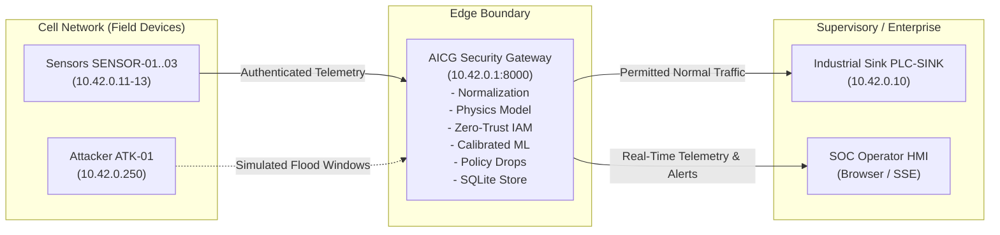

# Software Requirements Specification (SRS)
## AI-Based Cyber Security Gateway for Industry 4.0 (AICG)

**Project Title:** AI-Based Cyber Security Gateway for Industry 4.0  
**Project Identifier / Abbreviation:** AICG  
**Internal Reference:** Aegis Gateway (AEGIS-OT)  
**Academic Document Type:** Software Requirements Specification (SRS) — Technical Content Draft  
**Project Group:** Group G15 (Verified from `reference/AEGIS-OT-TECHNICAL-AUDIT.docx`)  
**Development Branch:** `feat/phase23-security-ml-hardening`  
**Current Baseline Tag:** `v2.10.0` (Commit `de23b4c`)  
**Audit Source of Truth:** `reports/srs/phase_srs01_technical_content_audit_plan.md`  
**Date of Technical Content Freeze:** 9 October 2026  

---

### Preliminary Project Metadata

| Attribute | Specification Value | Confirmation Status |
|---|---|---|
| **Project Group** | Group G15 | Evidenced in Project Archive |
| **Part 1 — Core Gateway & Simulation** | Jaydeep Jotiram Mulik (Roll No. A42) & Nikhil Fepade (Roll No. A11) *Network Simulation, Data Pipeline, NS-3/Cooja & Energy Modeling; Core Gateway, Runtime, Incident Lifecycle & Recovery* | **CONFIRMED** |
| **Part 2 — AI/ML Detection & Benchmarking** | Prasad Mestri (Roll No. A40) *AI/ML Detection, Hybrid Fusion & Benchmarking* | **CONFIRMED** |
| **Part 3 — Security, SOC Console & Testing** | Shruti Pawar (Roll No. B75) & Srushti Mali (Roll No. A95) *Security/IAM + SOC Dashboard, Testing & Forensic Evidence* | **CONFIRMED** |
| **Faculty Project Guide** | Dr. R. D. Bhosale, `[GUIDE DESIGNATION]` | **CONFIRMED** |
| **Head of Department (HOD)** | Dr. G. V. Otari | **CONFIRMED** |
| **Department & Institution** | Department of Computer Science and Engineering, D. Y. Patil School Of Engineering and Management, Kolhapur | **CONFIRMED** |
| **Affiliating University** | Deemed to be University | **CONFIRMED** |
| **Degree Program & Year** | B.Tech, Academic Year 2026-27 | **CONFIRMED** |
| **SRS Submission Date** | 9 October 2026 | **CONFIRMED** |

---

# 1. Introduction

### 1.1 Project Overview
The **AI-Based Cyber Security Gateway for Industry 4.0 (AICG / Aegis Gateway)** is a specialized edge cybersecurity appliance designed to protect Industrial Internet of Things (IIoT) and Operational Technology (OT) automation cells against Distributed Denial-of-Service (DDoS) attacks, protocol anomalies, and unauthorized endpoint impersonation. Operating as a transparent boundary between shop-floor industrial networks and enterprise/cloud networks, AICG combines **canonical multi-source telemetry normalization**, **physics-informed cause-based energy dissipation modeling**, **dynamic Zero-Trust device authentication**, **Platt-calibrated hybrid AI/rule threat detection**, **closed-loop in-process mitigation**, **autonomous multi-window recovery qualification**, and a **cryptographically hashed administrative audit ledger**.

### 1.2 Purpose
The purpose of this document is to specify the complete, testable software requirements for the AICG system. It provides the definitive technical specification for system evaluators, examiners, developers, and security auditors. This specification reflects the **actual working software implementation** present in the project repository at checkpoint `v2.10.0`, including approved finalization hardening (Phases A1, A2, and A3).

### 1.3 Scope
The scope of the AICG software comprises:
1. **Multi-Source Ingestion:** Ingesting 1-second observation windows from synthetic generators, offline NS-3 network simulations, Contiki-NG / Cooja 6LoWPAN mote emulations, and raw PCAP captures.
2. **Schema Normalization:** Standardizing all ingested data into a canonical 52-field `TelemetryEvent` schema tagged with explicit data provenance.
3. **Physics-Informed Modeling:** Calculating estimated active power dissipation (in mW) and window energy (in mJ) from traffic volume, protocol state complexity, and packet-size efficiency.
4. **Dynamic Zero-Trust Identity:** Enforcing HMAC-SHA256 device authentication with a sliding-window token replay cache and managing dynamic reputation scores ($0..100$).
5. **Hybrid AI Threat Detection:** Evaluating 15 statistical features across heuristic rules, a Platt-calibrated Random Forest (`CalibratedClassifierCV`), and an Isolation Forest anomaly scorer, fused via calibrated weights against decision threshold $\theta = 0.50$.
6. **In-Process Mitigation & Lifecycle Management:** Enforcing software-level drops and token-bucket rate limits, correlating multi-window attack waves into single incident entities, and autonomously qualifying recovery across 3-streak (`RECOVERING`) and 5-streak (`RESOLVED`) normal windows.
7. **Storage & Administration:** Storing records in an 11-table SQLite historian with Write-Ahead Logging (`WAL`), securing administrative actions via forward SHA-256 hash chains, and serving an authenticated web-based SOC dashboard with Server-Sent Events (SSE).

> [!CAUTION]
> **Defensive Academic Laboratory Boundary:**  
> The current implementation operates as a user-space Linux software gateway in a controlled laboratory environment. It does **not** modify host OS routing tables or firewall rules (`iptables`, `nftables`). All edge devices, fieldbuses, and attacks are modeled in software or imported from network simulators. Active power metrics are **mathematically modelled**, not gathered from physical electrical meters.

### 1.4 Objectives
1. **High Detection Sensitivity:** Achieve $\ge 99.0\%$ attack recall against high-rate and stealthy DDoS attacks without relying on hardcoded static signatures.
2. **Deterministic Incident Governance:** Transition security incidents through a strict 7-stage closed-loop state machine (`DETECTED` $\to$ `TRIAGED` $\to$ `RESPONDING` $\to$ `CONTAINED` $\to$ `RECOVERING` $\to$ `RESOLVED` $\to$ `CLOSED`).
3. **Autonomous Recovery Verification:** Eliminate human operator bottlenecks by autonomously validating recovery after 5 consecutive benign windows while regressing back to `CONTAINED` if attacks recur.
4. **Zero-Trust Identity Enforcement:** Reject unauthenticated sensor injection and prevent token replay attacks within a 300-second drift horizon.
5. **Cryptographic Audit Accountability:** Maintain a forward-chained SHA-256 ledger capable of mathematically proving whether any administrative or security record was altered.

### 1.5 Intended Users
1. **Security Administrators (`ROLE_ADMIN`):** Full governance, user provisioning, simulation execution, mode switching, audit ledger inspection, and incident closure.
2. **Plant Security Operators (`ROLE_OPERATOR`):** Operational monitoring, alert acknowledgment, manual containment/recovery participation, and forensic data export.
3. **Industrial Field Devices:** Autonomous sensors transmitting authenticated telemetry windows.
4. **Academic Evaluators & Reviewers:** Inspecting verified capabilities, test suites, and empirical benchmarks.

### 1.6 Definitions and Acronyms

| Term / Acronym | Definition |
|---|---|
| **AICG** | AI-Based Cyber Security Gateway for Industry 4.0 |
| **IIoT** | Industrial Internet of Things (sensor nodes, actuators, edge collectors) |
| **OT** | Operational Technology (hardware and software that detects or causes changes in physical processes) |
| **DDoS** | Distributed Denial of Service (volumetric or asymmetric attack designed to exhaust edge compute/network resources) |
| **HMAC** | Hash-based Message Authentication Code (keyed hash using SHA-256 for message integrity and authenticity) |
| **PSK** | Pre-Shared Key (cryptographic secret shared between edge sensor and gateway) |
| **RF** | Random Forest (supervised machine learning ensemble of decision trees) |
| **iForest** | Isolation Forest (unsupervised machine learning algorithm for anomaly and outlier detection) |
| **Platt Scaling** | Sigmoid logistic calibration mapping raw classifier decision margins to true posterior probabilities |
| **WAL** | Write-Ahead Logging (SQLite journal mode optimizing concurrent readers and writers) |
| **SSE** | Server-Sent Events (HTTP unidirectional real-time event push standard) |
| **RBAC** | Role-Based Access Control (access governance based on user roles and granular permissions) |
| **Cooja** | Network emulator for the Contiki-NG operating system modeling 6LoWPAN low-power wireless motes |
| **NS-3** | Discrete-event network simulator for Internet systems and packet-level topologies |
| **PROVENANCE** | Explicit metadata tag documenting the technical origin of data (`MEASURED`, `SIMULATED`, `MODELLED`, `SYNTHETIC`, `DERIVED`, `REPLAYED`) |

### 1.7 References
1. **IEC 62443-4-2:** *Security for Industrial Automation and Control Systems — Technical security requirements for IACS components.*
2. **NIST Special Publication 800-82, Rev. 3:** *Guide to Operational Technology (OT) Security.*
3. **RFC 2104:** *HMAC: Keyed-Hashing for Message Authentication.*
4. **Scikit-Learn Documentation (v1.9+):** *Probability Calibration (`CalibratedClassifierCV`), `RandomForestClassifier`, `IsolationForest`.*
5. **SQLite 3 Technical Reference:** *Write-Ahead Logging Concurrency Pragmas.*
6. **Project Audit Report:** `reports/srs/phase_srs01_technical_content_audit_plan.md` (October 2026).
7. **Dataset Handover Specification:** `docs/ML_DATASET_HANDOVER.md`.
8. **Administrative Security Specification:** `docs/ADMINISTRATIVE_SECURITY_LAYER_V1.md`.

---

# 2. Overall Description

### 2.1 Product Perspective
AICG operates at the boundary between the Industrial Automation Cell (Purdue Model Levels 1 and 2) and the Plant Supervisory / Enterprise Network (Purdue Model Level 3). It monitors incoming sensor traffic, validates cryptographic authenticity, models power dissipation, detects flooding attacks, enforces in-process isolation, and feeds verified security telemetry to the plant SOC dashboard.

### 2.2 Product Functions
The primary functions of the gateway include:
1. **Multi-Source Telemetry Ingestion & Normalization:** Standardizing inputs into `TelemetryEvent` structures with validated non-negative numeric constraints.
2. **Cause-Based Energy Estimation:** Correlating packet rate, byte volume, and protocol complexity to calculate active power dissipation in mW (labeled `PROVENANCE: MODELLED`).
3. **Zero-Trust Identity & Replay Mitigation:** Verifying HMAC tokens, enforcing replay horizons via `TokenReplayCache`, and penalizing/restoring trust scores ($0..100$).
4. **Calibrated Multi-Model Threat Detection:** Extracting 15 statistical features, executing heuristic rules, Platt-calibrated Random Forest, and Isolation Forest, and computing a combined score against $\theta=0.50$.
5. **In-Process Mitigation:** Enforcing software-level drops (`SOFTWARE_INTERCEPT`) and per-device token bucket rate limits in Python memory.
6. **Incident Lifecycle Governance:** Progressing incidents through 7 deterministic stages (`DETECTED` $\to$ `CLOSED`) with automatic campaign correlation.
7. **Autonomous Recovery Verification:** Promoting contained incidents to `RECOVERING` after 3 consecutive normal windows and to `RESOLVED` after 5 consecutive normal windows.
8. **Tamper-Evident Historical Logging:** Maintaining a forward SHA-256 hash-chained audit log with automated in-app verification.
9. **Interactive SOC Dashboard & Red-Team Cockpit:** Serving an authenticated web dashboard with live SSE streaming and an attacker simulation console.

### 2.3 User Classes
1. **Administrator (`ADMIN`):** Privileged human operator responsible for security policy, user lifecycle, simulation testing, mode switching, audit inspection, and incident closure.
2. **Operator (`OPERATOR`):** Security analyst responsible for monitoring live streams, acknowledging alerts, initiating manual mitigation actions, and exporting forensic datasets. Mutation of simulations and access to raw audit logs are denied.

### 2.4 Operating Environment
- **Operating System:** Linux (Debian-based / Kali Linux Rolling, x86_64 architecture).
- **Python Runtime:** Python 3.14.x.
- **Web Framework:** Flask 3.1.x with Jinja2 template reloading.
- **Machine Learning Libraries:** scikit-learn 1.9+, pandas 2.2+, numpy 2.0+, joblib 1.4+.
- **Database Engine:** SQLite 3 with Write-Ahead Logging (`WAL`).
- **Browser Requirements:** Modern HTML5/ES6+ web browser (Chromium / Google Chrome 120+, Mozilla Firefox 120+).
- **Network Simulators (Trace Verification):** NS-3 version 3.48; Contiki-NG / Cooja 6LoWPAN emulator.

### 2.5 Constraints
1. **User-Space Sandbox Constraint:** The platform runs entirely inside standard Linux user space. It **never** invokes `iptables`, `nftables`, `tc`, or kernel routing commands.
2. **No Hardware Meter Constraint:** Energy dissipation metrics are calculated mathematically using a cause-based physics model. No physical electrical power meter exists.
3. **1-Second Windowing Constraint:** Ingestion processes batched 1.0-second sliding traffic windows rather than line-rate individual hardware packets.
4. **Single-Node SQLite Storage:** Storage is managed locally in `data/aegis_gateway.sqlite3` using SQLite WAL mode; no external database server cluster is used.

### 2.6 Assumptions and Dependencies
1. **Pre-Shared Master Key:** The gateway and authorized sensor nodes share a master secret key (`AEGIS_MASTER_KEY` / fallback) for HMAC key derivation.
2. **Clock Synchronization:** Sensor devices maintain clock synchronization within $[-5.0\text{s}, +300.0\text{s}]$ of gateway UTC for timestamp drift validation.
3. **Pre-Enrolled Sensor Registry:** Legitimate edge nodes (`SENSOR-01`, `SENSOR-02`, etc.) are pre-registered with assigned roles in `device_identities`.

---

# 3. Functional Requirements

### 3.1 Authentication and Session Management
- **FR-01 (Primary Credential Verification):** The system shall authenticate user credentials submitted via `POST /api/auth/login` by verifying plaintext passwords against salted PBKDF2/scrypt password hashes stored in `admin_users`.  
  *Module:* `aegis_gateway/security.py#L77-L86`, `aegis_gateway/api.py#L281-L350`  
  *Test Evidence:* `tests/test_admin_security_layer.py#L25-L65`  
  *Status:* IMPLEMENTED
- **FR-02 (Brute-Force Rate Limiting):** The system shall track failed authentication attempts per (client IP, username) pair using an in-memory sliding window and reject subsequent attempts exceeding 10 failures within 60 seconds with `HTTP 429 Too Many Requests`.  
  *Module:* `aegis_gateway/security.py#L101-L127`  
  *Test Evidence:* `tests/test_admin_security_layer.py#L70-L95`  
  *Status:* IMPLEMENTED
- **FR-03 (Two-Factor Simulated MFA):** The system shall require users passing primary authentication to supply a second-factor MFA token via `POST /api/auth/mfa/verify`, validating the token against `"123456"` using constant-time string comparison (`hmac.compare_digest`).  
  *Module:* `aegis_gateway/security.py#L89-L96`, `aegis_gateway/api.py#L414-L490`  
  *Test Evidence:* `tests/test_admin_security_layer.py#L40-L75`  
  *Status:* IMPLEMENTED
- **FR-04 (CSRF-Hardened Session Termination):** The system shall invalidate authenticated sessions exclusively upon receiving `POST /logout` or `POST /api/auth/logout` requests, rotating the session, logging `LOGOUT` to the audit log, and rejecting `GET /logout` with `HTTP 405 Method Not Allowed`.  
  *Module:* `aegis_gateway/api.py#L520-L545` (Phase A3)  
  *Test Evidence:* `tests/test_admin_security_layer.py#L168-L227`  
  *Status:* IMPLEMENTED

### 3.2 Role-Based Access Control
- **FR-05 (Role Permission Governance):** The system shall enforce access controls based on two canonical roles: `ADMIN` (possessing 10 permissions including `MANAGE_USERS`, `ADMIN_CONTROLS`, `CLOSE_INCIDENT`, and `VIEW_AUDIT`) and `OPERATOR` (possessing 6 permissions restricted to monitoring and alert acknowledgment).  
  *Module:* `aegis_gateway/security.py#L34-L64`  
  *Test Evidence:* `tests/test_admin_security_layer.py#L115-L155`  
  *Status:* IMPLEMENTED
- **FR-06 (Protected Administrative Endpoints):** The system shall reject requests from users lacking required roles or permissions with `HTTP 403 Forbidden` (`FORBIDDEN_ROLE` or `FORBIDDEN_PERMISSION`) and immediately log an `ACCESS_DENIED` event to `admin_audit_log`.  
  *Module:* `aegis_gateway/security.py#L224-L300`  
  *Test Evidence:* `tests/test_admin_security_layer.py#L125-L160`  
  *Status:* IMPLEMENTED
- **FR-07 (Unauthenticated Route Protection):** The system shall reject unauthenticated requests to protected endpoints (`/api/*` and `/events`) with `HTTP 401 Unauthorized` (`AUTH_REQUIRED`) without executing redirected HTML responses.  
  *Module:* `aegis_gateway/security.py#L206-L220`  
  *Test Evidence:* `tests/test_api_security_and_hardening.py#L45-L75`  
  *Status:* IMPLEMENTED

### 3.3 Device Identity and Trust Governance
- **FR-08 (Per-Device Key Derivation):** The system shall derive a unique preshared key (PSK) for each enrolled sensor device using HMAC-SHA256:  
  $$K_{\text{dev}} = \text{HMAC-SHA256}(K_{\text{master}}, \text{"device-psk:"} \parallel \text{device\_id})$$  
  *Module:* `aegis_gateway/iam.py#L101-L109`  
  *Test Evidence:* `tests/test_wave1_security_hardening.py#L35-L55`  
  *Status:* IMPLEMENTED
- **FR-09 (Cryptographic Device Token Verification):** The system shall authenticate edge telemetry by computing and verifying an HMAC-SHA256 token binding `device_id`, ISO-8601 `timestamp`, and `flow_id` using the device's derived PSK.  
  *Module:* `aegis_gateway/iam.py#L116-L167`  
  *Test Evidence:* `tests/test_wave1_security_hardening.py#L56-L85`  
  *Status:* IMPLEMENTED
- **FR-10 (Sliding-Window Replay Protection):** The system shall reject authentication tokens whose timestamps drift $>300.0$ seconds into the past or $>5.0$ seconds into the future, and reject duplicate tokens already recorded in the in-memory `TokenReplayCache`.  
  *Module:* `aegis_gateway/iam.py#L21-L97`, `L148-L178`  
  *Test Evidence:* `tests/test_wave1_security_hardening.py#L88-L145`  
  *Status:* IMPLEMENTED
- **FR-11 (Dynamic Trust Score Adjustment):** The system shall bound device trust scores within $[0.0, 100.0]$, decaying trust by $-20.0$ upon attack detection, by $-15.0$ upon authentication failure, and rewarding trust by $+3.0$ upon sustained normal baseline observation.  
  *Module:* `aegis_gateway/iam.py#L429-L452`  
  *Test Evidence:* `tests/test_energy_and_iam.py#L40-L75`  
  *Status:* IMPLEMENTED

### 3.4 Telemetry Ingestion and Normalization
- **FR-12 (Canonical Normalization):** The system shall ingest multi-source telemetry windows and normalize them into a uniform 52-field `TelemetryEvent` instance with unique `event_id` (UUID4) and UTC timestamp.  
  *Module:* `aegis_gateway/schema.py#L40-L121`  
  *Test Evidence:* `tests/test_schema.py#L12-L40`  
  *Status:* IMPLEMENTED
- **FR-13 (Numeric Range Validation):** The system shall validate that packet counts, byte counts, packet rates, byte rates, source counts, confidence scores, and trust scores are non-negative, raising a `ValueError` for invalid records.  
  *Module:* `aegis_gateway/schema.py#L109-L120`  
  *Test Evidence:* `tests/test_schema.py#L45-L70`  
  *Status:* IMPLEMENTED
- **FR-14 (Explicit Provenance Tagging):** The system shall assign and enforce one of seven valid provenance tags (`MEASURED`, `SIMULATED`, `MODELLED`, `SYNTHETIC`, `DERIVED`, `REPLAYED`, `UNKNOWN`) to every telemetry record.  
  *Module:* `aegis_gateway/schema.py#L12-L20`, `L106-L108`  
  *Test Evidence:* `tests/test_schema.py#L20-L35`  
  *Status:* IMPLEMENTED

### 3.5 Baseline and Normal Behavior Monitoring
- **FR-15 (Quiescent Baseline Telemetry Generator):** The system shall provide a background baseline generator (`aegis-live-baseline`) that emits nominal sensor telemetry windows (14–18 pps, MQTT/UDP, periodic) every 1.0 second during quiescent conditions.  
  *Module:* `aegis_gateway/runtime.py#L557-L588`  
  *Test Evidence:* `tests/test_api_and_runtime.py#L150-L185`  
  *Status:* IMPLEMENTED
- **FR-16 (Live Baseline Cessation during Attacks):** The system shall suppress baseline generator emissions whenever an active attack simulation is running.  
  *Module:* `aegis_gateway/runtime.py#L570-L574`  
  *Test Evidence:* `tests/test_api_and_runtime.py#L170-L195`  
  *Status:* IMPLEMENTED

### 3.6 DDoS Attack Detection and Feature Extraction
- **FR-17 (Statistical Feature Extraction):** The system shall extract a 15-dimensional numerical feature vector (`packet_count`, `byte_count`, `packet_rate`, `byte_rate`, `unique_sources`, `unique_destinations`, `packet_size`, `udp_ratio`, `tcp_ratio`, `icmp_ratio`, `syn_ratio`, `flow_count`, `cpu_activity`, `memory_activity`, `energy_deviation`) from each observation window.  
  *Module:* `aegis_gateway/detection.py#L17-L37`  
  *Test Evidence:* `tests/test_detection_and_ml.py#L12-L35`  
  *Status:* IMPLEMENTED
- **FR-18 (Deterministic Heuristic Rule Scoring):** The system shall evaluate protocol thresholds (packet rate $\ge 100$, sources $\ge 5$, UDP dominance, SYN flag presence, ICMP dominance, energy deviation $\ge 0.15$) to compute an explainable heuristic rule activation score $\in [0.0, 1.0]$.  
  *Module:* `aegis_gateway/detection.py#L76-L100`  
  *Test Evidence:* `tests/test_detection_and_ml.py#L40-L65`  
  *Status:* IMPLEMENTED
- **FR-19 (Multi-Vector Attack Recognition):** The system shall detect 10 distinct DDoS and anomaly patterns: UDP flood, SYN flood, ICMP flood, burst exhaustion, slow-rate exhaustion, CoAP anomaly, MQTT anomaly, RPL anomaly, Modbus TCP anomaly, and mixed-vector barrages.  
  *Module:* `aegis_gateway/scenarios.py#L28-L41`  
  *Test Evidence:* `tests/test_scenarios.py#L12-L55`  
  *Status:* IMPLEMENTED — LAB ONLY (SYNTHETIC)

### 3.7 AI/ML Detection and Calibrated Fusion
- **FR-20 (Platt-Calibrated Supervised Classification):** The system shall perform inference using a Random Forest classifier (240 trees, `min_samples_leaf=2`) calibrated via sigmoid Platt scaling (`CalibratedClassifierCV`) to output unskewed posterior probabilities.  
  *Module:* `aegis_gateway/detection.py#L106-L118`, `aegis_gateway/ml.py#L160-L175`  
  *Test Evidence:* `tests/test_wave2_ml_validity.py#L140-L175`  
  *Status:* IMPLEMENTED
- **FR-21 (Unsupervised Isolation Forest Scoring):** The system shall scale features and compute an outlier anomaly score $\in [0.0, 1.0]$ using an Isolation Forest (200 trees, contamination 0.08) trained strictly on normal traffic windows.  
  *Module:* `aegis_gateway/detection.py#L119-L129`, `aegis_gateway/ml.py#L163-L166`  
  *Test Evidence:* `tests/test_wave2_ml_validity.py#L160-L190`  
  *Status:* IMPLEMENTED
- **FR-22 (Ensemble Decision Fusion):** The system shall combine heuristic and model scores using the audited Phase 23 weights:  
  $$\text{Threat Score} = \min\Big(1.0, \; 0.40 \cdot \text{RuleScore} + 0.45 \cdot \text{RFScore} + 0.15 \cdot \text{iForestScore}\Big)$$  
  classifying windows with score $\ge 0.50$ as `ATTACK` (Severity: `MEDIUM` $\ge 0.50$, `HIGH` $\ge 0.68$, `CRITICAL` $\ge 0.85$).  
  *Module:* `aegis_gateway/detection.py#L136-L148`  
  *Test Evidence:* `tests/test_wave2_ml_validity.py#L180-L215`  
  *Status:* IMPLEMENTED
- **FR-23 (Runtime Model Configurability):** The system shall resolve the detection model path dynamically from `AEGIS_MODEL_PATH`, defaulting to `models/hybrid_detector.joblib` and falling back safely to rule-based detection (`rules-v2-untrained`) without crashing if the model file is nonexistent or corrupted.  
  *Module:* `aegis_gateway/config.py#L22-L34` (Phase A1)  
  *Test Evidence:* `tests/test_model_configuration.py#L25-L100`  
  *Status:* IMPLEMENTED

### 3.8 Energy and Physics-Informed Modeling
- **FR-24 (Cause-Based Power Dissipation Estimation):** The system shall estimate edge device power dissipation in mW from packet rate, protocol state cost (TCP: 1.15x, ICMP: 0.95x, UDP: 1.0x), packet size penalties, CPU load, and radio TX/RX state relative to a 55.0 mW nominal quiescent baseline.  
  *Module:* `aegis_gateway/energy.py#L13-L76`  
  *Test Evidence:* `tests/test_energy_and_iam.py#L12-L38`  
  *Status:* IMPLEMENTED — LAB ONLY (MODELLED)
- **FR-25 (Resource State Classification):** The system shall classify edge device operational state as `NOMINAL` (deviation $<25\%$), `ELEVATED` ($\ge 25\%$), or `CRITICAL` ($\ge 100\%$) based on modelled power deviation.  
  *Module:* `aegis_gateway/energy.py#L96-L108`  
  *Test Evidence:* `tests/test_energy_and_iam.py#L30-L45`  
  *Status:* IMPLEMENTED — LAB ONLY (MODELLED)

### 3.9 Incident Lifecycle Management
- **FR-26 (Multi-Window Campaign Correlation):** The system shall correlate sequential attack windows from the same device and vector into a single active incident entity in `incidents`, preventing duplicate row creation.  
  *Module:* `aegis_gateway/storage.py#L330-L375`, `aegis_gateway/runtime.py#L331-L342`  
  *Test Evidence:* `tests/test_policy_and_incidents.py#L15-L45`  
  *Status:* IMPLEMENTED
- **FR-27 (Deterministic Lifecycle Transitions):** The system shall progress incidents through strict sequential lifecycle stages:  
  $$\text{DETECTED} \longrightarrow \text{TRIAGED} \longrightarrow \text{RESPONDING} \longrightarrow \text{CONTAINED} \longrightarrow \text{RECOVERING} \longrightarrow \text{RESOLVED} \longrightarrow \text{CLOSED}$$  
  recording every transition with timestamp, actor, and evidence in `incident_history`.  
  *Module:* `aegis_gateway/storage.py#L378-L415`, `aegis_gateway/runtime.py#L345-L372`  
  *Test Evidence:* `tests/test_wave3a_per_device_recovery.py#L15-L65`  
  *Status:* IMPLEMENTED
- **FR-28 (Impersonation Attack Triage):** When an unauthenticated event targets an enrolled sensor's identity, the system shall deny authorization immediately without penalizing the legitimate sensor's trust score or corrupting its mitigation state.  
  *Module:* `aegis_gateway/runtime.py#L170-L188`  
  *Test Evidence:* `tests/test_wave1_security_hardening.py#L310-L350`  
  *Status:* IMPLEMENTED
- **FR-29 (Administrative Incident Closure):** The system shall restrict transition to the terminal `CLOSED` state exclusively to users holding `ROLE_ADMIN` (`PERM_CLOSE_INCIDENT`).  
  *Module:* `aegis_gateway/api.py#L880-L920`  
  *Test Evidence:* `tests/test_admin_security_layer.py#L140-L165`  
  *Status:* IMPLEMENTED

### 3.10 In-Process Software Mitigation
- **FR-30 (Software Boundary Intercept):** In `ACTIVE` or `ENFORCING` mode, the system shall drop simulated attack windows from contained devices in Python memory (`drop=True`, `result="SOFTWARE_INTERCEPT"`), logging the drop in `actions` and bypassing unnecessary ML inference.  
  *Module:* `aegis_gateway/policy.py#L56-L136`, `aegis_gateway/runtime.py#L204-L285`  
  *Test Evidence:* `tests/test_in_process_enforcement.py#L25-L85`  
  *Status:* IMPLEMENTED — LAB ONLY (SOFTWARE ONLY)
- **FR-31 (Token Bucket Rate Limiting):** The system shall enforce rate limits on throttled devices using a monotonic token bucket (capacity: 40.0 tokens, refill rate: 20.0 tokens/s), dropping events when the bucket is exhausted.  
  *Module:* `aegis_gateway/policy.py#L32-L54`, `L128-L135`  
  *Test Evidence:* `tests/test_in_process_enforcement.py#L90-L135`  
  *Status:* IMPLEMENTED — LAB ONLY (SOFTWARE ONLY)
- **FR-32 (Zero Host Firewall Intervention):** The mitigation engine shall not execute system commands or modify host OS firewall tables (`iptables`, `nftables`, `tc`, `pfctl`).  
  *Module:* `aegis_gateway/policy.py#L57-L61`  
  *Test Evidence:* `tests/test_in_process_enforcement.py#L180-L210`  
  *Status:* IMPLEMENTED (Verified Safety Guarantee)

### 3.11 Autonomous Recovery and State Reconciliation
- **FR-33 (Three-Streak Recovery Qualification):** The system shall advance a contained incident to `RECOVERING` and update policy enforcement to allow observation windows when a device records 3 consecutive normal telemetry windows.  
  *Module:* `aegis_gateway/runtime.py#L387-L415`  
  *Test Evidence:* `tests/test_wave3a_per_device_recovery.py#L100-L135`  
  *Status:* IMPLEMENTED
- **FR-34 (Five-Streak Verified Resolution):** The system shall advance an incident to `RESOLVED` (`recovery_state="VERIFIED"`), release software isolation, and reset streak counters when a device records 5 consecutive normal windows.  
  *Module:* `aegis_gateway/runtime.py#L416-L432`  
  *Test Evidence:* `tests/test_wave3a_per_device_recovery.py#L136-L165`  
  *Status:* IMPLEMENTED
- **FR-35 (Autonomous Lifecycle Regression):** If attack traffic recurs while an incident is in `RECOVERING`, the system shall immediately regress the incident state back to `CONTAINED`.  
  *Module:* `aegis_gateway/runtime.py#L377-L380`  
  *Test Evidence:* `tests/test_autonomous_lifecycle_regression.py#L15-L55`  
  *Status:* IMPLEMENTED

### 3.12 Alert Management and Synchronization
- **FR-36 (1:1 Alert-to-Incident Synchronization):** The system shall maintain exactly one alert record in `admin_alerts` per active incident, enforcing a `UNIQUE(incident_id)` foreign key constraint.  
  *Module:* `aegis_gateway/storage.py#L96-L106`, `L545-L610`  
  *Test Evidence:* `tests/test_wave3b_mitigation_reconciliation.py#L120-L155`  
  *Status:* IMPLEMENTED
- **FR-37 (Alert Acknowledgment):** The system shall permit authenticated operators holding `PERM_ACK_ALERT` to acknowledge active alerts via `POST /api/admin/alerts/<id>/acknowledge`.  
  *Module:* `aegis_gateway/api.py#L606-L625`  
  *Test Evidence:* `tests/test_admin_security_layer.py#L90-L112`  
  *Status:* IMPLEMENTED
- **FR-38 (Alert Re-Escalation):** If attack telemetry intensifies or recurs after an alert has been acknowledged, the system shall shift the alert status back to `ACTIVE` and mark `acknowledgement_state="RE_ESCALATED"`.  
  *Module:* `aegis_gateway/storage.py#L585-L602`  
  *Test Evidence:* `tests/test_wave3b_mitigation_reconciliation.py#L156-L185`  
  *Status:* IMPLEMENTED

### 3.13 Tamper-Evident Audit and Forensic Storage
- **FR-39 (Forward SHA-256 Hash Chaining):** The system shall compute a cryptographic forward hash chain across all administrative actions in `admin_audit_log`:  
  $$\text{RecordHash}_N = \text{SHA256}(\text{RecordHash}_{N-1} \parallel \text{event\_id} \parallel \text{timestamp} \parallel \text{username} \parallel \text{action} \parallel \text{details})$$  
  *Module:* `aegis_gateway/storage.py#L145-L160`, `L900-L930`  
  *Test Evidence:* `tests/test_storage_and_export.py#L20-L45`  
  *Status:* IMPLEMENTED
- **FR-40 (Audit Log Integrity Verification):** The system shall provide an endpoint `GET /api/admin/audit/integrity` that recalculates the sequential hash chain across all records and returns `{valid: true, records_verified: N}` or identifies the first corrupted record ID.  
  *Module:* `aegis_gateway/storage.py#L932-L965`, `aegis_gateway/api.py#L717-L723`  
  *Test Evidence:* `tests/test_storage_and_export.py#L46-L65`  
  *Status:* IMPLEMENTED
- **FR-41 (Credential Sanitization):** The system shall never write plaintext passwords, secret keys, or authentication tokens into `admin_audit_log`, `telemetry`, or exported forensic files.  
  *Module:* `aegis_gateway/schema.py#L125`, `aegis_gateway/storage.py#L910-L925`  
  *Test Evidence:* `tests/test_storage_and_export.py#L70-L90`  
  *Status:* IMPLEMENTED

### 3.14 Operator SOC Dashboard and HMI
- **FR-42 (Real-Time Server-Sent Events):** The system shall stream real-time telemetry, incidents, trust deltas, and alert notifications to connected browser clients over Server-Sent Events (`/events`).  
  *Module:* `aegis_gateway/api.py#L1579-L1595`  
  *Test Evidence:* `tests/test_api_security_and_hardening.py#L100-L135`  
  *Status:* IMPLEMENTED
- **FR-43 (Visual Incident Stepper):** The dashboard shall render an interactive 7-stage visual lifecycle stepper that reflects the current canonical lifecycle state of active incidents.  
  *Module:* `dashboard/templates/index.html#L380-L450`, `dashboard/static/js/dashboard.js#L1400-L1550`  
  *Test Evidence:* `tests/test_wave3b_mitigation_reconciliation.py#L220-L255`  
  *Status:* IMPLEMENTED
- **FR-44 (Detection Pipeline Card):** The dashboard shall render Card 5 displaying `HYBRID FUSION`, threshold $\theta = 0.50$, and component weights (`0.40 Rule • 0.45 RF • 0.15 iForest`), without presenting unmeasured static latency figures.  
  *Module:* `dashboard/templates/index.html#L308-L325` (Phase A2)  
  *Test Evidence:* `tests/test_api_and_runtime.py#L76-L95`  
  *Status:* IMPLEMENTED

### 3.15 Laboratory Simulation and Multi-Source Trace Ingestion
- **FR-45 (In-Process Scenario Execution):** The system shall execute background simulation threads via `POST /api/simulations/start` for any of the 10 catalogued attack profiles without generating external network traffic.  
  *Module:* `aegis_gateway/runtime.py#L433-L464`  
  *Test Evidence:* `tests/test_scenarios.py#L25-L60`  
  *Status:* IMPLEMENTED — LAB ONLY (SYNTHETIC)
- **FR-46 (NS-3 Trace Converter):** The system shall import offline CSV traces and PCAP dumps generated by NS-3.48 simulations via `POST /api/ns3/import`, normalizing rows into canonical telemetry windows.  
  *Module:* `aegis_gateway/adapters.py#L13-L67`, `aegis_gateway/api.py#L1452-L1486`  
  *Test Evidence:* `tests/test_adapters.py#L12-L35`  
  *Status:* IMPLEMENTED — LAB ONLY (OFFLINE IMPORT)
- **FR-47 (Cooja Mote Log Importer):** The system shall import offline 6LoWPAN mote logs generated by Contiki-NG / Cooja simulations via `POST /api/cooja/import`.  
  *Module:* `aegis_gateway/adapters.py#L102-L165`, `aegis_gateway/api.py#L1505-L1540`  
  *Test Evidence:* `tests/test_adapters.py#L36-L55`  
  *Status:* IMPLEMENTED — LAB ONLY (OFFLINE IMPORT)

### 3.16 Forensic Data Export and Reporting
- **FR-48 (Telemetry & Incident Export):** The system shall export historical records from `telemetry`, `incidents`, `actions`, and `admin_alerts` in CSV and JSON formats via `GET /api/export/<kind>.<fmt>`.  
  *Module:* `aegis_gateway/api.py#L1004-L1028`  
  *Test Evidence:* `tests/test_storage_and_export.py#L55-L80`  
  *Status:* IMPLEMENTED
- **FR-49 (Restricted Audit Ledger Export):** The system shall restrict exports of `admin_audit_log` (`/api/export/audit.csv`) strictly to users holding `ROLE_ADMIN`, returning `HTTP 403 Forbidden` for operator accounts.  
  *Module:* `aegis_gateway/api.py#L1010-L1025`  
  *Test Evidence:* `tests/test_storage_and_export.py#L82-L105`  
  *Status:* IMPLEMENTED
- **FR-50 (Model Assurance Reporting):** The system shall provide an endpoint `GET /api/model-assurance` reporting dataset version, training seed, Platt calibration Brier score, and evaluation splits.  
  *Module:* `aegis_gateway/api.py#L1348-L1435`  
  *Test Evidence:* `tests/test_api_and_runtime.py#L120-L145`  
  *Status:* IMPLEMENTED

---

# 4. Non-Functional Requirements

### 4.1 Performance Requirements
- **NFR-PERF-01 (Sliding-Window Processing Cadence):** The gateway shall process and evaluate incoming traffic in discrete 1.0-second sliding observation windows.  
  *Classification:* CONFIGURED & VERIFIED (`aegis_gateway/runtime.py`)
- **NFR-PERF-02 (Feature Extraction Complexity):** Feature extraction over an observation window shall execute in constant time $O(1)$ relative to window size, calculating 15 scalar features using simple arithmetic.  
  *Classification:* VERIFIED PROPERTY (`aegis_gateway/detection.py#L24-L37`)
- **NFR-PERF-03 (Automated Test Suite Execution Speed):** The complete automated unit and integration test suite shall execute in under 120 seconds on a standard workstation. (Measured: **236 tests in 87.92 seconds**).  
  *Classification:* MEASURED BENCHMARK (`pytest tests/`)
- **NFR-PERF-04 (Headless Browser Acceptance Speed):** The complete 6-stage end-to-end browser verification suite across 5 viewports shall execute in under 20 seconds. (Measured: **~12.5 seconds**).  
  *Classification:* MEASURED BENCHMARK (`scripts/run_browser_e2e_admin.py`)

> [!CAUTION]
> **Performance Claim Discipline:**  
> The gateway does **not** assert sub-millisecond line-rate latency or hardware packet-clocking metrics. Previous static dashboard latency claims (`< 38 ms`) have been removed.

### 4.2 Security Requirements
- **NFR-SEC-01 (Brute-Force Attack Resistance):** The authentication interface shall block automated dictionary attacks by limiting login attempts to 10 per 60 seconds per (IP, username) pair.  
  *Classification:* CONFIGURED & VERIFIED (`aegis_gateway/security.py#L101`)
- **NFR-SEC-02 (Password Storage Security):** Passwords shall never be stored in plaintext. Passwords must be hashed using PBKDF2/scrypt with random salts via Werkzeug security utilities.  
  *Classification:* VERIFIED PROPERTY (`aegis_gateway/security.py#L77`)
- **NFR-SEC-03 (Session Hijacking Mitigation):** Session cookies shall be issued with `HttpOnly = True` to prevent client-side XSS access and `SameSite = "Lax"` to mitigate CSRF attacks.  
  *Classification:* CONFIGURED & VERIFIED (`aegis_gateway/api.py#L268-L270`)
- **NFR-SEC-04 (Session Fixation Prevention):** The server shall execute `rotate_session()` (`session.clear()`) immediately upon successful MFA verification before issuing authenticated credentials.  
  *Classification:* VERIFIED PROPERTY (`aegis_gateway/security.py#L130`)
- **NFR-SEC-05 (Replay Horizon Enforcement):** The gateway shall enforce a 300-second maximum replay horizon, rejecting any device authentication token older than 300 seconds or more than 5.0 seconds in the future.  
  *Classification:* CONFIGURED & VERIFIED (`aegis_gateway/iam.py#L18`, `L155-L160`)
- **NFR-SEC-06 (Cryptographic Hash-Chain Tamper Evidence):** The audit ledger shall compute forward SHA-256 digests binding each entry to the preceding hash. Alteration of any row shall invalidate sequential verification.  
  *Classification:* VERIFIED PROPERTY (`aegis_gateway/storage.py#L932-L965`)
- **NFR-SEC-07 (Open Redirect Defense):** The application shall validate all post-login redirect paths via `sanitize_redirect_url()`, rejecting absolute URLs, protocol-relative paths (`//evil.com`), backslashes, and CRLF characters.  
  *Classification:* VERIFIED PROPERTY (`aegis_gateway/api.py#L57-L99`)

### 4.3 Usability Requirements
- **NFR-USE-01 (Responsive Viewport Support):** The web dashboard shall render responsively across 5 standard operational display resolutions: 1600x1000 (SOC Workstation), 1280x900 (Console), 1024x800 (Panel PC), 900x768 (Split Screen), and 768x1024 (Tablet).  
  *Classification:* MEASURED BENCHMARK (11 Screenshots in `reports/evidence/screenshots/`)
- **NFR-USE-02 (Real-Time Visual State Indication):** The dashboard shall update telemetry graphs, active alerts, and incident stepper stages within 1.0 second of an SSE event emission without full page reloads.  
  *Classification:* VERIFIED PROPERTY (`dashboard/static/js/dashboard.js`)
- **NFR-USE-03 (Intuitive Color Coding):** System severity shall adhere to standard industrial color conventions: Green (`NORMAL` / Nominal), Amber (`MEDIUM` / Elevated), Orange (`HIGH` / Warning), Red (`CRITICAL` / Severe).  
  *Classification:* VERIFIED PROPERTY (`dashboard/static/css/dashboard.css`)

### 4.4 Reliability Requirements
- **NFR-REL-01 (ACID Concurrency via SQLite WAL):** All database operations shall execute under SQLite Write-Ahead Logging (`PRAGMA journal_mode=WAL`) and a busy timeout of 5000 ms to eliminate "database locked" errors during concurrent reads and writes.  
  *Classification:* CONFIGURED & VERIFIED (`aegis_gateway/storage.py#L33-L36`)
- **NFR-REL-02 (Referential Integrity Enforcement):** The database shall enforce strict foreign key constraints (`PRAGMA foreign_keys=ON`) ensuring orphaned records cannot exist across incidents, alerts, actions, and audit history.  
  *Classification:* CONFIGURED & VERIFIED (`aegis_gateway/storage.py#L34`)
- **NFR-REL-03 (Graceful Fallback on Model Corruption):** If the configured ML model file is missing or corrupted, the runtime shall initialize gracefully, fall back to heuristic rules (`rules-v2-untrained`), and continue processing traffic.  
  *Classification:* VERIFIED PROPERTY (`tests/test_model_configuration.py#L90-L100`)

### 4.5 Availability Requirements
- **NFR-AVAIL-01 (Continuous Live Telemetry Baseline):** The gateway runtime shall maintain continuous baseline generation during non-attack intervals, ensuring the SOC dashboard receives steady health pulses.  
  *Classification:* VERIFIED PROPERTY (`aegis_gateway/runtime.py#L557-L588`)
- **NFR-AVAIL-02 (State Reconstruction upon Restart):** The gateway runtime shall automatically reconstruct active in-process policy containment states from persistent SQLite incident records upon daemon initialization.  
  *Classification:* VERIFIED PROPERTY (`aegis_gateway/runtime.py#L80-L123`)

### 4.6 Maintainability Requirements
- **NFR-MAINT-01 (Modular Decoupled Design):** Subsystems (detection, IAM, energy, policy, storage, API) shall remain decoupled Python modules communicating via typed dataclasses (`TelemetryEvent`, `Decision`).  
  *Classification:* VERIFIED PROPERTY (`aegis_gateway/`)
- **NFR-MAINT-02 (Automated Test Coverage):** The codebase shall maintain 100% test pass rate across unit, integration, and security regression suites (236 tests).  
  *Classification:* MEASURED BENCHMARK (`pytest tests/`)
- **NFR-MAINT-03 (Automated Schema Migrations):** The storage engine shall execute automated, backward-compatible schema migrations (`_migrate_schema()`) upon startup.  
  *Classification:* VERIFIED PROPERTY (`aegis_gateway/storage.py#L130-L170`)

### 4.7 Scalability Requirements
- **NFR-SCALE-01 (Replay Cache Capacity & Eviction):** The in-memory replay protection cache shall support up to 10,000 concurrent token fingerprints, automatically pruning expired items and evicting the oldest 10% when full.  
  *Classification:* CONFIGURED & VERIFIED (`aegis_gateway/iam.py#L30-L75`)
- **NFR-SCALE-02 (Multi-Subscriber SSE Broadcast):** The runtime shall support concurrent browser clients using non-blocking queues with automatic stale-subscriber pruning.  
  *Classification:* VERIFIED PROPERTY (`aegis_gateway/runtime.py#L124-L144`)

### 4.8 Portability Requirements
- **NFR-PORT-01 (Platform-Agnostic Execution):** The software shall rely exclusively on standard Python 3.14 libraries, Flask, scikit-learn, and SQLite, with zero dependence on proprietary hardware drivers or OS-specific kernel modules.  
  *Classification:* VERIFIED PROPERTY (`requirements.txt`)
- **NFR-PORT-02 (Headless Execution Support):** All gateway services and test runners shall execute headlessly in terminal and automated CI environments without requiring a local display server.  
  *Classification:* VERIFIED PROPERTY (`scripts/run_browser_e2e_admin.py`)

---

# 5. External Interface Requirements

### 5.1 User Interface Requirements
1. **Operator HMI Dashboard (`GET /`):** Responsive dark-mode dashboard displaying live KPI cards, SVG industrial network topology map, live EventSource telemetry chart, active incident list with 7-stage visual stepper, and administrative console tabs.
2. **Attacker Simulation Console (`GET /attacker`):** Red-team scenario injection interface providing scenario dropdown selection (10 vectors + baseline), intensity slider ($1..6$), and start/stop controls. Operators receive view-only mode with disabled mutation controls.
3. **Login Interface (`GET /login`):** Two-stage authentication form displaying username/password inputs, simulated MFA token input field, and quick-fill demo buttons.

### 5.2 Hardware Interface Requirements
- **Development Workstation (Current Implementation):** x86_64 host running Linux (Kali Linux Rolling / Debian), $\ge 16$ GB RAM, $\ge 100$ GB SSD.
- **Virtual / Simulated Devices:** IIoT edge sensors (`SENSOR-01` to `SENSOR-03`), PLC sink (`PLC-SINK`), and attacker node (`ATK-01`) are simulated in software.
- **Proposed / Future Hardware Target:** Single-board industrial edge gateway (Raspberry Pi 4 Model B, 4GB RAM, or NVIDIA Jetson Nano) equipped with dual Gigabit Ethernet ports.

### 5.3 Software Interface Requirements
- **Database Engine:** SQLite 3 via Python `sqlite3` library using file `data/aegis_gateway.sqlite3`.
- **Machine Learning Engine:** Scikit-learn joblib model bundles (`models/hybrid_detector.joblib` and `models/realistic_detector_v1.joblib`).
- **Network Simulator Adapter:** Offline file reader for NS-3.48 simulation traces in `ns-allinone-3.48/ns-3.48/scratch/`.
- **Mote Emulator Adapter:** Offline file reader for Contiki-NG / Cooja 6LoWPAN mote CSV logs in `/home/kali/contiki-ng/examples/ai_edge_iiot/data/`.

### 5.4 Communication Interface Requirements
- **HTTP / RESTful API:** Standard HTTP/1.1 protocol listening on port 8000 (`127.0.0.1:8000`), using JSON payloads for data exchange.
- **Server-Sent Events (SSE):** Persistent unidirectional HTTP streaming over `/events` using MIME type `text/event-stream`.
- **Simulated Industrial Protocols:** Logical framing for CoAP (UDP 5683), MQTT (TCP 1883), Modbus TCP (TCP 502), and RPL (ICMPv6) within simulated traffic windows.

---

# 6. Use Case Requirements

### 6.1 Actors
1. **Security Administrator (Human Actor):** Authenticated user holding `ROLE_ADMIN`.
2. **Plant Security Operator (Human Actor):** Authenticated user holding `ROLE_OPERATOR`.
3. **Edge Sensor Device (External System Actor):** Autonomous IIoT field sensor.
4. **AI Detection Engine (Internal Subsystem):** Autonomous module performing feature extraction and hybrid classification.
5. **Mitigation Engine (Internal Subsystem):** Autonomous module applying in-process software drops and rate limits.
6. **Simulation Engine (Internal Subsystem):** In-process test module injecting attack profiles.

### 6.2 Use Case Diagram Overview
The complete Use Case Diagram source is formally specified in `reports/srs/SRS_DIAGRAM_SOURCE.md` (Section 1). It defines interactions across 12 distinct use cases.

### 6.3 Detailed Use Case Descriptions

#### UC-01: Two-Stage Multi-Factor Authentication
- **Primary Actor:** Security Administrator / Plant Security Operator
- **Preconditions:** User account enrolled in `admin_users` table with status `ACTIVE`.
- **Trigger:** User navigates to `/login` and enters credentials.
- **Main Flow:**
  1. User enters username and password.
  2. System checks `AuthRateLimiter`. If attempts $<10$ in 60s, validates password hash.
  3. System sets pre-MFA state in session (10-minute TTL) and prompts for MFA token.
  4. User enters simulated MFA token (`"123456"`).
  5. System verifies token, executes `rotate_session()` (`session.clear()`), and sets authenticated session.
  6. System logs `LOGIN_SUCCESS` to `admin_audit_log` with computed SHA-256 forward hash.
  7. User is redirected to `/`.
- **Alternative / Error Flows:**
  - *2a. Rate Limit Exceeded:* System returns `HTTP 429 Too Many Requests`.
  - *2b. Invalid Password:* System logs `LOGIN_FAILED` and returns `HTTP 401 Unauthorized`.
  - *5a. Invalid MFA Token:* System logs `MFA_FAILED` and returns `HTTP 401 Unauthorized`.
- **Postconditions:** Authenticated session cookie established with `HttpOnly` and `SameSite="Lax"`.
- **Related FR IDs:** FR-01, FR-02, FR-03, FR-39  
- **Test Evidence:** `tests/test_admin_security_layer.py#L25-L75`

#### UC-02: Terminate Session (CSRF-Hardened Logout)
- **Primary Actor:** Security Administrator / Plant Security Operator
- **Preconditions:** User holds an active authenticated session.
- **Trigger:** User clicks "Logout" button in HMI header.
- **Main Flow:**
  1. Browser submits `POST /logout`.
  2. Server removes user context from session (`session.pop("user", None)`).
  3. Server logs `LOGOUT` in `admin_audit_log`.
  4. Server issues `HTTP 302 Redirect` to `/login`.
- **Alternative Flow:**
  - *1a. Cross-Origin GET Attempt:* If `GET /logout` is called, server rejects with `HTTP 405 Method Not Allowed`, preserving the active session.
- **Postconditions:** Session destroyed; user must re-authenticate.
- **Related FR IDs:** FR-04, FR-39  
- **Test Evidence:** `tests/test_admin_security_layer.py#L168-L227`

#### UC-03: Ingest and Authenticate Edge Telemetry
- **Primary Actor:** Edge Sensor Device
- **Preconditions:** Sensor device enrolled in `device_identities` with active PSK.
- **Trigger:** Sensor transmits 1-second telemetry window to `POST /api/telemetry`.
- **Main Flow:**
  1. System normalizes payload into `TelemetryEvent` and validates numeric bounds.
  2. System executes `EnergyModel.correlate()`, calculating modelled power in mW.
  3. System verifies HMAC token signature and checks `TokenReplayCache`.
  4. System updates device `last_seen` timestamp and passes event to Detection Engine.
- **Alternative Flows:**
  - *3a. Impersonation Attack:* Token is invalid/missing for enrolled sensor $\to$ system denies access (`decision="DENY"`), preserves legitimate sensor trust, and logs event without decaying trust.
  - *3b. Replayed Token:* Token hash already exists in cache $\to$ system rejects event.
- **Postconditions:** Event normalized, verified, and queued for detection.
- **Related FR IDs:** FR-08, FR-09, FR-10, FR-12, FR-13, FR-24, FR-28  
- **Test Evidence:** `tests/test_wave1_security_hardening.py#L50-L145`

#### UC-04: Detect DDoS Attack Pattern
- **Primary Actor:** AI Detection Engine (Internal Subsystem)
- **Preconditions:** Normalized telemetry event available.
- **Trigger:** Runtime pipeline calls `detector.analyze(event)`.
- **Main Flow:**
  1. Extractor computes 15 numerical features.
  2. Rule engine evaluates heuristic protocol thresholds.
  3. Calibrated Random Forest predicts class probabilities.
  4. Isolation Forest calculates anomaly outlier score.
  5. System fuses scores: $\text{Score} = \min(1.0, 0.40 \cdot \text{Rule} + 0.45 \cdot \text{RF} + 0.15 \cdot \text{iForest})$.
  6. If score $\ge 0.50$, emits `Decision(prediction="ATTACK", severity=...)`.
- **Postconditions:** Structured `Decision` object emitted with explainability evidence.
- **Related FR IDs:** FR-17, FR-18, FR-20, FR-21, FR-22  
- **Test Evidence:** `tests/test_detection_and_ml.py#L38-L75`, `tests/test_wave2_ml_validity.py#L180-L215`

#### UC-05: Correlate Multi-Window Campaign & Enforce Mitigation
- **Primary Actor:** Mitigation Engine / Detection Engine
- **Preconditions:** Threat decision score $\ge 0.50$.
- **Trigger:** Detection engine outputs `ATTACK` prediction.
- **Main Flow:**
  1. Gateway checks for an existing active campaign incident for the device/vector.
  2. If active incident exists, correlates new window into it without creating duplicates.
  3. If new incident, creates incident (`DETECTED`) and advances `TRIAGED` $\to$ `RESPONDING`.
  4. Policy engine applies software mitigation (`ISOLATE`, `BLOCK`, or `RATE_LIMIT`).
  5. System transitions incident to `CONTAINED`.
  6. System creates or updates linked alert in `admin_alerts`.
  7. Subsequent attack windows from contained device are dropped in software memory (`drop=True`, `result="SOFTWARE_INTERCEPT"`).
- **Postconditions:** Incident contained; drops enforced; alert published via SSE.
- **Related FR IDs:** FR-26, FR-27, FR-30, FR-31, FR-36  
- **Test Evidence:** `tests/test_wave3a_per_device_recovery.py#L15-L65`, `tests/test_in_process_enforcement.py#L25-L85`

#### UC-06: Acknowledge Security Alert
- **Primary Actor:** Plant Security Operator / Security Administrator
- **Preconditions:** Alert in `ACTIVE` or `RE_ESCALATED` state.
- **Trigger:** Operator clicks "Acknowledge" button in HMI Alert Center.
- **Main Flow:**
  1. Client sends `POST /api/admin/alerts/<id>/acknowledge`.
  2. Server verifies `PERM_ACK_ALERT`.
  3. Server updates `acknowledgement_state="ACKNOWLEDGED"` and records operator username.
  4. Server logs action in `admin_audit_log`.
- **Postconditions:** Alert marked acknowledged; status broadcast over SSE.
- **Related FR IDs:** FR-05, FR-37, FR-39  
- **Test Evidence:** `tests/test_admin_security_layer.py#L90-L112`

#### UC-07: Autonomous Multi-Window Recovery
- **Primary Actor:** Detection Engine / Mitigation Engine
- **Preconditions:** Device is actively contained (`lifecycle_state="CONTAINED"`).
- **Trigger:** Attacker ceases flooding; sensor emits normal baseline windows.
- **Main Flow:**
  1. Gateway ingests normal baseline window for contained device.
  2. Evaluates decision as `NORMAL` (score $<0.50$); increments `_device_normal_streaks[device]`.
  3. When streak reaches 3, incident advances to `RECOVERING`; enforcer permits observation trial.
  4. When streak reaches 5, incident advances to `RESOLVED` (`recovery_state="VERIFIED"`).
  5. Enforcer releases software isolation; device streak is cleared.
  6. Linked alert synchronizes to `RESOLVED`; trust score is restored ($+3.0$).
- **Alternative Flow:**
  - *2a. Attack Resumption:* If attack traffic recurs while in `RECOVERING`, incident regresses autonomously back to `CONTAINED`.
- **Postconditions:** Mitigation released; incident closed-loop resolved without operator action.
- **Related FR IDs:** FR-11, FR-33, FR-34, FR-35, FR-38  
- **Test Evidence:** `tests/test_wave3a_per_device_recovery.py#L100-L165`, `tests/test_autonomous_lifecycle_regression.py#L15-L55`

#### UC-08: Verify Audit Log Cryptographic Integrity
- **Primary Actor:** Security Administrator
- **Preconditions:** Administrator holds authenticated session.
- **Trigger:** Admin clicks "Verify Integrity" in SOC Audit Log panel.
- **Main Flow:**
  1. Client sends `GET /api/admin/audit/integrity`.
  2. Server verifies `ROLE_ADMIN`.
  3. System iterates sequentially through `admin_audit_log`, recomputing SHA-256 digests.
  4. If all hashes match, returns `{valid: true, records_verified: N}`.
  5. Green verification badge displays in HMI.
- **Alternative Flow:**
  - *4a. Tampered Row Detected:* System detects hash mismatch, returns `{valid: false, first_corrupted_id: ...}`.
- **Postconditions:** Audit ledger integrity mathematically verified.
- **Related FR IDs:** FR-06, FR-39, FR-40  
- **Test Evidence:** `tests/test_storage_and_export.py#L20-L65`

#### UC-09: Inject Controlled Attack Simulation
- **Primary Actor:** Security Administrator
- **Preconditions:** Admin holds authenticated session.
- **Trigger:** Admin selects vector and clicks "Launch Simulation" in `/attacker`.
- **Main Flow:**
  1. Client sends `POST /api/simulations/start` with scenario ID and intensity.
  2. Server verifies `PERM_ADMIN_CONTROLS`.
  3. Runtime spawns background simulation thread emitting synthetic windows.
  4. Pipeline detects and mitigates simulated attack in memory.
- **Alternative Flow:**
  - *2a. Operator Role Denied:* If operator attempts mutation, server returns `HTTP 403 Forbidden`.
- **Postconditions:** Safe in-process simulation active; telemetry stream reflects attack.
- **Related FR IDs:** FR-05, FR-19, FR-45  
- **Test Evidence:** `tests/test_scenarios.py#L25-L60`

#### UC-10: Export Forensic Evidence
- **Primary Actor:** Security Administrator / Plant Security Operator
- **Preconditions:** User holds authenticated session.
- **Trigger:** User requests CSV or JSON download in HMI.
- **Main Flow:**
  1. User requests `GET /api/export/<kind>.<fmt>`.
  2. Server queries requested table (`telemetry`, `incidents`, `actions`, `alerts`).
  3. Formats rows into RFC 4180 CSV or JSON and returns download attachment.
- **Alternative Flow:**
  - *2a. Operator Requests Audit Export:* If operator requests `/api/export/audit.csv`, server returns `HTTP 403 Forbidden` (`FORBIDDEN_ROLE`).
- **Postconditions:** Forensic dataset exported for offline examination.
- **Related FR IDs:** FR-06, FR-48, FR-49  
- **Test Evidence:** `tests/test_storage_and_export.py#L55-L105`

#### UC-11: Manage User Accounts
- **Primary Actor:** Security Administrator (`ROLE_ADMIN`)
- **Supporting Actor(s):** None
- **Preconditions:** Administrator holds an active authenticated session possessing `ROLE_ADMIN` (`PERM_MANAGE_USERS`).
- **Trigger:** Administrator navigates to the Users tab in the SOC Admin Console and submits an account creation, update, or deactivation request.
- **Main Flow:**
  1. Administrator submits account modification parameters to `POST /api/admin/users`.
  2. Server verifies caller possesses `PERM_MANAGE_USERS`.
  3. Server validates input payload (username uniqueness, password complexity, role assignment `ADMIN` or `OPERATOR`).
  4. Server generates salted cryptographic password hash using PBKDF2/scrypt (`werkzeug.security.generate_password_hash`).
  5. Server persists user record in `admin_users` table.
  6. Server records `USER_CREATED` or `USER_UPDATED` event in `admin_audit_log` with computed SHA-256 forward hash.
  7. Server returns `HTTP 200 OK` or `HTTP 201 Created` with sanitized user metadata (excluding password hash).
- **Alternative / Error Flows:**
  - *2a. Unauthorized Operator Access:* If an operator attempts access, server returns `HTTP 403 Forbidden` (`FORBIDDEN_ROLE`), logs `ACCESS_DENIED` to `admin_audit_log`, and aborts execution.
  - *3a. Duplicate Username:* If username exists, server rejects with `HTTP 400 Bad Request` (`DUPLICATE_USERNAME`).
- **Postconditions:** User account persisted or updated in `admin_users`; operation recorded in tamper-evident audit ledger; credentials sanitized in response.
- **Related FR IDs:** FR-01, FR-05, FR-06, FR-39, FR-41  
- **Implementation Evidence:** `aegis_gateway/security.py#L34-L64`, `aegis_gateway/api.py#L650-L710`, `aegis_gateway/storage.py#L90-L95`  
- **Test Evidence:** `tests/test_admin_security_layer.py#test_admin_allowed_privileged_endpoints`, `tests/test_admin_security_layer.py#test_operator_denied_admin_only_endpoints`

#### UC-12: Monitor Live Stream via Server-Sent Events (SSE)
- **Primary Actor:** Plant Security Operator (`ROLE_OPERATOR`) / Security Administrator (`ROLE_ADMIN`)
- **Supporting Actor(s):** Browser HMI Client, Gateway Runtime Daemon
- **Preconditions:** Client has authenticated and established an active session cookie.
- **Trigger:** Browser HMI loads `/` and initializes an `EventSource` connection to `GET /events`.
- **Main Flow:**
  1. Client sends HTTP GET request to `/events` requesting MIME type `text/event-stream`.
  2. Server verifies caller is authenticated.
  3. Runtime registers a thread-safe subscriber queue for the connection.
  4. As 1-second telemetry windows, incident transitions, trust score updates, and alerts are produced by the runtime, the server formats them into SSE data frames (`event: telemetry`, `event: incident`, `event: alert`).
  5. Browser JavaScript receives frames asynchronously, updating KPI cards, the SVG network topology, and the 7-stage incident stepper in real time without polling.
- **Alternative / Error Flows:**
  - *2a. Unauthenticated Access:* If client requests `/events` without an active session, server rejects immediately with `HTTP 401 Unauthorized` (`AUTH_REQUIRED`), without issuing an HTML redirect loop.
  - *4a. Client Disconnection:* When browser tab closes, runtime detects closed socket on next write, unregisters subscriber queue, and reclaims memory.
- **Postconditions:** Continuous, unidirectional, real-time telemetry stream maintained without browser polling; server state reflected on HMI within 1.0 second.
- **Related FR IDs:** FR-07, FR-42, FR-43, FR-44  
- **Implementation Evidence:** `aegis_gateway/api.py#L220-L260`, `aegis_gateway/runtime.py#L124-L144`, `dashboard/static/js/dashboard.js`  
- **Test Evidence:** `tests/test_admin_security_layer.py#test_events_endpoint_zero_trust_authentication`, `tests/test_api_and_runtime.py#test_api_events_sse_endpoint`

---

# 7. System Models

Complete Mermaid source specifications for all 9 system models are provided in `reports/srs/SRS_DIAGRAM_SOURCE.md`. The models include:
1. **Use Case Diagram (`SRS_DIAGRAM_SOURCE.md#L1`):** Complete boundary map of human actors, sensor systems, internal detection/mitigation engines, and 12 functional use cases.
2. **System Context Diagram (`SRS_DIAGRAM_SOURCE.md#L2`):** Operational boundary depicting IIoT field sensors, controlled adversary simulator, AICG edge gateway engine, PLC sink, SOC HMI clients, and offline simulator adapters.
3. **Data Flow Diagram Level 0 (`SRS_DIAGRAM_SOURCE.md#L3`):** Context-level DFD modeling gateway process `0.0` and data exchanges with 4 primary data stores (`telemetry`, `incidents`, `admin_audit_log`, `device_identities`).
4. **Data Flow Diagram Level 1 (`SRS_DIAGRAM_SOURCE.md#L4`):** Detailed decomposition into 5 sub-processes: `1.0 Normalization & Device Auth`, `2.0 Physics Energy Modeling`, `3.0 Hybrid AI Threat Detection`, `4.0 Policy Enforcement & Lifecycle Governance`, `5.0 Presentation, Alerting & Audit Verification`.
5. **Activity Diagrams (`SRS_DIAGRAM_SOURCE.md#L5`):**
   - *Activity 1:* Two-Stage MFA Login, rate limiting, and session rotation.
   - *Activity 2:* Telemetry ingestion, in-process software drops, threat detection fusion, and autonomous 5-streak recovery.
6. **Sequence Diagrams (`SRS_DIAGRAM_SOURCE.md#L6`):**
   - *Sequence 1:* Administrative authentication, MFA token validation, and SHA-256 audit integrity verification.
   - *Sequence 2:* Multi-window attack detection, in-process software intercept, and 5-streak autonomous recovery.
7. **UML Class Diagram (`SRS_DIAGRAM_SOURCE.md#L7`):** Object-oriented relationships between `GatewayRuntime`, `GatewayStore`, `HybridDetector`, `EnergyModel`, `IAMService`, `ResponseEngine`, `InProcessPolicyEnforcer`, `TelemetryEvent`, `Decision`, `TokenBucket`, and `TokenReplayCache`.
8. **Entity-Relationship Diagram (`SRS_DIAGRAM_SOURCE.md#L8`):** Crow's foot relational model covering all 11 SQLite tables, primary keys, foreign keys, and cardinalities.
9. **UML Deployment Diagram (`SRS_DIAGRAM_SOURCE.md#L9`):** Architectural deployment topology modeling execution environment nodes (Linux sandbox, gateway runtime daemon, local SQLite storage, simulation generators, and browser client) without asserting physical hardware deployment.

---

# 8. Data Requirements

### 8.1 Database Tables (11 SQLite Tables)
The database resides at `data/aegis_gateway.sqlite3` with Write-Ahead Logging (`WAL`) enabled.

| Table Name | Purpose | Primary Key | Foreign Keys & Constraints | Security / Integrity Fields | Line in `storage.py` |
|---|---|---|---|---|---|
| `telemetry` | Append-only historian of 1-second telemetry windows | `event_id` | Implicit via schema | Tokens stripped; canonical fields | `L48-L50` |
| `incidents` | Active and historical incident campaigns | `incident_id` | Unique incident identifier | `severity`, `confidence`, `lifecycle_state`, `recovery_state` | `L54-L61` |
| `incident_history` | State transition audit log for incidents | `history_id` | `incident_id REFERENCES incidents(incident_id) ON DELETE CASCADE` | `actor`, `previous_state`, `state`, `evidence_json` | `L63-L67` |
| `actions` | History of mitigation decisions and enforcements | `action_id` | `incident_id REFERENCES incidents(incident_id) ON DELETE SET NULL` | `action`, `mode`, `result`, `provenance` | `L69-L74` |
| `iam_events` | Zero-Trust access decisions and evaluations | `iam_event_id` | None | `identity`, `role`, `authentication_status`, `authorization_status` | `L75-L79` |
| `trust_history` | Historical log of trust score adjustments | `trust_event_id` | None | `identity`, `score` ($0..100$), `delta`, `reason` | `L80-L84` |
| `metadata` | System configuration manifests and checkpoints | `metadata_id` | None | `kind`, `version`, `payload_json` | `L85-L89` |
| `admin_users` | Administrative and operator accounts | `user_id` | `username UNIQUE NOT NULL` | `password_hash` (PBKDF2/scrypt), `role`, `status` | `L90-L95` |
| `admin_alerts` | Operator-facing alerts synchronized 1:1 with incidents | `alert_id` | `incident_id REFERENCES incidents(incident_id) ON DELETE CASCADE UNIQUE` | `severity`, `lifecycle_state`, `acknowledgement_state`, `status` | `L96-L106` |
| `admin_audit_log` | Tamper-evident ledger of administrative actions | `event_id` | None | `prev_hash` (SHA-256), `record_hash` (SHA-256 forward chain) | `L107-L115` |
| `device_identities` | Zero-Trust registry of known sensors and devices | `device_id` | `device_id UNIQUE` | `auth_key_hash` (SHA-256 of PSK), `trust_score`, `failures` | `L116-L123` |

### 8.2 Data Dictionary (Canonical Telemetry & Identity Fields)

| Field Name | Data Type | Meaning / Purpose | Constraints / Valid Values | Sensitivity |
|---|---|---|---|---|
| `event_id` | TEXT (UUID4) | Globally unique identifier for telemetry window | Not null, 36-char UUID format | Low |
| `timestamp` | TEXT (ISO-8601) | UTC timestamp of observation window | ISO-8601 millisecond format | Low |
| `device_id` | TEXT | Identifier of edge sensor or generator | e.g., `SENSOR-01`, `ATK-01` | Medium |
| `packet_count` | INTEGER | Total packets observed in 1-second window | $\ge 0$ | Low |
| `byte_count` | INTEGER | Total bytes observed in 1-second window | $\ge 0$ | Low |
| `packet_rate` | REAL | Packets per second (pps) | $\ge 0.0$ | Low |
| `byte_rate` | REAL | Bytes per second (Bps) | $\ge 0.0$ | Low |
| `packet_size` | REAL | Mean packet size in bytes | $\ge 0.0$ | Low |
| `protocol` | TEXT | Dominant transport protocol in window | `UDP`, `TCP`, `ICMP`, `ICMPV6` | Low |
| `tcp_flags` | TEXT | Aggregated TCP control flags | e.g., `"S"`, `"PA"`, `None` | Low |
| `attack_type` | TEXT | Specific DDoS attack profile name | 10 vector names or `None` | Low |
| `label` | TEXT | Binary detection classification | `NORMAL`, `ATTACK` | Low |
| `confidence` | REAL | Calibrated decision confidence score | $\in [0.0, 1.0]$ | Low |
| `provenance` | TEXT | Technical origin of data | `MEASURED`, `SIMULATED`, `MODELLED`, `SYNTHETIC`, `DERIVED`, `REPLAYED` | Low |
| `energy_rate` | REAL | Estimated active power dissipation (mW) | $\ge 44.0\text{ mW}$ (Modelled) | Low |
| `energy_deviation` | REAL | Relative power deviation from 55 mW baseline | Modeled float | Low |
| `trust_score` | REAL | Zero-Trust device reputation score | Strictly bounded $\in [0.0, 100.0]$ | Medium |
| `lifecycle_state` | TEXT | Incident management stage | `DETECTED`, `TRIAGED`, `RESPONDING`, `CONTAINED`, `RECOVERING`, `RESOLVED`, `CLOSED` | Low |
| `response_action` | TEXT | Selected policy mitigation action | `ALLOW`, `ALERT`, `RATE_LIMIT`, `BLOCK`, `ISOLATE`, `DROP` | Low |
| `auth_token` | TEXT | HMAC-SHA256 device authentication token | Stripped prior to persistence; never logged | **HIGH (Sanitized)** |
| `password_hash` | TEXT | Salted cryptographic password hash | PBKDF2/scrypt string | **HIGH (Confidential)** |
| `auth_key_hash` | TEXT | SHA-256 digest of derived device PSK | Never stores plaintext PSK | **HIGH (Confidential)** |
| `record_hash` | TEXT | SHA-256 forward digest in audit chain | 64-char hexadecimal digest | High (Integrity) |

---

# 9. System Constraints

The SRS explicitly enforces the following architectural and laboratory constraints:

1. **User-Space Software Execution:** The gateway executes entirely as an unprivileged user-space Linux process.
2. **Zero Host Network Alteration:** The system does not modify host firewall rules (`iptables`, `nftables`), routing tables, or network interface queues. All mitigation actions (`ISOLATE`, `BLOCK`, `RATE_LIMIT`) are executed in Python software memory.
3. **Modelled Energy Bounds:** Power metrics are generated via mathematical cause-based equations. No physical current-sensing hardware or electrical wattmeter is connected.
4. **Machine Learning Generalization Bounds:** While synthetic laboratory evaluations yield 100% accuracy, evaluation on the realistic benchmark proves an operational accuracy of **89.72%** (Attack Recall: **99.00%**, False Positive Rate: **21.88%**). The system does **not** assert "zero false positives" or "100% real-world accuracy."
5. **No Deep Packet Payload Decoders:** Protocol anomaly profiles (`coap_anomaly`, `mqtt_anomaly`, `rpl_anomaly`, `modbus_anomaly`) represent transport-level traffic-window signatures rather than full binary application payload decoders.

---

# 10. Acceptance Criteria

| Requirement Ref | Acceptance Criterion Statement | Verification Test in Repository | Evidenced Outcome | Status |
|---|---|---|---|---|
| **FR-01, FR-02** | User submit valid credentials $\to$ pre-MFA returned; submit $>10$ invalid attempts $\to$ HTTP 429. | `tests/test_admin_security_layer.py#L25-L95` | Valid creds yield pre-MFA; 11th attempt returns HTTP 429. | **PASSED** |
| **FR-03, FR-04** | Valid token `"123456"` authenticates; session rotates; GET `/logout` returns 405 Method Not Allowed. | `tests/test_admin_security_layer.py#L40-L75`, `L168-L227` | Session cleared on POST; GET `/logout` rejected with 405. | **PASSED** |
| **FR-05, FR-06** | Operator role denied access to `/api/admin/users` and `/api/admin/audit` with HTTP 403 Forbidden. | `tests/test_admin_security_layer.py#L115-L160` | HTTP 403 returned; `ACCESS_DENIED` logged in audit table. | **PASSED** |
| **FR-09, FR-10** | Valid HMAC token accepted; replayed token or timestamp drift $>300$s rejected. | `tests/test_wave1_security_hardening.py#L50-L145` | Fresh token accepted; duplicate token rejected with replay error. | **PASSED** |
| **FR-12, FR-13** | Ingested events validate schema; negative rates or trust $>100$ raise `ValueError`. | `tests/test_schema.py#L12-L70` | Out-of-bound values raise explicit `ValueError`. | **PASSED** |
| **FR-20, FR-22** | Threat score computed via $0.40 \cdot \text{Rule} + 0.45 \cdot \text{RF} + 0.15 \cdot \text{iForest}$; attack if $\ge 0.50$. | `tests/test_wave2_ml_validity.py#L180-L215` | Fusion score matches weighted sum; attack triggers at $\ge 0.50$. | **PASSED** |
| **FR-23** | `AEGIS_MODEL_PATH` selects alternate valid model; missing file falls back safely to rules. | `tests/test_model_configuration.py#L25-L100` | Unset loads default; nonexistent path falls back to rules. | **PASSED** |
| **FR-24, FR-25** | Modeled power increases with packet rate; small packets incur interrupt storm penalty. | `tests/test_energy_and_iam.py#L12-L38` | Power rises from 55 mW baseline; protocol weighting verified. | **PASSED** |
| **FR-30, FR-31** | In `ACTIVE` mode, contained device attack windows are dropped in-process (`drop=True`). | `tests/test_in_process_enforcement.py#L25-L85` | Drop recorded in SQLite; zero system commands executed. | **PASSED** |
| **FR-33, FR-34** | 3 normal windows transition to `RECOVERING`; 5 normal windows resolve and release mitigation. | `tests/test_wave3a_per_device_recovery.py#L100-L165` | Device streak counter verified; incident transitions autonomously. | **PASSED** |
| **FR-35** | Attack window arriving during `RECOVERING` regresses incident back to `CONTAINED`. | `tests/test_autonomous_lifecycle_regression.py#L15-L55` | Autonomous regression verified; regression note logged. | **PASSED** |
| **FR-36, FR-38** | Multi-window waves update single alert; acknowledged alert re-escalates on intensification. | `tests/test_wave3b_mitigation_reconciliation.py#L120-L185` | Single alert maintained; re-escalation shifts status to `ACTIVE`. | **PASSED** |
| **FR-39, FR-40** | Recomputed SHA-256 hash chain validates unaltered logs; corrupted rows detected. | `tests/test_storage_and_export.py#L20-L65` | `verify_audit_log_integrity()` returns `valid: True`. | **PASSED** |
| **FR-44** | Card 5 displays `HYBRID FUSION`, $\theta=0.50$, and weights; static latency `<38 ms` absent. | `tests/test_api_and_runtime.py#L76-L95` | Assertions verify fusion metadata and absence of static latency. | **PASSED** |

---

# 11. Requirements Traceability Matrix (RTM)

The following matrix establishes complete traceability from functional requirements through use cases, modules, interfaces, and test cases:

| Req ID | Requirement Statement | Use Case | Implementing Module | API / UI Entry Point | Automated Test Case | Verification Status |
|---|---|---|---|---|---|---|
| **FR-01** | Primary Credential Verification | UC-01 | `aegis_gateway/security.py` | `POST /api/auth/login` | `tests/test_admin_security_layer.py#test_admin_login_success` | **IMPLEMENTED** |
| **FR-02** | Brute-Force Rate Limiting | UC-01 | `aegis_gateway/security.py` | `POST /api/auth/login` | `tests/test_api_security_and_hardening.py#test_auth_rate_limiting_brute_force_protection` | **IMPLEMENTED** |
| **FR-03** | Simulated MFA Token Verification | UC-01 | `aegis_gateway/security.py` | `POST /api/auth/mfa/verify` | `tests/test_admin_security_layer.py#test_simulated_mfa_step_and_invalid_mfa` | **IMPLEMENTED** |
| **FR-04** | CSRF-Hardened POST-Only Logout | UC-02 | `aegis_gateway/api.py` | `POST /logout` | `tests/test_admin_security_layer.py#test_get_logout_rejected_method_not_allowed` | **IMPLEMENTED** |
| **FR-05** | Role-Based Access Governance | UC-01 | `aegis_gateway/security.py` | Core Security Decorators | `tests/test_admin_security_layer.py#test_rbac_permission_matrix` | **IMPLEMENTED** |
| **FR-06** | Protected Administrative Endpoints | UC-08, UC-11 | `aegis_gateway/security.py` | `/api/admin/*` | `tests/test_admin_security_layer.py#test_operator_denied_admin_only_endpoints` | **IMPLEMENTED** |
| **FR-07** | Unauthenticated Route Rejection | UC-01 | `aegis_gateway/security.py` | `/api/*`, `/events` | `tests/test_admin_security_layer.py#test_unauthenticated_protected_route_rejection` | **IMPLEMENTED** |
| **FR-08** | Per-Device PSK Derivation | UC-03 | `aegis_gateway/iam.py` | Core IAM Service | `tests/test_wave1_security_hardening.py#test_sec02_deterministic_device_key_derivation` | **IMPLEMENTED** |
| **FR-09** | Cryptographic HMAC Verification | UC-03 | `aegis_gateway/iam.py` | `POST /api/telemetry` | `tests/test_wave1_security_hardening.py#test_sec02_device_authentication_with_custom_key` | **IMPLEMENTED** |
| **FR-10** | Replay Protection & Drift Limits | UC-03 | `aegis_gateway/iam.py` | `POST /api/telemetry` | `tests/test_wave1_security_hardening.py#test_sec01_exact_replay_rejected` | **IMPLEMENTED** |
| **FR-11** | Dynamic Device Trust Scoring | UC-03 | `aegis_gateway/iam.py` | `GET /api/trust` | `tests/test_energy_and_iam.py#test_dynamic_trust_decay_and_recovery` | **IMPLEMENTED** |
| **FR-12** | Canonical 52-Field Normalization | UC-03 | `aegis_gateway/schema.py` | Core Ingestion | `tests/test_schema.py#test_telemetry_normalization` | **IMPLEMENTED** |
| **FR-13** | Numeric Non-Negative Validation | UC-03 | `aegis_gateway/schema.py` | Core Ingestion | `tests/test_schema.py#test_negative_values_raise` | **IMPLEMENTED** |
| **FR-14** | Explicit Provenance Tagging | UC-03 | `aegis_gateway/schema.py` | Core Ingestion | `tests/test_schema.py#test_invalid_provenance_raises` | **IMPLEMENTED** |
| **FR-15** | Live Quiescent Baseline Generator | UC-07 | `aegis_gateway/runtime.py` | Core Runtime Daemon | `tests/test_api_and_runtime.py#test_energy_baseline_causal_contract` | **IMPLEMENTED** |
| **FR-16** | Baseline Suppression during Attacks | UC-05 | `aegis_gateway/runtime.py` | Core Runtime Daemon | `tests/test_wave3b_mitigation_reconciliation.py#test_n_active_attack_simulation_prevents_recovery_observation` | **IMPLEMENTED** |
| **FR-17** | Statistical Feature Extraction | UC-04 | `aegis_gateway/detection.py` | Core Detection Engine | `tests/test_detection_and_ml.py#test_feature_mapping_completeness` | **IMPLEMENTED** |
| **FR-18** | Heuristic Protocol Rule Scoring | UC-04 | `aegis_gateway/detection.py` | Core Detection Engine | `tests/test_detection_and_ml.py#test_rule_based_detection_untrained` | **IMPLEMENTED** |
| **FR-19** | Multi-Vector Attack Recognition | UC-04 | `aegis_gateway/scenarios.py` | `POST /api/simulations/start` | `tests/test_scenarios.py#test_catalogue_contents` | **IMPLEMENTED** |
| **FR-20** | Platt-Calibrated Supervised RF | UC-04 | `aegis_gateway/detection.py` | Core Detection Engine | `tests/test_detection_and_ml.py#test_hybrid_detector_with_trained_bundle` | **IMPLEMENTED** |
| **FR-21** | Unsupervised Isolation Forest Scorer| UC-04 | `aegis_gateway/detection.py` | Core Detection Engine | `tests/test_wave2_ml_validity.py#test_contradictory_rule_and_ml_evidence_documented` | **IMPLEMENTED** |
| **FR-22** | Calibrated Decision Fusion ($\theta=0.50$)| UC-04| `aegis_gateway/detection.py` | Core Detection Engine | `tests/test_wave2_ml_validity.py#test_fusion_weights_exact_coefficients` | **IMPLEMENTED** |
| **FR-23** | Runtime Model Configurability | UC-04 | `aegis_gateway/config.py` | `AEGIS_MODEL_PATH` | `tests/test_model_configuration.py#test_default_model_path_is_hybrid_detector` | **IMPLEMENTED** |
| **FR-24** | Cause-Based Power Estimation (mW) | UC-03 | `aegis_gateway/energy.py` | `GET /api/energy` | `tests/test_energy_and_iam.py#test_energy_correlation_normal_vs_attack` | **IMPLEMENTED** |
| **FR-25** | Resource State Classification | UC-03 | `aegis_gateway/energy.py` | `GET /api/energy` | `tests/test_wave2_ml_validity.py#test_energy_different_packet_sizes_yield_different_energy` | **IMPLEMENTED** |
| **FR-26** | Multi-Window Campaign Correlation | UC-05 | `aegis_gateway/storage.py` | `GET /api/incidents` | `tests/test_policy_and_incidents.py#test_incident_correlation_and_lifecycle` | **IMPLEMENTED** |
| **FR-27** | Deterministic 7-Stage Lifecycle | UC-05 | `aegis_gateway/storage.py` | Core Lifecycle Engine | `tests/test_policy_and_incidents.py#test_invalid_lifecycle_transition_raises` | **IMPLEMENTED** |
| **FR-28** | Impersonation Attack Triage | UC-05 | `aegis_gateway/runtime.py` | Core Ingestion | `tests/test_wave1_security_hardening.py#test_sec01_replay_does_not_decay_legitimate_sensor_trust` | **IMPLEMENTED** |
| **FR-29** | Admin-Only Incident Closure | UC-05 | `aegis_gateway/api.py` | `POST /api/incidents/<incident_id>/transition` | `tests/test_admin_security_layer.py#test_admin_allowed_privileged_endpoints` | **IMPLEMENTED** |
| **FR-30** | In-Process Software Drops | UC-05 | `aegis_gateway/policy.py` | Core Policy Enforcer | `tests/test_in_process_enforcement.py#test_isolated_device_filtered_before_detector` | **IMPLEMENTED** |
| **FR-31** | Monotonic Token Bucket Rate Limit | UC-05 | `aegis_gateway/policy.py` | Core Policy Enforcer | `tests/test_in_process_enforcement.py#test_rate_limit_token_bucket_allows_then_drops` | **IMPLEMENTED** |
| **FR-32** | Zero Host Firewall Alteration | UC-05 | `aegis_gateway/policy.py` | Core Policy Enforcer | `tests/test_in_process_enforcement.py#test_dry_run_invariant_and_no_host_enforcement` | **IMPLEMENTED** |
| **FR-33** | 3-Streak Recovery Qualification | UC-07 | `aegis_gateway/runtime.py` | Core Runtime Daemon | `tests/test_wave3a_per_device_recovery.py#test_c_device_a_independently_completes_recovery_and_is_released` | **IMPLEMENTED** |
| **FR-34** | 5-Streak Sustained Resolution | UC-07 | `aegis_gateway/runtime.py` | Core Runtime Daemon | `tests/test_wave3b_mitigation_reconciliation.py#test_c_recovery_state_transitions` | **IMPLEMENTED** |
| **FR-35** | Autonomous Recovery Regression | UC-07 | `aegis_gateway/runtime.py` | Core Runtime Daemon | `tests/test_api_security_and_hardening.py#test_incident_recovery_regression_on_recurring_attack` | **IMPLEMENTED** |
| **FR-36** | 1:1 Incident-Alert Synchronization | UC-05 | `aegis_gateway/storage.py` | `GET /api/admin/alerts` | `tests/test_admin_security_layer.py#test_attack_creates_single_alert_and_deduplicates` | **IMPLEMENTED** |
| **FR-37** | Operator Alert Acknowledgment | UC-06 | `aegis_gateway/api.py` | `POST /api/admin/alerts/<alert_id>/acknowledge` | `tests/test_admin_security_layer.py#test_alert_acknowledgement` | **IMPLEMENTED** |
| **FR-38** | Attack Recurrence Re-Escalation | UC-05 | `aegis_gateway/storage.py` | `GET /api/admin/alerts` | `tests/test_api_security_and_hardening.py#test_alert_re_escalation_on_higher_severity_recurrence` | **IMPLEMENTED** |
| **FR-39** | SHA-256 Forward Hash Chaining | UC-01 | `aegis_gateway/storage.py` | `admin_audit_log` Table | `tests/test_api_security_and_hardening.py#test_audit_log_cryptographic_chaining` | **IMPLEMENTED** |
| **FR-40** | Audit Log Integrity Verification | UC-08 | `aegis_gateway/storage.py` | `GET /api/admin/audit/integrity` | `tests/test_api_security_and_hardening.py#test_audit_log_tamper_detection` | **IMPLEMENTED** |
| **FR-41** | Credential Sanitization | UC-10 | `aegis_gateway/schema.py` | Serialization Utils | `tests/test_admin_security_layer.py#test_audit_logs_record_administrative_events_without_passwords` | **IMPLEMENTED** |
| **FR-42** | Real-Time Server-Sent Events | UC-12 | `aegis_gateway/api.py` | `GET /events` | `tests/test_admin_security_layer.py#test_events_endpoint_zero_trust_authentication` | **IMPLEMENTED** |
| **FR-43** | Visual Lifecycle Stepper | UC-05 | `dashboard/templates/index.html`| Web Dashboard HMI | `tests/test_api_and_runtime.py#test_incident_lifecycle_stepper_contracts` | **IMPLEMENTED** |
| **FR-44** | Detection Pipeline Card Display | UC-04 | `dashboard/templates/index.html`| Web Dashboard Card 5 | `tests/test_api_and_runtime.py#test_dashboard_kpi_card_detection_pipeline_accuracy` | **IMPLEMENTED** |
| **FR-45** | In-Process Simulation Execution | UC-09 | `aegis_gateway/runtime.py` | `POST /api/simulations/start` | `tests/test_scenarios.py#test_generate_window_attack_profiles` | **IMPLEMENTED** |
| **FR-46** | NS-3.48 Trace Import Adapter | UC-03 | `aegis_gateway/adapters.py` | `POST /api/ns3/import` | `tests/test_adapters.py#test_ns3_window_csv_adapter` | **IMPLEMENTED** |
| **FR-47** | Cooja 6LoWPAN Trace Adapter | UC-03 | `aegis_gateway/adapters.py` | `POST /api/cooja/import` | `tests/test_adapters.py#test_cooja_csv_adapter` | **IMPLEMENTED** |
| **FR-48** | Forensic CSV and JSON Export | UC-10 | `aegis_gateway/api.py` | `GET /api/export/<kind>.<fmt>` | `tests/test_api_and_runtime.py#test_api_export_endpoints` | **IMPLEMENTED** |
| **FR-49** | Restricted Audit Export RBAC | UC-10 | `aegis_gateway/api.py` | `GET /api/export/audit.csv` | `tests/test_admin_security_layer.py#test_forensic_export_rbac` | **IMPLEMENTED** |
| **FR-50** | Model Assurance Metadata API | UC-04 | `aegis_gateway/api.py` | `GET /api/model-assurance` | `tests/test_api_and_runtime.py#test_api_model_assurance_endpoint` | **IMPLEMENTED** |

---

# 12. Appendices

### 12.1 Appendix A: Complete Attack Scenario Catalogue

The gateway implements 10 distinct DDoS/anomaly attack profiles and 1 operational baseline (`aegis_gateway/scenarios.py`):

| ID | Name | Protocol | Profile | Signatures | Resource Impact | Severity | Modeled Ports |
|---|---|---|---|---|---|---|---|
| `normal` | Normal IIoT rhythm | MQTT / UDP | periodic | Steady packet rate (14–18 pps) | Nominal dissipation | INFO | 1883, 5683 |
| `udp_flood` | UDP flood | UDP | sustained | High packet rate, UDP ratio = 1.0 | High RX/CPU dissipation | HIGH | 30000–50000 |
| `syn_flood` | TCP SYN flood | TCP | sustained | SYN flag ratio = 1.0, flow expansion | Memory connection pressure | HIGH | 1883 |
| `icmp_flood` | ICMP control flood | ICMP | sustained | ICMP dominance, echo requests | Control RX/CPU increase | HIGH | None |
| `burst_exhaustion` | Burst exhaustion | UDP | burst | Pulsating spikes (nominal to 200+ pps) | Radio/CPU dissipation spikes | HIGH | 5683 |
| `slow_rate` | Slow-rate exhaustion | TCP | slow | Persistent holding, low rate (25–45 pps)| Memory connection holding | MEDIUM | 1883 |
| `coap_anomaly` | CoAP-style anomaly | UDP | coap-style | Request rate shift on CoAP port | Radio RX/TX increase | MEDIUM | 5683 |
| `mqtt_anomaly` | MQTT-style anomaly | TCP | mqtt-style | High publish frequency to broker | Broker connection pressure | MEDIUM | 1883 |
| `rpl_anomaly` | RPL / 6LoWPAN anomaly| ICMPv6 | rpl-style | DODAG inconsistency, control ratio | Routing control churn | HIGH | None |
| `modbus_anomaly` | Modbus TCP anomaly | TCP | modbus-style| Function code / register scan burst | PLC-facing connection stress | HIGH | 502 |
| `mixed_vector` | Mixed multi-vector | MIXED | mixed | Shifting UDP, TCP, and ICMP barrage | Extreme compute/radio stress | CRITICAL | Dynamic |

### 12.2 Appendix B: Model Artifact Inventory & Training Parameters

1. **Baseline Runtime Model (`models/hybrid_detector.joblib`):**
   - *Model Version:* `hybrid-rf-if-v2`
   - *Training Dataset:* `data/datasets/synthetic_lab_v2.csv` (1,480 rows across 37 campaigns)
   - *Classifier:* `RandomForestClassifier(n_estimators=240, min_samples_leaf=2, class_weight="balanced", random_state=20260913)`
   - *Calibrator:* `CalibratedClassifierCV(method="sigmoid")` via Platt scaling on validation split
   - *Anomaly Detector:* `IsolationForest(n_estimators=200, contamination=0.08, random_state=20260913)` on scaled normal data
2. **Realistic Benchmark Model (`models/realistic_detector_v1.joblib`):**
   - *Model Version:* `realistic-rf-if-v1`
   - *Training Dataset:* `data/datasets/realistic_benchmark_v1.csv` (1,760 rows across 44 campaigns)
   - *Validation Protocol:* Stratified group split with held-out stealth scenario (`slow_stealth`, 160 attack samples)
   - *Evaluation Artifact:* `reports/realistic_evaluation.json`

### 12.3 Appendix C: Empirical Machine Learning Validity Comparison

The following table provides the exact empirical evaluation figures from repository evidence artifacts:

| Evaluation Metric | Baseline Model on Synthetic Lab Dataset (`evaluation.json`) | Baseline Model Zero-Shot on Realistic Benchmark (`baseline_on_realistic_benchmark.json`) | Realistic Evaluation Model on Realistic Benchmark (`realistic_evaluation.json`) |
|---|---|---|---|
| **Model Version** | `hybrid-rf-if-v2` | `hybrid-rf-if-v2` | `realistic-rf-if-v1` |
| **Test Set Size** | 320 samples | 1,760 samples | 360 samples |
| **Accuracy** | **1.0000 (100.0%)** | **0.6790 (67.90%)** | **0.8972 (89.72%)** |
| **Attack Precision** | 1.0000 (100.0%) | 0.6673 (66.73%) | 0.8498 (84.98%) |
| **Attack Recall** | 1.0000 (100.0%) | 0.9884 (98.84%) | 0.9900 (99.00%) |
| **Attack F1-Score** | 1.0000 (100.0%) | 0.7967 (79.67%) | 0.9145 (91.45%) |
| **Normal Precision** | 1.0000 (100.0%) | 0.8713 (87.13%) | 0.9843 (98.43%) |
| **Normal Recall** | 1.0000 (100.0%) | 0.1375 (13.75%) | 0.7813 (78.13%) |
| **Normal F1-Score** | 1.0000 (100.0%) | 0.2375 (23.75%) | 0.8711 (87.11%) |
| **False Positive Rate** | **0.0000 (0.0%)** | **0.8625 (86.25%)** | **0.2188 (21.88%)** |
| **False Negative Rate** | **0.0000 (0.0%)** | **0.0116 (1.16%)** | **0.0100 (1.00%)** |
| **ROC-AUC Score** | 1.0000 | 0.7571 | 0.9926 |
| **PR-AUC Score** | 1.0000 | 0.8142 | 0.9945 |
| **Brier Score** | 0.000098 | 0.2848 | 0.0733 |
| **Held-Out Generalization**| 100% on `mixed_vector` | N/A | **72.50% recall** on held-out `slow_stealth` |

### 12.4 Appendix D: Team Contribution Mapping & Project Metadata

As established in `reports/srs/SRS_MANUAL_INPUTS.md`, the technical contributions are organized into three verified functional parts:

- **Part 1 — Jaydeep Jotiram Mulik (Roll No. A42) & Nikhil Fepade (Roll No. A11):**  
  Network Simulation, Data Pipeline, NS-3/Cooja & Energy Modeling;  
  Core Gateway, Runtime, Incident Lifecycle & Recovery.

- **Part 2 — Prasad Mestri (Roll No. A40):**  
  AI/ML Detection, Hybrid Fusion & Benchmarking.

- **Part 3 — Shruti Pawar (Roll No. B75) & Srushti Mali (Roll No. A95):**  
  Security/IAM + SOC Dashboard, Testing & Forensic Evidence.
