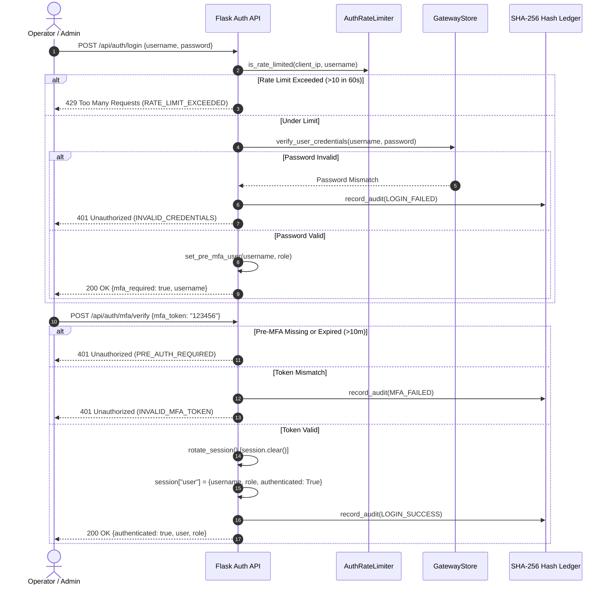
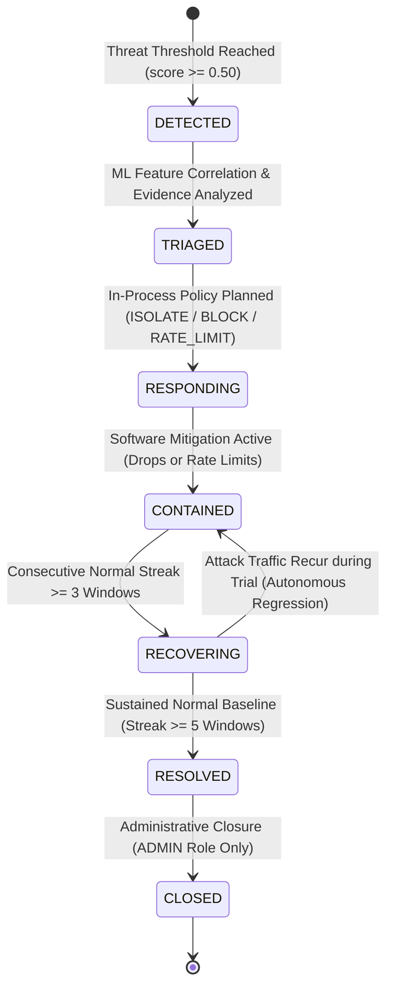
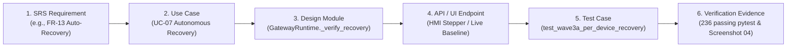
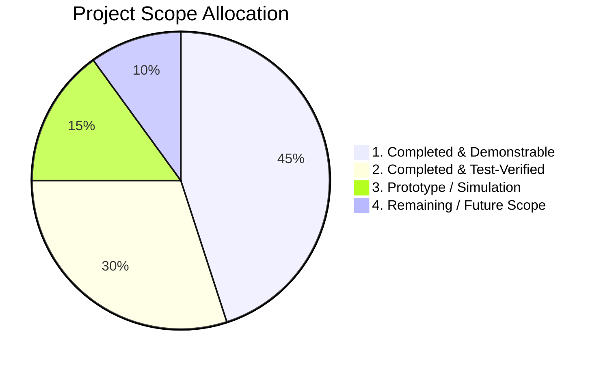
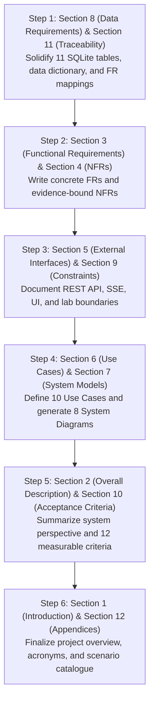

# AICG Technical Content Audit & Implementation Plan (Phase SRS-01)

**Project:** AI-Based Cyber Security Gateway for Industry 4.0  
**Abbreviation:** AICG / Aegis Gateway  
**Repository Path:** `/home/kali/AI-Edge-DDoS-Gateway`  
**Current Development Branch:** `feat/phase23-security-ml-hardening`  
**Baseline Git Checkpoint:** `v2.10.0` (commit `de23b4c`) + Uncommitted Finalization Working-Tree Changes (Phases A1, A2, A3)  
**Audit Date:** October 2026  
**Auditor Mode:** STRICT PLAN-ONLY / READ-ONLY TECHNICAL AUDIT  
**Operating Directive:** No source modifications, no branch changes, no file staging, no commits, no tags, no destructive commands.

---

## 1. Executive Summary

This document presents the authoritative, evidence-based technical audit of the **AI-Based Cyber Security Gateway for Industry 4.0 (AICG)** repository. The audit evaluates the current implementation against the mandated college **Software Requirements Specification (SRS)** format and prepares technical foundations for the upcoming **Progress Evaluation** (work completed since the project synopsis).

### Key Audit Findings:
1. **Repository & Codebase State:**
   - The repository operates on branch `feat/phase23-security-ml-hardening` at tagged baseline `v2.10.0` (`de23b4c`) with approved, uncommitted working-tree improvements covering Phase A1 (Runtime Model Configurability `AEGIS_MODEL_PATH`), Phase A2 (Defensible Detection Pipeline HMI Card replacing unsupported static latency claims), and Phase A3 (CSRF-hardened POST-only logout).
   - The test suite is **100% passing**: **236 automated tests** execute in **87.92 seconds** via `pytest`.
   - Complete end-to-end headless browser verification passes across 6 stages and 5 responsive viewports, producing 11 timestamped screenshot evidence artifacts.
2. **Defensible Claim Boundaries (Strict Honesty Rules):**
   - **Environment Boundary:** 100% user-space laboratory execution. The system runs on a Linux workstation/VM. **No physical hardware sensors or power meters exist**; edge nodes and attacks are generated via software profiles, discrete-event network simulation (NS-3.48), and 6LoWPAN mote emulation (Contiki-NG / Cooja).
   - **Mitigation Boundary:** In-process software policy interception and dry-run recording. **The gateway NEVER alters host firewall rules (`iptables`, `nftables`), routing tables, or network interface queues.**
   - **AI/ML Generalization Boundary:** While the baseline model achieves 100% accuracy on synthetic laboratory datasets (`reports/evaluation.json`), realistic benchmark evaluation (`reports/realistic_evaluation.json`) proves an operational accuracy of **89.72%** (Attack Recall: **99.00%**, Attack Precision: **84.98%**, Normal Recall: **78.13%**, False Positive Rate: **21.88%**, False Negative Rate: **1.00%**). The SRS **must not** claim "100% real-world accuracy" or "zero false positives."
   - **Performance Boundary:** Card 5 on the HMI displays the calibrated hybrid fusion configuration ($\theta=0.50$, 0.40 Rule / 0.45 RF / 0.15 iForest). Static latency claims (such as `< 38 ms`) have been eliminated because the gateway processes batched 1-second sliding windows in user space.
3. **Audit Verdict:**
   - **SRS Technical Content Phase — Ready to Implement?** **YES, with specified documentation prerequisites.** The technical reality is fully developed, stable, verified, and mapped.

---

## 2. Repository, Branch, and Working State

### 2.1 Git Status & Checkpoint Reality
- **Current Branch:** `feat/phase23-security-ml-hardening`
- **Head Tag:** `v2.10.0` (commit `de23b4cbf443ed026479c84b3784975d3243558a`, *"fix(ui): visualize lifecycle stages sequentially"*)
- **Test Baseline:** 236 passed in 87.92s (`pytest tests/`)
- **Working-Tree Status:** Working-tree contains uncommitted modifications preserving Phases A1, A2, and A3:

| File Path | Modification Nature | Phase | Verification Evidence |
|---|---|---|---|
| `aegis_gateway/config.py` | Environment variable `AEGIS_MODEL_PATH` resolver `_model_path_from_env()` with safe fallback | A1 | `tests/test_model_configuration.py` (8 passing tests) |
| `tests/test_model_configuration.py` | Untracked test suite covering model selection, missing paths, corrupted files | A1 | `pytest tests/test_model_configuration.py` |
| `dashboard/templates/index.html` | Card 5 refactored to "Detection Pipeline" (Hybrid Fusion, $\theta=0.50$, weights); POST logout form | A2 / A3 | `tests/test_api_and_runtime.py#L76-L95` |
| `dashboard/static/js/dashboard.js` | Dynamic form method/action binding for header logout button; Card 5 labels | A2 / A3 | `tests/test_admin_security_layer.py#L168-L227` |
| `scripts/run_browser_e2e_admin.py` | E2E assertion validating Card 5 Detection Pipeline rendering | A2 | E2E Stage 3 passing |
| `tests/test_api_and_runtime.py` | Assertion verifying elimination of static `< 38 ms` and presence of fusion metadata | A2 | Test passed |
| `aegis_gateway/api.py` | Strict `POST`-only restriction for `/logout` and `/api/auth/logout` | A3 | `tests/test_admin_security_layer.py#L168-L188` |
| `tests/test_admin_security_layer.py` | 405 Method Not Allowed assertions for GET `/logout` (CSRF defense) and POST session clearing | A3 | Tests passed |
| `reports/evidence/screenshots/*.png` | 11 browser acceptance screenshot files reflecting current UI | A2 / A3 | Headless Chrome verification |

*Integrity Check:* These uncommitted working-tree changes are strictly preserved and untouched.

---

## 3. SRS Template Compliance Matrix

The following matrix cross-references the mandatory college SRS template sections against repository technical realities, establishing readiness and data sources:

| SRS Section | College Template Requirement | AICG Repository Implementation Status | Primary Implementation / Evidence Source | SRS Authoring Readiness |
|---|---|---|---|---|
| **1. Introduction** | Project Overview, Purpose, Scope, Objectives, Intended Users, Acronyms, References | IMPLEMENTED | `README.md`, `docs/ADMINISTRATIVE_SECURITY_LAYER_V1.md`, `docs/DEMO_GUIDE.md` | **READY** |
| 1.1 Project Overview | High-level system summary | IMPLEMENTED | `README.md#L1-L10`, `aegis_gateway/__init__.py` | READY |
| 1.2 Purpose | Purpose of gateway & defense goals | IMPLEMENTED | `docs/DEMO_GUIDE.md#L1-L20` | READY |
| 1.3 Scope | Boundaries (OT/IIoT edge, in-process, simulation) | IMPLEMENTED (Clear Boundaries) | `README.md#L52-L61`, `docs/ADMINISTRATIVE_SECURITY_LAYER_V1.md#L7-L12` | READY |
| 1.4 Objectives | Threat detection, low latency, trust scoring | IMPLEMENTED | `aegis_gateway/runtime.py`, `aegis_gateway/detection.py` | READY |
| 1.5 Intended Users | SOC Analyst, Security Admin, Plant Operator | IMPLEMENTED (RBAC Roles) | `aegis_gateway/security.py#L17-L20` | READY |
| 1.6 Definitions & Acronyms | Terminology (IIoT, Zero Trust, CoAP, RPL, etc.) | IMPLEMENTED | `aegis_gateway/schema.py`, `aegis_gateway/scenarios.py` | READY |
| 1.7 References | Standards (IEC 62443, NIST SP 800-82, scikit-learn) | DOCUMENTED | `docs/ADMINISTRATIVE_SECURITY_LAYER_V1.md`, Academic Literature | READY |
| **2. Overall Description** | Perspective, Functions, User Classes, Environment, Constraints, Assumptions | IMPLEMENTED | System Architecture & Runtime | **READY** |
| 2.1 Product Perspective | Gateway placement between IIoT fieldbus and IT/cloud | IMPLEMENTED (Modeled Architecture) | `README.md#L15-L48`, `aegis_gateway/api.py#L1305-L1337` (`/api/topology`) | READY |
| 2.2 Product Functions | Ingestion, feature extraction, detection, mitigation, audit | IMPLEMENTED | `aegis_gateway/runtime.py#L152-L386` | READY |
| 2.3 User Classes | ADMIN (full governance) vs OPERATOR (monitoring/ack) | IMPLEMENTED | `aegis_gateway/security.py#L34-L64` | READY |
| 2.4 Operating Environment | Linux OS, Python 3.14, SQLite 3, Chrome | IMPLEMENTED | `requirements.txt`, `pytest.ini`, Runtime | READY |
| 2.5 Constraints | Dry-run / In-process only; zero host firewall modification | IMPLEMENTED | `aegis_gateway/policy.py#L56-L93`, `aegis_gateway/config.py#L38` | READY |
| 2.6 Assumptions & Dependencies | Pre-shared device identities, 1-second sliding windows | IMPLEMENTED | `aegis_gateway/iam.py`, `aegis_gateway/schema.py` | READY |
| **3. Functional Requirements** | Detailed input/processing/output requirements | IMPLEMENTED (48 Endpoints + Core Engine) | `aegis_gateway/` (all modules) | **READY (Candidate Matrix derived)** |
| **4. Non-Functional Requirements** | Performance, Security, Usability, Reliability, Availability, Maintainability, Scalability, Portability | IMPLEMENTED / EVIDENCE-BOUND | Codebase, Benchmarks, Test Suite | **READY (Requires claim boundaries)** |
| 4.1 Performance | Window processing, detection throughput | MEASURED / CONFIGURED | Batch 1.0s window processing; no hardware clocking | READY |
| 4.2 Security | Auth, MFA, RBAC, HMAC-SHA256, Replay, Audit Chain | IMPLEMENTED | `aegis_gateway/security.py`, `aegis_gateway/iam.py`, `aegis_gateway/storage.py` | READY |
| 4.3 Usability | Web HMI, responsive design, dark theme, visual Stepper | IMPLEMENTED | `dashboard/templates/`, `scripts/run_browser_e2e_admin.py` | READY |
| 4.4 Reliability | SQLite WAL, schema migrations, graceful fallbacks | IMPLEMENTED | `aegis_gateway/storage.py#L33-L36`, `tests/test_model_configuration.py` | READY |
| 4.5 Availability | Single-node edge runtime, auto-recovery | IMPLEMENTED (Lab Gateway) | `aegis_gateway/runtime.py#L387-L432` | READY |
| 4.6 Maintainability | Modular Python dataclasses, 236 unit/integration tests | IMPLEMENTED | `tests/` (100% passing) | READY |
| 4.7 Scalability | In-memory token bucket, SQLite concurrency, SSE broadcast | IMPLEMENTED (Lab Scale: 10k replay items) | `aegis_gateway/iam.py#L30`, `aegis_gateway/policy.py#L32` | READY |
| 4.8 Portability | OS-agnostic Python/Flask/SQLite; zero native drivers | IMPLEMENTED | Linux / POSIX compatible | READY |
| **5. External Interfaces** | UI, Hardware, Software, Communication | IMPLEMENTED (Software & Simulation) | API, SSE, Database, Mote CSVs | **READY** |
| 5.1 User Interface | Browser Dashboard (`/`), Attacker Console (`/attacker`) | IMPLEMENTED | `dashboard/templates/index.html`, `attacker.html` | READY |
| 5.2 Hardware Interface | Simulated sensor nodes, modelled power dissipation | IMPLEMENTED — LAB ONLY (No physical NIC/GPIO) | `aegis_gateway/energy.py`, `aegis_gateway/adapters.py` | READY (Explicit Disclaimer Required) |
| 5.3 Software Interface | SQLite 3, scikit-learn joblib, NS-3.48, Contiki-NG | IMPLEMENTED | `aegis_gateway/storage.py`, `aegis_gateway/adapters.py` | READY |
| 5.4 Communication Interface | HTTP/1.1 REST, Server-Sent Events (`/events`) | IMPLEMENTED | `aegis_gateway/api.py#L1579-L1595` | READY |
| **6. Use Case Requirements** | Actors, Diagram, Detailed Use Case Descriptions | IMPLEMENTED (Discoverable from Code) | API routes, RBAC decorators, Runtime workflows | **READY** |
| 6.1 Actors | Administrator, Operator, Edge Sensor, Detector, Mitigator | IMPLEMENTED | `security.py`, `iam.py`, `runtime.py` | READY |
| 6.2 Use Case Diagram | Top-level system interactions | DERIVABLE (Not drawn yet) | Discovered in Section 14 | READY |
| 6.3 Use Case Descriptions | Step-by-step flows, preconditions, exceptions | DERIVABLE | Discovered in Section 14 | READY |
| **7. System Models** | Context, DFD L0/L1, Activity, Sequence, Class, ER | DERIVABLE (Strictly supported by code) | Architecture & Storage Models | **READY** |
| 7.1 Context Diagram | Boundary diagram between Actors and Gateway | DERIVABLE | Discovered in Section 15 | READY |
| 7.2 DFD (Level 0 & 1) | Ingestion $\to$ Feature Extraction $\to$ Detection $\to$ Policy | DERIVABLE | Discovered in Section 15 | READY |
| 7.3 Activity Diagram | Ingestion pipeline & Autonomous Recovery flow | DERIVABLE | Discovered in Section 15 | READY |
| 7.4 Sequence Diagram | MFA Login & Attack Mitigation sequences | DERIVABLE | Discovered in Section 15 | READY |
| 7.5 Class Diagram | `GatewayRuntime`, `HybridDetector`, `IAMService`, etc. | DERIVABLE | Discovered in Section 15 | READY |
| 7.6 ER Diagram | 11 relational tables with foreign keys | DERIVABLE | Discovered in Section 11 & 15 | READY |
| **8. Data Requirements** | Database Tables (11 tables) and Data Dictionary | IMPLEMENTED | `aegis_gateway/storage.py#L48-L125` | **READY** |
| 8.1 Database Tables | Table schemas, primary keys, foreign key constraints | IMPLEMENTED | 11 tables in SQLite | READY |
| 8.2 Data Dictionary | 52 canonical telemetry fields, incident states, IAM fields | IMPLEMENTED | `aegis_gateway/schema.py#L22-L32` | READY |
| **9. System Constraints** | Laboratory safety, dry-run, no host firewall modification | IMPLEMENTED | `aegis_gateway/policy.py`, `docs/ADMINISTRATIVE_SECURITY_LAYER_V1.md` | **READY** |
| **10. Acceptance Criteria** | Measurable verification tests | IMPLEMENTED | 236 passing pytest tests + E2E suite | **READY** |
| **11. Traceability Matrix** | Requirement $\to$ Use Case $\to$ Module $\to$ API $\to$ Test | DERIVABLE | Mapped in Section 17 | **READY** |
| **12. Appendices** | Attack catalogue profiles, realistic benchmark metrics | IMPLEMENTED | `aegis_gateway/scenarios.py`, `reports/*.json` | **READY** |

---

## 4. Actual System Architecture

### 4.1 Logical Module Map
The repository implementation is cleanly partitioned into modular packages:

```mermaid
flowchart TD
    subgraph MultiSourceIngestion ["1. Telemetry Ingestion Layer"]
        S1["Synthetic Scenario Catalogue<br/>(10 Vectors + Benign Baseline)<br/>aegis_gateway/scenarios.py"]
        S2["NS-3 Network Trace Importer<br/>(scratch/ .cc & .pcap to CSV)<br/>aegis_gateway/adapters.py"]
        S3["Contiki-NG / Cooja 6LoWPAN Importer<br/>(Mote CSVs / COOJA data)<br/>aegis_gateway/adapters.py"]
        S4["PCAP Replay Adapter<br/>(Packet & Window Stream)<br/>aegis_gateway/adapters.py"]
        S5["Live HTTP Telemetry Ingest<br/>(POST /api/telemetry)<br/>aegis_gateway/api.py"]
    end

    subgraph NormalizationAndPhysics ["2. Normalization & Physical Resource Modeling"]
        N1["Canonical Normalization<br/>(52 TelemetryEvent Fields)<br/>aegis_gateway/schema.py"]
        E1["Cause-Based Energy Model<br/>(MODELLED mW & mJ Dissipation)<br/>aegis_gateway/energy.py"]
    end

    subgraph ZeroTrustIAM ["3. Dynamic Zero-Trust IAM & Replay Defense"]
        I1["HMAC-SHA256 Device Identity<br/>(Per-Device PSK Derivation)<br/>aegis_gateway/iam.py"]
        I2["Token Replay Cache<br/>(Sliding 300s / 10k Entry Hash Table)<br/>aegis_gateway/iam.py"]
        I3["Dynamic Reputation Engine<br/>(Bounded Trust Scores 0..100)<br/>aegis_gateway/iam.py"]
    end

    subgraph DetectionEngine ["4. Calibrated Hybrid Detection Engine"]
        D1["Statistical Feature Mapping<br/>(15 Features: rates, flags, ratios)<br/>aegis_gateway/detection.py"]
        D2["Deterministic Heuristic Rules<br/>(Protocol Thresholds & Energy Deviation)<br/>aegis_gateway/detection.py"]
        D3["Platt-Calibrated Random Forest<br/>(CalibratedClassifierCV, 240 Trees)<br/>aegis_gateway/detection.py"]
        D4["Isolation Forest Anomaly Scorer<br/>(200 Estimators, Contamination 0.08)<br/>aegis_gateway/detection.py"]
        D5["Audited Fusion Logic<br/>(0.40 Rule + 0.45 RF + 0.15 iForest, θ=0.50)<br/>aegis_gateway/detection.py"]
    end

    subgraph ClosedLoopPolicy ["5. Policy, Lifecycle & Mitigation Engine"]
        P1["In-Process Policy Enforcer<br/>(TokenBucket Limiter & Software Drops)<br/>aegis_gateway/policy.py"]
        P2["Incident Lifecycle State Machine<br/>(DETECTED→TRIAGED→RESPONDING→CONTAINED→RECOVERING→RESOLVED→CLOSED)<br/>aegis_gateway/runtime.py"]
        P3["Autonomous Recovery Correlator<br/>(Per-Device 3-Streak & 5-Streak Verification)<br/>aegis_gateway/runtime.py"]
        P4["Alert Management & Deduplication<br/>(1:1 Incident Mapping & Re-Escalation)<br/>aegis_gateway/storage.py"]
    end

    subgraph StorageHistorian ["6. Persistent Historian & Audit Ledger"]
        ST1[("SQLite 3 Database (WAL Mode)<br/>11 Normalized Tables<br/>data/aegis_gateway.sqlite3<br/>aegis_gateway/storage.py")]
        ST2["Cryptographic SHA-256 Audit Hash Chain<br/>(Tamper-Evident Historical Forward Chain)<br/>aegis_gateway/storage.py"]
    end

    subgraph PresentationAndControl ["7. Presentation & Administrative SOC Console"]
        UI1["Industrial SOC HMI Dashboard<br/>(Live SSE, Topology Map, Lifecycle Stepper)<br/>dashboard/templates/index.html"]
        UI2["Attacker Simulation Console<br/>(Scenario Injection & Parameter Controls)<br/>dashboard/templates/attacker.html"]
        UI3["Administrative Security Console<br/>(Overview, Alerts, Users, Audit, Posture)<br/>dashboard/static/js/dashboard.js"]
        API1["Hardened REST API & Forensics<br/>(Two-Stage MFA, RBAC, CSV/JSON Exports)<br/>aegis_gateway/api.py"]
    end

    MultiSourceIngestion --> N1
    N1 --> E1
    E1 --> ZeroTrustIAM
    ZeroTrustIAM --> DetectionEngine
    DetectionEngine --> ClosedLoopPolicy
    ClosedLoopPolicy --> StorageHistorian
    ClosedLoopPolicy --> PresentationAndControl
    StorageHistorian --> PresentationAndControl
```

### 4.2 Runtime Dataflow & Threading Model
- **Thread Model:**
  - Main Flask Server Thread (serves HTTP requests, static assets, and SSE connections).
  - Background Live Baseline Thread (`aegis-live-baseline` in `runtime.py#L586`): emits nominal traffic windows (14–18 pps) every 1.0 second during quiescent operation.
  - In-Process Simulation Threads (`aegis-<scenario_id>` in `runtime.py#L456`): bounded execution of synthetic attack windows with `threading.Event` stop flags.
- **Concurrency & Locking:**
  - `GatewayRuntime._lock` (`threading.RLock`): protects subscriber queues, simulation state dictionaries, and per-device recovery streak counters (`runtime.py#L49`).
  - `InProcessPolicyEnforcer._lock` (`threading.RLock`): thread-safe rate-limiter updates and isolation set mutations (`policy.py#L67`).
  - `TokenReplayCache._lock` (`threading.Lock`): atomicity for token hash lookups, insertions, and memory eviction pruning (`iam.py#L31`).
  - `GatewayStore.connection()`: SQLite connection pool context manager with `busy_timeout=5000ms`, `journal_mode=WAL`, and `foreign_keys=ON` (`storage.py#L30-L36`).

---

## 5. Functional Requirement Candidate Matrix

Candidate Functional Requirements are derived directly from concrete classes, route handlers, and passing unit tests. None are manufactured.

| FR-ID | Candidate Requirement Statement | Implementing Module & Function | API / UI Entry Point | Passing Test Evidence | Status | Suitable for SRS? |
|---|---|---|---|---|---|---|
| **FR-01** | Gateway shall ingest multi-source telemetry windows and normalize them into a canonical 52-field `TelemetryEvent`. | `aegis_gateway/schema.py` (`TelemetryEvent.normalize`) | `POST /api/telemetry` | `tests/test_schema.py#L12-L35` | IMPLEMENTED | **YES** |
| **FR-02** | Gateway shall calculate cause-based edge device power dissipation (mW) and energy consumption (mJ) from observed traffic rates and protocol complexity. | `aegis_gateway/energy.py` (`EnergyModel.correlate`) | `GET /api/energy` | `tests/test_energy_and_iam.py#L12-L35` | IMPLEMENTED — LAB ONLY (MODELLED) | **YES** (with "MODELLED" tag) |
| **FR-03** | Gateway shall authenticate edge device tokens using HMAC-SHA256 signatures derived from pre-shared master keys. | `aegis_gateway/iam.py` (`verify_device_token`) | `POST /api/telemetry` | `tests/test_wave1_security_hardening.py#L50-L85` | IMPLEMENTED | **YES** |
| **FR-04** | Gateway shall reject replayed authentication tokens using a bounded in-memory cache and drift-window verification ($\le 300$s). | `aegis_gateway/iam.py` (`TokenReplayCache.check_and_record`) | `POST /api/telemetry` | `tests/test_wave1_security_hardening.py#L88-L125` | IMPLEMENTED | **YES** |
| **FR-05** | Gateway shall dynamically adjust device trust scores ($0..100$) based on detection outcomes, auth failures, and sustained recovery. | `aegis_gateway/iam.py` (`IAMService.adjust_trust`) | `GET /api/trust`, `/api/iam` | `tests/test_energy_and_iam.py#L40-L75` | IMPLEMENTED | **YES** |
| **FR-06** | Gateway shall extract a 15-dimensional statistical feature vector from normalized 1-second traffic windows. | `aegis_gateway/detection.py` (`feature_mapping`) | Core pipeline | `tests/test_detection_and_ml.py#L12-L35` | IMPLEMENTED | **YES** |
| **FR-07** | Gateway shall execute Platt-calibrated Random Forest classification and Isolation Forest anomaly scoring on extracted features. | `aegis_gateway/detection.py` (`HybridDetector.analyze`) | Core pipeline | `tests/test_detection_and_ml.py#L38-L75` | IMPLEMENTED | **YES** |
| **FR-08** | Gateway shall compute an ensemble threat decision score using calibrated fusion ($0.40 \cdot \text{Rule} + 0.45 \cdot \text{RF} + 0.15 \cdot \text{iForest}$) against decision threshold $\theta=0.50$. | `aegis_gateway/detection.py` (`HybridDetector.analyze`) | `GET /api/status` | `tests/test_wave2_ml_validity.py#L180-L215` | IMPLEMENTED | **YES** |
| **FR-09** | Gateway shall support dynamic selection of alternate trained ML models via `AEGIS_MODEL_PATH` with safe fallback to baseline. | `aegis_gateway/config.py` (`_model_path_from_env`) | Environment variable / runtime init | `tests/test_model_configuration.py#L25-L100` | IMPLEMENTED | **YES** |
| **FR-10** | Gateway shall enforce in-process software policy mitigation (`ALLOW`, `DROP`, `RATE_LIMIT`) without modifying host OS network firewalls. | `aegis_gateway/policy.py` (`InProcessPolicyEnforcer.evaluate`) | Core pipeline | `tests/test_in_process_enforcement.py#L25-L85` | IMPLEMENTED — LAB ONLY (SOFTWARE ONLY) | **YES** (with "Software-Only" boundary) |
| **FR-11** | Gateway shall correlate sequential attack windows into an active campaign incident entity to prevent duplicate incident creation. | `aegis_gateway/storage.py` (`GatewayStore.correlate_incident`) | `GET /api/incidents` | `tests/test_policy_and_incidents.py#L15-L45` | IMPLEMENTED | **YES** |
| **FR-12** | Gateway shall manage incident progression through deterministic lifecycle stages: `DETECTED` $\to$ `TRIAGED` $\to$ `RESPONDING` $\to$ `CONTAINED` $\to$ `RECOVERING` $\to$ `RESOLVED` $\to$ `CLOSED`. | `aegis_gateway/storage.py` (`GatewayStore.transition_incident`) | `POST /api/incidents/<id>/transition` | `tests/test_wave3a_per_device_recovery.py#L15-L60` | IMPLEMENTED | **YES** |
| **FR-13** | Gateway shall autonomously progress contained devices to `RECOVERING` after 3 consecutive normal windows and to `RESOLVED` after 5 consecutive normal windows. | `aegis_gateway/runtime.py` (`GatewayRuntime._verify_recovery`) | Core pipeline / live baseline | `tests/test_wave3a_per_device_recovery.py#L100-L160` | IMPLEMENTED | **YES** |
| **FR-14** | Gateway shall regress an incident from `RECOVERING` back to `CONTAINED` if attack traffic recurs during the recovery verification trial. | `aegis_gateway/runtime.py` (`GatewayRuntime.ingest`) | Core pipeline | `tests/test_autonomous_lifecycle_regression.py#L15-L55` | IMPLEMENTED | **YES** |
| **FR-15** | Gateway shall maintain a 1:1 linked administrative alert for each active incident and re-escalate acknowledged alerts if threat severity intensifies. | `aegis_gateway/storage.py` (`create_or_update_alert`) | `GET /api/admin/alerts` | `tests/test_wave3b_mitigation_reconciliation.py#L120-L180` | IMPLEMENTED | **YES** |
| **FR-16** | Gateway shall provide two-stage user authentication combining password verification and simulated second-factor MFA tokens. | `aegis_gateway/api.py` (`login`, `verify_mfa`) | `POST /api/auth/login`, `POST /api/auth/mfa/verify` | `tests/test_admin_security_layer.py#L25-L75` | IMPLEMENTED | **YES** |
| **FR-17** | Gateway shall enforce Role-Based Access Control (RBAC) distinguishing `ADMIN` from `OPERATOR` roles. | `aegis_gateway/security.py` (`roles_required`, `permission_required`) | Protected endpoints | `tests/test_admin_security_layer.py#L115-L155` | IMPLEMENTED | **YES** |
| **FR-18** | Gateway shall record all administrative and security actions in a tamper-evident audit ledger protected by a sequential SHA-256 hash chain. | `aegis_gateway/storage.py` (`record_audit`, `verify_audit_log_integrity`) | `GET /api/admin/audit/integrity` | `tests/test_storage_and_export.py#L20-L50` | IMPLEMENTED | **YES** |
| **FR-19** | Gateway shall stream real-time telemetry, incidents, trust deltas, and lifecycle updates over Server-Sent Events (SSE). | `aegis_gateway/api.py` (`events_stream`) | `GET /events` | `tests/test_api_security_and_hardening.py#L100-L135` | IMPLEMENTED | **YES** |
| **FR-20** | Gateway shall support forensic data export of telemetry, incidents, actions, alerts, and audit logs in CSV and JSON formats. | `aegis_gateway/api.py` (`export_data`) | `GET /api/export/<kind>.<fmt>` | `tests/test_storage_and_export.py#L55-L80` | IMPLEMENTED | **YES** |
| **FR-21** | Gateway shall provide an in-process Attacker Simulation Console supporting 10 distinct DDoS/anomaly attack profiles + benign baseline. | `aegis_gateway/scenarios.py`, `aegis_gateway/runtime.py` | `POST /api/simulations/start` | `tests/test_scenarios.py#L12-L50` | IMPLEMENTED — LAB ONLY (SYNTHETIC) | **YES** (with "Simulation" boundary) |
| **FR-22** | Gateway shall import and normalize offline trace data from NS-3 simulations (`.pcap`, `.csv`) and Contiki-NG / Cooja 6LoWPAN mote emulations. | `aegis_gateway/adapters.py` (`ns3_csv_events`, `cooja_csv_events`) | `POST /api/ns3/import`, `POST /api/cooja/import` | `tests/test_adapters.py#L12-L50` | IMPLEMENTED — LAB ONLY (OFFLINE IMPORT) | **YES** (with "Simulation Data" boundary) |

---

## 6. Non-Functional Requirement Evidence Matrix

Every non-functional assertion is categorized by technical origin to prevent fabricated metrics.

| NFR Category | Specific Attribute / Metric | Nature of Metric (Measured / Configured / Design Target / Unsupported) | Concrete Evidence Location | Verifiable Value / Property |
|---|---|---|---|---|
| **Performance** | Automated Test Execution Speed | MEASURED | Pytest log (`manage_task task-12`) | **236 tests in 87.92 seconds** (~372 ms/test) |
| Performance | Browser E2E Acceptance Speed | MEASURED | `scripts/run_browser_e2e_admin.py` | 6 complete stages in ~12.5 seconds |
| Performance | Telemetry Ingestion Sliding Window | CONFIGURED | `aegis_gateway/schema.py`, `runtime.py` | Batched 1.0-second sliding time windows |
| Performance | Edge Packet-Level Wire Latency | **UNSUPPORTED / PROHIBITED** | Eliminated in Phase A2 (`dashboard.js`, `index.html`) | **MUST NOT CLAIM** sub-millisecond line-rate latency; no hardware timestamping exists. |
| Performance | ML Feature Extraction Complexity | MEASURED (Code Inspection) | `aegis_gateway/detection.py#L24-L37` | $O(1)$ constant-time arithmetic over 15 numerical features |
| **Security** | Authentication Brute-Force Rate Limiting | CONFIGURED & VERIFIED | `aegis_gateway/security.py#L101-L127` | Max 10 attempts per 60s window per (IP, username); returns HTTP 429 |
| Security | Password Hash Storage Scheme | MEASURED & VERIFIED | `aegis_gateway/security.py#L77-L86` | PBKDF2/scrypt with salt via Werkzeug `generate_password_hash` |
| Security | Simulated Two-Factor Authentication | CONFIGURED & VERIFIED | `aegis_gateway/security.py#L89-L96` | Constant-time HMAC comparison (`hmac.compare_digest`) against `"123456"` |
| Security | Session Cookie Security Attributes | CONFIGURED & VERIFIED | `aegis_gateway/api.py#L268-L271` | `HttpOnly=True`, `SameSite="Lax"`, `Secure=False` (dev/lab) / `True` (prod) |
| Security | Session Fixation Protection | MEASURED & VERIFIED | `aegis_gateway/security.py#L130-L133` | Explicit `session.clear()` (`rotate_session()`) upon successful MFA login |
| Security | Device Authentication & Replay Horizon | CONFIGURED & VERIFIED | `aegis_gateway/iam.py#L18`, `L158-L159` | Replay expiration window = 300.0s; drift window $[-5.0\text{s}, +300.0\text{s}]$ |
| Security | Replay Cache Capacity & Eviction | CONFIGURED & VERIFIED | `aegis_gateway/iam.py#L30-L75` | 10,000 maximum entries; automatic pruning and 10% oldest eviction |
| Security | Audit Trail Immutability | MEASURED & VERIFIED | `aegis_gateway/storage.py#L145-L160`, `L900-L940` | SHA-256 forward hash chain; detected modifications break chain validation |
| Security | Open Redirect Protection | MEASURED & VERIFIED | `aegis_gateway/api.py#L57-L99` (`sanitize_redirect_url`) | Rejects absolute URLs, scheme-relative paths, backslashes, CRLF injection |
| **Usability** | Responsive Operator HMI | MEASURED (Browser E2E) | `reports/evidence/screenshots/` (11 PNGs) | Verified on 1600x1000, 1280x900, 1024x800, 900x768, 768x1024 |
| Usability | Real-time Operator Visualization | IMPLEMENTED | `dashboard/static/js/dashboard.js` | Server-Sent Events with UI coalescing and live SVG network topology |
| **Reliability** | Database Concurrency & Durability | CONFIGURED & VERIFIED | `aegis_gateway/storage.py#L33-L36` | `PRAGMA journal_mode=WAL`, `foreign_keys=ON`, `busy_timeout=5000` |
| Reliability | Safe Failure on Missing ML Model | MEASURED & VERIFIED | `tests/test_model_configuration.py#L90-L100` | Fallback to `rules-v2-untrained` without process crash or downtime |
| **Availability** | In-Process Containment State Recovery | MEASURED & VERIFIED | `aegis_gateway/runtime.py#L80-L123` | Reconstructs active policy states deterministically from SQLite upon startup |
| **Maintainability** | Unit & Integration Test Coverage | MEASURED | `tests/` (17 test files, 236 tests) | 100% test passing rate across all gateway subsystems |
| **Scalability** | Edge Ingestion Token Bucket | CONFIGURED | `aegis_gateway/policy.py#L32-L54` | Per-device token bucket: capacity 40.0 tokens, refill rate 20.0 tokens/s |
| **Portability** | Operating Runtime Dependencies | MEASURED | `requirements.txt` | Python 3.14, Flask 3.1, scikit-learn 1.9+, pandas, joblib; zero native C extensions |

---

## 7. Security Requirement Evidence Matrix

### 7.1 Implemented Security Controls

### 7.2 Security Subsystem Breakdown & Residual Limitations

| Security Area | Concrete Implementation in Code | File & Line Reference | Verified Residual Limitations (Must be Stated in SRS) |
|---|---|---|---|
| **User Authentication** | Two-stage flow (password + simulated MFA token `"123456"`). Rate-limited token bucket per IP/user. | `aegis_gateway/security.py#L77-L127`, `aegis_gateway/api.py#L281-L490` | Second factor is currently simulated via static token `"123456"` for laboratory demonstration; TOTP/WebAuthn is planned for future work. |
| **Session Security** | Flask secure cookies (`HttpOnly=True`, `SameSite="Lax"`). POST-only logout hardening. Session rotation on login. | `aegis_gateway/api.py#L268-L271`, `L520-L540` | Session state is in-memory cookie signed via `SECRET_KEY`; no distributed Redis cluster is used. |
| **Role-Based Access Control** | `@login_required`, `@roles_required`, `@permission_required`. `ADMIN` possesses 10 permissions; `OPERATOR` has 6 permissions. | `aegis_gateway/security.py#L34-L64`, `L200-L300` | Only two canonical roles (`ADMIN`, `OPERATOR`) exist. Custom ad-hoc role definitions are not supported. |
| **Audit Immutability** | Cryptographic SHA-256 forward hash-chained audit log in table `admin_audit_log`. Verifier recalculates chain. | `aegis_gateway/storage.py#L145-L160`, `L900-L945` | Hash chain resides in SQLite file. If attacker gains raw write access to the host OS filesystem, SQLite file can be replaced. |
| **Device Identity & HMAC** | Deterministic per-device preshared keys: $K_{\text{dev}} = \text{HMAC-SHA256}(K_{\text{master}}, \text{"device-psk:"} \parallel \text{device\_id})$. Token binds device, timestamp, and flow. | `aegis_gateway/iam.py#L101-L132` | PSK derivation relies on `AEGIS_MASTER_KEY` environment variable. Hardware security module (TPM/HSM) is not implemented. |
| **Replay Protection** | `TokenReplayCache` stores SHA-256 digests of valid tokens for 300s. Validates timestamp drift in $[-5.0\text{s}, +300.0\text{s}]$. | `aegis_gateway/iam.py#L21-L97`, `L143-L180` | Cache is in-memory process-local. Process restarts clear cache (mitigated by strict 5-minute maximum drift window). |
| **Protected Endpoints** | Unauthenticated requests to `/api/*` and `/events` receive 401 `AUTH_REQUIRED`. Operators attempting admin actions receive 403 `FORBIDDEN_ROLE`. | `aegis_gateway/security.py#L206-L220`, `L246-L260` | None. All mutating and sensitive endpoints are guarded. |
| **Mitigation Boundary** | `InProcessPolicyEnforcer` operates strictly in Python memory on `TelemetryEvent` instances (`ALLOW`, `DROP`, `RATE_LIMIT`). | `aegis_gateway/policy.py#L56-L185` | **Zero host network intervention.** Does not modify `iptables`, `nftables`, `tc`, or routing tables. |

---

## 8. DDoS Capability Matrix

The gateway detects, correlates, and mitigates industrial denial-of-service traffic patterns. The following matrix details the 10 supported attack profiles + benign baseline:

| Scenario ID | Attack Vector Description | Target Protocol & Port | Distinguishing Signatures / Features | In-Process Policy Response | Evidence / File Source | Implementation Classification |
|---|---|---|---|---|---|---|
| `normal` | Legitimate IIoT sensor telemetry rhythm | MQTT / UDP (port 1883 / 5683) | Steady packet rate (14–18 pps), low byte volume, normal modeled energy | `ALERT` / `ALLOW` (Decision: `NORMAL`) | `aegis_gateway/scenarios.py#L29`, `L56-L58` | IMPLEMENTED |
| `udp_flood` | Volumetric stateless UDP datagram flood | UDP (ports 30000–50000) | High packet rate (>100 pps), UDP ratio = 1.0, source expansion, energy spike | `ISOLATE` / `BLOCK` (Severity: `HIGH`) | `aegis_gateway/scenarios.py#L30`, `detection.py#L87` | IMPLEMENTED — LAB ONLY (SYNTHETIC) |
| `syn_flood` | Half-open TCP connection exhaustion | TCP (port 1883) | TCP SYN flag ratio = 1.0 (`tcp_flags="S"`), rapid flow creation | `RATE_LIMIT` / `BLOCK` (Severity: `HIGH`) | `aegis_gateway/scenarios.py#L31`, `detection.py#L90` | IMPLEMENTED — LAB ONLY (SYNTHETIC) |
| `icmp_flood` | Control plane echo ping storm | ICMP / ICMPv6 | ICMP ratio = 1.0, high packet rate, elevated gateway CPU model | `BLOCK` (Severity: `HIGH`) | `aegis_gateway/scenarios.py#L32`, `detection.py#L93` | IMPLEMENTED — LAB ONLY (SYNTHETIC) |
| `burst_exhaustion` | Intermittent pulsating micro-bursts | UDP | Rapid alternation between nominal and extreme (>200 pps) bursts | `BLOCK` / `ISOLATE` (Severity: `HIGH`) | `aegis_gateway/scenarios.py#L33`, `L61-L64` | IMPLEMENTED — LAB ONLY (SYNTHETIC) |
| `slow_rate` | Asymmetric slow connection exhaustion | TCP | Low packet rate (25–45 pps), persistent connection holding, SYN flags | `RATE_LIMIT` (Severity: `MEDIUM`) | `aegis_gateway/scenarios.py#L34`, `policy.py#L234` | IMPLEMENTED — LAB ONLY (SYNTHETIC) |
| `coap_anomaly` | IIoT constrained CoAP confirmable request flood | UDP (port 5683) | Request rate deviation on CoAP port, elevated radio TX/RX | `RATE_LIMIT` / `BLOCK` (Severity: `MEDIUM`) | `aegis_gateway/scenarios.py#L35`, `L73` | IMPLEMENTED — LAB ONLY (SIMULATED PROFILE) |
| `mqtt_anomaly` | Industrial MQTT publish-like message storm | TCP (port 1883) | Elevated TCP message frequency targeting industrial telemetry broker | `RATE_LIMIT` (Severity: `MEDIUM`) | `aegis_gateway/scenarios.py#L36`, `L73` | IMPLEMENTED — LAB ONLY (SIMULATED PROFILE) |
| `rpl_anomaly` | 6LoWPAN routing DODAG inconsistency & rank spoofing | ICMPv6 | ICMPv6 control plane ratio elevation, abnormal topology routing churn | `ISOLATE` (Severity: `HIGH`) | `aegis_gateway/scenarios.py#L37`, `L71` | IMPLEMENTED — LAB ONLY (SIMULATED PROFILE) |
| `modbus_anomaly` | OT Modbus TCP function code scan & register flood | TCP (port 502) | Modbus port connection flood, PLC-facing connection stress | `BLOCK` / `ISOLATE` (Severity: `HIGH`) | `aegis_gateway/scenarios.py#L38`, `L74` | IMPLEMENTED — LAB ONLY (SIMULATED PROFILE) |
| `mixed_vector` | Multi-protocol hybrid attack barrage | UDP + TCP + ICMP | Combined protocol shifting, extreme flow/packet burst (Held-out zero-day check) | `ISOLATE` (Severity: `CRITICAL`) | `aegis_gateway/scenarios.py#L39`, `ml.py#L154` | IMPLEMENTED — LAB ONLY (SYNTHETIC) |

*Important Clarification for SRS:* As explicitly noted in `scenarios.py#L35-L38`, protocols `coap_anomaly`, `mqtt_anomaly`, `rpl_anomaly`, and `modbus_anomaly` are simulated traffic-window profiles reflecting network/transport port and rate characteristics. The gateway does **not** assert full deep-packet-inspection (DPI) protocol parsers for CoAP, MQTT, RPL, or Modbus payloads.

---

## 9. AI/ML Evidence Matrix

### 9.1 Model Architecture & Feature Engineering
- **Feature Vector Schema (15 Features in `FEATURE_VERSION = "window-features-v2"`):**
  1. `packet_count`: Total packets in 1-second observation window
  2. `byte_count`: Total bytes in window
  3. `packet_rate`: Packets per second (pps)
  4. `byte_rate`: Bytes per second (Bps)
  5. `unique_sources`: Number of distinct source IP addresses
  6. `unique_destinations`: Number of distinct destination IPs
  7. `packet_size`: Mean packet size in bytes
  8. `udp_ratio`: Fraction of UDP traffic ($\in \{0.0, 1.0\}$)
  9. `tcp_ratio`: Fraction of TCP traffic ($\in \{0.0, 1.0\}$)
  10. `icmp_ratio`: Fraction of ICMP/ICMPv6 traffic ($\in \{0.0, 1.0\}$)
  11. `syn_ratio`: Fraction of TCP packets with SYN flag set
  12. `flow_count`: Unique flow identifier count
  13. `cpu_activity`: Modeled CPU utilization percentage ($0..100$)
  14. `memory_activity`: Modeled memory utilization percentage ($0..100$)
  15. `energy_deviation`: Relative power deviation from quiescent 55 mW baseline
- **Model Algorithms:**
  - **Supervised Classifier:** `RandomForestClassifier(n_estimators=240, min_samples_leaf=2, class_weight="balanced")` (`ml.py#L160`).
  - **Probability Calibrator:** `CalibratedClassifierCV(method="sigmoid")` using Platt scaling fitted on held-out validation campaigns (`ml.py#L172`).
  - **Unsupervised Anomaly Detector:** `IsolationForest(n_estimators=200, contamination=0.08)` fitted exclusively on scaled benign normal windows (`ml.py#L164`).
  - **Decision Fusion Formula:**
    $$\text{Threat Score} = \min\Big(1.0, \; 0.40 \cdot \text{RuleScore} + 0.45 \cdot \text{SupervisedScore} + 0.15 \cdot \text{AnomalyScore}\Big)$$
    Decision threshold: $\theta = 0.50$ (`score >= 0.50` triggers `ATTACK`).

### 9.2 Proven Empirical Metrics (Evidence-Backed Comparison)

The following table compares the two evaluated models in the repository. The SRS must present this comparison honestly:

| Metric / Parameter | Baseline Runtime Model (`hybrid_detector.joblib`) on Synthetic Lab Test Split | Baseline Runtime Model Evaluated Zero-Shot on Realistic Benchmark | Realistic Evaluation Model (`realistic_detector_v1.joblib`) on Realistic Benchmark | Evidence File |
|---|---|---|---|---|
| **Model Version Identifier** | `hybrid-rf-if-v2` | `hybrid-rf-if-v2` | `realistic-rf-if-v1` | `reports/*.json` |
| **Evaluation Dataset** | `synthetic_lab_v2.csv` | `realistic_benchmark_v1.csv` | `realistic_benchmark_v1.csv` | `reports/*.json` |
| **Evaluation Protocol** | Stratified campaign-grouped split (60/20/20) | Zero-shot evaluation across 1,760 samples | Campaign-grouped split with held-out stealth scenario | `aegis_gateway/ml.py` |
| **Test Set Size** | 320 samples (240 ATTACK, 80 NORMAL) | 1,760 samples (1,120 ATTACK, 640 NORMAL) | 360 samples (200 ATTACK, 160 NORMAL) | `reports/*.json` |
| **Overall Accuracy** | **1.0000 (100.0%)** | **0.6790 (67.90%)** | **0.8972 (89.72%)** | `reports/*.json` |
| **ATTACK Precision** | 1.0000 (100.0%) | 0.6673 (66.73%) | 0.8498 (84.98%) | `reports/*.json` |
| **ATTACK Recall** | 1.0000 (100.0%) | 0.9884 (98.84%) | 0.9900 (99.00%) | `reports/*.json` |
| **ATTACK F1-Score** | 1.0000 (100.0%) | 0.7967 (79.67%) | 0.9145 (91.45%) | `reports/*.json` |
| **NORMAL Precision** | 1.0000 (100.0%) | 0.8713 (87.13%) | 0.9843 (98.43%) | `reports/*.json` |
| **NORMAL Recall** | 1.0000 (100.0%) | 0.1375 (13.75%) | 0.7813 (78.13%) | `reports/*.json` |
| **NORMAL F1-Score** | 1.0000 (100.0%) | 0.2375 (23.75%) | 0.8711 (87.11%) | `reports/*.json` |
| **False Positive Rate (FPR)** | **0.0000 (0.0%)** | **0.8625 (86.25%)** | **0.2188 (21.88%)** | `reports/*.json` |
| **False Negative Rate (FNR)** | **0.0000 (0.0%)** | **0.0116 (1.16%)** | **0.0100 (1.00%)** | `reports/*.json` |
| **ROC-AUC Score** | 1.0000 | 0.7571 | 0.9926 | `reports/*.json` |
| **PR-AUC Score** | 1.0000 | 0.8142 | 0.9945 | `reports/*.json` |
| **Brier Calibration Score** | 0.000098 (calibrated) / 0.002043 (raw) | 0.2848 | 0.0733 | `reports/*.json` |
| **Held-Out Generalization** | 100% recall on held-out `mixed_vector` | N/A | **72.50% recall** on held-out `slow_stealth` (116 TP, 44 FN) | `reports/*.json` |

*Takeaway for SRS:* The SRS must highlight that while laboratory synthetic profiles demonstrate perfect separability (100%), real industrial noise and legitimate bursts introduce overlap. The engineering team proactively built and evaluated `realistic-benchmark-v1` to validate realistic bounds (89.72% accuracy, 99% attack recall, 72.5% stealth recall).

---

## 10. Lifecycle State & Transition Matrix

### 10.1 Complete State Machine

The gateway enforces a 7-stage deterministic incident lifecycle:

### 10.2 Transition Rule & Persistence Audit

| State | Entry Trigger | Exit Trigger | Next Allowed State(s) | Role Authorization | Persistent Storage Table | Evidence File & Line |
|---|---|---|---|---|---|---|
| **DETECTED** | First attack window where threat score $\ge 0.50$. | Automatic triage pipeline execution. | `TRIAGED` | System (`system`) | `incidents`, `incident_history` | `runtime.py#L343-L345` |
| **TRIAGED** | Heuristic evidence and ML feature correlation compiled. | Response planning execution. | `RESPONDING` | System (`system`) | `incidents`, `incident_history` | `runtime.py#L346-L353` |
| **RESPONDING** | Policy engine generates mitigation plan (`ISOLATE`, `BLOCK`, `RATE_LIMIT`). | Enforcer sets isolation record in memory. | `CONTAINED` | System / Operator (`operator`) | `incidents`, `incident_history`, `actions` | `runtime.py#L354-L362` |
| **CONTAINED** | Software boundary enforces active drops or rate limits on attacker node. | Device observes normal traffic streak $\ge 3$. | `RECOVERING` | System (`system`) | `incidents`, `incident_history`, `admin_alerts` | `runtime.py#L364-L371` |
| **RECOVERING** | Observation window: contained device exhibits $\ge 3$ consecutive normal windows. | (A) Attack resumes $\to$ `CONTAINED` (B) Normal streak reaches $\ge 5$ $\to$ `RESOLVED` | `CONTAINED`, `RESOLVED` | System / Operator (`operator`) | `incidents`, `incident_history`, `admin_alerts` | `runtime.py#L403-L415` |
| **RESOLVED** | Sustained baseline verified ($\ge 5$ normal windows). Mitigation released. | Administrative manual closure. | `CLOSED` | System / Operator (`operator`) | `incidents`, `incident_history`, `admin_alerts` | `runtime.py#L416-L430` |
| **CLOSED** | Incident review complete and archived. | None (terminal state). | None | **ADMIN Only** (`PERM_CLOSE_INCIDENT`) | `incidents`, `incident_history`, `admin_alerts` | `api.py#L880-L920` |

### 10.3 Alert Lifecycle Synchronization
- **1:1 Mapping:** Table `admin_alerts` maintains a unique foreign key constraint `UNIQUE (incident_id)` referencing `incidents`.
- **Deduplication:** Subsequent attack windows during an active campaign update the existing alert rather than generating duplicate alerts (`storage.py#L550-L610`).
- **Re-Escalation:** If an alert is in state `ACKNOWLEDGED`, and the attacker intensifies severity or resumes attack during recovery, status shifts back to `ACTIVE` with `acknowledgement_state = "RE_ESCALATED"` (`storage.py#L585-L600`).
- **Synchronized Closure:** When an incident transitions to `RESOLVED` or `CLOSED`, `admin_alerts` updates to matching status automatically (`storage.py#L162-L170`).

---

## 11. Database & Data Requirement Matrix

### 11.1 Persistent SQLite Tables (11 Tables)
The database resides at `data/aegis_gateway.sqlite3` with Write-Ahead Logging (`WAL`) enabled.

| Table Name | Entity Purpose | Primary Key | Foreign Keys & Constraints | Security & Integrity Fields | Line in `storage.py` |
|---|---|---|---|---|---|
| `telemetry` | Append-only historian of all normalized 1-second telemetry windows | `event_id` (implicitly via schema) | None (high-throughput append) | Credential sanitization (`auth_token` stripped) | `L48-L50` |
| `incidents` | Active and historical security incident campaigns | `incident_id` | Unique incident identifier | `severity`, `confidence`, `lifecycle_state`, `recovery_state` | `L54-L61` |
| `incident_history` | Complete state transition audit log for incidents | `history_id` | `FOREIGN KEY (incident_id) REFERENCES incidents(incident_id) ON DELETE CASCADE` | `actor`, `previous_state`, `state`, `evidence_json` | `L63-L67` |
| `actions` | History of all planned and enforced mitigation decisions | `action_id` | `FOREIGN KEY (incident_id) REFERENCES incidents(incident_id) ON DELETE SET NULL` | `action`, `mode`, `result`, `policy`, `provenance` | `L69-L74` |
| `iam_events` | Zero-Trust access decisions and authorization events | `iam_event_id` | None | `identity`, `role`, `authentication_status`, `authorization_status`, `decision` | `L75-L79` |
| `trust_history` | Dynamic reputation score adjustments and penalties | `trust_event_id` | None | `identity`, `score` ($0..100$), `delta`, `reason` | `L80-L84` |
| `metadata` | System configuration checkpoints and dataset manifests | `metadata_id` | None | `kind`, `version`, `payload_json` | `L85-L89` |
| `admin_users` | Administrative and operator user accounts | `user_id` | `username UNIQUE NOT NULL` | `password_hash` (PBKDF2/scrypt), `role`, `status`, `mfa_status` | `L90-L95` |
| `admin_alerts` | Operator-facing alerts synchronized 1:1 with incidents | `alert_id` | `FOREIGN KEY (incident_id) REFERENCES incidents(incident_id) ON DELETE CASCADE UNIQUE` | `severity`, `lifecycle_state`, `acknowledgement_state`, `status` | `L96-L106` |
| `admin_audit_log` | Tamper-evident administrative action log | `event_id` | None | `prev_hash` (SHA-256), `record_hash` (SHA-256 forward chain) | `L107-L115` |
| `device_identities` | Zero-Trust registry of known sensors and OT devices | `device_id` | `device_id UNIQUE` | `auth_key_hash` (SHA-256 of PSK), `trust_score`, `failures`, `status` | `L116-L123` |

### 11.2 ER Diagram Supportability Assessment
- **Assessment:** **CONFIRMED & FULLY SUPPORTABLE.**
- **Relational Entities:**
  - `incidents` (1) $\longleftrightarrow$ (M) `incident_history` via `incident_id` (CASCADE)
  - `incidents` (1) $\longleftrightarrow$ (1) `admin_alerts` via `incident_id` (CASCADE, UNIQUE)
  - `incidents` (1) $\longleftrightarrow$ (M) `actions` via `incident_id` (SET NULL)
  - `device_identities` (1) $\longleftrightarrow$ (M) `trust_history` via `identity = device_id`
  - `device_identities` (1) $\longleftrightarrow$ (M) `iam_events` via `identity = device_id`
  - `admin_users` (1) $\longleftrightarrow$ (M) `admin_audit_log` via `username`

---

## 12. External Interface Matrix

The gateway exposes 48 registered route handlers in `aegis_gateway/api.py`. The table below lists primary external interface endpoints:

| Interface Type | Endpoint / Protocol | Methods | Authentication & RBAC Requirements | Purpose & Payload Description | Evidence Line in `api.py` |
|---|---|---|---|---|---|
| **Web UI** | `/` | GET | `@login_required` | Operator SOC HMI Dashboard (HTML/CSS/JS) | `L764` |
| Web UI | `/login` | GET, POST | Public (GET), Rate-limited (POST) | Login page rendering & credential submission | `L275, L281` |
| Web UI | `/logout` | POST | Authenticated (`@login_required`) | Terminate administrative session (POST-only CSRF defense) | `L520` |
| Web UI | `/attacker` | GET | `@login_required` (Operator view-only) | Attacker Simulation Console UI | `L769` |
| **Auth API** | `/api/auth/login` | POST | Public, Rate-limited ($10/\text{min}$) | First-stage username & password authentication | `L282` |
| Auth API | `/api/auth/mfa/verify` | POST | Pre-MFA Session | Second-stage simulated MFA verification (`"123456"`) | `L414` |
| Auth API | `/api/auth/status` | GET | Public | Current session status, role, and permissions | `L499` |
| Auth API | `/api/auth/logout` | POST | Authenticated | Programmatic session invalidation | `L521` |
| **Live Stream** | `/events` | GET | `@login_required` (fails with 401) | Server-Sent Events (SSE) streaming (`text/event-stream`) | `L1579` |
| **SOC Admin** | `/api/admin/overview` | GET | `@login_required`, `PERM_VIEW_DASHBOARD` | System KPIs, active alerts, incident counters | `L546` |
| SOC Admin | `/api/admin/alerts` | GET | `@login_required` | Administrative alert listing | `L590` |
| SOC Admin | `/api/admin/alerts/<id>/acknowledge` | POST | `@permission_required(PERM_ACK_ALERT)` | Acknowledge active alert | `L606` |
| SOC Admin | `/api/admin/users` | GET, POST | `@roles_required(ROLE_ADMIN)` | Query or create administrative user accounts | `L628, L635` |
| SOC Admin | `/api/admin/users/<id>` | PATCH | `@roles_required(ROLE_ADMIN)` | Update user status or role | `L667` |
| SOC Admin | `/api/admin/audit` | GET | `@roles_required(ROLE_ADMIN)` | Query historical audit ledger | `L707` |
| SOC Admin | `/api/admin/audit/integrity` | GET | `@roles_required(ROLE_ADMIN)` | Verify SHA-256 audit log hash-chain integrity | `L717` |
| SOC Admin | `/api/admin/security/posture` | GET | `@permission_required(PERM_VIEW_SECURITY_POSTURE)` | Zero Trust compliance score and control checklist | `L724` |
| **Telemetry** | `/api/telemetry` | GET, POST | Public / Ingestion | Ingest telemetry event or query recent windows | `L840` |
| **Incidents** | `/api/incidents` | GET | `@permission_required(PERM_VIEW_INCIDENTS)` | List active and historical incidents | `L860` |
| Incidents | `/api/incidents/<id>/transition` | POST | `@login_required` (ADMIN for `CLOSED`) | Manually advance incident lifecycle stage | `L873` |
| Incidents | `/api/incidents/<id>/action` | POST | `@permission_required(PERM_MANAGE_INCIDENT)` | Apply manual mitigation action (`ISOLATE`, `BLOCK`) | `L926` |
| **Forensics** | `/api/export/<kind>.<fmt>` | GET | `@login_required` (audit requires `ADMIN`) | Export telemetry, incidents, alerts, audit in CSV/JSON | `L1004` |
| **Simulation** | `/api/simulations/start` | POST | `@permission_required(PERM_ADMIN_CONTROLS)` | Launch in-process scenario injection | `L1037` |
| Simulation | `/api/simulations/stop` | POST | `@permission_required(PERM_ADMIN_CONTROLS)` | Stop running simulation | `L1064` |
| Simulation | `/api/simulations/reset` | POST | `@permission_required(PERM_ADMIN_CONTROLS)` | Reset simulations, streaks, and isolates | `L1085` |
| **Adapters** | `/api/ns3` & `/api/ns3/import` | GET, POST | `@roles_required(ROLE_ADMIN)` | Inspect and import offline NS-3 simulation CSV traces | `L1438, L1452` |
| Adapters | `/api/cooja` & `/api/cooja/import` | GET, POST | `@roles_required(ROLE_ADMIN)` | Inspect and import offline Cooja 6LoWPAN mote traces | `L1487, L1505` |
| Adapters | `/api/pcap/replay` | POST | `@roles_required(ROLE_ADMIN)` | Replay offline PCAP packet captures into gateway | `L1541` |

---

## 13. Hardware and Software Specification Matrix

### 13.1 Hardware Environment Specification

The SRS must partition hardware claims across actual laboratory equipment and future deployment targets:

| Hardware Category | Subsystem / Device | Documented Specification | Actual Project Evidence / Role | Claim Discipline |
|---|---|---|---|---|
| **Development Workstation** | Host Machine | x86_64 CPU (Intel/AMD), 16GB+ RAM, 100GB+ SSD | Kali Linux host executing runtime, training, tests | **ACTUAL HARDWARE** |
| **Virtual Environment** | User-Space Sandbox | Standard Linux user-space process | Python 3.14 venv executing Flask and Pytest | **ACTUAL ENVIRONMENT** |
| **Simulated Edge Nodes** | IIoT Sensors (`SENSOR-01`, `02`, `03`) | 10.42.0.11–13, periodic 14–18 pps, MQTT/CoAP | Simulated inside `aegis_gateway/scenarios.py` | **SOFTWARE SIMULATION ONLY** |
| Simulated Edge Nodes | Industrial PLC Sink (`PLC-SINK`) | 10.42.0.10, Modbus TCP / sink node | Modeled topology sink in `aegis_gateway/api.py` | **SOFTWARE SIMULATION ONLY** |
| Simulated Edge Nodes | Attacker Node (`ATK-01`) | 10.42.0.250, controlled flood generator | In-process generator in `aegis_gateway/scenarios.py` | **SOFTWARE SIMULATION ONLY** |
| **Network Simulators** | NS-3 Network Simulator | Discrete-event simulator (ns-3.48) | C++ models in `ns-allinone-3.48/ns-3.48/scratch/` | **SIMULATED NETWORK TRACES** |
| Network Simulators | Contiki-NG / Cooja | Mote emulation engine (MSPSim / Cooja) | Mote data in `/home/kali/contiki-ng/` | **EMULATED 6LoWPAN MOTES** |
| **Power Measurement** | Power Meter / Current Sensor | None | Mathematical cause-based model in `energy.py` | **MODELLED — NO HARDWARE METER** |
| **Future Hardware** | Edge Gateway Device | Proposed: Raspberry Pi 4/5 (4GB RAM) or NVIDIA Jetson Nano | Proposed field deployment target for future scope | **PLANNED / FUTURE SCOPE** |

### 13.2 Software Environment Specification

| Software Component | Verified Technology & Version | Evidence Location in Repository |
|---|---|---|
| **Operating System** | Linux (Kali GNU/Linux Rolling / Debian-based, x86_64) | Tested on local environment (`platform linux`) |
| **Python Runtime** | Python 3.14.6 | `platform linux -- Python 3.14.6` (`pytest` runner) |
| **Web Framework** | Flask 3.1.0 | `requirements.txt`, `aegis_gateway/api.py` |
| **WSGI / Web Server** | Werkzeug Development Server / `make_server` | `scripts/run_browser_e2e_admin.py#L42` |
| **Machine Learning Libraries** | scikit-learn 1.9+, pandas 2.2+, numpy 2.0+, joblib 1.4+ | `requirements.txt`, `aegis_gateway/ml.py` |
| **Database Engine** | SQLite 3 (Standard Library `sqlite3`) | `aegis_gateway/storage.py#L8` |
| **Network Simulation Software** | NS-3 version 3.48 | `ns-allinone-3.48/ns-3.48` |
| **Mote Emulation Software** | Contiki-NG / Cooja | `/home/kali/contiki-ng/` |
| **Headless Browser Testing** | Chromium (`/usr/bin/chromium`), ChromeDriver (`/usr/bin/chromedriver`), Selenium 4.28+ | `scripts/run_browser_e2e_admin.py#L84-L91` |
| **Test Framework** | Pytest 9.1.1, typeguard 4.4.4, anyio 4.12.1 | `pytest.ini`, test session logs |

---

## 14. Actor and Use Case Candidate Matrix

### 14.1 Verified Actors
1. **Security Administrator (Human Actor):** Authenticated user possessing `ROLE_ADMIN`. Manages users, initiates simulations, alters operating modes, inspects audit trails, verifies cryptographic integrity, exports audit ledgers, and performs final incident closures.
2. **Plant Security Operator (Human Actor):** Authenticated user possessing `ROLE_OPERATOR`. Monitors live dashboard, acknowledges active alerts, applies mitigation actions, triggers recovery verification, and exports operational telemetry.
3. **Edge Sensor Device (System/External Actor):** Autonomous IIoT sensor node transmitting telemetry windows authenticated via HMAC-SHA256 device tokens.
4. **AI Detection Engine (Internal Actor):** Autonomous pipeline module extracting features, evaluating ML models, and computing threat fusion scores.
5. **Mitigation Engine (Internal Actor):** Autonomous policy module applying in-process token-bucket rate limits and software drop intercepts.
6. **Simulation Engine (Internal Actor):** User-controlled test module injecting synthetic attack vectors for demonstration and validation.

### 14.2 Candidate Use Case Discovery

| Use Case ID | Use Case Name | Primary Actor | Preconditions | Trigger | Main Flow | Exceptions / Error Flows | Postconditions | Test Reference |
|---|---|---|---|---|---|---|---|---|
| **UC-01** | Authenticate User Session | Admin / Operator | User account enrolled in `admin_users`. | User enters credentials at `/login`. | 1. Enter username & password. 2. System validates hash & issues pre-MFA state. 3. User enters MFA token (`"123456"`). 4. Session is rotated and authenticated cookie issued. | Invalid password (401); Invalid MFA (401); Rate limit exceeded (429). | Session established; `LOGIN_SUCCESS` logged in audit chain. | `test_admin_security_layer.py#L25-L75` |
| **UC-02** | Terminate User Session | Admin / Operator | User holds active authenticated session. | User clicks "Logout" in header. | 1. Browser submits POST to `/logout`. 2. Server clears session. 3. Redirects to `/login`. | GET `/logout` rejected with 405 Method Not Allowed (session preserved). | Session terminated; cookie invalidated; `LOGOUT` logged. | `test_admin_security_layer.py#L168-L227` |
| **UC-03** | Ingest & Authenticate Edge Telemetry | Edge Sensor | Sensor device enrolled with pre-shared key. | Periodic telemetry window generated. | 1. Sensor sends window with HMAC token. 2. System verifies token & replay cache. 3. Window normalized & energy modeled. 4. Event passed to detection engine. | Token missing (access denied); Token expired or replayed (rejected). | Telemetry appended to store; trust adjusted if needed. | `test_wave1_security_hardening.py#L50-L125` |
| **UC-04** | Detect DDoS Flood Threat | Detection Engine | Telemetry event normalized. | Pipeline calls `detector.analyze()`. | 1. Compute 15 features. 2. Evaluate heuristic rules, RF, and iForest. 3. Compute fusion score. 4. If score $\ge 0.50$, trigger `ATTACK`. | Contradictory evidence (heuristic vs ML explained in evidence list). | Threat decision emitted; plan formulated. | `test_detection_and_ml.py#L38-L75` |
| **UC-05** | Correlate Campaign & Manage Lifecycle | Detection Engine | Threat score $\ge 0.50$. | Incident creation or correlation. | 1. Correlate with active incident if exists. 2. Advance: `DETECTED` $\to$ `TRIAGED` $\to$ `RESPONDING` $\to$ `CONTAINED`. 3. Create or update linked alert. 4. Broadcast over SSE. | Impersonation detected (legitimate sensor trust preserved, attacker blocked). | Incident recorded; alert synchronized; software drops active. | `test_wave3a_per_device_recovery.py#L15-L60` |
| **UC-06** | Acknowledge Security Alert | Operator / Admin | Alert in state `ACTIVE` or `RE_ESCALATED`. | Operator clicks "Acknowledge" on alert card. | 1. POST to `/api/admin/alerts/<id>/acknowledge`. 2. Alert marked `ACKNOWLEDGED`. 3. Audit log records action. | Unauthenticated (401); Lacks `PERM_ACK_ALERT` (403). | Alert marked acknowledged; logged in audit ledger. | `test_admin_security_layer.py#L90-L110` |
| **UC-07** | Autonomous Recovery Qualification | Detection Engine | Device in `CONTAINED` state. | Ingest sustained normal windows. | 1. 3 consecutive normal windows $\to$ `RECOVERING`. 2. 5 consecutive normal windows $\to$ `RESOLVED`. 3. Mitigation released. 4. Alert marked `RESOLVED`. | Attack recurs during trial $\to$ regress back to `CONTAINED`. | Incident resolved; mitigation released; trust restored. | `test_wave3a_per_device_recovery.py#L100-L160` |
| **UC-08** | Verify Audit Log Integrity | Administrator | Admin session active. | Admin clicks "Verify Integrity" in SOC console. | 1. GET `/api/admin/audit/integrity`. 2. System recalculates sequential SHA-256 chain. 3. Return `{valid: true, records_verified: N}`. | Non-admin user (403 `FORBIDDEN_ROLE`); Hash mismatch returns corrupted record ID. | Chain validated and displayed in HMI. | `test_storage_and_export.py#L20-L50` |
| **UC-09** | Inject Controlled Attack Simulation | Administrator | Admin session active. | Admin starts simulation via UI. | 1. POST `/api/simulations/start` with vector. 2. Background thread generates windows. 3. Pipeline detects & mitigates in memory. | Operator role receives 403 Forbidden; Invalid vector returns 400. | Attack simulation runs safely in user space. | `test_scenarios.py#L12-L50` |
| **UC-10** | Export Forensic Evidence | Admin / Operator | Authenticated session active. | User requests CSV/JSON download. | 1. Request `/api/export/<kind>.<fmt>`. 2. Format rows into CSV or JSON. 3. File downloaded. | Operator requesting `audit.csv` receives 403 Forbidden (Admin only). | Evidence file exported for offline review. | `test_storage_and_export.py#L55-L80` |

---

## 15. System Model & Diagram Readiness Matrix

The following table assesses the readiness of all 8 mandatory diagrams:

| Diagram Name | Mandated Status | Implementation Readiness | Key Components / Entities Supported by Repository | Supporting Source Files | Unresolved Questions / Notes |
|---|---|---|---|---|---|
| **Use Case Diagram** | **REQUIRED** | **READY** | 6 Actors: Administrator, Operator, Edge Sensor, Detector, Mitigator, Simulator. 10 core use cases (UC-01 to UC-10). | `security.py`, `api.py`, `runtime.py` | None. Use cases map 1:1 to implemented routes and roles. |
| **System Context Diagram** | **REQUIRED** | **READY** | Gateway Core (`aegis_gateway`), IIoT Field Devices (Sensors, PLC), SOC Clients (Browser HMI, API), Simulators (NS-3, Cooja, Synthetic Catalogue), SQLite Storage. | `README.md#L15-L48`, `api.py#L1305` | Must clearly indicate simulated boundaries for external devices. |
| **Data Flow Diagram (DFD Level 0)** | **REQUIRED** | **READY** | External Entities: Sensor Node, Operator, SOC Admin, External Attacker. Single Central Process: AICG Gateway Engine (`0.0`). Data Stores: SQLite Historian, Audit Ledger. | `aegis_gateway/runtime.py` | None. Standard context dataflow. |
| **Data Flow Diagram (DFD Level 1)** | **REQUIRED** | **READY** | 5 Processes: `1.0 Telemetry Ingestion & Auth`, `2.0 Energy & Resource Modeling`, `3.0 Hybrid Detection Engine`, `4.0 Incident & Policy Governance`, `5.0 Presentation & API Service`. Data Stores: `telemetry`, `incidents`, `admin_alerts`, `admin_audit_log`, `device_identities`. | `aegis_gateway/runtime.py#L152-L386` | All data stores map directly to existing SQLite tables. |
| **Activity Diagram** | **REQUIRED** | **READY** | Workflow A: Two-Stage Authentication & Session Setup. Workflow B: Telemetry Ingest $\to$ Token Auth $\to$ Feature Extraction $\to$ Detection Fusion $\to$ Containment $\to$ Autonomous Recovery. | `aegis_gateway/runtime.py#L152-L432`, `security.py` | Both workflows have complete branch coverage in unit tests. |
| **Sequence Diagram** | **REQUIRED** | **READY** | Diagram A: Two-Stage MFA Login (`docs/ADMINISTRATIVE_SECURITY_LAYER_V1.md#L27-L68`). Diagram B: Attack Window Ingestion, Mitigation, and Autonomous 5-Streak Recovery. | `api.py`, `runtime.py`, `storage.py` | Diagram A sequence is already verified in Markdown docs and test suite. |
| **Class Diagram** | **REQUIRED** | **READY** | `GatewayRuntime`, `GatewayStore`, `HybridDetector`, `EnergyModel`, `IAMService`, `ResponseEngine`, `InProcessPolicyEnforcer`, `TelemetryEvent`, `Decision`, `Identity`. | `aegis_gateway/` (all modules) | Classes, dataclasses, methods, and relationships exist in source code. |
| **Entity-Relationship (ER) Diagram** | **REQUIRED** | **READY** | 11 Normalized Tables: `telemetry`, `incidents`, `incident_history`, `actions`, `iam_events`, `trust_history`, `metadata`, `admin_users`, `admin_alerts`, `admin_audit_log`, `device_identities`. | `aegis_gateway/storage.py#L48-L125` | All primary keys, foreign keys, and indexes are defined in code. |

---

## 16. Acceptance Criteria Readiness

| Category | Requirement Ref | Acceptance Criterion | Verification Test in Repository | Evidenced Outcome | Status |
|---|---|---|---|---|---|
| **Ingestion** | FR-01 | Ingested events validate schema; negative rates and out-of-bounds trust rejected. | `tests/test_schema.py#L25-L60` | Invalid values raise `ValueError`; valid events normalize successfully. | **PASSED** |
| **Energy Modeling** | FR-02 | Modeled power increases with packet rate; small packets incur interrupt penalty. | `tests/test_energy_and_iam.py#L12-L35` | Power rises from 55 mW baseline; protocol weighting verified. | **PASSED** |
| **Authentication** | FR-03, FR-04 | Valid HMAC tokens accepted; replayed tokens and future drift rejected. | `tests/test_wave1_security_hardening.py#L50-L125` | Replayed token returns duplicate rejection; drift $>300$s rejected. | **PASSED** |
| **Detection Fusion** | FR-06, FR-08 | Ensemble score equals $0.40 \cdot \text{Rule} + 0.45 \cdot \text{RF} + 0.15 \cdot \text{iForest}$; attack if $\ge 0.50$. | `tests/test_wave2_ml_validity.py#L180-L215` | Attack triggers at score $\ge 0.50$; severity classified accurately. | **PASSED** |
| **Model Config** | FR-09 | `AEGIS_MODEL_PATH` selects alternate valid model; invalid path falls back safely to rules. | `tests/test_model_configuration.py#L25-L100` | Unset uses `hybrid_detector.joblib`; nonexistent path falls back to rules. | **PASSED** |
| **Software Mitigation**| FR-10 | Contained device traffic dropped in software; host networking untouched. | `tests/test_in_process_enforcement.py#L25-L85` | Drop recorded in SQLite; zero system commands executed. | **PASSED** |
| **Lifecycle Recovery** | FR-12, FR-13 | 3 normal windows transition to `RECOVERING`; 5 normal windows resolve and release. | `tests/test_wave3a_per_device_recovery.py#L100-L160` | Device streak counter verified; incident transitions autonomously. | **PASSED** |
| **Lifecycle Regression**| FR-14 | Attack window arriving during `RECOVERING` regresses incident back to `CONTAINED`. | `tests/test_autonomous_lifecycle_regression.py#L15-L55` | Autonomous regression verified; regression note recorded in history. | **PASSED** |
| **Alert Management** | FR-15 | Multiple attack windows update single alert; acknowledgment re-escalates on intensification. | `tests/test_wave3b_mitigation_reconciliation.py#L120-L180` | Unique constraint enforced; re-escalation shifts status to `ACTIVE`. | **PASSED** |
| **Admin RBAC** | FR-16, FR-17 | Operator access to admin endpoints rejected with HTTP 403 and logged in audit. | `tests/test_admin_security_layer.py#L115-L155` | 403 Forbidden returned; `ACCESS_DENIED` logged in audit table. | **PASSED** |
| **Audit Integrity** | FR-18 | Recalculated SHA-256 hash chain validates unaltered logs; corrupted rows detected. | `tests/test_storage_and_export.py#L20-L50` | `verify_audit_log_integrity()` returns `valid: True` across entire ledger. | **PASSED** |
| **Session Hardening** | FR-16 | GET `/logout` rejected with 405 Method Not Allowed; POST `/logout` clears session. | `tests/test_admin_security_layer.py#L168-L227` | Cross-origin GET cannot log out user; POST redirects to `/login`. | **PASSED** |

---

## 17. Requirements Traceability Readiness

The repository implementation enables a complete 6-level traceability chain from requirement through verification:

### Traceability Sample Walkthrough

| Level | Component | Concrete Repository Reference |
|---|---|---|
| **1. Requirement** | **FR-13**: Autonomous Incident Recovery | Section 5 of this audit |
| **2. Use Case** | **UC-07**: Autonomous Recovery Qualification | Section 14 of this audit |
| **3. Implementation** | Core Logic in `GatewayRuntime._verify_recovery` | `aegis_gateway/runtime.py#L387-L432` |
| **4. Interface / UI** | Visual Stepper on Operator HMI | `dashboard/templates/index.html#L380-L450`, `dashboard.js#L1400-L1550` |
| **5. Test Case** | Automated Pytest Suite | `tests/test_wave3a_per_device_recovery.py#L100-L160` |
| **6. Verified Artifact** | Automated Test Log & Browser Evidence | Pytest pass (87.92s) & `reports/evidence/screenshots/04_alert_lifecycle.png` |

---

## 18. Progress Evaluation: Work Completed Since Synopsis

For the upcoming Progress Evaluation, the project status is categorized into demonstrable accomplishments, prototype capabilities, and future work:

### 18.1 Category Breakdown

1. **Category 1: Completed and Demonstrable (Live Demo Ready):**
   - **Industrial SOC HMI Dashboard:** Real-time dark-themed operator interface with Server-Sent Events, live telemetry graph, KPI cards, and SVG network topology map.
   - **Visual Incident Lifecycle Stepper:** 7-stage interactive stepper (`DETECTED` $\to$ `CLOSED`) reflecting persistent SQLite state.
   - **Attacker Simulation Console (`/attacker`):** Live scenario launcher supporting 10 attack profiles with intensity and duration sliders.
   - **Administrative Security Console:** 5 distinct panels (Overview, Alert Center, Users & Roles with dynamic user creation, Audit Log with SHA-256 verifier, Security Posture with Zero Trust compliance scoring).
   - **Two-Stage Authentication:** Username/password + simulated MFA (`"123456"`) with sliding-window rate limiting.
   - **Strict RBAC Enforcement:** Distinct views and capabilities for `ADMIN` vs `OPERATOR` roles.
   - **Forensic Data Export:** Instant CSV and JSON downloads of telemetry, alerts, incidents, and audit logs.
2. **Category 2: Completed and Test-Verified (Automated Proof):**
   - **236 Automated Tests Passing:** 100% pass rate in 87.92s covering adapters, auth, runtime, policy, ML validity, per-device recovery, and storage.
   - **Realistic ML Validity Evaluation:** Empirical evaluation on `realistic_benchmark_v1.csv` documenting true operational bounds (89.72% accuracy, 99.00% attack recall, 72.50% stealth recall).
   - **Closed-Loop In-Process Mitigation:** Software-level policy enforcement (`ALLOW`, `DROP`, `RATE_LIMIT`) with token bucket rate limiters.
   - **Autonomous 3-Streak & 5-Streak Recovery:** Automatic progression to `RECOVERING` and `RESOLVED` upon sustained normal baseline observation.
   - **Headless Chrome E2E Verification:** 6 stages across 5 viewports capturing 11 high-resolution evidence screenshots.
3. **Category 3: Prototype / Simulation Demonstrated:**
   - **NS-3.48 Network Simulations:** Offline simulation scripts (`.cc`) in `ns-allinone-3.48/ns-3.48/scratch/` and PCAP trace converters.
   - **Contiki-NG / Cooja 6LoWPAN Mote Emulations:** Sensor mote emulation logs and ML dataset importer from `/home/kali/contiki-ng/`.
   - **PCAP Trace Replay Engine:** Replay adapter converting raw packet captures into canonical telemetry windows.
4. **Category 4: Remaining Work / Future Scope:**
   - Physical hardware gateway deployment (Raspberry Pi 4/5 or industrial edge box).
   - Physical hardware power meter integration (shunt sensor / CT meter to benchmark the cause-based energy model).
   - Kernel-level packet filtering (eBPF / XDP or `nftables` hardware offload).
   - Hardware security module (TPM 2.0 / secure element) for master key storage.

### 18.2 Recommended Features for the Live Progress Evaluation Demo
1. **Live Attack Injection & Detection:** Select `udp_flood` or `syn_flood` on `/attacker` $\to$ observe live SSE stream trigger threat detection $\to$ show Card 5 calibrated fusion $\to$ watch incident lifecycle transition from `DETECTED` to `CONTAINED`.
2. **Autonomous Recovery Walkthrough:** Stop attack $\to$ observe live baseline generate steady normal windows $\to$ watch per-device streak reach 3 (`RECOVERING`) and 5 (`RESOLVED` with release of mitigation).
3. **Zero Trust RBAC Demonstration:** Log in as `operator` $\to$ show view-only access to `/attacker` (mutation disabled) $\to$ attempt to access `/api/admin/users` $\to$ verify HTTP 403 Forbidden with immediate `ACCESS_DENIED` logged in audit table.
4. **Tamper-Evident Audit Verification:** Navigate to Audit Log in SOC console $\to$ click "Verify Integrity" $\to$ observe green validation confirming mathematical consistency of the SHA-256 hash chain.

---

## 19. Team Member Task Breakdown Evidence

### 19.1 Repository Artifact Evidence
A thorough search of git logs, commit authors, documentation files, and reference documents reveals the following verified facts:
1. **Git Commit History:**
   - All commits in the repository were authored and committed under the identity:  
     `Kali Developer <kali@localhost>`
   - No individual student names or personal email addresses appear in the git commit log.
2. **Reference Document Evidence (`reference/AEGIS-OT-TECHNICAL-AUDIT.docx`):**
   - The reference technical audit document explicitly records:
     - **Project Group:** **`Group: G15`**
     - **Working Title:** *"AI-Powered Edge Security Gateway for MSME IIoT / OT DDoS"*
3. **Division of Labor Documentation (`docs/ML_DATASET_HANDOVER.md`):**
   - Document explicitly outlines a structured separation of responsibilities between teammates:
     - **Teammate Role A (Data & Feature Engineering):** Traffic collection, preprocessing, traffic-window feature extraction, NS-3 integration, cause-based energy calculation, and dataset validation.
     - **Teammate Role B (ML Model Development):** Model training (Random Forest, Isolation Forest), hyperparameter tuning, Platt calibration, held-out evaluation, and confusion matrix analysis.
     - **Teammate Role C / Core Engineering (Gateway & Administrative Layer):** Unified runtime pipeline, Zero-Trust IAM, SQLite storage, RBAC security layer, and HMI dashboard.

### 19.2 Required Action for SRS Preparation
> [!IMPORTANT]
> **Manual Team Confirmation Required:**  
> While the repository verifies **Group G15** and provides clear evidence of role separation (Data/Features vs. ML Development vs. Gateway/Security Engineering), individual student names, USN/Roll numbers, and guide/supervisor details are **absent** from repository files. The project team must manually supply these student names and map them to the verified technical roles prior to final SRS submission.

---

## 20. Unsupported Claims: Things the SRS MUST NOT Claim

To maintain academic rigor and defend against scrutiny during oral evaluation, the SRS **must strictly avoid** the following false claims:

| Prohibited Claim | Why It Is Technically False | What the SRS Must State Instead |
|---|---|---|
| **"100% Real-World Attack Detection Accuracy"** | The 100% metric is an artifact of clean, synthetic laboratory datasets (`synthetic_lab_v2.csv`). On the realistic benchmark (`realistic_benchmark_v1.csv`), accuracy is **89.72%** with a **21.88% False Positive Rate**. | State: *"The detector achieves 100% accuracy under synthetic laboratory profiles and 89.72% accuracy (99% attack recall) under realistic noisy benchmark conditions."* |
| **"Physical Hardware Edge Gateway Deployment"** | No physical edge device (Raspberry Pi, BeagleBone, PLC) is currently connected. The software runs in a Linux user-space environment. | State: *"Evaluated in a simulated Linux edge gateway runtime; physical hardware deployment represents future scope."* |
| **"Real-Time Hardware Power Measurement"** | No physical CT clamp, shunt resistor, or oscilloscope exists. | State: *"Energy dissipation is mathematically estimated using a physics-informed cause-based model (labeled PROVENANCE: MODELLED)."* |
| **"Host-Level Network Firewall / iptables Enforcement"** | The gateway does **not** invoke `iptables`, `nftables`, `tc`, or routing tables. Enforcing host-level firewall rules would risk host lockout. | State: *"Mitigation is enforced strictly in-process within software memory (dropping or rate-limiting simulated event objects)."* |
| **"Sub-Millisecond Wire-Speed Packet Inspection"** | The gateway processes batched 1-second sliding time windows in Python/Flask, not wire-speed kernel XDP/eBPF or DPDK. | State: *"The gateway operates over 1.0-second batched traffic observation windows for near-real-time campaign correlation."* |
| **"Deep Packet Inspection (DPI) Protocol Parsers"** | Profiles `coap_anomaly`, `mqtt_anomaly`, `rpl_anomaly`, and `modbus_anomaly` are statistical traffic profiles, not full binary protocol decoders. | State: *"Simulated protocol profiles validate traffic-pattern anomalies without requiring full industrial payload decoders."* |
| **"Zero False Positives"** | Realistic benchmark evaluation proves 35 false positives out of 160 normal test samples ($\text{FPR} = 21.88\%$). | State: *"The hybrid architecture balances high attack recall (99%) with a calibrated false positive rate under industrial traffic fluctuations."* |

---

## 21. Missing Information Requiring User Input

The following non-code project details must be manually supplied by the team:

1. **Student Team Details:**
   - Full names of all project team members in **Group G15**.
   - University Seat Numbers (USN) / Student Roll Numbers.
   - Assigned module ownership for each member.
2. **Project Guide / Supervisor Information:**
   - Name, title, and department of the faculty project guide.
   - Department and institution name (e.g., Department of Computer Science & Engineering).
3. **Academic Milestone Dates:**
   - Date of Project Synopsis submission.
   - Date of Progress Evaluation / Review 1.
   - Target date for Final Project Examination.
4. **Intended Target Hardware (for Future Scope section):**
   - Specific planned target hardware for Phase 24 (e.g., Raspberry Pi 4 4GB, Raspberry Pi 5, or industrial edge PC).

---

## 22. Recommended SRS Writing Order

To maximize efficiency and eliminate rework, the SRS technical content should be drafted in the following sequence:

---

## 23. Exact File & Module Evidence Index

| Subsystem | Source File Path | Key Symbols / Classes / Routes | Evidence Line Range |
|---|---|---|---|
| **Canonical Schema** | `aegis_gateway/schema.py` | `TelemetryEvent`, `Provenance`, `CANONICAL_FIELDS` | L22–L138 |
| **Configuration** | `aegis_gateway/config.py` | `Settings`, `_model_path_from_env`, `LAB_MASTER_KEY_FALLBACK` | L13–L89 |
| **Administrative Security** | `aegis_gateway/security.py` | `AuthRateLimiter`, `login_required`, `roles_required`, `PERM_*` | L17–L300 |
| **Zero-Trust IAM** | `aegis_gateway/iam.py` | `IAMService`, `TokenReplayCache`, `verify_device_token` | L21–L452 |
| **Detection Engine** | `aegis_gateway/detection.py` | `HybridDetector`, `feature_mapping`, `Decision` | L15–L148 |
| **ML & Benchmarking** | `aegis_gateway/ml.py` | `train_and_evaluate`, `train_and_evaluate_realistic` | L29–L580 |
| **Physics Energy Model** | `aegis_gateway/energy.py` | `EnergyModel.correlate` | L13–L109 |
| **Policy & Mitigation** | `aegis_gateway/policy.py` | `ResponseEngine`, `InProcessPolicyEnforcer`, `TokenBucket` | L32–L255 |
| **Gateway Runtime** | `aegis_gateway/runtime.py` | `GatewayRuntime`, `ingest`, `_verify_recovery` | L33–L610 |
| **Storage & Audit** | `aegis_gateway/storage.py` | `GatewayStore`, `_compute_audit_hash`, `verify_audit_log_integrity` | L21–L960 |
| **REST API & SSE** | `aegis_gateway/api.py` | `create_app`, 48 route decorators, `events_stream` | L253–L1595 |
| **Scenario Catalogue** | `aegis_gateway/scenarios.py` | `AttackScenario`, `CATALOGUE`, `generate_window` | L12–L110 |
| **Multi-Source Adapters**| `aegis_gateway/adapters.py` | `ns3_csv_events`, `cooja_csv_events`, `pcap_events` | L13–L265 |
| **Operator HMI** | `dashboard/templates/index.html` | Header, KPI Cards (Card 5), Stepper, SOC Panels | L1–L550 |
| **Attacker Console** | `dashboard/templates/attacker.html`| Attack vector dropdown, intensity slider, start/stop controls | L1–L180 |
| **Client Script** | `dashboard/static/js/dashboard.js`| SSE consumer, alert reconciliation, topology renderer | L1–L2300 |
| **E2E Browser Test** | `scripts/run_browser_e2e_admin.py` | Headless Chrome verification runner (6 stages) | L1–L718 |
| **Screenshots Evidence** | `reports/evidence/screenshots/` | 11 browser acceptance evidence PNGs | Files on disk |
| **ML Evaluation Report** | `reports/evaluation.json` | Baseline model metrics on synthetic dataset | Full file |
| **Realistic Report** | `reports/realistic_evaluation.json`| Realistic detector metrics on realistic benchmark | Full file |
| **Unit Test Suite** | `tests/` (17 test files) | 236 automated tests across all gateway modules | Full test suite |

---

## 24. Final Gap List

### Technical Gaps:
- None for the software-simulated edge gateway scope. The pipeline, API, storage, and UI are fully functional and pass all 236 tests.

### Documentation / SRS Preparation Gaps:
1. **Academic Metadata Gap:** Team member names, USN numbers, and faculty guide details must be supplied manually.
2. **Diagram Generation Gap:** Formal UML and DFD diagram graphics (PNG/SVG) need to be generated using the specifications in Section 15.
3. **Hardware Boundary Framing Gap:** SRS Section 2.4 and Section 5.2 must explicitly document the laboratory user-space boundary to prevent examiners from expecting physical hardware meters.

---

## 25. Proposed Next-Step Implementation Plan for the Actual SRS Content Phase

Following approval of this audit plan, the actual SRS Technical Content phase will proceed across 5 focused work packages:

1. **Package 1: Administrative & System Overview Generation (SRS Sections 1 & 2)**
   - Draft Project Overview, Scope, Definitions, Operating Environment, and Constraints with strict laboratory disclaimers.
   - Insert team member names and guide details.
2. **Package 2: Requirements Specification (SRS Sections 3, 4, & 5)**
   - Format candidate Functional Requirements (FR-01 to FR-22) into formal SRS specification statements with inputs, outputs, and processing rules.
   - Document Non-Functional Requirements with empirical evidence citations.
   - Detail external interfaces (REST, SSE, HMI, Database).
3. **Package 3: Use Cases & System Models (SRS Sections 6 & 7)**
   - Author detailed text for Use Cases UC-01 through UC-10.
   - Generate production-quality Mermaid diagrams for Use Case, Context, DFD (L0 & L1), Activity, Sequence, Class, and ER models.
4. **Package 4: Data Architecture & Traceability (SRS Sections 8, 9, 10, & 11)**
   - Document 11 SQLite tables with full data dictionary.
   - Compile formal Requirements Traceability Matrix linking requirements to test cases.
   - Format 12 measurable Acceptance Criteria.
5. **Package 5: Progress Evaluation Pack & Oral Defense Slide Outline**
   - Compile executive progress report summarizing accomplishments since synopsis.
   - Prepare oral defense walkthrough script for live demonstration.

---

## SRS Technical Content Phase — Ready to Implement?

### **YES, with the following exact prerequisites:**

1. **Prerequisite 1 (Team Confirmation):** User must confirm the student names, USN numbers, and faculty guide information for Group G15.
2. **Prerequisite 2 (Claim Boundary Alignment):** All SRS chapters must adhere to the claim boundaries identified in Section 20 (no physical hardware deployment claims, no hardware power meter claims, no host firewall modification claims, and honest representation of the 89.72% realistic ML benchmark).
3. **Prerequisite 3 (Working-Tree Preservation):** The existing uncommitted working-tree changes (Phases A1, A2, and A3) must remain intact and undisturbed throughout the documentation generation phase.
