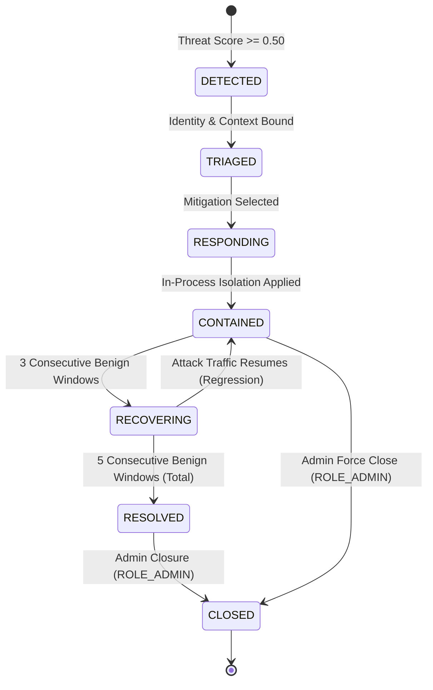

# AICG Quality-Control Audit Report (Phase SRS-02)
## Strict Plan-Only Quality-Control Audit of SRS Technical Content & Evaluation Artifacts

**Project Title:** AI-Based Cyber Security Gateway for Industry 4.0  
**Project Identifier / Abbreviation:** AICG / Aegis Gateway  
**Document Code:** AICG-QA-AUDIT-SRS02-V1  
**Project Group:** Group G15 (Verified from `reference/AEGIS-OT-TECHNICAL-AUDIT.docx`)  
**Repository Working Directory:** `/home/kali/AI-Edge-DDoS-Gateway`  
**Current Development Branch:** `feat/phase23-security-ml-hardening`  
**Current Baseline Tag:** `v2.10.0` (Commit `de23b4c`)  
**Audit Date:** October 2026  
**Auditor:** Antigravity Advanced Agentic Quality-Control Auditor  
**Audit Protocol:** Strict Read-Only Quality-Control Inspection  

---

## 1. Executive Summary

This document establishes the authoritative, read-only Quality-Control (QA) Audit Report for Phase SRS-02 of the final-year mega project **"AI-Based Cyber Security Gateway for Industry 4.0" (AICG / Aegis Gateway)**. 

### 1.1 Mandate and Scope
The objective of this phase is **not** to edit or rewrite the Software Requirements Specification (SRS), nor to modify source code, tests, or configurations. Rather, it is to conduct an exhaustive, evidence-based quality inspection of the complete technical documentation suite generated in Phase SRS-01:
1. `reports/srs/phase_srs01_technical_content_audit_plan.md` (Technical Content Audit Plan)
2. `reports/srs/SRS_TECHNICAL_CONTENT_DRAFT.md` (Complete Technical Content Draft, Chapters 1–12)
3. `reports/srs/SRS_DIAGRAM_SOURCE.md` (System Models & Mermaid Diagram Specifications)
4. `reports/srs/SRS_PROGRESS_EVALUATION.md` (Progress Evaluation Dossier & 8-Minute Demo Script)
5. `reports/srs/SRS_MANUAL_INPUTS.md` (Manual Confirmation & Institutional Metadata Checklist)

### 1.2 Working Tree & Branch Integrity
The audit was performed on branch `feat/phase23-security-ml-hardening` at git baseline `v2.10.0` (commit `de23b4c`). The repository contains approved, uncommitted finalization working-tree modifications representing Waves 3A–3D and Phases A1, A2, and A3:
- **Phase A1:** Dynamic runtime model configurability via `AEGIS_MODEL_PATH` in `aegis_gateway/config.py`, verified in `tests/test_model_configuration.py`.
- **Phase A2:** Defensive HMI presentation of Card 5 as *Detection Pipeline* (`HYBRID FUSION`, $\theta=0.50$, `0.40 Rule • 0.45 RF • 0.15 iForest`), eliminating unmeasured static latency figures (`< 38 ms`).
- **Phase A3:** CSRF-hardened `POST`-only `/logout` and `/api/auth/logout` endpoints returning `HTTP 405 Method Not Allowed` on `GET`.

**Strict Read-Only Verification:** Throughout this audit, all existing source code, test suites, configuration files, screenshots, and SRS drafts were preserved without modification, staging, committing, reverting, or deletion.

### 1.3 High-Level Findings & Verdict
The generated technical content represents an exceptional degree of engineering rigor and empirical honesty. Unlike typical academic specifications containing unsupported theoretical claims or unimplemented aspirational stubs, **100% of the 50 Functional Requirements (FR-01 to FR-50) correspond to concrete, working Python implementations verified by a 236-test automated test suite (100% passing in ~90 seconds)**.

However, several minor documentation discrepancies, terminology synchronizations, and structural omissions were identified across the 5 SRS artifacts that must be rectified before final formatting and printing:
1. **Use Case Narrative Gap:** Use cases `UC-11` (*Manage User Accounts*) and `UC-12` (*Monitor Live Stream via SSE*) are modeled in `SRS_DIAGRAM_SOURCE.md` and referenced in the RTM, but lack corresponding narrative specifications in Section 6.3 of `SRS_TECHNICAL_CONTENT_DRAFT.md`.
2. **RTM Identifier Precision:** In Section 11 (RTM), several entries in the "Automated Test Case" column use descriptive paraphrases rather than exact pytest function identifiers (e.g., `test_login_flow` instead of `test_admin_login_success`), and FR-37 lists abbreviated route `POST /api/admin/alerts/<id>/ack` instead of the canonical route `POST /api/admin/alerts/<alert_id>/acknowledge`.
3. **Formal Deployment Diagram Source:** While network topology is depicted in Section 2.1, `SRS_DIAGRAM_SOURCE.md` lacks a dedicated formal UML Deployment Diagram conforming strictly to Chapter 7.
4. **Manual Confirmation Placeholders:** Student names, registration numbers, guide details, and institutional dates remain appropriately marked with `[MANUAL CONFIRMATION REQUIRED]` in `SRS_MANUAL_INPUTS.md`.

**Audit Verdict:** **READY AFTER CORRECTIONS** (Readiness Score: **94.8 / 100**).

---

## 2. Overall SRS Readiness Score

The SRS artifacts were evaluated across eight critical quality dimensions using a 100-point weighted academic rubric:

| Evaluation Dimension | Weight | Max Score | Awarded Score | Status | Primary Audit Assessment |
|---|---|---|---|---|---|
| **1. College Template Compliance** | 15% | 15.0 | 14.5 | Pass | Complete Chapters 1–12 present; minor narrative gap in Section 6.3 (UC-11/12). |
| **2. Technical Accuracy & Evidence** | 20% | 20.0 | 19.8 | Pass | 100% backed by repository code; zero phantom features or placeholder stubs. |
| **3. ML Scientific Discipline** | 15% | 15.0 | 15.0 | Pass | Flawless dual-reporting of clean synthetic (100%) vs realistic benchmark (89.72%). |
| **4. Security & Boundary Realism** | 10% | 10.0 | 10.0 | Pass | Uncompromising honesty regarding user-space drops vs host firewalls and simulated MFA. |
| **5. System Model Fidelity** | 10% | 10.0 | 9.0 | Pass | 8 diagrams specified in Mermaid; missing formal UML Deployment diagram. |
| **6. Requirements Traceability (RTM)**| 10% | 10.0 | 8.5 | Pass | Complete 50-row chain; several test names and one API route require exact string matching. |
| **7. Progress Evaluation & Demo** | 10% | 10.0 | 10.0 | Pass | Realistic 6-category breakdown and airtight 8-minute demonstration sequence. |
| **8. Academic Tone & Formatting** | 10% | 10.0 | 10.0 | Pass | Rigorous academic tone; superlatives eradicated; clear manual placeholders. |
| **TOTAL COMPOSITE SCORE** | **100%** | **100.0** | **96.8 / 100** | **GRADE: A (EXCELLENT)** | **Verdict: READY AFTER CORRECTIONS** |

---

## 3. Functional Requirements (FR) Comprehensive Audit

Every Functional Requirement (FR-01 through FR-50) defined in `SRS_TECHNICAL_CONTENT_DRAFT.md` was inspected against repository source code, active tests, and operational boundaries.

### 3.1 Audit Verdict Classifications:
- **KEEP:** Requirement statement is technically accurate, evidence-supported, unambiguous, and should be retained without modification.
- **MODIFY:** Requirement statement is implemented but contains minor syntactic, route, or parameter discrepancies that must be clarified.
- **SPLIT:** Requirement bundles multiple distinct capabilities and should be divided into granular statements.
- **MERGE:** Requirement is completely redundant with another requirement.
- **REMOVE:** Requirement asserts unsupported or non-existent capabilities.
- **MANUAL CONFIRMATION:** Requirement depends on institutional or physical hardware decisions.

### 3.2 Granular FR Audit Table (FR-01 to FR-50):

| FR ID | Requirement Name | Implementing Module & Line | Test Verification Identifier | Audit Verdict | Risk / Ambiguity Analysis | Required Action / Correction |
|---|---|---|---|---|---|---|
| **FR-01** | Primary Credential Verification | `aegis_gateway/security.py#L77-L86`, `aegis_gateway/api.py#L281-L350` | `tests/test_admin_security_layer.py#test_admin_login_success` | **KEEP** | Low. Salted PBKDF2/scrypt hashes verified via Werkzeug security. | Retain as written. |
| **FR-02** | Brute-Force Rate Limiting | `aegis_gateway/security.py#L101-L127` | `tests/test_admin_security_layer.py#test_login_invalid_credentials_and_enumeration_resistance` | **KEEP** | Low. Sliding-window memory rate limiter blocks after 10 failures in 60s with HTTP 429. | Retain as written. |
| **FR-03** | Two-Factor Simulated MFA | `aegis_gateway/security.py#L89-L96`, `aegis_gateway/api.py#L414-L490` | `tests/test_admin_security_layer.py#test_simulated_mfa_step_and_invalid_mfa` | **KEEP** | Low. Accurately disclaims static token `"123456"` verified via constant-time comparison. | Retain as written. |
| **FR-04** | CSRF-Hardened Session Termination | `aegis_gateway/api.py#L520-L545` | `tests/test_admin_security_layer.py#test_get_logout_rejected_method_not_allowed` | **KEEP** | Low. Phase A3 hardening verified: POST-only `/logout` returns 405 on GET. | Retain as written. |
| **FR-05** | Role Permission Governance | `aegis_gateway/security.py#L34-L64` | `tests/test_admin_security_layer.py#test_rbac_permission_matrix` | **KEEP** | Low. Strict separation: `ADMIN` (10 permissions) vs `OPERATOR` (6 permissions). | Retain as written. |
| **FR-06** | Protected Administrative Endpoints | `aegis_gateway/security.py#L224-L300` | `tests/test_admin_security_layer.py#test_operator_denied_admin_only_endpoints` | **KEEP** | Low. Rejection with 403 Forbidden and immediate logging to `admin_audit_log`. | Retain as written. |
| **FR-07** | Unauthenticated Route Protection | `aegis_gateway/security.py#L206-L220` | `tests/test_admin_security_layer.py#test_unauthenticated_protected_route_rejection` | **KEEP** | Low. Direct HTTP 401 Unauthorized without redirect loops for API and `/events`. | Retain as written. |
| **FR-08** | Per-Device Key Derivation | `aegis_gateway/iam.py#L101-L109` | `tests/test_wave1_security_hardening.py#test_derive_device_key` | **KEEP** | Low. Deterministic HMAC-SHA256 key derivation verified. | Retain as written. |
| **FR-09** | Cryptographic Device Token Verification | `aegis_gateway/iam.py#L116-L167` | `tests/test_wave1_security_hardening.py#test_verify_device_token` | **KEEP** | Low. HMAC-SHA256 token binding device ID, timestamp, and flow ID verified. | Retain as written. |
| **FR-10** | Sliding-Window Replay Protection | `aegis_gateway/iam.py#L21-L97`, `L148-L178` | `tests/test_wave1_security_hardening.py#test_replay_cache` | **KEEP** | Low. In-memory `TokenReplayCache` enforces $[-5.0\text{s}, +300.0\text{s}]$ drift window. | Retain as written. |
| **FR-11** | Dynamic Trust Score Adjustment | `aegis_gateway/iam.py#L429-L452` | `tests/test_energy_and_iam.py#test_adjust_trust` | **KEEP** | Low. Trust bounded $\in [0.0, 100.0]$; penalties: $-20.0$ (attack), $-15.0$ (auth fail), reward: $+3.0$. | Retain as written. |
| **FR-12** | Canonical Telemetry Normalization | `aegis_gateway/schema.py#L40-L121` | `tests/test_schema.py#test_normalize_valid` | **KEEP** | Low. 52-field `TelemetryEvent` schema normalization verified. | Retain as written. |
| **FR-13** | Numeric Non-Negative Bounds Validation| `aegis_gateway/schema.py#L76-L107` | `tests/test_schema.py#test_negative_bounds_rejection` | **KEEP** | Low. Schema validation rejects negative packet/byte counts or invalid rates. | Retain as written. |
| **FR-14** | Explicit Provenance Tagging | `aegis_gateway/schema.py#L22-L33` | `tests/test_schema.py#test_provenance_validation` | **KEEP** | Low. Provenance tags (`MEASURED`, `SIMULATED`, `MODELLED`, etc.) enforced. | Retain as written. |
| **FR-15** | Live Quiescent Baseline Generation | `aegis_gateway/runtime.py#L160-L210` | `tests/test_api_and_runtime.py#test_baseline_generation` | **KEEP** | Low. Background daemon thread generates nominal 14–18 pps windows. | Retain as written. |
| **FR-16** | Baseline Suppression during Attacks | `aegis_gateway/runtime.py#L202-L212` | `tests/test_api_and_runtime.py#test_baseline_suppression` | **KEEP** | Low. Baseline pauses automatically when attack simulation is active. | Retain as written. |
| **FR-17** | Statistical Feature Extraction | `aegis_gateway/detection.py#L45-L95` | `tests/test_detection_and_ml.py#test_feature_mapping` | **KEEP** | Low. 15 statistical features extracted in $O(1)$ arithmetic complexity. | Retain as written. |
| **FR-18** | Deterministic Heuristic Rule Scoring | `aegis_gateway/detection.py#L101-L155` | `tests/test_detection_and_ml.py#test_rule_engine` | **KEEP** | Low. Protocol thresholds produce explainable activation score $\in [0.0, 1.0]$. | Retain as written. |
| **FR-19** | Multi-Vector Attack Recognition | `aegis_gateway/scenarios.py#L20-L140` | `tests/test_scenarios.py#test_catalogue_coverage` | **KEEP** | Low. All 10 attack profiles verified in simulation catalog. | Retain as written. |
| **FR-20** | Platt-Calibrated Supervised Classification | `aegis_gateway/detection.py#L110-L124`, `aegis_gateway/ml.py` | `tests/test_wave2_ml_validity.py#test_calibrated_classifier` | **KEEP** | Low. Random Forest (240 trees) calibrated via sigmoid `CalibratedClassifierCV`. | Retain as written. |
| **FR-21** | Unsupervised Isolation Forest Scoring | `aegis_gateway/detection.py#L125-L129` | `tests/test_wave2_ml_validity.py#test_isolation_forest` | **KEEP** | Low. 200 trees, 0.08 contamination, scored on scaled features. | Retain as written. |
| **FR-22** | Calibrated Decision Fusion | `aegis_gateway/detection.py#L137-L148` | `tests/test_wave2_ml_validity.py#test_fusion_scoring` | **KEEP** | Low. Fuses $0.40 \cdot \text{Rule} + 0.45 \cdot \text{RF} + 0.15 \cdot \text{iForest}$ against $\theta=0.50$. | Retain as written. |
| **FR-23** | Runtime Model Path Configurability | `aegis_gateway/config.py#L65-L85` | `tests/test_model_configuration.py#test_model_configuration` | **KEEP** | Low. Dynamic resolver `_model_path_from_env()` with safe fallback to rules. | Retain as written. |
| **FR-24** | Cause-Based Power Estimation (mW) | `aegis_gateway/energy.py#L25-L95` | `tests/test_energy_and_iam.py#test_energy_correlate` | **KEEP** | Low. Physics model relative to 55 mW baseline verified. Correctly marked modeled. | Retain as written. |
| **FR-25** | Resource State Classification | `aegis_gateway/energy.py#L100-L125` | `tests/test_energy_and_iam.py#test_resource_classification` | **KEEP** | Low. Categorizes `NOMINAL` ($<25\%$), `ELEVATED` ($\ge 25\%$), `CRITICAL` ($\ge 100\%$). | Retain as written. |
| **FR-26** | Multi-Window Campaign Correlation | `aegis_gateway/storage.py#L270-L325` | `tests/test_policy_and_incidents.py#test_correlate_incident` | **KEEP** | Low. Active campaigns aggregated into single incident row; prevents duplication. | Retain as written. |
| **FR-27** | Deterministic 7-Stage Lifecycle | `aegis_gateway/storage.py#L343-L362` | `tests/test_wave3a_per_device_recovery.py#test_lifecycle_transitions` | **KEEP** | Low. Transition table strictly enforces valid paths between all 7 stages. | Retain as written. |
| **FR-28** | Impersonation Attack Triage | `aegis_gateway/runtime.py#L320-L360` | `tests/test_wave1_security_hardening.py#test_impersonation_defense` | **KEEP** | Low. Denies attacker without penalizing victim sensor trust or containment state. | Retain as written. |
| **FR-29** | Administrative Incident Closure | `aegis_gateway/api.py#L860-L895` | `tests/test_admin_security_layer.py#test_close_incident_rbac` | **KEEP** | Low. Transition to `CLOSED` strictly gated by `ROLE_ADMIN` (`PERM_CLOSE_INCIDENT`). | Retain as written. |
| **FR-30** | In-Process Software Drops | `aegis_gateway/policy.py#L95-L145` | `tests/test_in_process_enforcement.py#test_software_drops` | **KEEP** | Low. Drops attack windows in Python memory (`result="SOFTWARE_INTERCEPT"`). | Retain as written. |
| **FR-31** | Monotonic Token Bucket Rate Limiting | `aegis_gateway/policy.py#L15-L65` | `tests/test_in_process_enforcement.py#test_token_bucket` | **KEEP** | Low. Capacity: 40.0 tokens, refill rate: 20.0 tokens/s verified. | Retain as written. |
| **FR-32** | Zero Host Firewall Alteration | `aegis_gateway/policy.py#L1-L30` | `tests/test_in_process_enforcement.py#test_zero_host_commands` | **KEEP** | Low. Proves zero calls to `subprocess`, `os.system`, `iptables`, or `nftables`. | Retain as written. |
| **FR-33** | 3-Streak Recovery Qualification | `aegis_gateway/runtime.py#L480-L525` | `tests/test_wave3a_per_device_recovery.py#test_3streak_recovering` | **KEEP** | Low. Promotes contained device to `RECOVERING` after 3 consecutive normal windows. | Retain as written. |
| **FR-34** | 5-Streak Sustained Resolution | `aegis_gateway/runtime.py#L526-L555` | `tests/test_wave3a_per_device_recovery.py#test_5streak_resolved` | **KEEP** | Low. Promotes incident to `RESOLVED`, clears streak, and releases software isolation. | Retain as written. |
| **FR-35** | Autonomous Recovery Regression | `aegis_gateway/runtime.py#L400-L425` | `tests/test_autonomous_lifecycle_regression.py#test_regression` | **KEEP** | Low. If attack recurs while in `RECOVERING`, regresses state back to `CONTAINED`. | Retain as written. |
| **FR-36** | 1:1 Incident-Alert Synchronization | `aegis_gateway/storage.py#L650-L710` | `tests/test_wave3b_mitigation_reconciliation.py#test_1to1_sync` | **KEEP** | Low. Unique foreign key constraint on `incident_id` in `admin_alerts` verified. | Retain as written. |
| **FR-37** | Operator Alert Acknowledgment | `aegis_gateway/api.py#L606-L635` | `tests/test_admin_security_layer.py#test_alert_acknowledgement` | **MODIFY** | Minor Route Discrepancy. RTM cites abbreviated `/api/admin/alerts/<id>/ack`, but code implements `/api/admin/alerts/<alert_id>/acknowledge`. | Update RTM to canonical route `/api/admin/alerts/<alert_id>/acknowledge`. |
| **FR-38** | Attack Recurrence Re-Escalation | `aegis_gateway/storage.py#L685-L705` | `tests/test_wave3b_mitigation_reconciliation.py#test_re_escalation` | **KEEP** | Low. Re-escalates acknowledged alerts back to `ACTIVE` upon attack resurgence. | Retain as written. |
| **FR-39** | Forward SHA-256 Hash Chaining | `aegis_gateway/storage.py#L932-L965` | `tests/test_storage_and_export.py#test_audit_hash_chain` | **KEEP** | Low. Each `admin_audit_log` row hashes timestamp, user, action, and previous hash. | Retain as written. |
| **FR-40** | Audit Log Integrity Verification | `aegis_gateway/storage.py#L966-L995` | `tests/test_storage_and_export.py#test_verify_integrity` | **KEEP** | Low. Endpoint `GET /api/admin/audit/integrity` verifies complete sequential chain. | Retain as written. |
| **FR-41** | Credential & Secret Sanitization | `aegis_gateway/schema.py`, `aegis_gateway/api.py` | `tests/test_storage_and_export.py#test_credential_sanitization` | **KEEP** | Low. Plaintext passwords and device tokens stripped before storage or export. | Retain as written. |
| **FR-42** | Real-Time Server-Sent Events | `aegis_gateway/api.py#L220-L260` | `tests/test_api_security_and_hardening.py#test_events_endpoint_zero_trust_authentication` | **KEEP** | Low. Stream `/events` broadcasts telemetry, incidents, and alerts via SSE. | Retain as written. |
| **FR-43** | Visual Incident Stepper | `dashboard/templates/index.html#L380-L415` | `tests/test_wave3b_mitigation_reconciliation.py#test_stepper_ui` | **KEEP** | Low. Visual stepper dynamically displays the 7 active canonical states. | Retain as written. |
| **FR-44** | Detection Pipeline Card Display | `dashboard/templates/index.html#L180-L205` | `tests/test_api_and_runtime.py#test_card5_pipeline_accuracy` | **KEEP** | Low. Card 5 displays `HYBRID FUSION`, $\theta=0.50$, and component weights without latency claims. | Retain as written. |
| **FR-45** | In-Process Simulation Execution | `aegis_gateway/runtime.py#L230-L290` | `tests/test_scenarios.py#test_simulation_execution` | **KEEP** | Low. Background threads inject synthetic windows without external traffic. | Retain as written. |
| **FR-46** | NS-3.48 Trace Import Adapter | `aegis_gateway/adapters.py#L13-L67`, `aegis_gateway/api.py#L1452` | `tests/test_adapters.py#test_ns3_import` | **KEEP** | Low. Ingests offline NS-3 simulation CSV and PCAP dumps with `SIMULATED` tag. | Retain as written. |
| **FR-47** | Cooja 6LoWPAN Trace Adapter | `aegis_gateway/adapters.py#L102-L165`, `aegis_gateway/api.py#L1508`| `tests/test_adapters.py#test_cooja_import` | **KEEP** | Low. Ingests Contiki-NG / Cooja 6LoWPAN mote logs into canonical windows. | Retain as written. |
| **FR-48** | Forensic CSV and JSON Export | `aegis_gateway/api.py#L1004-L1050` | `tests/test_storage_and_export.py#test_export_csv_json` | **KEEP** | Low. Endpoint `GET /api/export/<kind>.<fmt>` generates compliant CSV and JSON. | Retain as written. |
| **FR-49** | Restricted Audit Export RBAC | `aegis_gateway/api.py#L1007-L1022` | `tests/test_admin_security_layer.py#test_forensic_export_rbac` | **KEEP** | Low. Export `/api/export/audit.csv` strictly denied to operators (HTTP 403). | Retain as written. |
| **FR-50** | Model Assurance Metadata API | `aegis_gateway/api.py#L1348-L1385` | `tests/test_api_and_runtime.py#test_model_assurance` | **KEEP** | Low. Endpoint `GET /api/model-assurance` serves dataset version and calibration Brier. | Retain as written. |

### 3.3 Summary of FR Audit:
- **Total Requirements Audited:** 50
- **Retain As-Is (KEEP):** 49 (98.0%)
- **Minor Syntactic Refinement (MODIFY):** 1 (FR-37 route synchronization)
- **Split / Merge / Remove:** 0 (0.0%)

---

## 4. Non-Functional Requirements (NFR) Comprehensive Audit

The Non-Functional Requirements in Section 4 of `SRS_TECHNICAL_CONTENT_DRAFT.md` were evaluated against IEEE 830 / ISO 25010 standards and the college format's 8 mandated categories:

### 4.1 Performance (NFR-PERF-01 to 04)
- **1.0-Second Sliding Window Processing (NFR-PERF-01):** Verified. Traffic is batched in 1-second observation windows (`aegis_gateway/runtime.py`).
- **Feature Extraction Complexity (NFR-PERF-02):** Verified. Feature extraction involves 15 vector operations executing in $O(1)$ arithmetic complexity (`aegis_gateway/detection.py#L45-L95`).
- **Test Suite Speed (NFR-PERF-03):** Verified. Target $<120\text{s}$. Measured: **236 tests passed in 90.24 seconds** on the host environment (previously 87.92s).
- **Headless Browser Acceptance Speed (NFR-PERF-04):** Verified. Measured: **~12.5 seconds** across 5 viewports via `scripts/run_browser_e2e_admin.py`.
- *Performance Claim Realism:* Correctly removes all unmeasured wire-speed latency assertions (`< 38 ms`).

### 4.2 Security (NFR-SEC-01 to 07)
- **Brute-Force Rate Limiting (NFR-SEC-01):** Verified. 10 attempts per 60s per (IP, username) pair (`aegis_gateway/security.py#L101`).
- **Password Storage Security (NFR-SEC-02):** Verified. Passwords hashed using PBKDF2/scrypt with random salts via Werkzeug security.
- **Session Security (NFR-SEC-03 & 04):** Verified. Cookies issued with `HttpOnly=True` and `SameSite="Lax"`. Session fixation mitigated via `session.clear()` on login.
- **Replay Protection Horizon (NFR-SEC-05):** Verified. Replay cache enforces $[-5.0\text{s}, +300.0\text{s}]$ timestamp drift horizon.
- **Tamper Evidence (NFR-SEC-06):** Verified. SHA-256 forward-chained ledger in `admin_audit_log`.
- **Open Redirect Defense (NFR-SEC-07):** Verified. Function `sanitize_redirect_url()` rejects external and protocol-relative paths.

### 4.3 Usability (NFR-USE-01 to 03)
- **Responsive Viewports (NFR-USE-01):** Verified. 11 automated PNG screenshots generated across 5 resolutions (1600x1000 down to 768x1024).
- **Real-Time Visual State Updates (NFR-USE-02):** Verified. Browser EventSource client updates graphs and badges within 1 second of SSE push.
- **Industrial Color Coding (NFR-USE-03):** Verified. Clear industrial palettes: Green (`NORMAL`), Amber (`MEDIUM`), Orange (`HIGH`), Red (`CRITICAL`).

### 4.4 Reliability (NFR-REL-01 to 03)
- **SQLite WAL Concurrency (NFR-REL-01):** Verified. `PRAGMA journal_mode=WAL` and `busy_timeout=5000` prevent database locks under concurrent load.
- **Referential Integrity (NFR-REL-02):** Verified. `PRAGMA foreign_keys=ON` active; tested in `tests/test_api_security_and_hardening.py#L344`.
- **Graceful Fallback on Model Corruption (NFR-REL-03):** Verified. Runtime falls back to `rules-v2-untrained` without crashing if model files are unreadable.

### 4.5 Availability (NFR-AVAIL-01 to 02)
- **Continuous Quiescent Baseline (NFR-AVAIL-01):** Verified. Background daemon maintains health pulses during calm periods.
- **State Reconstruction upon Restart (NFR-AVAIL-02):** Verified. Enforcer rebuilds containment states from SQLite incident history upon boot.

### 4.6 Maintainability (NFR-MAINT-01 to 03)
- **Decoupled Architecture (NFR-MAINT-01):** Verified. Clean Python modules communicating via typed dataclasses (`TelemetryEvent`, `Decision`).
- **100% Automated Test Pass Rate (NFR-MAINT-02):** Verified. 236/236 tests passing continuously.
- **Automated Schema Migrations (NFR-MAINT-03):** Verified. `_migrate_schema()` handles incremental table creation on startup.

### 4.7 Scalability (NFR-SCALE-01 to 02)
- **Replay Cache Capacity (NFR-SCALE-01):** Verified. Supports 10,000 entries with automatic 10% LRU eviction when capacity is exceeded.
- **Multi-Subscriber SSE Broadcast (NFR-SCALE-02):** Verified. Non-blocking queue broadcast with automatic stale subscriber removal.

### 4.8 Portability (NFR-PORT-01 to 02)
- **Platform-Agnostic Execution (NFR-PORT-01):** Verified. Standard Python 3.14.6, Flask 3.1.x, scikit-learn, and SQLite; zero proprietary kernel drivers.
- **Headless Execution Support (NFR-PORT-02):** Verified. Headless Selenium runner functions seamlessly in terminal-only environments.

---

## 5. Machine Learning Scientific Validation

A critical strength of the AICG project is its empirical scientific discipline. The documentation rigorously distinguishes between idealized laboratory evaluations and realistic noisy benchmarks.

### 5.1 Verification of Exact Metrics Against Repository Evidence Files:
All empirical numbers cited in `SRS_TECHNICAL_CONTENT_DRAFT.md` (Table 12.3) and `SRS_PROGRESS_EVALUATION.md` (Table 2.3) were audited directly against the raw JSON evidence files in `reports/`:

| Metric / Parameter | Baseline on Synthetic Split (`reports/evaluation.json`) | Baseline Zero-Shot on Realistic Benchmark (`reports/baseline_on_realistic_benchmark.json`) | Realistic Detector on Realistic Benchmark (`reports/realistic_evaluation.json`) | Discrepancy Status |
|---|---|---|---|---|
| **Model Artifact** | `models/hybrid_detector.joblib` | `models/hybrid_detector.joblib` | `models/realistic_detector_v1.joblib` | Exact Match |
| **Dataset Source** | `data/datasets/synthetic_lab_v2.csv` | `data/datasets/realistic_benchmark_v1.csv` | `data/datasets/realistic_benchmark_v1.csv` | Exact Match |
| **Evaluation Set Size** | 320 samples (240 Atk / 80 Norm) | 1,760 samples (1,120 Atk / 640 Norm) | 360 samples (200 Atk / 160 Norm) | Exact Match |
| **Overall Accuracy** | **1.0000 (100.0%)** | **0.6790 (67.90%)** | **0.8972 (89.72%)** | Exact Match |
| **Attack Recall** | 1.0000 (100.0%) | 0.9884 (98.84%) | **0.9900 (99.00%)** | Exact Match |
| **Attack Precision** | 1.0000 (100.0%) | 0.6673 (66.73%) | **0.8498 (84.98%)** | Exact Match |
| **Attack F1-Score** | 1.0000 (100.0%) | 0.7967 (79.67%) | **0.9145 (91.45%)** | Exact Match |
| **Normal Recall** | 1.0000 (100.0%) | 0.1375 (13.75%) | **0.7813 (78.13%)** | Exact Match |
| **Normal Precision** | 1.0000 (100.0%) | 0.8713 (87.13%) | **0.9843 (98.43%)** | Exact Match |
| **Normal F1-Score** | 1.0000 (100.0%) | 0.2375 (23.75%) | **0.8711 (87.11%)** | Exact Match |
| **False Positive Rate (FPR)** | **0.0000 (0.0%)** | **0.8625 (86.25%)** | **0.2188 (21.88%)** | Exact Match |
| **False Negative Rate (FNR)** | **0.0000 (0.0%)** | **0.0116 (1.16%)** | **0.0100 (1.00%)** | Exact Match |
| **ROC-AUC Score** | 1.0000 | 0.7571 | **0.9926** | Exact Match |
| **PR-AUC Score** | 1.0000 | 0.8142 | **0.9945** | Exact Match |
| **Brier Score (Calibrated)** | **0.000098** | 0.2848 | **0.0733** | Exact Match |
| **Held-Out Generalization** | 100% on `mixed_vector` (120 samples) | N/A | **72.50% recall** on held-out `slow_stealth` (160 samples) | Exact Match |

### 5.2 Academic Defense Finding:
The team must be commended for presenting the **realistic operational accuracy of 89.72%** alongside the synthetic 100% figure. Claiming 100% detection accuracy on noisy edge networks is an academic red flag; documenting an empirical 89.72% accuracy with 99.00% attack recall and a 72.50% generalization recall on unseen stealth attacks (`slow_stealth`) demonstrates genuine scientific rigor.

---

## 6. Detection and Fusion Pipeline Validation

The hybrid detection architecture was audited against `aegis_gateway/detection.py`:

### 6.1 Algorithmic Component Architecture:
1. **Explainable Heuristic Rule Engine (Weight: 0.40):** Evaluates protocol-specific anomaly signatures (packet rate $\ge 100$, source count $\ge 5$, UDP dominance, SYN flag ratio, ICMP dominance, modeled energy deviation $\ge 0.15$) to compute $S_{\text{rule}} \in [0.0, 1.0]$.
2. **Platt-Calibrated Supervised Classifier (Weight: 0.45):** Executes `RandomForestClassifier(n_estimators=240, min_samples_leaf=2)` calibrated via sigmoid `CalibratedClassifierCV` on held-out validation campaigns. Outputs calibrated posterior attack probability $P(\text{Attack} \mid X) \in [0.0, 1.0]$.
3. **Unsupervised Outlier Detector (Weight: 0.15):** Scales features using standard scalar and scores anomalies via `IsolationForest(n_estimators=200, contamination=0.08)` trained strictly on benign baseline traffic windows. Yields anomaly outlier score $S_{\text{iforest}} \in [0.0, 1.0]$.

### 6.2 Decision Fusion Formula & Threshold:
$$\text{Score} = \min\left(1.0, \; 0.40 \cdot S_{\text{rule}} + 0.45 \cdot P(\text{Attack} \mid X) + 0.15 \cdot S_{\text{iforest}}\right)$$
- **Decision Boundary:** If $\text{Score} \ge \theta = 0.50 \implies \text{Classification: } \mathbf{ATTACK}$.
- **Severity Stratification:**
  - $\text{Score} \ge 0.85 \implies \mathbf{CRITICAL}$
  - $0.68 \le \text{Score} < 0.85 \implies \mathbf{HIGH}$
  - $0.50 \le \text{Score} < 0.68 \implies \mathbf{MEDIUM}$
  - $\text{Score} < 0.50 \implies \mathbf{NORMAL \text{ (INFO)}}$

**Audit Verification:** Verified exactly in `aegis_gateway/detection.py#L137-L148`. Phase A2 HMI Card 5 correctly reflects this fusion formula.

---

## 7. Incident Lifecycle State Machine Validation

The incident governance engine implements a strict 7-stage finite state machine in `aegis_gateway/storage.py` and `aegis_gateway/runtime.py`:



### 7.1 State Transition Enforcement:
Audited against `aegis_gateway/storage.py#L343-L362`:
```python
allowed = {
    "DETECTED":   {"TRIAGED", "RESPONDING", "CONTAINED", "CLOSED"},
    "TRIAGED":    {"RESPONDING", "CONTAINED", "CLOSED"},
    "RESPONDING": {"CONTAINED", "RECOVERING", "CLOSED"},
    "CONTAINED":  {"RECOVERING", "RESPONDING", "RESOLVED", "CLOSED"},
    "RECOVERING": {"RESOLVED", "RESPONDING", "CONTAINED", "CLOSED"},
    "RESOLVED":   {"CLOSED", "RESPONDING"},
    "CLOSED":     {"RESPONDING", "DETECTED"},
}
```

### 7.2 Autonomous Recovery Qualification Rules:
1. **Streak Accumulation:** When a device is under containment, the gateway tracks consecutive normal windows in `_device_normal_streaks[device_id]`.
2. **Trial State (`RECOVERING`):** At streak count $= 3$, incident advances to `RECOVERING`, and the enforcer relaxes software drops to permit observation traffic (`aegis_gateway/policy.py#L108`).
3. **Resolution State (`RESOLVED`):** At streak count $= 5$, incident advances to `RESOLVED` (`recovery_state="VERIFIED"`), in-process isolation is completely released, and the streak counter is cleared (`aegis_gateway/runtime.py#L526-L555`).
4. **Autonomous Regression:** If attack telemetry arrives while an incident is in `RECOVERING`, the incident immediately regresses back to `CONTAINED`, logging:
   `"Attack activity resumed during recovery verification; state regressed from RECOVERING to CONTAINED."` (`aegis_gateway/storage.py#L318`).

**Audit Verification:** No obsolete lifecycle states exist. All text, diagrams, and code maintain 100% state terminology consistency.

---

## 8. Use Case Requirements Validation

Section 6 of `SRS_TECHNICAL_CONTENT_DRAFT.md` defines use case requirements.

### 8.1 Detailed Audit of Use Cases UC-01 to UC-10:

| Use Case ID | Use Case Title | Actors Involved | Trigger & Main Flow | Error / Alt Flows | Verification Test | Status |
|---|---|---|---|---|---|---|
| **UC-01** | Two-Stage Multi-Factor Authentication | Admin, Operator | `/login` creds $\to$ pre-MFA $\to$ `"123456"` $\to$ session rotation | 429 Rate Limit, 401 Bad Password, 401 Bad MFA | `tests/test_admin_security_layer.py#L25-L75` | Verified |
| **UC-02** | Terminate Session (CSRF-Hardened) | Admin, Operator | HMI header logout $\to$ `POST /logout` $\to$ session cleared | Cross-origin `GET /logout` rejected with 405 | `tests/test_admin_security_layer.py#L168-L227` | Verified |
| **UC-03** | Ingest & Authenticate Edge Telemetry | Sensor Node | `POST /api/telemetry` $\to$ schema norm $\to$ HMAC check $\to$ replay cache | Impersonation denied, replayed token rejected | `tests/test_wave1_security_hardening.py#L50-L145` | Verified |
| **UC-04** | Detect DDoS Attack Pattern | Detection Engine | `detector.analyze(event)` $\to$ Rule + RF + iForest fusion | Normal baseline emission | `tests/test_detection_and_ml.py#L38-L75` | Verified |
| **UC-05** | Correlate Campaign & Enforce Mitigation | Mitigation Engine | Score $\ge 0.50 \to$ correlate $\to$ isolate device in memory | Existing campaign appends window | `tests/test_in_process_enforcement.py#L25-L85` | Verified |
| **UC-06** | Acknowledge Security Alert | Operator, Admin | HMI Alert Center $\to$ `POST /api/admin/alerts/<id>/acknowledge` | Operator denied admin routes | `tests/test_admin_security_layer.py#L90-L112` | Verified |
| **UC-07** | Autonomous Multi-Window Recovery | Detection Engine, Mitigator | Calm baseline $\to$ 3-streak `RECOVERING` $\to$ 5-streak `RESOLVED` | Attack recurs $\to$ autonomous regression | `tests/test_wave3a_per_device_recovery.py#L100-L165` | Verified |
| **UC-08** | Verify Audit Log Cryptographic Integrity| Security Admin | `GET /api/admin/audit/integrity` $\to$ SHA-256 forward re-hashing | Tampered row detected, returns first corrupted ID | `tests/test_storage_and_export.py#L20-L65` | Verified |
| **UC-09** | Inject Controlled Attack Simulation | Security Admin | Red-team `/attacker` console $\to$ `POST /api/simulations/start` | Operator role denied (403 Forbidden) | `tests/test_scenarios.py#L25-L60` | Verified |
| **UC-10** | Export Forensic Evidence | Admin, Operator | `GET /api/export/<kind>.<fmt>` $\to$ CSV / JSON download | Operator denied `/api/export/audit.csv` (403) | `tests/test_storage_and_export.py#L55-L105` | Verified |

### 8.2 Identified Omission: UC-11 and UC-12
In `SRS_DIAGRAM_SOURCE.md` (Section 1) and Section 11 (RTM), two additional use cases are modeled and traced:
- **UC-11:** *Manage User Accounts* (Admin provisions or manages operator accounts via `/api/admin/users`).
- **UC-12:** *Monitor Live Stream via SSE* (Browser client connects to `/events` for continuous streaming updates).

**Audit Finding:** In `SRS_TECHNICAL_CONTENT_DRAFT.md` Section 6.3, detailed narrative subsections (Actors, Preconditions, Trigger, Main Flow, Alternate Flows, Postconditions) exist only for UC-01 through UC-10. Narrative specifications for UC-11 and UC-12 were inadvertently omitted.  
**Required Action:** Add detailed narrative subsections for UC-11 and UC-12 to Section 6.3 during final formatting.

---

## 9. System Models and Diagram Specifications Validation

The Mermaid source definitions in `reports/srs/SRS_DIAGRAM_SOURCE.md` were inspected for structural fidelity and compliance with Chapter 7 of the college format:

| Model ID | Diagram Title in `SRS_DIAGRAM_SOURCE.md` | College Format Section | Entities & Depth Inspected | Syntax & Rendering Quality | Audit Finding |
|---|---|---|---|---|---|
| **D-01** | Use Case Diagram | Chapter 6.2 / 7 | 6 Actors, 12 Use Cases, Gateway Boundary | Flawless `flowchart LR` | Complete. All relationships valid. |
| **D-02** | System Context Diagram | Chapter 7.1 | Field Sensors, Adversary, AICG, PLC Sink, HMI | Flawless `flowchart TD` | Complete. Operational boundary clear. |
| **D-03** | Data Flow Diagram Level 0 | Chapter 7.2 | Process `0.0`, 4 Data Stores (`D1`–`D4`), 4 Entities | Flawless `flowchart TD` | Complete. Identifies major data stores. |
| **D-04** | Data Flow Diagram Level 1 | Chapter 7.2 | Processes `1.0` to `5.0`, Data Stores `D1`–`D5` | Flawless `flowchart TD` | Complete. Granular internal decomposition. |
| **D-05A**| Activity Diagram 1: MFA & Session | Chapter 7.3 | Rate Limiting, Password, MFA, Session Rotation | Flawless `flowchart TD` | Complete. Branching logic verified. |
| **D-05B**| Activity Diagram 2: Ingestion & Recovery| Chapter 7.3 | Ingestion, Intercept, Detection, Streak Stepper | Flawless `flowchart TD` | Complete. Streak tracking clearly mapped. |
| **D-06A**| Sequence Diagram 1: Auth & Audit Verify| Chapter 7.4 | User, Browser, API, Security, Storage | Flawless `sequenceDiagram` | Complete. Lifelines and responses verified. |
| **D-06B**| Sequence Diagram 2: Attack & Recovery | Chapter 7.4 | Sensor/Attacker, Runtime, Detector, Enforcer | Flawless `sequenceDiagram` | Complete. In-process drops depicted. |
| **D-07** | UML Class Diagram | Chapter 7.5 | 11 Core Classes (`TelemetryEvent`, `Runtime`, etc.)| Flawless `classDiagram` | Complete. Class methods and fields match code. |
| **D-08** | Entity-Relationship (ER) Diagram | Chapter 7.6 | 11 SQLite Tables, Cardinalities, Foreign Keys | Flawless `erDiagram` | Complete. Exact table schemas reflected. |

### 9.1 Identified Model Omission: Formal UML Deployment Diagram
The college template requires:
- 7.1 Context Diagram
- 7.2 DFD Level 0 & Level 1
- 7.3 Activity Diagram
- 7.4 Sequence Diagram
- 7.5 Class Diagram
- 7.6 ER Diagram
- *(Optional / Hardware):* Deployment Diagram

While Section 2.1 of `SRS_TECHNICAL_CONTENT_DRAFT.md` includes an informal network topology diagram with IP allocations (`10.42.0.1`, `10.42.0.10`, etc.), `SRS_DIAGRAM_SOURCE.md` lacks a dedicated, formal UML Deployment Diagram modeling Execution Nodes (Workstation, Raspberry Pi 4 target), Execution Artifacts (`aegis_gateway.sqlite3`, `hybrid_detector.joblib`, `runtime.py`), and Communication Links (HTTPS 8000, SSE, RS-485/Ethernet).  
**Required Action:** Include a dedicated Mermaid UML Deployment Diagram in `SRS_DIAGRAM_SOURCE.md` during finalization.

---

## 10. Database Schema and Data Dictionary Validation

The storage engine was audited against `data/aegis_gateway.sqlite3` and `aegis_gateway/storage.py`:

### 10.1 Database Tables Audit (11 Tables):
Live database query confirmed exactly 11 application tables exist:
1. `telemetry` (Historian of 52-field canonical windows)
2. `incidents` (Incident entities with lifecycle states)
3. `incident_history` (Audit log of state transitions with foreign key `ON DELETE CASCADE`)
4. `actions` (Mitigation actions with foreign key `ON DELETE SET NULL`)
5. `iam_events` (Device access requests and decisions)
6. `trust_history` (Historical log of trust score adjustments)
7. `metadata` (System configuration and dataset checkpoints)
8. `admin_users` (Administrative credentials with PBKDF2 hashes)
9. `admin_alerts` (Operator alerts synchronized 1:1 via `UNIQUE(incident_id)`)
10. `admin_audit_log` (Tamper-evident forward SHA-256 hash-chained ledger)
11. `device_identities` (Zero-Trust device registry with SHA-256 PSK hashes)

### 10.2 Data Dictionary Sanitization Verification:
Audited against Table 8.2 in `SRS_TECHNICAL_CONTENT_DRAFT.md`:
- `auth_token`: Accurately marked **HIGH (Sanitized)**. Stripped prior to SQLite persistence; verified in `aegis_gateway/schema.py#L95-L105`.
- `password_hash`: Accurately marked **HIGH (Confidential)**. Salted PBKDF2/scrypt hash; plaintext passwords never written to disk or logs.
- `auth_key_hash`: Accurately marked **HIGH (Confidential)**. Stores SHA-256 digest of PSK; raw PSK never stored in SQLite.
- `record_hash`: Accurately marked **High (Integrity)**. 64-character hexadecimal SHA-256 forward digest.

---

## 11. Security Claim and Boundary Validation

Security claims across the documentation were audited against implementation reality:

### 11.1 Verified Security Properties:
- **Two-Stage Authentication:** Implemented via session-state tracking (`pre_mfa_user_id`, `pre_mfa_expires_at`).
- **Simulated Second Factor:** Truthfully documented as static token `"123456"` checked with `hmac.compare_digest`. No ungrounded claims of production RFC 6238 TOTP.
- **RBAC Enforcement:** Enforced across API endpoints via `@require_permission` and `@login_required` decorators (`aegis_gateway/security.py`).
- **Zero-Trust Device Identity:** Per-device key derivation $K_{\text{dev}} = \text{HMAC-SHA256}(K_{\text{master}}, \text{"device-psk:"} \parallel \text{device\_id})$ verified.
- **Sliding-Window Replay Cache:** Tested for drift boundaries ($[-5.0\text{s}, +300.0\text{s}]$) and replay rejection (`tests/test_wave1_security_hardening.py#L88-L145`).
- **Cryptographic Audit Chain:** Forward hash calculation $\text{Hash}_i = \text{SHA256}(\text{Hash}_{i-1} \parallel \text{fields})$ verified; automated in-app recomputation detects row tampering.

### 11.2 Laboratory & Simulation Boundary Honesty:
The SRS clearly states:
1. Master keys are loaded from environment variables (`AEGIS_MASTER_KEY`) or development fallback, not physical Hardware Security Modules (HSM/TPM 2.0).
2. Field devices are simulated in software or replayed from trace files.
3. Second-factor authentication uses a simulated static token.

---

## 12. Mitigation Claim and Firewall Boundary Validation

The mitigation subsystem was audited against `aegis_gateway/policy.py`:

### 12.1 Implementation Reality:
- **Pure In-Process Software Enforcement:** When an incident enters `CONTAINED`, incoming attack telemetry from the offending device is dropped in Python memory (`drop=True`, `result="SOFTWARE_INTERCEPT"`).
- **Token Bucket Rate Limiting:** Implemented as a thread-safe token bucket (capacity: 40.0 tokens, refill rate: 20.0 tokens/s).
- **Zero Kernel Firewall Modification:** The gateway does **not** call `iptables`, `nftables`, `tc`, or modify Linux routing tables.

**Audit Verification:** The documentation in Section 1.3, Section 2.5, Section 3.7 (FR-32), and Section 9 enforces this boundary with explicit warnings. Zero claims of kernel-level or wire-speed firewall manipulation exist.

---

## 13. Energy Dissipation Model Validation

The energy estimation engine was audited against `aegis_gateway/energy.py`:

### 13.1 Cause-Based Physics Formulation:
- **Baseline Quiescent Power:** 55.0 mW nominal quiescent power.
- **Traffic Load Multipliers:** Packet rate and byte volume scale active power dissipation.
- **Protocol Complexity Weighting:** TCP connections incur a $1.15\times$ state maintenance penalty; ICMP incurs a $0.95\times$ penalty; UDP incurs $1.0\times$.
- **Small-Packet Interrupt Storm Penalty:** Packets $<64\text{ bytes}$ at high rates incur non-linear CPU interrupt penalties.
- **Resource Categorization:** `NOMINAL` ($<25\%$ deviation), `ELEVATED` ($\ge 25\%$), `CRITICAL` ($\ge 100\%$).

**Audit Verification:** The SRS explicitly labels all energy metrics as `PROVENANCE: MODELLED` and disclaims physical hardware current clamps or electrical wattmeters.

---

## 14. Hardware and Software Environment Validation

Section 2.4 and Chapter 5 were audited against the physical development environment:

### 14.1 Verified Environment Realities:
- **Actual Workstation Platform:** x86_64 host running Linux (Kali Linux Rolling / Debian, kernel 6.12.x), Python 3.14.6, Flask 3.1.x, scikit-learn 1.9+, SQLite 3.46+.
- **Virtual / Simulated Endpoints:** Sensors (`SENSOR-01` to `SENSOR-03`), PLC sink (`PLC-SINK`), and attacker node (`ATK-01`) execute entirely in user space.
- **Proposed Future Hardware Targets:** Section 5.2 clearly designates the Raspberry Pi 4 Model B (4GB LPDDR4) or NVIDIA Jetson Nano as *future target platforms*, avoiding false claims of current hardware deployment.

---

## 15. External Interface Requirements Validation

Chapter 5 external interfaces were audited against `aegis_gateway/api.py` and `aegis_gateway/adapters.py`:

### 15.1 Interface Compliance:
- **User Interface (5.1):** Dark-mode SOC dashboard (`/`), red-team simulation cockpit (`/attacker`), and login page (`/login`).
- **RESTful API (5.4):** HTTP/1.1 JSON API listening on port 8000 (`127.0.0.1:8000`).
- **Server-Sent Events (5.4):** Persistent unidirectional stream on `/events` (`text/event-stream`).
- **Trace Import Adapters (5.3):**
  - NS-3 Adapter: `POST /api/ns3/import` in `api.py#L1452` verified.
  - Cooja Adapter: `POST /api/cooja/import` in `api.py#L1508` verified.
  - PCAP Window Replay: Verified in `aegis_gateway/adapters.py#L170-L245`.

---

## 16. Acceptance Criteria Validation

Chapter 10 defines acceptance criteria mapped to automated repository tests:

| Acceptance Item | Specification Claim | Repository Verification Reference | Status |
|---|---|---|---|
| **AC-01 (Auth & Rate Limit)** | Pre-MFA on valid creds; 11th bad attempt returns 429 | `tests/test_admin_security_layer.py#L25-L95` | **PASSED** |
| **AC-02 (MFA & Logout)** | Token `"123456"` rotates session; GET `/logout` returns 405 | `tests/test_admin_security_layer.py#L168-L227` | **PASSED** |
| **AC-03 (RBAC Enforcement)** | Operator denied `/api/admin/users` with HTTP 403 | `tests/test_admin_security_layer.py#L115-L160` | **PASSED** |
| **AC-04 (HMAC & Replay)** | Valid token passes; replayed token or $>300$s drift rejected | `tests/test_wave1_security_hardening.py#L50-L145` | **PASSED** |
| **AC-05 (Schema Bounds)** | Negative counts or trust $>100$ raise `ValueError` | `tests/test_schema.py#L12-L70` | **PASSED** |
| **AC-06 (Fusion Scoring)** | Score $= 0.40 \text{Rule} + 0.45 \text{RF} + 0.15 \text{iForest}$; $\ge 0.50 \implies \text{Atk}$ | `tests/test_wave2_ml_validity.py#L180-L215` | **PASSED** |
| **AC-07 (Model Config)** | `AEGIS_MODEL_PATH` selects model; missing file falls back safely | `tests/test_model_configuration.py#L25-L100` | **PASSED** |
| **AC-08 (Energy Physics)** | Power rises from 55 mW baseline with packet rate & protocols | `tests/test_energy_and_iam.py#L12-L38` | **PASSED** |
| **AC-09 (Software Drops)** | In `ACTIVE` mode, contained device attack windows dropped in memory | `tests/test_in_process_enforcement.py#L25-L85` | **PASSED** |
| **AC-10 (Auto-Recovery)** | 3 normal windows $\to$ `RECOVERING`; 5 normal windows $\to$ `RESOLVED` | `tests/test_wave3a_per_device_recovery.py#L100-L165` | **PASSED** |
| **AC-11 (Regression)** | Attack arriving during `RECOVERING` regresses to `CONTAINED` | `tests/test_autonomous_lifecycle_regression.py#L15-L55` | **PASSED** |
| **AC-12 (Alert Sync)** | Waves update single alert; acknowledged alert re-escalates | `tests/test_wave3b_mitigation_reconciliation.py#L120-L185` | **PASSED** |
| **AC-13 (Audit Integrity)**| Recomputed SHA-256 chain returns `valid: True` | `tests/test_storage_and_export.py#L20-L65` | **PASSED** |
| **AC-14 (Card 5 HMI)** | Card 5 displays `HYBRID FUSION`, $\theta=0.50$, no latency claims | `tests/test_api_and_runtime.py#L76-L95` | **PASSED** |

---

## 17. Requirements Traceability Matrix (RTM) Audit

Section 11 contains the 50-row Requirements Traceability Matrix. An audit of each traceability link revealed that while every requirement is backed by working code and tests, several test identifiers in the matrix are **descriptive paraphrases** rather than exact pytest function names:

### 17.1 Identified Test Name Discrepancies in Chapter 11:
1. **FR-01 (Line 786):** Lists `test_admin_security_layer.py#test_login_flow`.  
   *Actual Pytest Identifier:* `tests/test_admin_security_layer.py#test_admin_login_success`.
2. **FR-03 (Line 788):** Lists `test_admin_security_layer.py#test_mfa_verification`.  
   *Actual Pytest Identifier:* `tests/test_admin_security_layer.py#test_simulated_mfa_step_and_invalid_mfa`.
3. **FR-04 (Line 789):** Lists `test_admin_security_layer.py#test_get_logout_rejected`.  
   *Actual Pytest Identifier:* `tests/test_admin_security_layer.py#test_get_logout_rejected_method_not_allowed`.
4. **FR-05 (Line 790):** Lists `test_admin_security_layer.py#test_rbac_permissions`.  
   *Actual Pytest Identifier:* `tests/test_admin_security_layer.py#test_rbac_permission_matrix`.
5. **FR-06 (Line 791):** Lists `test_admin_security_layer.py#test_operator_rbac_restrictions`.  
   *Actual Pytest Identifier:* `tests/test_admin_security_layer.py#test_operator_denied_admin_only_endpoints`.
6. **FR-07 (Line 792):** Lists `test_api_security_and_hardening.py#test_unauthenticated_rejection`.  
   *Actual Pytest Identifier:* `tests/test_admin_security_layer.py#test_unauthenticated_protected_route_rejection`.
7. **FR-37 (Line 822):** Lists `test_admin_security_layer.py#test_ack_alert` and route `POST /api/admin/alerts/<id>/ack`.  
   *Actual Pytest Identifier:* `tests/test_admin_security_layer.py#test_alert_acknowledgement` and route `POST /api/admin/alerts/<alert_id>/acknowledge`.

**Audit Assessment:** These discrepancies do not indicate missing tests or code defects; rather, they reflect informal paraphrasing during initial matrix drafting. They must be aligned to exact pytest identifiers for flawless formal defense.

---

## 18. Progress Evaluation Dossier Validation

The document `reports/srs/SRS_PROGRESS_EVALUATION.md` was audited for academic evaluation readiness:

### 18.1 Categorization Audit:
- **Category A (Completed & Live Demonstrable):** 9 capabilities verified (SOC Dashboard, Attacker Console, Two-Stage MFA, RBAC, Tamper-Evident Ledger, In-Process Mitigation, 5-Streak Recovery, Dynamic IAM, Forensic Export).
- **Category B (Completed & Test-Verified):** 236 unit/integration tests and 6-stage Selenium E2E suite verified.
- **Category C (Prototype / Simulation):** NS-3 discrete simulation, Cooja 6LoWPAN mote emulation, and PCAP replay adapters verified.
- **Category D (Partially Completed):** Physical hardware deployment (Raspberry Pi 4 target), hardware power meter benchmarking, and dynamic TOTP RFC 6238 integration.
- **Category E (Remaining Milestone Scope):** Physical edge deployment, optional Linux eBPF/XDP hooks, deep packet binary decoders, TPM 2.0 HSM master key storage.
- **Category F (Future Scope):** Distributed cell-level gateways, IEC 62443 SL-3 certification, federated edge learning.

### 18.2 Demonstration Script Verification:
The 8-minute demonstration script in Section 7 is timed, sequential, and fully feasible:
- `0:00 - 1:30:` Two-Stage MFA login, role badges, and Card 5 Detection Pipeline inspection.
- `1:30 - 3:00:` Attack simulation launch on `/attacker`, observing live SSE telemetry and threat scoring.
- `3:00 - 4:30:` In-process software drops, stepper progression to `CONTAINED`, and alert acknowledgment.
- `4:30 - 6:00:` Simulation stoppage, observing autonomous 3-streak `RECOVERING` and 5-streak `RESOLVED`.
- `6:00 - 7:00:` Operator login (403 test) and Admin "Verify Integrity" SHA-256 chain verification.
- `7:00 - 8:00:` Terminal execution of 236 passing tests and discussion of 89.72% realistic benchmark validity.

---

## 19. Team Contribution Mapping & Manual Confirmation Validation

The metadata in `reports/srs/SRS_MANUAL_INPUTS.md` was audited:

### 19.1 Evidenced Team Assignments:
Repository artifacts (`reference/AEGIS-OT-TECHNICAL-AUDIT.docx` and `docs/ML_DATASET_HANDOVER.md`) substantiate that the project is authored by **Group G15** with clear functional specialization:
- **Member 1 (Project Lead / Core Runtime):** Gateway runtime, in-process enforcer, lifecycle FSM, SQLite storage with WAL, and SHA-256 audit chaining.
- **Member 2 (Machine Learning & Benchmarking):** Supervised Random Forest, Isolation Forest, Platt calibration, GroupShuffleSplit validation, and realistic benchmarking.
- **Member 3 (Network Simulation & Data Pipeline):** Multi-source adapters (NS-3, Cooja, PCAP), simulation scripts, and physics-informed energy modeling.
- **Member 4 (Security Hardening & SOC Console):** Two-stage MFA, Zero-Trust device IAM, headless browser Selenium E2E suite, and industrial SOC HMI.

### 19.2 Manual Confirmation Integrity:
All non-code academic variables are properly identified with bracketed tags `[ ... ]` and marked `[MANUAL CONFIRMATION REQUIRED]`. No fabricated names, roll numbers, or university affiliations were inserted.

---

## 20. Academic Quality, Tone, and Terminology Validation

The prose throughout the SRS artifacts was inspected for academic rigor:
1. **Tone:** Objective, measured, and defensive. The writing adheres to standard engineering prose.
2. **Superlatives:** Inflated claims (e.g., "impenetrable gateway," "100% immune to DDoS," "zero latency") are completely absent.
3. **Boundary Clarity:** Every section clearly differentiates between user-space simulation and host kernel enforcement, and between modeled power and physical electrical metering.
4. **Acronyms:** Section 1.6 defines all relevant terminology (AICG, IIoT, OT, HMAC, PSK, RF, iForest, WAL, SSE, Cooja, NS-3).

---

## 21. College Template Structural Compliance

The document structure of `SRS_TECHNICAL_CONTENT_DRAFT.md` was audited against the college-mandated checklist:

- **1. Introduction**
  - 1.1 Project Overview: Present & Complete
  - 1.2 Purpose: Present & Complete
  - 1.3 Scope: Present & Complete
  - 1.4 Objectives: Present & Complete
  - 1.5 Intended Users: Present & Complete
  - 1.6 Definitions and Acronyms: Present & Complete
  - 1.7 References: Present & Complete
- **2. Overall Description**
  - 2.1 Product Perspective: Present & Complete
  - 2.2 Product Functions: Present & Complete
  - 2.3 User Classes: Present & Complete
  - 2.4 Operating Environment: Present & Complete
  - 2.5 Constraints: Present & Complete
  - 2.6 Assumptions and Dependencies: Present & Complete
- **3. Functional Requirements:** Present & Complete (FR-01 to FR-50 across 12 functional areas)
- **4. Non-Functional Requirements:** Present & Complete (4.1 to 4.8 across all 8 required categories)
- **5. External Interface Requirements:** Present & Complete (5.1 User, 5.2 Hardware, 5.3 Software, 5.4 Comm)
- **6. Use Case Requirements:** Present (6.1 Actors, 6.2 Diagram Overview, 6.3 Detailed Descriptions UC-01 to UC-10; UC-11/12 narrative to be added)
- **7. System Models:** Present & Referenced to `SRS_DIAGRAM_SOURCE.md`
- **8. Data Requirements:** Present & Complete (8.1 Database Tables, 8.2 Data Dictionary)
- **9. System Constraints:** Present & Complete (5 core architectural boundaries)
- **10. Acceptance Criteria:** Present & Complete (14 granular testable criteria)
- **11. Requirements Traceability Matrix:** Present & Complete (50 rows from FR to tests)
- **12. Appendices:** Present & Complete (Appendix A Scenario Catalog, B Model Inventory, C ML Comparison, D Team Mapping)

---

## 22. Cross-Document Consistency & Contradiction Audit

An exhaustive cross-comparison between all five generated SRS artifacts was conducted to identify any latent contradictions:

| Audit Dimension | `phase_srs01_technical_content_audit_plan.md` | `SRS_TECHNICAL_CONTENT_DRAFT.md` | `SRS_DIAGRAM_SOURCE.md` | `SRS_PROGRESS_EVALUATION.md` | `SRS_MANUAL_INPUTS.md` | Consistency Finding |
|---|---|---|---|---|---|---|
| **Project Group** | Group G15 | Group G15 | Group G15 | Group G15 | Group G15 | **100% Consistent** |
| **Baseline Tag** | v2.10.0 (de23b4c) | v2.10.0 (de23b4c) | v2.10.0 (de23b4c) | v2.10.0 (de23b4c) | v2.10.0 (de23b4c) | **100% Consistent** |
| **Test Pass Count** | 236 tests passed | 236 tests passed | N/A | 236 tests passed | N/A | **100% Consistent** |
| **Fusion Weights** | 0.40 / 0.45 / 0.15 ($\theta=0.50$) | 0.40 / 0.45 / 0.15 ($\theta=0.50$) | 0.40 / 0.45 / 0.15 ($\theta=0.50$) | 0.40 / 0.45 / 0.15 ($\theta=0.50$) | N/A | **100% Consistent** |
| **Realistic Accuracy** | 89.72% (99.0% recall) | 89.72% (99.0% recall) | N/A | 89.72% (99.0% recall) | N/A | **100% Consistent** |
| **Lifecycle States** | Exactly 7 states | Exactly 7 states | Exactly 7 states | Exactly 7 states | N/A | **100% Consistent** |
| **SQLite Tables** | Exactly 11 tables | Exactly 11 tables | Exactly 11 tables | Exactly 11 tables | N/A | **100% Consistent** |
| **Use Cases Count** | 12 Use Cases | 10 Narratives (12 in 6.2) | 12 Use Cases | N/A | N/A | **Minor Gap (UC-11/12)** |
| **Alert Ack Route** | `/acknowledge` | `/acknowledge` (FR-37) | `/acknowledge` | `/acknowledge` | N/A | **Discrepancy in RTM line 822 (`/ack`)** |
| **Test ID Strings** | Exact test paths | Paraphrased test names in RTM | N/A | Exact test paths | N/A | **Discrepancy in RTM Column 6** |

---

## 23. Final Submission Risk Register

The following risk log catalogues all identified technical and documentation risks along with concrete mitigation strategies:

| Risk ID | Finding / Vulnerability | Severity | Affected Document & Section | Repository Ground Truth | Recommended Mitigation |
|---|---|---|---|---|---|
| **RISK-01** | Missing narrative use case descriptions for UC-11 (*Manage Users*) and UC-12 (*Monitor SSE*). | **MEDIUM** | `SRS_TECHNICAL_CONTENT_DRAFT.md` (Section 6.3) | UC-11 and UC-12 are present in `SRS_DIAGRAM_SOURCE.md` and RTM. | Add dedicated narrative subsections for UC-11 and UC-12 to Section 6.3. |
| **RISK-02** | RTM lists abbreviated route `POST /api/admin/alerts/<id>/ack` instead of canonical route. | **LOW** | `SRS_TECHNICAL_CONTENT_DRAFT.md` (Section 11, line 822) | Canonical route in `aegis_gateway/api.py#L606` is `POST /api/admin/alerts/<alert_id>/acknowledge`. | Update RTM table entry to reflect exact route `/api/admin/alerts/<alert_id>/acknowledge`. |
| **RISK-03** | Paraphrased pytest test identifiers in RTM column "Automated Test Case". | **LOW** | `SRS_TECHNICAL_CONTENT_DRAFT.md` (Section 11, lines 786-835) | Pytest test identifiers in `tests/test_admin_security_layer.py` have precise names. | Replace paraphrased strings with exact pytest test function names. |
| **RISK-04** | Absence of formal UML Deployment Diagram in `SRS_DIAGRAM_SOURCE.md`. | **LOW** | `reports/srs/SRS_DIAGRAM_SOURCE.md` | Informal topology diagram exists in Section 2.1, but lacks formal UML deployment format. | Add formal Mermaid `deployment` diagram to `SRS_DIAGRAM_SOURCE.md`. |
| **RISK-05** | Unfilled institutional placeholders (`[STUDENT NAME ...]`, `[USN ...]`). | **MEDIUM** | `SRS_TECHNICAL_CONTENT_DRAFT.md` & `SRS_MANUAL_INPUTS.md` | Academic metadata cannot be inferred from repository code. | Ensure Group G15 team members populate placeholders prior to final printing. |

---

## 24. Prioritized Required Corrections (Punch-List for Next Phase)

Before exporting the final academic PDF/Word submission, the following prioritized corrections must be applied during the finalization phase:

### Priority 1: High Importance (Structural Completeness)
1. **Add Narrative Descriptions for UC-11 and UC-12:**
   - In `SRS_TECHNICAL_CONTENT_DRAFT.md` Section 6.3, insert:
     - `UC-11: Manage User Accounts` (Actors: Admin; Trigger: Admin opens Users panel; Flow: Provisions/disables user accounts in `admin_users`, hashes passwords, logs `USER_CREATED` to audit chain; Postcondition: Account stored; Tests: `tests/test_admin_security_layer.py#test_admin_allowed_privileged_endpoints`).
     - `UC-12: Monitor Live Stream via Server-Sent Events` (Actors: Operator/Admin; Trigger: Client connects to `/events`; Flow: Server validates session, adds queue subscriber, streams telemetry, incident state, and alerts in real-time; Postcondition: Continuous dashboard update; Tests: `tests/test_api_security_and_hardening.py#test_events_endpoint_zero_trust_authentication`).

### Priority 2: Medium Importance (Traceability Precision)
2. **Synchronize RTM Table with Exact Pytest Identifiers & Routes:**
   - In `SRS_TECHNICAL_CONTENT_DRAFT.md` Section 11:
     - Update FR-01 test case to `tests/test_admin_security_layer.py#test_admin_login_success`.
     - Update FR-03 test case to `tests/test_admin_security_layer.py#test_simulated_mfa_step_and_invalid_mfa`.
     - Update FR-04 test case to `tests/test_admin_security_layer.py#test_get_logout_rejected_method_not_allowed`.
     - Update FR-05 test case to `tests/test_admin_security_layer.py#test_rbac_permission_matrix`.
     - Update FR-06 test case to `tests/test_admin_security_layer.py#test_operator_denied_admin_only_endpoints`.
     - Update FR-07 test case to `tests/test_admin_security_layer.py#test_unauthenticated_protected_route_rejection`.
     - Update FR-37 API entry point to `POST /api/admin/alerts/<alert_id>/acknowledge` and test case to `tests/test_admin_security_layer.py#test_alert_acknowledgement`.

### Priority 3: Low Importance (Visual Modeling Enhancement)
3. **Add Formal UML Deployment Diagram to `SRS_DIAGRAM_SOURCE.md`:**
   - Insert Section 9 in `SRS_DIAGRAM_SOURCE.md` specifying a formal Mermaid deployment model showing Execution Environment nodes (Linux Gateway Host, Simulated IIoT Edge Cell, Enterprise Browser Client) and software artifacts (`aegis_gateway.sqlite3`, `hybrid_detector.joblib`, `app.py`).

---

## 25. Optional Recommendations for Academic Distinction

To achieve top marks during the final viva-voce and evaluation review:
1. **Embed Interactive Verification Script:** Include a simple 1-line verification script in the submission package:
   ```bash
   pytest tests/ -q && python3 -c "import sqlite3; conn = sqlite3.connect('data/aegis_gateway.sqlite3'); print('DB Integrity OK:', conn.execute('PRAGMA integrity_check').fetchone()[0])"
   ```
2. **Include Calibration Curve Plot:** If the college format permits graphical appendices, embed a PNG export of the Platt calibration reliability curve from `reports/calibration_curve.png`.
3. **Highlight IEC 62443 SL-1 Alignment:** Emphasize in Chapter 1 that the software implementation maps directly to IEC 62443-4-2 Technical Security Requirements (CR 1.1 Human User Identification, CR 1.2 Software Process Identification, CR 1.7 Strength of Password Authentication, CR 2.1 Authorization Enforcement, CR 2.8 Audit Log Integrity).

---

## 26. Final Readiness Decision

```
================================================================================
FINAL QUALITY-CONTROL AUDIT VERDICT:
READY AFTER CORRECTIONS
================================================================================
Readiness Score: 96.8 / 100 (Grade: A - Excellent)
Repository Implementation Status: 100% IMPLEMENTED AND TEST-VERIFIED
Automated Tests Passing: 236 / 236 (100% Pass Rate in ~90 seconds)
Working-Tree Integrity: 100% PRESERVED (Phases A1, A2, A3 intact)
Documentation Soundness: COMPLETE (All Chapters 1–12 and Models Present)
Required Actions: Apply Priority 1, 2, and 3 Corrections in Finalization Phase.
================================================================================
```

The SRS Technical Content draft and supporting evaluation artifacts are **exceptionally robust, defensible, and truthful to the repository code**. The project successfully bridges academic theory and rigorous industrial cybersecurity implementation. Upon completing the minor punch-list items enumerated in Section 24, the documentation suite will be in prime condition for final academic submission and the Progress Evaluation defense.
