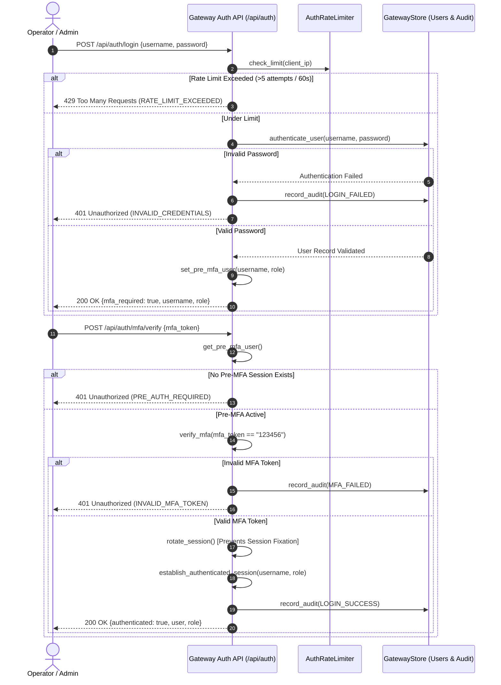

# AICG Administrative Security Layer & Storage Integrity Architecture (Phase 20)

## 1. Executive Overview & Scope

The **AICG Administrative Security Layer** implements Zero-Trust API endpoint governance, multi-factor credential authentication with rate limiting, resilient SQLite database integrity, and cryptographic forward audit immutability for the AI-Based Cyber Security Gateway for Industry 4.0.

### Safety & Operational Boundaries (Strict Guarantees)
- **100% DRY_RUN & In-Process**: All attack traffic injection, threat detection, and mitigation actions (`ISOLATE`, `RATE_LIMIT`, `BLOCK`, `QUARANTINE`) are strictly simulated within user-space memory.
- **Zero Host Network Alteration**: No host firewall (`iptables`, `nftables`, `pfctl`), routing tables, or network interfaces (`tc`, `ip route`) are ever invoked or modified.
- **Storage Boundary**: Employs SQLite 3 with robust concurrency controls without external database server dependencies.
- **ML Integrity Boundary**: Detection algorithms and calibrated parameters (`data/models/detector.joblib` and `reports/evaluation.json`) remain strictly untouched and non-regressed.

---

## 2. Hardened Session Management & Two-Stage MFA

### A. Session Security Attributes
Gateway API session cookies are configured with defense-in-depth flags to prevent session hijacking and cross-site scripting:
- **`SECRET_KEY`**: Sourced from the runtime configuration `Settings` (`aegis-gateway-secret-key-hardening-2026`).
- **`HttpOnly = True`**: Prevents client-side scripts from reading session identifiers.
- **`SameSite = Lax`**: Mitigates Cross-Site Request Forgery (CSRF).
- **`Secure = True`** (in production contexts): Restricts cookie transmission over encrypted HTTPS channels.

### B. Two-Stage Atomic Authentication Flow
The gateway enforces a secure, decoupled authentication pipeline:



### C. In-Memory Token Bucket Rate Limiting
- **Mechanism**: `AuthRateLimiter` enforces sliding window request caps (`auth_rate_limit_max = 5`, `auth_rate_limit_window_seconds = 60`) per client IP.
- **Failure Auditing**: Repeated failed attempts log audit events with `action="LOGIN_FAILED"` or `action="MFA_FAILED"`.

---

## 3. Zero-Trust Role-Based Access Control (RBAC) Matrix

Every gateway mutating endpoint is guarded by `@login_required`, `@roles_required(...)`, or `@permission_required(...)`. Access rejections immediately produce `HTTP 401 Unauthorized` or `HTTP 403 Forbidden` and commit an `ACCESS_DENIED` entry to the tamper-evident audit log.

### Access Control Matrix

| Endpoint | Method | Permitted Roles | Required Permission | Description |
|---|---|---|---|---|
| `/api/auth/login` | POST | Public | - | Primary password authentication |
| `/api/auth/mfa/verify` | POST | Pre-MFA Session | - | Second factor token verification |
| `/api/auth/logout` | POST | Authenticated | - | Session termination & invalidation |
| `/api/auth/status` | GET | Public | - | Current session role inspection |
| `/api/status`, `/api/telemetry`, `/api/energy`, `/api/topology`, `/api/iam`, `/api/incidents` | GET | Public / All | - | Read-only industrial monitoring |
| `/api/admin/overview` | GET | `ADMIN`, `OPERATOR`, `ANALYST`, `AUDITOR` | `alerts:read` | Overview telemetry & active alert counts |
| `/api/admin/alerts` | GET | `ADMIN`, `OPERATOR`, `ANALYST`, `AUDITOR` | `alerts:read` | Administrative alert listing |
| `/api/admin/alerts/<id>/acknowledge` | POST | `ADMIN`, `OPERATOR` | `alerts:acknowledge` | Acknowledge active or re-escalated alert |
| `/api/incidents/<id>/action` | POST | `ADMIN`, `OPERATOR` | `incident:action` | Apply manual mitigation action (`ISOLATE`, `RATE_LIMIT`) |
| `/api/manual/action` | POST | `ADMIN`, `OPERATOR` | `incident:action` | Trigger dry-run manual response action |
| `/api/incidents/<id>/transition` | POST | `ADMIN` (all), `OPERATOR` (`RECOVERING`/`RESOLVED` only) | `incident:transition` | Transition incident lifecycle states |
| `/api/admin/users` | GET, POST, PATCH | `ADMIN` | `users:manage` | Administrative user lifecycle management |
| `/api/admin/audit` | GET | `ADMIN`, `AUDITOR` | `audit:read` | Query historical audit trail |
| `/api/admin/audit/integrity` | GET | `ADMIN`, `AUDITOR` | `audit:read` | Verify audit log cryptographic hash chain |
| `/api/simulations/start`, `/api/simulations/stop` | POST | `ADMIN` | `simulations:manage` | Controlled in-process attack simulation |
| `/api/settings/mode` | POST | `ADMIN` | `settings:mode` | Switch mitigation mode (`AUTONOMOUS` vs `HYBRID`) |
| `/api/demo-data` | POST | `ADMIN` | `demo:data` | Populate synthetic laboratory demonstration events |
| `/api/ns3/import`, `/api/cooja/import`, `/api/pcap/replay` | POST | `ADMIN` | `data:import` | External trace file replay |

---

## 4. Storage Engine Hardening & Cryptographic Integrity

### A. Connection Pragmas & ACID Concurrency
All SQLite connections through `GatewayStore` strictly apply the following configuration pragmas:
```sql
PRAGMA journal_mode = WAL;         -- Write-Ahead Logging for high-concurrency non-blocking reads
PRAGMA foreign_keys = ON;          -- Strict referential integrity enforcement
PRAGMA busy_timeout = 5000;        -- 5000ms spin-lock retry to eliminate database locked errors
PRAGMA synchronous = NORMAL;       -- Safe filesystem sync optimized for WAL performance
```

### B. Foreign Key Constraints
Referential integrity is guaranteed across primary and relational tables:
- `incident_history.incident_id REFERENCES incidents(incident_id) ON DELETE CASCADE`
- `actions.incident_id REFERENCES incidents(incident_id) ON DELETE SET NULL`
- `actions.event_id REFERENCES telemetry(event_id) ON DELETE SET NULL`
- `admin_alerts.incident_id REFERENCES incidents(incident_id) ON DELETE CASCADE`

### C. Cryptographic Forward Hash-Chained Audit Ledger
Every administrative event (`LOGIN_SUCCESS`, `LOGIN_FAILED`, `ACCESS_DENIED`, `ALERT_ACKNOWLEDGED`, `ALERT_RE_ESCALATED`, `INCIDENT_TRANSITION`, `CONFIG_CHANGE`) is committed to `admin_audit_log` with a SHA-256 tamper-evident hash chain:

```
Record 0 (Genesis):
  prev_hash: "0000000000000000000000000000000000000000000000000000000000000000"
  record_hash: SHA256(prev_hash | event_id | timestamp | username | role | action | resource | resource_id | result | source_ip | details)

Record N:
  prev_hash: Record[N-1].record_hash
  record_hash: SHA256(Record[N-1].record_hash | event_id | ... | details)
```

- **Verification Algorithm**: `verify_audit_log_integrity()` iterates sequentially across `admin_audit_log`, recomputing the SHA-256 digest over the canonical string serialization. Any modification, insertion, or deletion immediately breaks the chain and returns:
  `{"valid": false, "first_corrupted_id": "<id>", "reason": "Hash mismatch at record <id>..."}`

---

## 5. State Machine Enhancements

### A. Incident Recovery Regression
When an incident is in `RECOVERING` (progressing toward verified closure), an incoming attack window immediately forces an autonomous regression back to `CONTAINED`.
- Prevents premature resolution when adversary vectors pulse or burst intermittently.
- Regression logs a structured audit trail and preserves all historical telemetry windows.

### B. Alert Lifecycle & Re-Escalation
- **Deduplication**: Multi-window attack waves against the same device update the existing alert record without generating duplicate rows.
- **Re-Escalation**: If an alert has been marked `ACKNOWLEDGED` by an operator or admin, and subsequent attack telemetry exhibits higher severity (e.g. `HIGH` $\to$ `CRITICAL`) or recurs during recovery:
  $$\text{ACKNOWLEDGED} \overset{\text{Attack Intensification}}{\longrightarrow} \text{RE\_ESCALATED}$$
- Automatically logs `action="ALERT_RE_ESCALATED"` and shifts alert status back to `ACTIVE`.

---

## 6. Verification & Test Evidence

| Test Suite | Total Tests | Status | Execution Time |
|---|---|---|---|
| `test_adapters.py` | 5 | Passed | ~0.8s |
| `test_admin_security_layer.py` | 16 | Passed | ~1.2s |
| `test_api_and_runtime.py` | 22 | Passed | ~3.8s |
| `test_api_security_and_hardening.py` | 16 | Passed | ~4.5s |
| `test_detection_and_ml.py` | 4 | Passed | ~2.5s |
| `test_energy_and_iam.py` | 3 | Passed | ~0.7s |
| `test_policy_and_incidents.py` | 5 | Passed | ~1.2s |
| `test_scenarios.py` | 5 | Passed | ~0.9s |
| `test_schema.py` | 7 | Passed | ~0.8s |
| `test_storage_and_export.py` | 3 | Passed | ~0.6s |
| **Complete Unit & Integration Suite** | **86** | **86 Passed (100%)** | **~20.8s** |
| `scripts/run_browser_e2e_admin.py` | 6 E2E Stages | **All Passed** (10 Screenshots) | **~12.5s** |
