# Revised UI/UX Unslopping Implementation Plan: AI-Edge-DDoS-Gateway Industrial SOC HMI

## Goal Description
Perform a disciplined, incremental craft unslopping pass on the primary operator Human-Machine Interface (HMI) for the **AI-Based Cyber Security Gateway for Industry 4.0** ([`frontend/templates/index.html`](file:///home/kali/AI-Edge-DDoS-Gateway/frontend/templates/index.html), [`frontend/static/css/dashboard.css`](file:///home/kali/AI-Edge-DDoS-Gateway/frontend/static/css/dashboard.css), and UI-only styling hooks in [`frontend/static/js/dashboard.js`](file:///home/kali/AI-Edge-DDoS-Gateway/frontend/static/js/dashboard.js)).

The goal is to eliminate vibecoded artifacts (raw emoji decoration, neon glow drop-shadows, all-caps shouting headings, and overcrowded center badge stacks) while elevating the interface into an authoritative, professional **Industrial Cybersecurity Operations Center (SOC)** console.

---

## 1. Strict Functional & Architectural Boundaries

> [!IMPORTANT]
> ### Non-Negotiable Change Boundaries
> 1. **Zero Backend Modifications**: [`backend/app.py`](file:///home/kali/AI-Edge-DDoS-Gateway/backend/app.py), [`backend/aegis_gateway/`](file:///home/kali/AI-Edge-DDoS-Gateway/backend/aegis_gateway/), REST API contracts, SSE event formats, authentication, RBAC authorization, and SQLite historian are **completely frozen**.
> 2. **ML & Detection Engine Untouched**: Platt-calibrated Random Forest bundles, Isolation Forest models, decision thresholds, and feature extractors are **100% preserved**.
> 3. **Safety & Policy Containment Intact**: Strict `DRY_RUN` non-enforcing execution, in-process simulations, zero external packet transmission, and untouched host firewall guarantees remain inviolate.
> 4. **No Full JS Rewrite**: [`frontend/static/js/dashboard.js`](file:///home/kali/AI-Edge-DDoS-Gateway/frontend/static/js/dashboard.js) will NOT be rewritten. All existing event handlers (`toggleSidebar`, `toggleResponseMode`, `executeManualAction`, `triggerScenario`, `runControlledDemo`, `filterAdminAlerts`, `submitCreateUser`), SSE listeners, and chart update loops are preserved. Only canvas visual styling parameters (font styling, grid colors, legend layout) and gauge track classes will be touched.
> 5. **Zero External Dependencies / CDNs**: The interface remains 100% air-gapped and offline. No remote icon fonts (FontAwesome, Google Fonts, Lucide CDN) or external JS packages will be loaded. All icons will be locally embedded SVG line glyphs.
> 6. **Claim & Provenance Discipline**: Strict operational boundaries between `LIVE INGRESS`, `MODELLED`, `SIMULATED`, and `DRY_RUN` will be prominently maintained and visually highlighted, never misrepresenting synthetic or modeled metrics as physical hardware readings.

---

## 2. Unslopping Direction (The 5 Lines)

- **Product:** An edge cybersecurity gateway that detects and safely mitigates DDoS attacks in real time for Industry 4.0 automation networks.
- **Character:** `vigilant, industrial, calibrated` (unwavering, authoritative, and physically grounded in edge instrumentation).
- **World:** An air-gapped industrial plant control room, ruggedized DIN-rail edge gateways, low-power 6LoWPAN field meshes, SCADA control networks, and mission-critical OT night shifts.
- **Moments:** 
  1. The **Live Plant Mimic Topology**, where subtle packet flow telemetry maps sensor-to-gateway health across the factory floor.
  2. The **Calibrated Dual-Channel Historian**, where continuous network ingress is physically correlated against modeled edge power dissipation (mW).
- **Signature:** A unified **Instrument Status Bar** coupling the live SSE heartbeat with crisp, tabular monospace claim boundary chips (`[MODELLED]`, `[DRY_RUN]`, `[SIMULATED]`).

---

## 3. Preservation Matrix: 21 Navigation Items & Functional Features

All 21 sidebar navigation targets across the 8 functional categories will be preserved with identical DOM IDs, anchor targets, and interactive handlers:

| Category | # | Nav Link Label | DOM Target Anchor | Existing Feature Preserved | New Icon |
|---|---|---|---|---|---|
| **Overview** | 1 | Security Overview | `#sec-kpis` | 6 KPI Cards & Live Throughput Counters | Embedded SVG Line: `layout-dashboard` |
| | 2 | Live KPIs | `#sec-status-gauges` | Security Status Banner & Circular Gauges | Embedded SVG Line: `activity` |
| **Monitoring** | 3 | Live Network Traffic | `#sec-telemetry` | Canvas Chart: Ingress Packets/s vs Baseline | Embedded SVG Line: `trending-up` |
| | 4 | Energy Monitoring | `#sec-telemetry` / `#sec-energy` | Canvas Chart & Causal Chain Power Meters | Embedded SVG Line: `zap` |
| | 5 | Protocol Mix | `#sec-topology` | Canvas Donut Chart & Protocol Pills | Embedded SVG Line: `pie-chart` |
| | 6 | Raw Flows | `#sec-flows` | Real-time Ingested Flow Inspection Table | Embedded SVG Line: `list` |
| **Administration** | 7 | Admin Overview | `#sec-admin-overview` | 4 Administrative Cards & Recent Audit Log | Embedded SVG Line: `shield-check` |
| | 8 | Active Alerts | `#sec-admin-alerts` | Alert Center, Filter Bar, Acknowledge & CSV/JSON Export | Embedded SVG Line: `bell-ring` |
| | 9 | Users & Roles | `#sec-admin-users` | RBAC Registry, Add User Form & Status | Embedded SVG Line: `users` |
| | 10 | Audit Log | `#sec-admin-audit` | Append-Only Cryptographic Audit Ledger & Filter | Embedded SVG Line: `file-text` |
| | 11 | Security Posture | `#sec-admin-posture` | 6-Stage Zero-Trust Decision Chain | Embedded SVG Line: `sliders` |
| **Security** | 12 | AI Detection / XAI | `#sec-xai` / `#sec-energy` | Explainability Evidence & Anomaly Scores | Embedded SVG Line: `cpu` |
| | 13 | Incident Lifecycle | `#sec-lifecycle` | 7-Step Campaign Stepper & Streak Recovery | Embedded SVG Line: `git-commit` |
| | 14 | Incident Journal | `#sec-incidents` | Durable Incident Table & Cryptographic Export | Embedded SVG Line: `clipboard-list` |
| | 15 | Autonomous Response | `#sec-lifecycle` | Policy Mode Toggle (Auto/Manual) & Dry-Run Actions | Embedded SVG Line: `terminal` |
| **Identity** | 16 | Identity & Access (IAM) | `#sec-iam` | Zero-Trust Local Registry Table & Trust Scores | Embedded SVG Line: `key-round` |
| | 17 | Zero Trust | `#sec-iam` | Decision Flow Bar & Posture Chips | Embedded SVG Line: `lock` |
| **IIoT / OT** | 18 | Plant Mimic | `#sec-topology` | SVG Interactive Topology & Packet Flow Animation | Embedded SVG Line: `network` |
| | 19 | IIoT Protocol Stack | `#sec-protocol-stack` | 5-Layer Industrial Stack & RFC Specifications | Embedded SVG Line: `layers` |
| **Model** | 20 | Model Assurance | `#sec-assurance` | 8 Grouped Evaluation Metrics & Disclosure | Embedded SVG Line: `check-circle-2` |
| | 21 | Confusion Matrix | `#sec-assurance` | 2x2 Test Split Confusion Matrix Table | Embedded SVG Line: `grid` |
| **Simulation** | * | AICG Attack Simulator | `#sec-controls` | 11-Profile Attack Injection Grid & Demo Bar | Embedded SVG Line: `play` |

---

## 4. Header & Instrument Status Bar Architecture

### Streamlined Single-Tier Sticky Header (56px–60px Height)
The current 84px header stacks 4 badges awkwardly in 3 rows in the center, crowding the title and causing vertical clipping on compact monitors. The revised layout unifies this into a precision 3-column instrument bar:

```
+----------------------------------------------------------------------------------------------------------------------------------+
| [NAV] [SHIELD] AI EDGE SECURITY GATEWAY [AICG] [OT CELL] | [PLANT: ONLINE] [GW: AICG-GW-01] [HYBRID] [DRY_RUN] | 08:42:17 UTC [SECURE] [ADMIN] [CSV] [ATTACKER] |
+----------------------------------------------------------------------------------------------------------------------------------+
```

1. **Left (Brand & Scope)**:
   - Expandable sidebar toggle (`[NAV]`) with clean SVG line icon.
   - SVG Shield brand mark.
   - Product title: `AI Edge Security Gateway` with subtle secondary subtitle: `Plant • OT Cell (6LoWPAN / CoAP / MQTT) • Zero-Trust Defense`.
   - Small quiet tags: `AICG` and `OT CELL`.

2. **Center (Calibrated Instrument Status Bar)**:
   - A single horizontal row of four cohesive, tabular instrument chips:
     - `● PLANT: ONLINE` (emerald pulse dot, live SSE status).
     - `GATEWAY: AICG-GW-01` (muted industrial hardware ID).
     - `RUNTIME: HYBRID FUSION` (calibrated model state).
     - `MODE: DRY_RUN (SIMULATED)` (cyan border, strict claim indicator).

3. **Right (Session, Clock & Tools)**:
   - High-contrast tabular monospace UTC clock & session uptime: `08:42:17 UTC • UPTIME: 00h 00m 02s`.
   - Dynamic Threat State Pill (`SYSTEM SECURE` / `ATTACK ACTIVE` / `RECOVERING`).
   - User identity tag with RBAC badge: `admin [ADMIN]`.
   - Quiet tool buttons: `[Logout]`, `[Export CSV]`, `[Attacker Console →]`.

### Viewport Responsiveness Verification
- **1600x1000 (Standard SOC Workstation)**: Full 3-column linear layout with spacious gutters.
- **1280x900 (Compact Console)**: Center badges abbreviate cleanly (`GW-01`, `DRY_RUN`); clock remains visible.
- **1024x800 (Ruggedized Panel PC)**: Center badges tuck below title in a secondary row; sidebar collapses to 56px icon rail.
- **900x768 (Split-Screen View)**: Sidebar operates as an overlay drawer; header actions collapse into icon buttons.
- **768x1024 (Vertical Tablet / HMI)**: Fluid vertical stacking with sticky header intact.

---

## 5. Incremental 9-Pass Implementation Strategy

```mermaid
flowchart LR
    P1["Pass 1: Spacing & Grid"] --> P2["Pass 2: Surfaces & Color"]
    P2 --> P3["Pass 3: SVG Icon System"]
    P3 --> P4["Pass 4: Copy & Case"]
    P4 --> P5["Pass 5: Typography"]
    P5 --> P6["Pass 6: Header & Sidebar"]
    P6 --> P7["Pass 7: Gauges & Stepper"]
    P7 --> P8["Pass 8: Charts & Canvas"]
    P8 --> P9["Pass 9: Motion & Redline"]
```



### Pass 1: Spacing & Rhythm
- **Files Modified**: [`frontend/static/css/dashboard.css`](file:///home/kali/AI-Edge-DDoS-Gateway/frontend/static/css/dashboard.css)
- **Changes**: Normalize layout paddings and margins to the 4px scale (`4, 8, 12, 16, 20, 24, 32px`). Set card padding to uniform 16px/20px, section margins to 24px, and table row heights to 36px.
- **Preservation Check**: Verify no content is clipped; verify smooth scrolling anchor offsets.

### Pass 2: Surfaces & Color Restraint
- **Files Modified**: [`frontend/static/css/dashboard.css`](file:///home/kali/AI-Edge-DDoS-Gateway/frontend/static/css/dashboard.css)
- **Changes**: 
  - Remove all artificial colored drop-shadow glows (`--green-glow`, `--red-glow`, `--amber-glow`, glowing pulse rings).
  - Tame neon borders (`--border-bright: rgba(56,189,248,0.6)`) to quiet 8-10% opacity hairlines.
  - Refine dark surface steps: Base `#060a12` -> Surface `#0a101d` -> Card `#0e172a` -> Elevated `#13203c`.
  - Tame the bright pink/red gradient on the simulator run button (`linear-gradient(...)`) into an authoritative industrial control button (`#e11d48` solid with 1px top highlight).
- **Preservation Check**: Ensure contrast ratios exceed 4.5:1 on all text; confirm Dark SOC identity is preserved.

### Pass 3: Embedded SVG Icon System
- **Files Modified**: [`frontend/templates/index.html`](file:///home/kali/AI-Edge-DDoS-Gateway/frontend/templates/index.html) & [`frontend/static/css/dashboard.css`](file:///home/kali/AI-Edge-DDoS-Gateway/frontend/static/css/dashboard.css)
- **Changes**:
  - Replace all 25+ raw emoji icons (in sidebar, KPI headers, buttons, banners, and modals) with clean, lightweight embedded SVG line glyphs (16px/18px, 1.5 stroke).
  - Style icons via CSS: inherit `--text-secondary` color; active states take `--text-primary` or semantic accent.
- **Preservation Check**: Confirm all 21 sidebar links, quick CSV exports, attacker console links, and modal triggers maintain their exact DOM IDs and `onclick` handlers.

### Pass 4: Copy, Case & Claim Discipline
- **Files Modified**: [`frontend/templates/index.html`](file:///home/kali/AI-Edge-DDoS-Gateway/frontend/templates/index.html) & [`frontend/static/js/dashboard.js`](file:///home/kali/AI-Edge-DDoS-Gateway/frontend/static/js/dashboard.js) (DOM string updates)
- **Changes**:
  - Convert shouty ALL-CAPS headings to disciplined Sentence Case (`Live OT Network Traffic` instead of `HISTORIAN • LIVE OT NETWORK TRAFFIC`).
  - Standardize status banner copy: `Normal Baseline • No DDoS Anomaly Observed` instead of `CLEAR • NO ACTIVE DDOS ANOMALY • PLANT WITHIN BASELINE`.
  - Ensure all provenance tags (`[MODELLED]`, `[SIMULATED]`, `[DRY_RUN]`, `[DERIVED]`) are displayed with distinct visual badges.
- **Preservation Check**: Ensure zero academic claims or security boundaries are altered.

### Pass 5: Typography & Tabular Numerals
- **Files Modified**: [`frontend/static/css/dashboard.css`](file:///home/kali/AI-Edge-DDoS-Gateway/frontend/static/css/dashboard.css)
- **Changes**:
  - Enforce `font-variant-numeric: tabular-nums` across all counters, packet rates, energy figures, timestamps, and IP addresses.
  - Set headings to weight 500-600 (eliminating 800/900 bloat).
  - Use `--font-mono` (`JetBrains Mono`) for all system metadata and IDs.
- **Preservation Check**: Verify table columns and KPI numbers do not jitter or jump during live SSE updates.

### Pass 6: Header Streamlining & Sidebar Rail
- **Files Modified**: [`frontend/templates/index.html`](file:///home/kali/AI-Edge-DDoS-Gateway/frontend/templates/index.html) & [`frontend/static/css/dashboard.css`](file:///home/kali/AI-Edge-DDoS-Gateway/frontend/static/css/dashboard.css)
- **Changes**:
  - Re-engineer the top header into the 56px Instrument Status Bar.
  - Refine the sidebar rail: 56px compact width, icons aligned in a single column, sleek tooltips on hover, zero vertical scrollbar at 1000px height.
  - Retain full drawer expansion when `[NAV]` toggle is clicked.
- **Preservation Check**: Test across 1600x1000, 1280x900, 1024x800, and 768x1024 viewports.

### Pass 7: Details, Gauges & Pipeline Stepper
- **Files Modified**: [`frontend/templates/index.html`](file:///home/kali/AI-Edge-DDoS-Gateway/frontend/templates/index.html), [`frontend/static/css/dashboard.css`](file:///home/kali/AI-Edge-DDoS-Gateway/frontend/static/css/dashboard.css), and gauge styling in [`frontend/static/js/dashboard.js`](file:///home/kali/AI-Edge-DDoS-Gateway/frontend/static/js/dashboard.js)
- **Changes**:
  - Refine circular SVG gauges: eliminate glowing shadows, use crisp 4px stroke tracks, clean centered tabular percentages.
  - Refine 7-step Incident Lifecycle stepper: precision connecting tracks, clear active step indicators, and verified recovery streak counters.
  - Polish Confusion Matrix table into a clean correlation matrix with subtle tinted cells.
- **Preservation Check**: Verify SVG gauge animations still calculate correct dash offsets when SSE events arrive.

### Pass 8: Canvas Visualizations & Plant Mimic
- **Files Modified**: [`frontend/static/js/dashboard.js`](file:///home/kali/AI-Edge-DDoS-Gateway/frontend/static/js/dashboard.js) (Canvas styling only) & [`frontend/static/css/dashboard.css`](file:///home/kali/AI-Edge-DDoS-Gateway/frontend/static/css/dashboard.css)
- **Changes**:
  - Ensure razor-sharp canvas rendering: align gridlines to pixel boundaries, render crisp 11px JetBrains Mono axis labels.
  - Quiet legend styling: subtle neutral line indicators without clunky dashed boxes.
  - Plant Mimic SVG: style nodes as crisp industrial gateway and sensor icons with subtle packet-flow animation.
- **Preservation Check**: Confirm canvas charts continuously stream live data from `/api/telemetry/stream` without stuttering or memory leaks.

### Pass 9: Motion Restraint & Redline Check
- **Files Modified**: [`frontend/static/css/dashboard.css`](file:///home/kali/AI-Edge-DDoS-Gateway/frontend/static/css/dashboard.css)
- **Changes**:
  - Standardize all transitions to `cubic-bezier(0.22, 1, 0.36, 1)` with 150ms-200ms durations.
  - Remove all non-essential looping animations.
  - Run full audit checklist against `references/signs.md` to ensure zero slop signs remain.
- **Preservation Check**: Full visual and functional inspection.

---

## 6. Verification & Quality Gates

### Automated Verification Pipeline
```bash
# 1. Run the comprehensive 236-test backend, API, ML, and security test suite
.venv/bin/pytest

# 2. Run the end-to-end headless browser acceptance test suite across viewports and RBAC
.venv/bin/python backend/scripts/run_browser_e2e_admin.py
```

### Visual & Interactive Quality Checklist
- [ ] Zero browser console errors (`Uncaught TypeError`, 404s, SVG parsing errors).
- [ ] SSE real-time connection stays active (`/api/telemetry/stream`) and updates KPIs every second.
- [ ] Dual-channel canvas charts render smoothly and cleanly update with live incoming packets.
- [ ] All 21 navigation links scroll smoothly to exact target anchors without header occlusion.
- [ ] Alert Center filters (`ALL`, `UNACK`, `ACTIVE`, `RESOLVED`) and acknowledgment buttons work reliably.
- [ ] Inline user creation and audit ledger searching work without breaking layout.
- [ ] Attack scenario injection (`UDP Flood`, `SYN Flood`, `Normal Rhythm`) activates proper threat states and updates the status banner.
- [ ] Viewport responsiveness verified at 1600x1000, 1280x900, 1024x800, and 768x1024.

---

## 7. Rollback Protocol

The repository is on branch `ui/unslop-refinement` with a clean working tree:
```bash
git status  # Verified clean
```
- A Git tag checkpoint (`git tag checkpoint-pre-unslop`) will be created before touching any files.
- If any pass introduces regressions or breaks existing tests, instant rollback is guaranteed:
```bash
git checkout -- frontend/
```
- No changes will be committed until all 9 passes are complete, verified by tests, and reviewed by the user.
