# Approved UI/UX Unslopping Implementation Plan: AI-Edge-DDoS-Gateway Industrial Operations Console

## Goal Description
Perform a disciplined, incremental craft unslopping pass on the primary operator Human-Machine Interface (HMI) for the **AI-Based Cyber Security Gateway for Industry 4.0** ([`frontend/templates/index.html`](file:///home/kali/AI-Edge-DDoS-Gateway/frontend/templates/index.html), [`frontend/static/css/dashboard.css`](file:///home/kali/AI-Edge-DDoS-Gateway/frontend/static/css/dashboard.css), and UI-only styling hooks in [`frontend/static/js/dashboard.js`](file:///home/kali/AI-Edge-DDoS-Gateway/frontend/static/js/dashboard.js)).

The objective is to eliminate "vibecoded" aesthetic flaws (emoji clutter, neon glow drop-shadows, all-caps shouting headings, floating badge stacks, and colored chrome) and transition the interface into the clean, professional **Charcoal / Matte Graphite Design System** demonstrated in the canonical reference (`./dashboard-design-reference.png`).

---

## 1. Strict Functional & Architectural Boundaries

> [!IMPORTANT]
> ### Non-Negotiable Change Boundaries
> 1. **Zero Backend Modifications**: [`backend/app.py`](file:///home/kali/AI-Edge-DDoS-Gateway/backend/app.py), [`backend/aegis_gateway/`](file:///home/kali/AI-Edge-DDoS-Gateway/backend/aegis_gateway/), REST API contracts, SSE event formats, authentication, RBAC authorization, and SQLite historian are **completely frozen**.
> 2. **ML & Detection Engine Untouched**: Platt-calibrated Random Forest bundles, Isolation Forest models, decision thresholds, and feature extractors are **100% preserved**.
> 3. **Safety & Policy Containment Intact**: Strict `DRY_RUN` non-enforcing execution, in-process simulations, zero external packet transmission, and untouched host firewall guarantees remain inviolate.
> 4. **No Full JS Rewrite**: [`frontend/static/js/dashboard.js`](file:///home/kali/AI-Edge-DDoS-Gateway/frontend/static/js/dashboard.js) will NOT be rewritten. All existing event handlers (`toggleSidebar`, `toggleResponseMode`, `executeManualAction`, `triggerScenario`, `runControlledDemo`, `filterAdminAlerts`, `submitCreateUser`), SSE listeners, and chart update loops are preserved. Only canvas visual styling parameters (font styling, grid colors, legend layout) and gauge track classes will be touched.
> 5. **Zero External Dependencies / CDNs**: The interface remains 100% air-gapped and offline. No remote icon fonts (FontAwesome, Google Fonts, Lucide CDN) or external JS packages will be loaded. All icons will be locally embedded SVG line glyphs.
> 6. **Claim & Provenance Discipline**: Strict operational boundaries between `LIVE INGRESS`, `MODELLED`, `SIMULATED`, and `DRY_RUN` will be prominently maintained and visually highlighted, never misrepresenting synthetic or modeled metrics as physical hardware readings.

---

## 2. Unslopping Direction: Charcoal / Matte Graphite

Following the visual reference (`./dashboard-design-reference.png`) and the UNSLOP principles:

- **Product:** An edge cybersecurity gateway that detects and safely mitigates DDoS attacks in real time for Industry 4.0 automation networks.
- **Character:** `calm, exact, technical` (authoritative, understated, and mathematically disciplined).
- **World:** Industrial instrument panels, night-shift server consoles, DIN-rail edge hardware, and dark graphite telemetry.
- **Moments:** 
  1. The **Live Plant Mimic Topology**, where subtle packet flow telemetry maps sensor-to-gateway health across the factory floor.
  2. The **Calibrated Dual-Channel Historian**, where continuous network ingress is physically correlated against modeled edge power dissipation (mW).
- **Signature:** A unified **Instrument Status Bar** coupling the live SSE heartbeat with crisp, tabular monospace claim boundary chips (`[MODELLED]`, `[DRY_RUN]`, `[SIMULATED]`).

### Charcoal / Matte Graphite Color Tokens

```css
/* Surface & Background Hierarchy (Graphite Ramp from Reference) */
--bg-base: #111113;             /* Root viewport backdrop */
--bg-sidebar: #0c0c0e;          /* Sunken sidebar & deep wells */
--bg-surface: #141416;          /* First raised layout layer */
--bg-panel: #17171a;            /* Primary panels & containers */
--bg-panel-elevated: #1d1d21;   /* Hovered / elevated containers */
--bg-card: #19191d;             /* Cards, widgets & modal bodies */
--bg-input: #1f1f24;            /* Inset search & input troughs */

/* Hairline Borders & Dividers (Zero Neon) */
--border-subtle: rgba(255, 255, 255, 0.06);   /* Quiet hairline dividers */
--border-medium: rgba(255, 255, 255, 0.10);   /* Structural container outlines */
--border-strong: rgba(255, 255, 255, 0.16);   /* Active boundaries & focus rings */
--border-active: #ffffff;                     /* Primary selection marker */

/* Typography Roles */
--text-primary: #ededed;        /* High-contrast crisp primary text */
--text-secondary: #a1a1a6;      /* Slate/neutral secondary text */
--text-muted: #6e6e73;          /* Captions, units & metadata */
--text-dim: #48484a;            /* Disabled & subtle markers */

/* Quiet Semantic Accents (Strictly Reserved for Data, Not Surfaces) */
--accent-cyan: #38bdf8;         /* Live ingress traffic line */
--accent-green: #4cc38a;        /* Normal baseline & positive deltas */
--accent-amber: #f59e0b;        /* Warning states & throttles */
--accent-red: #f43f5e;          /* Attack surge & critical alerts */
--accent-purple: #818cf8;       /* Gateway identity & protocol mix */

/* Shadows: Zero Colored Halos */
--shadow-panel: 0 4px 20px -2px rgba(0, 0, 0, 0.65), 0 0 0 1px var(--border-subtle);
--shadow-card: 0 2px 8px rgba(0, 0, 0, 0.45);
--highlight-top: inset 0 1px 0 rgba(255, 255, 255, 0.08); /* Physical top edge reflection */
```

---

## 3. Preservation Matrix: 21 Navigation Items & Functional Features

All 21 sidebar navigation targets across the 8 functional categories will be preserved with identical DOM IDs, anchor targets, and interactive handlers:

| Category | # | Nav Link Label | DOM Target Anchor | Existing Feature Preserved | New Icon |
|---|---|---|---|---|---|
| **Overview** | 1 | Security Overview | `#sec-kpis` | 6 KPI Cards & Live Throughput Counters | Embedded SVG Line: `layout-dashboard` |
| | 2 | Live KPIs | `#sec-status-gauges` | Security Status Banner & Circular Gauges | Embedded SVG Line: `activity` |
| **Monitoring** | 3 | Live Network Traffic | `#sec-telemetry` | Canvas Chart: Ingress Packets/s vs Baseline | Embedded SVG Line: `trending-up` |
| | 4 | Energy Monitoring | `#sec-telemetry` / `#sec-energy` | Canvas Chart & Causal Chain Power Meters | Embedded SVG Line: `zap` |
| | 5 | Protocol Mix | `#sec-topology` | Canvas Donut Chart & Protocol Pills | Embedded SVG Line: `pie-chart` |
| | 6 | Raw Flows | `#sec-flows` | Real-time Ingested Flow Inspection Table | Embedded SVG Line: `list` |
| **Administration** | 7 | Admin Overview | `#sec-admin-overview` | 4 Administrative Cards & Recent Audit Log | Embedded SVG Line: `shield-check` |
| | 8 | Active Alerts | `#sec-admin-alerts` | Alert Center, Filter Bar, Acknowledge & CSV/JSON Export | Embedded SVG Line: `bell-ring` |
| | 9 | Users & Roles | `#sec-admin-users` | RBAC Registry, Add User Form & Status | Embedded SVG Line: `users` |
| | 10 | Audit Log | `#sec-admin-audit` | Append-Only Cryptographic Audit Ledger & Filter | Embedded SVG Line: `file-text` |
| | 11 | Security Posture | `#sec-admin-posture` | 6-Stage Zero-Trust Decision Chain | Embedded SVG Line: `sliders` |
| **Security** | 12 | AI Detection / XAI | `#sec-xai` / `#sec-energy` | Explainability Evidence & Anomaly Scores | Embedded SVG Line: `cpu` |
| | 13 | Incident Lifecycle | `#sec-lifecycle` | 7-Step Campaign Stepper & Streak Recovery | Embedded SVG Line: `git-commit` |
| | 14 | Incident Journal | `#sec-incidents` | Durable Incident Table & Cryptographic Export | Embedded SVG Line: `clipboard-list` |
| | 15 | Autonomous Response | `#sec-lifecycle` | Policy Mode Toggle (Auto/Manual) & Dry-Run Actions | Embedded SVG Line: `terminal` |
| **Identity** | 16 | Identity & Access (IAM) | `#sec-iam` | Zero-Trust Local Registry Table & Trust Scores | Embedded SVG Line: `key-round` |
| | 17 | Zero Trust | `#sec-iam` | Decision Flow Bar & Posture Chips | Embedded SVG Line: `lock` |
| **IIoT / OT** | 18 | Plant Mimic | `#sec-topology` | SVG Interactive Topology & Packet Flow Animation | Embedded SVG Line: `network` |
| | 19 | IIoT Protocol Stack | `#sec-protocol-stack` | 5-Layer Industrial Stack & RFC Specifications | Embedded SVG Line: `layers` |
| **Model** | 20 | Model Assurance | `#sec-assurance` | 8 Grouped Evaluation Metrics & Disclosure | Embedded SVG Line: `check-circle-2` |
| | 21 | Confusion Matrix | `#sec-assurance` | 2x2 Test Split Confusion Matrix Table | Embedded SVG Line: `grid` |
| **Simulation** | * | AICG Attack Simulator | `#sec-controls` | 11-Profile Attack Injection Grid & Demo Bar | Embedded SVG Line: `play` |

---

## 4. Header & Instrument Status Bar Architecture

### Streamlined Single-Tier Sticky Header (56px–60px Height)
The current 84px header stacks 4 badges awkwardly in 3 rows in the center, crowding the title and causing vertical clipping on compact monitors. The revised layout unifies this into a precision 3-column instrument bar in matte graphite:

```
+----------------------------------------------------------------------------------------------------------------------------------+
| [NAV] [SHIELD] AI Edge Security Gateway [AICG] [OT Cell] | [PLANT: ONLINE] [GW: AICG-GW-01] [HYBRID] [DRY_RUN] | 08:42:17 UTC [SECURE] [ADMIN] [CSV] [ATTACKER] |
+----------------------------------------------------------------------------------------------------------------------------------+
```

1. **Left (Brand & Scope)**:
   - Expandable sidebar toggle (`[NAV]`) with clean SVG line icon.
   - SVG Shield brand mark (flat stroke, no glowing gradient).
   - Product title: `AI Edge Security Gateway` (Sentence Case, font-weight 500) with subtle secondary subtitle: `Plant • OT Cell (6LoWPAN / CoAP / MQTT) • Zero-Trust Defense`.
   - Small quiet tags: `AICG` and `OT Cell`.

2. **Center (Calibrated Instrument Status Bar)**:
   - A single horizontal row of four cohesive, tabular instrument chips:
     - `● Plant: Online` (quiet green status dot, live SSE status).
     - `Gateway: AICG-GW-01` (muted industrial hardware ID).
     - `Runtime: Hybrid Fusion` (calibrated model state).
     - `Mode: DRY_RUN (Simulated)` (restrained border, strict claim indicator).

3. **Right (Session, Clock & Tools)**:
   - High-contrast tabular monospace UTC clock & session uptime: `08:42:17 UTC • Uptime: 00h 00m 02s`.
   - Dynamic Threat State Pill (`System Secure` / `Attack Active` / `Recovering`).
   - User identity tag with RBAC badge: `admin [Admin]`.
   - Quiet tool buttons: `[Logout]`, `[Export CSV]`, `[Attacker Console →]`.

### Viewport Responsiveness Verification
- **1600x1000 (Standard SOC Workstation)**: Full 3-column linear layout with spacious gutters.
- **1280x900 (Compact Console)**: Center badges abbreviate cleanly (`GW-01`, `DRY_RUN`); clock remains visible.
- **1024x800 (Ruggedized Panel PC)**: Center badges tuck below title in a secondary row; sidebar collapses to 56px icon rail.
- **900x768 (Split-Screen View)**: Sidebar operates as an overlay drawer; header actions collapse into icon buttons.
- **768x1024 (Vertical Tablet / HMI)**: Fluid vertical stacking with sticky header intact.

---

## 5. Incremental 9-Pass Implementation Strategy

```mermaid
flowchart LR
    P1["Pass 1: Spacing & Grid"] --> P2["Pass 2: Charcoal Surfaces"]
    P2 --> P3["Pass 3: SVG Icon System"]
    P3 --> P4["Pass 4: Copy & Case"]
    P4 --> P5["Pass 5: Typography"]
    P5 --> P6["Pass 6: Header & Sidebar"]
    P6 --> P7["Pass 7: Gauges & Stepper"]
    P7 --> P8["Pass 8: Charts & Canvas"]
    P8 --> P9["Pass 9: Motion & Redline"]
```



### Pass 1: Spacing & 4px Rhythm
- **Files Modified**: [`frontend/static/css/dashboard.css`](file:///home/kali/AI-Edge-DDoS-Gateway/frontend/static/css/dashboard.css)
- **Changes**: Normalize layout paddings and margins to the 4px scale (`4, 8, 12, 16, 20, 24, 32px`). Set card padding to uniform 16px/20px, section margins to 24px, and table row heights to 36px.
- **Preservation Check**: Verify no content is clipped; verify smooth scrolling anchor offsets.

### Pass 2: Charcoal / Graphite Surfaces & Zero-Glow Restraint
- **Files Modified**: [`frontend/static/css/dashboard.css`](file:///home/kali/AI-Edge-DDoS-Gateway/frontend/static/css/dashboard.css)
- **Changes**: 
  - Apply the Graphite token ramp: Base `#111113`, Sidebar `#0c0c0e`, Panel `#17171a`, Card `#19191d`, Input `#1f1f24`.
  - Replace glowing drop-shadows with hairlines (`rgba(255, 255, 255, 0.07)`) and subtle neutral shadows.
  - Tame the bright pink/red gradient on the simulator run button into an authoritative industrial control button (`#e11d48` solid with top highlight `inset 0 1px 0 rgba(255,255,255,0.15)`).
- **Preservation Check**: Ensure contrast ratios exceed 4.5:1 on all text; confirm neutral charcoal aesthetics match reference.

### Pass 3: Embedded SVG Icon System & Sidebar Navigation Refinement
- **Files Modified**: [`frontend/templates/index.html`](file:///home/kali/AI-Edge-DDoS-Gateway/frontend/templates/index.html) & [`frontend/static/css/dashboard.css`](file:///home/kali/AI-Edge-DDoS-Gateway/frontend/static/css/dashboard.css)
- **Changes**:
  - **Embedded SVG Line Icon System**: Replace all 25+ raw emoji icons across sidebar navigation, header action buttons (`Logout`, `Export CSV`, `Attacker`), KPI cards, banners, and modals with lightweight, locally embedded SVG line glyphs (16px x 16px, 1.5 stroke, `stroke="currentColor"`, `fill="none"`). Zero external icon fonts, CDNs, or remote network dependencies.
  - **NAV Toggle Redesign**: Redesign `#sidebarToggle` as a clean, minimal menu/collapse control with an embedded SVG line glyph matching the matte graphite instrument header styling.
  - **Sidebar Visual Harmonization**:
    - Refine compact 58px rail and expanded 230px flyout drawer in neutral graphite surfaces (`--bg-sidebar: #0c0c0e`, elevated drawer `rgba(23, 23, 26, 0.98)` with hairline borders).
    - Refine link states (`.hmi-sidebar-link`): resting (`--text-secondary`), hover (`background: var(--bg-surface); color: var(--text-primary)`), and active (`background: var(--bg-panel-elevated); color: #fff; border-left: 2px solid var(--text-primary); box-shadow: var(--highlight-top)`).
    - Perfect icon alignment, sizing, and spacing: optical centering of 16px glyphs in 34px-height link blocks on a 4px grid rhythm.
    - Notification badge refinement: style `#sidebarAlertCounter` with crisp tabular numerals and clean border while strictly preserving semantic red/crimson alert indicators.
- **Preservation Check**: Confirm all 21 sidebar navigation links, DOM IDs (`nav-admin-overview`, `nav-admin-alerts`, `nav-admin-users`, `nav-admin-audit`, `nav-admin-posture`), `data-target` attributes, `onclick` handlers (`toggleSidebar()`, `collapseSidebar()`), and expanded/collapsed drawer behavior remain 100% functional and intact.

### Pass 4: Copy, Case & Claim Discipline
- **Files Modified**: [`frontend/templates/index.html`](file:///home/kali/AI-Edge-DDoS-Gateway/frontend/templates/index.html) & [`frontend/static/js/dashboard.js`](file:///home/kali/AI-Edge-DDoS-Gateway/frontend/static/js/dashboard.js) (DOM string updates)
- **Changes**:
  - Convert shouty ALL-CAPS headings to disciplined Sentence Case (`Live OT Network Traffic` instead of `HISTORIAN • LIVE OT NETWORK TRAFFIC`).
  - Standardize status banner copy: `Normal Baseline • No DDoS Anomaly Observed` instead of `CLEAR • NO ACTIVE DDOS ANOMALY • PLANT WITHIN BASELINE`.
  - Ensure all provenance tags (`[MODELLED]`, `[SIMULATED]`, `[DRY_RUN]`, `[DERIVED]`) are displayed with distinct visual badges.
- **Preservation Check**: Ensure zero academic claims or security boundaries are altered.

### Pass 5: Typography & Tabular Numerals [COMPLETED]
- **Files Modified**: [`frontend/static/css/dashboard.css`](file:///home/kali/AI-Edge-DDoS-Gateway/frontend/static/css/dashboard.css)
- **Changes**:
  - Enforce `font-variant-numeric: tabular-nums lining-nums` across all counters, packet rates, energy figures, timestamps, durations, and IP addresses.
  - Set headings to weight 500-600 (completely eliminating 800/900 font-weight bloat).
  - Standardized heading sizes, line heights, and letter spacing across all panels and subpanels.
  - Removed unnecessary uppercase transformations from headings and labels (`.kpi-header`, `.panel-title`, `.panel-badge`, `.donut-center-sub`, `.energy-stat span`, `.evidence-list-title`, `.iam-table-compact th`, `.meta-label`, `.step-label`, `.pipeline-title`, `.btn-mode-toggle`, `.btn-sim-action`, `.hmi-table th`, `.metric-box span`, `.cm-cell-title`, `.btn-catalogue`).
  - Applied `--font-mono` (`JetBrains Mono`) for all system metadata, timestamps, hashes, and IDs.
- **Verification**:
  - All 236 backend and security tests passed.
  - Headless browser acceptance suite passed across all 5 industrial viewports.
  - Screenshots captured and verified: `docs/pass5_top_preview.png`, `docs/pass5_middle_preview.png`, `docs/pass5_lower_preview.png`, `docs/pass5_admin_preview.png`. No numeric jitter during updates.

### Pass 6: Visual Consistency & Polish [COMPLETED]
- **Files Modified**: [`frontend/static/css/dashboard.css`](file:///home/kali/AI-Edge-DDoS-Gateway/frontend/static/css/dashboard.css) & [`frontend/templates/index.html`](file:///home/kali/AI-Edge-DDoS-Gateway/frontend/templates/index.html)
- **Changes**:
  - **Header Layout Streamlining**: Tightened the top sticky header from 84px to 56px (`--hmi-header-height: 56px`, `min-height: 56px`, `padding: 6px 18px`). Reclaimed 28px of vertical screen real estate across all displays while preserving all gateway details, live status badges, threat state pill, and session tools.
  - **Brand Geometry & Element Tightening**: Brand shield scaled to 32px with 17px embedded SVG; badge items, threat state pill, user session, and tool buttons unified to 24px-25px compact heights with 6px indicator dots.
  - **WCAG AA Contrast Upgrades**: Enhanced neutral text contrast tokens against `#17171a` panel backgrounds (`--text-secondary: #b4b4bc` at ~8.4:1 contrast, `--text-muted: #909098` at ~5.5:1 contrast, `--text-dim: #5c5c64`). Updated table column headings, secondary labels, metadata, energy stats, and audit search labels to accessible neutral slate tones.
  - **Attack Simulator CTA Refinement**: Replaced the oversized full-width pink/crimson CTA banner with a restrained, industrial danger action control (`min-width: 190px`, `height: 32px`, `padding: 7px 16px`, deep crimson `#991b1b` with border `rgba(248, 113, 113, 0.4)` and physical top-edge reflection). Harmonized with adjacent 32px `.btn-open-remote`.
  - **Table Density & Heading Alignment**: Standardized `.hmi-table th`, `table.data-table th`, and `.iam-table-compact th` to `padding: 7px 12px`, weight 600, letter-spacing 0.2px, and border hairlines. Data cells standardized to `padding: 7px 12px` with full tabular numerals.
  - **Component Spacing & Admin Console Harmonization**: Added universal `.panel-badge-group` and `.tag` base rules. Standardized filter buttons to 25px height. Cleaned leftover inline `text-transform: uppercase` from admin security overview cards, user modal, and audit log controls.
- **Verification**:
  - Full backend and security test suite: 236 passed in 64.04s (`pytest backend/tests/`).
  - Headless browser acceptance suite: passed all 8 steps across 5 industrial viewports (1600x1000, 1280x900, 1024x800, 900x768, 768x1024).
  - Screenshots captured and verified: `docs/pass6_top_preview.png`, `docs/pass6_middle_preview.png`, `docs/pass6_lower_preview.png`, `docs/pass6_admin_preview.png`.

### Pass 7: Final Responsive & Functional Quality Assurance [COMPLETED]
- **Files Modified**: [`frontend/static/css/dashboard.css`](file:///home/kali/AI-Edge-DDoS-Gateway/frontend/static/css/dashboard.css), [`frontend/static/js/dashboard.js`](file:///home/kali/AI-Edge-DDoS-Gateway/frontend/static/js/dashboard.js), [`frontend/templates/index.html`](file:///home/kali/AI-Edge-DDoS-Gateway/frontend/templates/index.html), & [`frontend/templates/login.html`](file:///home/kali/AI-Edge-DDoS-Gateway/frontend/templates/login.html)
- **Defects Verified & Fixed**:
  - **Sticky Header Responsive Alignment (Zero Content Obscuring)**:
    - Fixed exact height correspondence across all 5 industrial viewports:
      - `1600x1000` (Workstation): exactly `56.0px` (body width 1594px <= 1600px).
      - `1280x900` (Compact Console): exactly `56.0px` (body width 1274px <= 1280px; reduced from 130px wrap).
      - `1024x800` (Ruggedized Panel): exactly `56.0px` (body width 1018px <= 1024px; reduced from 105px wrap).
      - `900x768` (Split Screen): exactly `120.0px` (body width 894px <= 900px; perfectly matches `--hmi-header-height: 120px;`).
      - `768x1024` (Vertical Tablet): exactly `120.0px` (body width 762px <= 768px; perfectly matches `--hmi-header-height: 120px;`).
    - Added `@media (max-width: 1400px)` rules to hide secondary informational badges (`Gateway: AICG-GW-01` and `Runtime: Canonical Hybrid`) while preserving vital indicators (`Plant: ONLINE` and `Mode: DRY_RUN`), preventing any header wrap at 1280px.
    - Corrected class selector in `@media (max-width: 1100px)` from `.header-badges` to `.header-center-badges` and collapsed header action button labels into compact icons (`padding: 3px 6px; min-width: 25px;`), eliminating header wrap at 1024px.
    - Standardized `.clock-widget` to `min-width: 95px; white-space: nowrap;` to prevent text splitting across all desktop viewports.
    - Verified `scroll-margin-top: calc(var(--hmi-header-height) + 16px)` guarantees sticky header never obscures jump-target content or panel headers.
  - **Embedded SVG Favicon (Zero Console Errors)**:
    - Added self-contained SVG data URI shield favicon to both [`index.html`](file:///home/kali/AI-Edge-DDoS-Gateway/frontend/templates/index.html) and [`login.html`](file:///home/kali/AI-Edge-DDoS-Gateway/frontend/templates/login.html), completely eliminating the browser 404 favicon error and achieving **0 console errors**.
  - **Keyboard Navigation & Visible Focus Rings (WCAG 2.4.7 Focus Visible)**:
    - Added global `:focus-visible` styles with a crisp, accessible cyan outline (`outline: 2px solid rgba(56, 189, 248, 0.75); outline-offset: 2px;`) across all buttons, inputs, links, scenario catalogue controls, sidebar navigation links, and administrative actions.
  - **Chart Rendering & Resize Optimization**:
    - Added a 120ms debounce to the window resize listener in [`dashboard.js`](file:///home/kali/AI-Edge-DDoS-Gateway/frontend/static/js/dashboard.js) to eliminate redundant network fetches and canvas re-draw stuttering during window dragging.
  - **Audit Log Usability**:
    - Updated `renderAuditTable` to differentiate empty ledger state from search filter misses ("No administrative audit records match your filter criteria").
- **Verification**:
  - Full backend and security test suite: **236 passed** in 62.47s (`pytest backend/tests/`).
  - Headless browser acceptance suite: **All 8 steps passed** across all 5 industrial viewports (1600x1000, 1280x900, 1024x800, 900x768, 768x1024).
  - Browser console logs: **0 errors** observed.
  - Final screenshots captured and verified: `docs/pass7_final_top.png`, `docs/pass7_final_middle.png`, `docs/pass7_final_lower.png`, `docs/pass7_final_admin.png`.

---

## 6. Verification & Quality Gates

### Automated Verification Pipeline
```bash
# 1. Run the comprehensive 236-test backend, API, ML, and security test suite
.venv/bin/pytest

# 2. Run the end-to-end headless browser acceptance test suite across viewports and RBAC
.venv/bin/python backend/scripts/run_browser_e2e_admin.py
```

### Visual & Interactive Quality Checklist
- [ ] Zero browser console errors (`Uncaught TypeError`, 404s, SVG parsing errors).
- [ ] SSE real-time connection stays active (`/api/telemetry/stream`) and updates KPIs every second.
- [ ] Dual-channel canvas charts render smoothly and cleanly update with live incoming packets.
- [ ] All 21 navigation links scroll smoothly to exact target anchors without header occlusion.
- [ ] Alert Center filters (`ALL`, `UNACK`, `ACTIVE`, `RESOLVED`) and acknowledgment buttons work reliably.
- [ ] Inline user creation and audit ledger searching work without breaking layout.
- [ ] Attack scenario injection (`UDP Flood`, `SYN Flood`, `Normal Rhythm`) activates proper threat states and updates the status banner.
- [ ] Viewport responsiveness verified at 1600x1000, 1280x900, 1024x800, and 768x1024.

---

## 7. Rollback Protocol

The repository is on branch `ui/unslop-refinement` with a clean working tree:
```bash
git status  # Verified clean
```
- A Git tag checkpoint (`checkpoint-pre-unslop`) is already established.
- If any pass introduces regressions or breaks existing tests, instant rollback is guaranteed:
```bash
git checkout checkpoint-pre-unslop -- frontend/
```
- No changes will be committed until all 9 passes are complete, verified by tests, and reviewed by the user.

---

## 8. Cross-Interface Extension: Login, Attack Simulator & Unified Typography

### Phase 1: Login Page Modernization [COMPLETED]
- Replaced glowing gradients with industrial Graphite visual language (`#111113` base, `#17171a` panel, hairline borders).
- Implemented integrated progressive-disclosure simulated MFA drawer (`#mfaContainer` starts hidden; dynamically reveals upon valid primary credentials requiring step-up).
- Streamlined persona switcher with compact administrative tiles (`admin`, `operator`).
- Preserved compliance disclosures (`LOCAL LAB IDENTITY`, `SIMULATED MFA`, `DRY_RUN`).

### Phase 2: AICG Attack Simulator Dual-Pane Cockpit [COMPLETED]
- Replaced cramped single-column layout with a 50/50 balanced industrial cockpit.
- Left Pane (Configuration & Execution): Profile selectors, attack categories (`Volumetric`, `Protocol`, `Application`), real-time intensity/duration sliders with live numeric badges, restrained danger CTA button, and quick-load presets.
- Right Pane (Telemetry & Safety Boundary): In-process engine status, active attack vector, physical egress containment (`ZERO PACKET TRANSMISSION`), host firewall state (`HOST FIREWALL UNTOUCHED`), and execution results.
- Operator RBAC mode: View-only cockpit with disabled execution controls and disclaimer banner.

### Pass 5: Cross-Interface Typography & Tabular Numerals [COMPLETED]
- **Files Modified**: [`frontend/static/css/dashboard.css`](file:///home/kali/AI-Edge-DDoS-Gateway/frontend/static/css/dashboard.css), [`frontend/static/js/dashboard.js`](file:///home/kali/AI-Edge-DDoS-Gateway/frontend/static/js/dashboard.js), [`frontend/templates/index.html`](file:///home/kali/AI-Edge-DDoS-Gateway/frontend/templates/index.html).
- **Typography Audit & Normalization**:
  - Enforced strict separation between UI typography (`--font-ui`: Inter / system sans-serif) and technical data typography (`--font-mono`: JetBrains Mono).
  - Standardized control typography: category filter tabs, field labels, navigation links, and button labels standardized to `--font-ui` (font weights 500-600).
  - Replaced hardcoded `monospace` strings in `dashboard.js` with `var(--font-mono)`.
- **Tabular Numeral Enforcement (`font-variant-numeric: tabular-nums lining-nums`)**:
  - Main Dashboard: Live clock, KPI counters (packet rate, throughput, anomaly probability), gauge readouts, energy rates, topology device counts, protocol breakdown pills, XAI anomaly scores, model assurance metrics (F1, Precision, Recall, FPR, AUC, Brier), confusion matrix cells, admin overview counters, alert filter buttons, and dynamic table rows (`incidentsTable`, `eventsTable`, `sampleFlowsTable`, `adminAuditTableBody`).
  - Login Page: Persona tile credentials, MFA input code, simulated MFA hint token, and authentication scope indicators.
  - Attack Simulator Cockpit: Intensity highlight values, slider scale tick labels, duration readouts, status table value columns, telemetry mini rate badges, and preset parameter cards. Dynamic slider scrubbing confirmed zero layout jitter.
- **Mobile Responsive Hardening**:
  - Constrained CSS grid expansion (`minmax(0, 1fr)`), enabled `.zt-decision-flow-bar` wrapping, allowed `.panel-header` wrapping, and wrapped safety claim tags to eliminate horizontal overflow at 375px mobile viewport while strictly preserving `position: sticky` on the navigation sidebar.
- **Automated Verification**:
  - Pass 5 Selenium automated cross-interface test: **100% passed** across Desktop (1600x1000), Tablet (1024x768), and Mobile (375x812) with **0 console errors** and **0 horizontal overflow**.
  - Backend Security & API Test Suite: **64 passed** (`pytest backend/tests/`).
  - Headless Browser Acceptance Suite: **All 8 steps passed** across all 5 industrial viewports.

